

  

<h1 align="center">Textus</h1>

  <strong>Die integrierte Schreibumgebung der nächsten Generation.</strong> 
  Die KI hält die Tinte im Fluss. Die Feder führst du.

  <a href="https://textus.md"><strong>Website</strong></a> ·
  <a href="https://github.com/CatVinci-Studio/Textus/releases/latest"><strong>Download</strong></a> ·
  <a href="https://github.com/CatVinci-Studio/Textus/issues/648"><strong>Unterstützen</strong></a>

  <a href="./README.md">English</a> ·
  <a href="./README.zh.md">简体中文</a> ·
  <a href="./README.zh-Hant.md">繁體中文</a> ·
  <a href="./README.ja.md">日本語</a> ·
  <a href="./README.ko.md">한국어</a> ·
  <a href="./README.es.md">Español</a> ·
  <a href="./README.fr.md">Français</a> ·
  Deutsch ·
  <a href="./README.ru.md">Русский</a> ·
  <a href="./README.pt.md">Português</a>

  
  
  
  
  

  

<strong>Hauptsponsor</strong>

  <a href="https://www.anthropic.com/">
    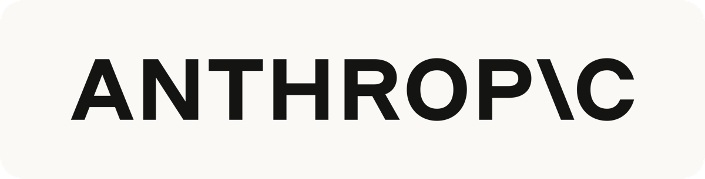
  </a>

  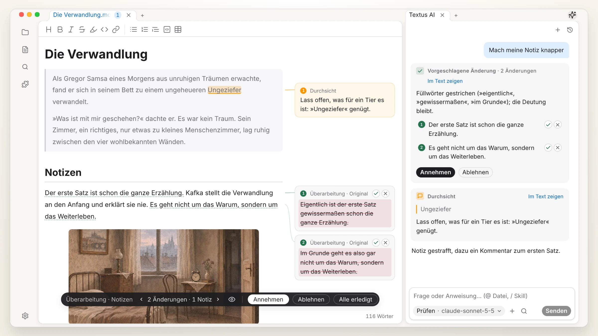 
  <i>Die Verwandlung</i>, Franz Kafka (1915)

## Hol dir Textus

Kostenlos und Open Source, unter der MIT-Lizenz.

| Plattform             | Download                                                                                                | Weitere Installationswege                                                       |
| --------------------- | ------------------------------------------------------------------------------------------------------- | ------------------------------------------------------------------------------- |
| macOS · Apple Silicon | [.dmg herunterladen](https://github.com/CatVinci-Studio/Textus/releases/latest)                         | Homebrew: `brew install --cask textus`                                          |
| macOS · Intel         | [.dmg herunterladen](https://github.com/CatVinci-Studio/Textus/releases/latest)                         | Homebrew: `brew install --cask textus`                                          |
| Windows · x64         | [.exe herunterladen](https://github.com/CatVinci-Studio/Textus/releases/latest)                         | —                                                                               |
| Linux · x64           | [.AppImage herunterladen](https://github.com/CatVinci-Studio/Textus/releases/latest) · Auch als .deb · .rpm | Arch Linux: das [`[catvinci]`-Repository](https://github.com/CatVinci-Studio/arch-repo) |
| Android · arm64       | [.apk herunterladen](https://github.com/CatVinci-Studio/Textus/releases/latest) | — |

> iOS (iPhone und iPad): bald als öffentliche Beta über TestFlight.

Beta: Stell unter **Einstellungen › Über** den **Update-Kanal** auf **Beta**.

## Warum Textus

Programmierer haben IDEs: einen Ort, an dem Code schreiben, prüfen und ihre Werkzeuge zusammenkommen. Wer schreibt, leiht sich meist einen Code-Editor oder wechselt zwischen mehreren Apps hin und her. Textus bringt den ganzen Schreibprozess an einen Ort.

- **Markdown als gemeinsame Sprache.** Im KI-Zeitalter ist Markdown mehr als ein Dateiformat: Menschen, KI und andere Werkzeuge lesen es gleichermaßen, deine Texte wandern frei zwischen ihnen.
- **Fürs Schreiben gebaut, nicht für Code.** Entwerfen, Prüfen und Überarbeiten stehen im Mittelpunkt, nicht als Zusatzfunktionen eines Code-Editors.
- **KI fürs Schreiben.** Vorschläge beim Schreiben, Kommentare beim Prüfen und Änderungen, die du einzeln annimmst oder ablehnst.
- **So zusammengestellt, wie du willst.** WYSIWYG-Bearbeitung, ein umfangreiches Plugin-System, Sync, sogar deine Tagesplanung: Nimm, was du brauchst, und lass den Rest weg.
- **Deine Notizen kommen mit.** Öffne einen Obsidian-Vault so, wie er ist, importiere aus Notion und nutze Typora-Themes.

## Schreiben

Was du siehst, ist, was du bekommst: Markdown wird beim Tippen gesetzt, mit Tabellen, Code, Formeln und Diagrammen, und Entwürfe, Notizen und Quellen liegen nebeneinander. Export nach PDF, Word, HTML und mehr.

  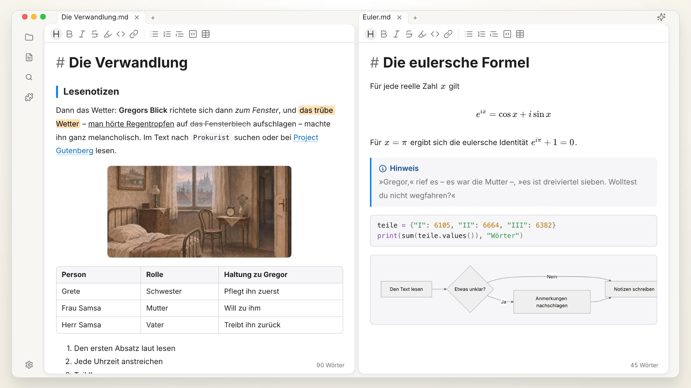

## Textus AI

Funktioniert mit Online- und lokalen Modellen und schreibt selbst mit.

| Fortsetzung | Tippfehler und Grammatik |
| :---: | :---: |
| 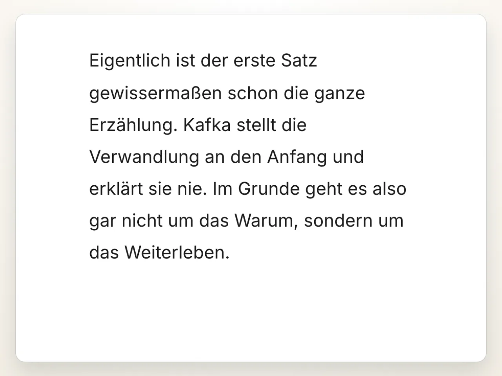 |  |
| **Änderungsvorschläge** | **Anmerkungen** |
| 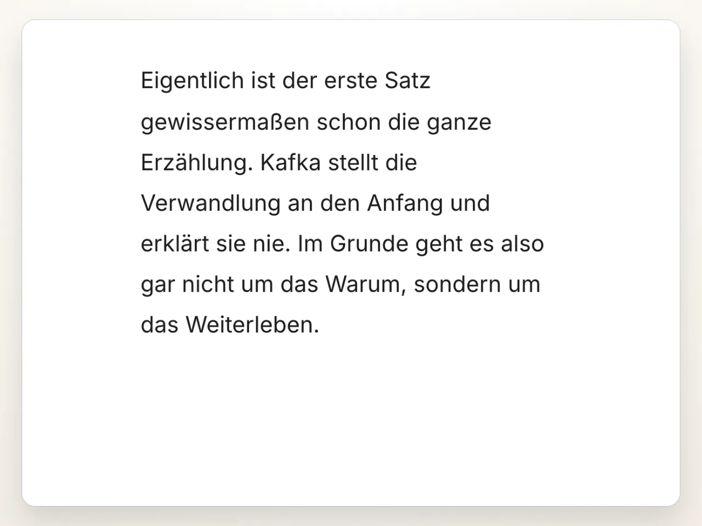 | 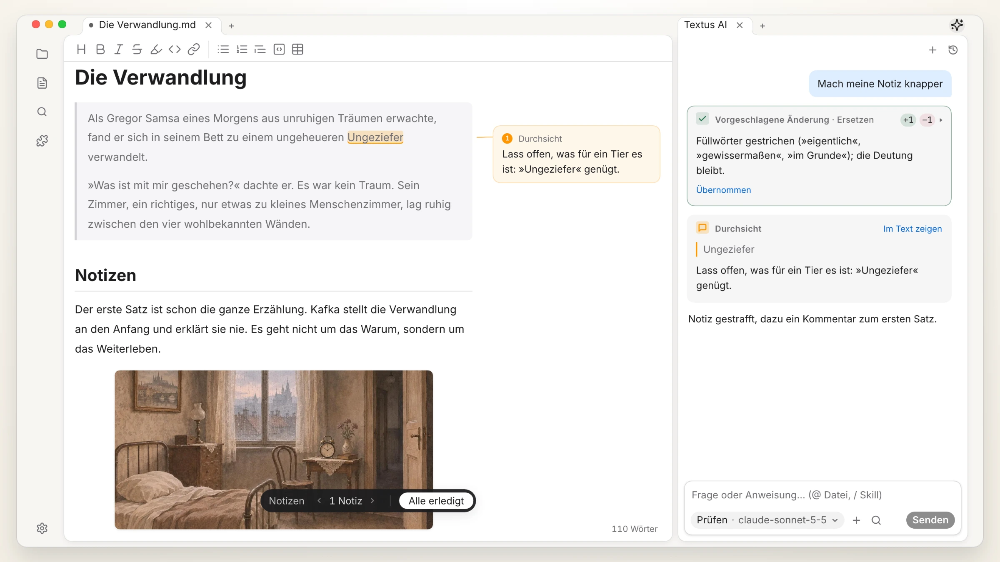 |
| **Slash-Skills** | **Jedes Modell** |
| 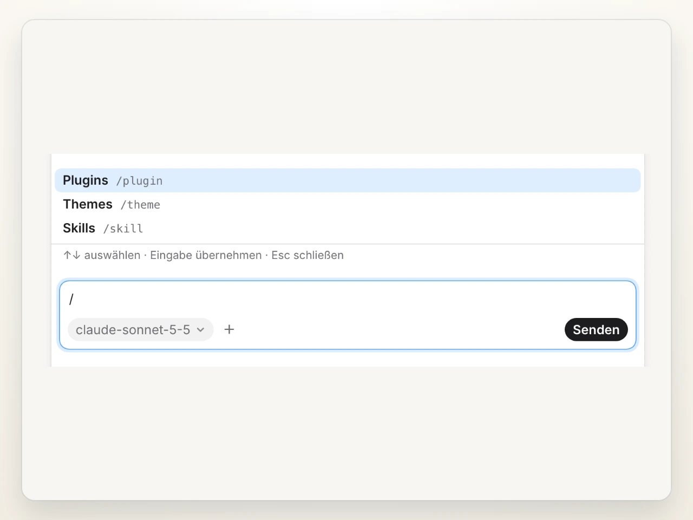 | 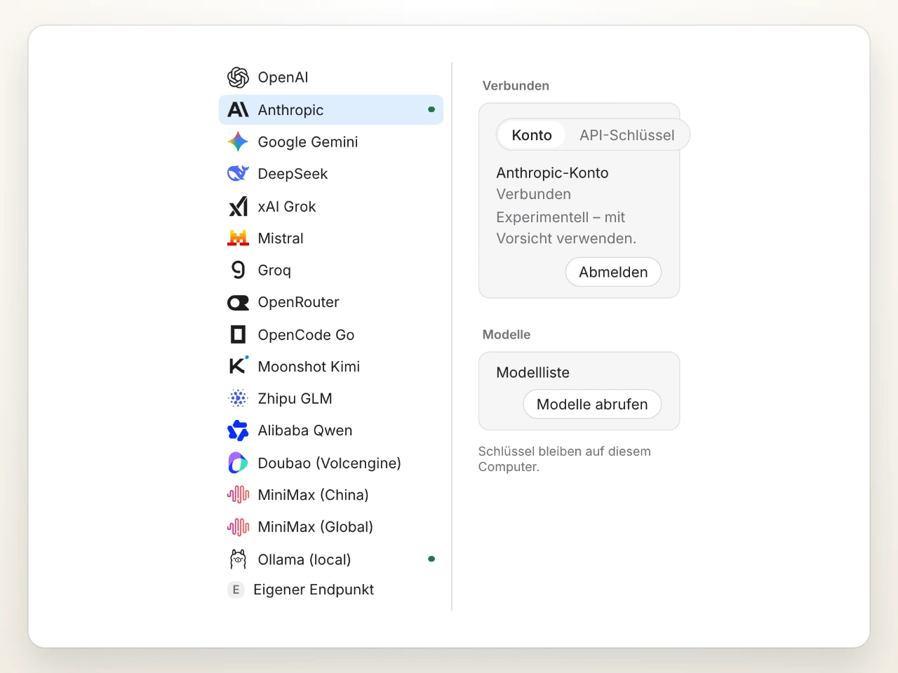 |

Für Fortgeschrittene: MCP-Server anbinden oder Claude Code und Codex als Agenten ins KI-Panel holen.

## Plugins

| Graphansicht | Versionsverlauf |
| :---: | :---: |
| 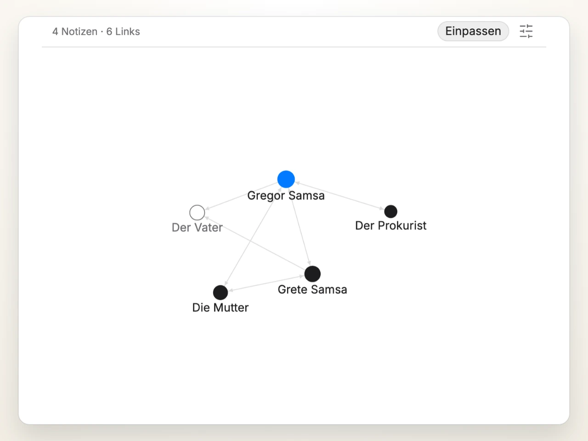 | 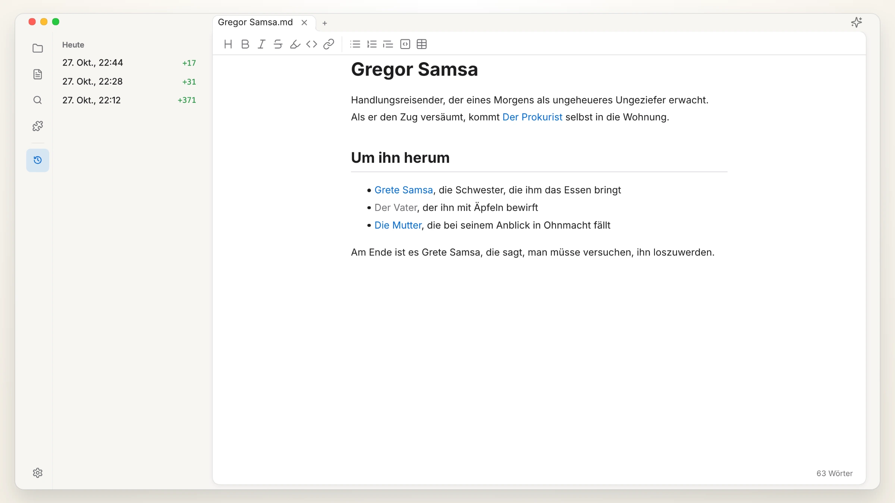 |
| **Schnellvorschau** | **Wissensdatenbank** |
| 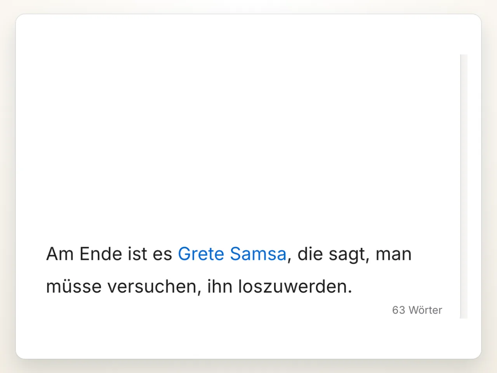 | 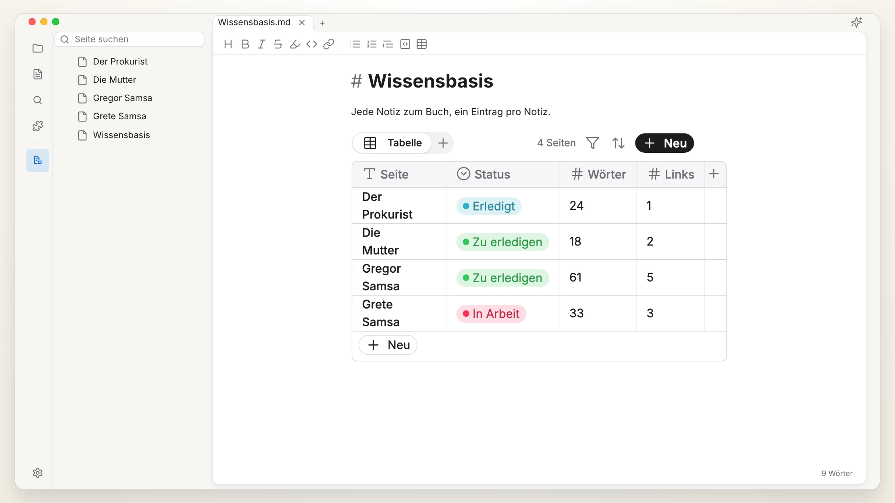 |

Weitere Plugins und Themes: [textus.md/extensions](https://textus.md/de/extensions/).

## Sponsoren

Textus ist kostenlos und Open Source. [Unterstütze uns](https://github.com/CatVinci-Studio/Textus/issues/648), um die Entwicklung zu fördern.

**Hauptsponsor:** [Anthropic](https://www.anthropic.com/), über das Anthropic Startup Program.

## Community

Komm zu uns auf Discord, QQ oder WeChat: [textus.md/community](https://textus.md/de/community/). Fehlerberichte und Wünsche sind in den [GitHub Issues](https://github.com/CatVinci-Studio/Textus/issues) willkommen. Wenn du Code beitragen möchtest, fang mit [CONTRIBUTING.md](CONTRIBUTING.md) (auf Englisch) an.

## Gut zu wissen

<strong>Ist Textus kostenlos?</strong>

Ja, und das bleibt auch so. Es ist Open Source unter der MIT-Lizenz, ohne Konto und ohne Abo. Wenn du Textus AI nutzt, rechnet dein Anbieter direkt mit dir ab, mit einem lokalen Modell gar nicht.

<strong>Auf welchen Plattformen läuft es?</strong>

macOS (Apple Silicon und Intel), Windows und Linux, dazu Android und iOS (öffentliche Beta).

<strong>Wie viel Arbeitsspeicher braucht es?</strong>

Speicher ist uns sehr wichtig, und wir messen ihn in jeder Version. Ein Fenster braucht etwa 110 MB, jedes weitere etwa 55 MB mehr. Plugins werden erst geladen, wenn du sie nutzt, und eine Webseite im Hintergrund wird freigegeben und lädt neu, wenn du zu ihr zurückkehrst.

<strong>Brauche ich ein KI-Konto?</strong>

Nein. Der Editor funktioniert vollständig ohne KI. Für Textus AI verbindest du einen eigenen Anbieter: mit ChatGPT oder Claude anmelden, einen API-Schlüssel eintragen oder ein lokales Modell mit Ollama betreiben.

<strong>Funktioniert es offline?</strong>

Der Editor schon, vollständig. Textus AI braucht deinen Anbieter, außer du nutzt ein lokales Modell.

<strong>Ist das normales Markdown? Wohin kann ich exportieren?</strong>

Ja: einfache .md-Dateien, mit Tabellen, Aufgabenlisten, Fußnoten, Formeln und Mermaid. Export nach PDF, Word, HTML und mehr.

## Sterne im Verlauf

<a href="https://star-history.com/#CatVinci-Studio/Textus&Date">
  <picture>
    <source media="(prefers-color-scheme: dark)" srcset="https://api.star-history.com/svg?repos=CatVinci-Studio/Textus&type=Date&theme=dark">
    
  </picture>
</a>

## Lizenz

[MIT](./LICENSE) © CatVinci Studio
