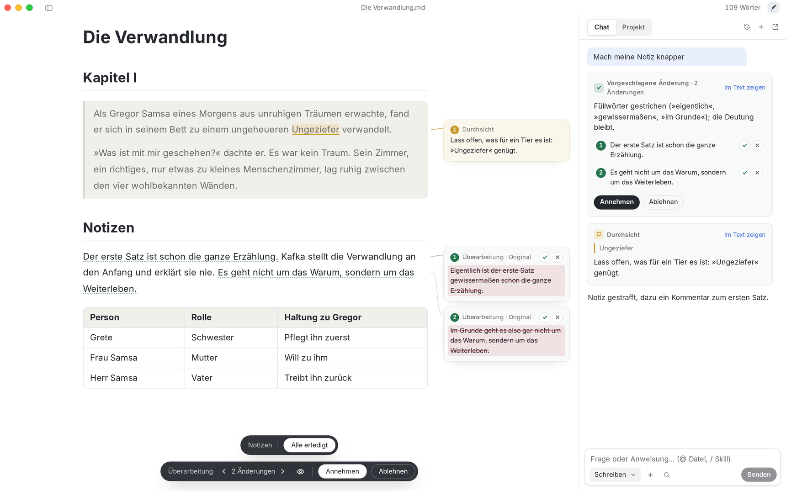
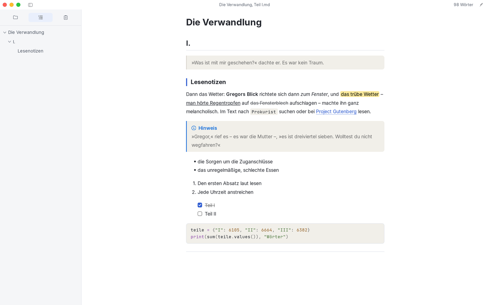
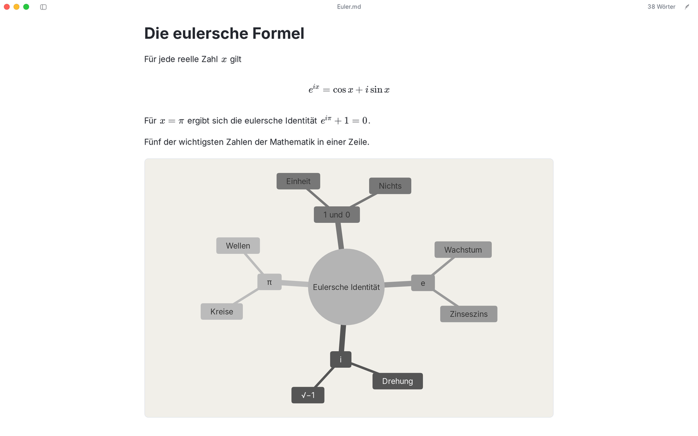
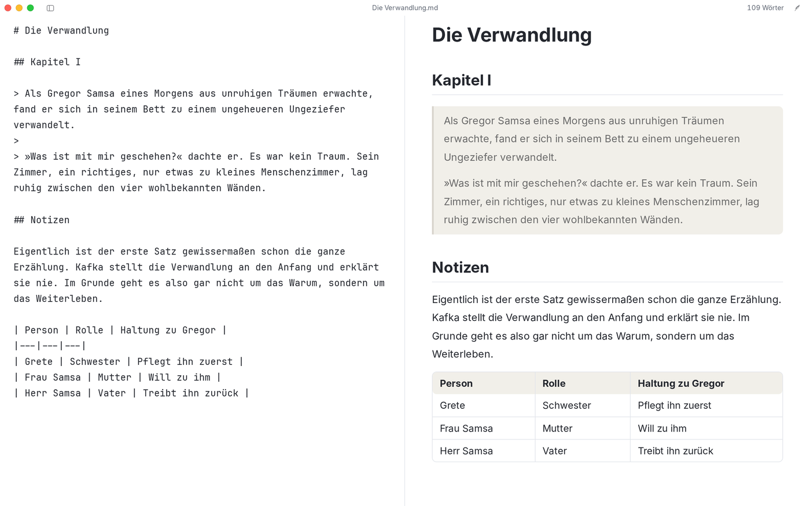
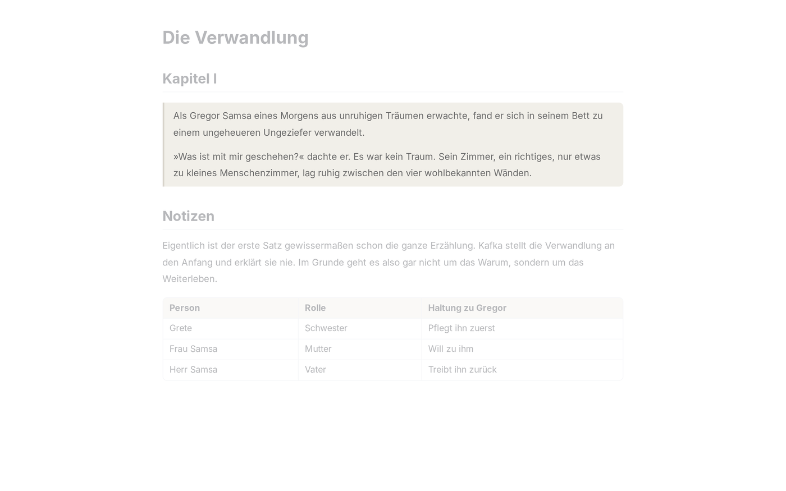
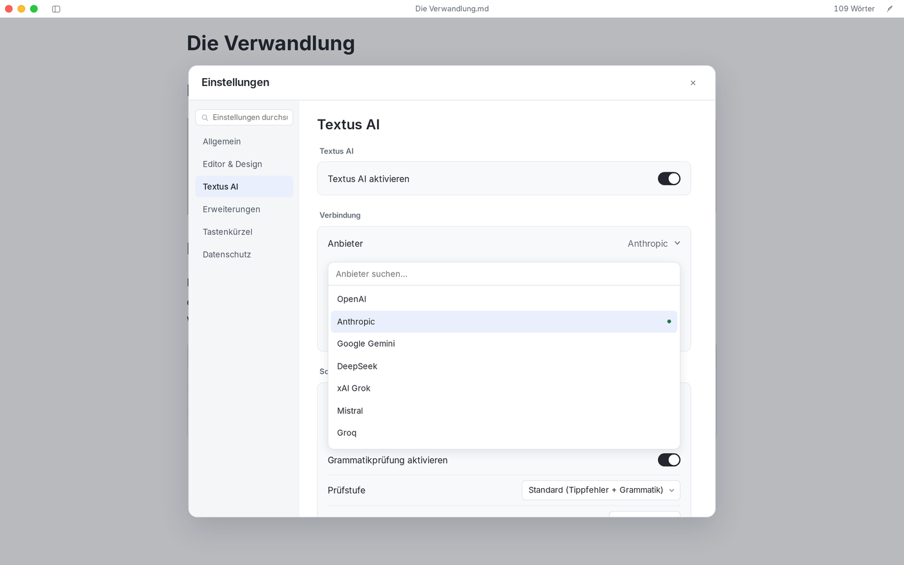
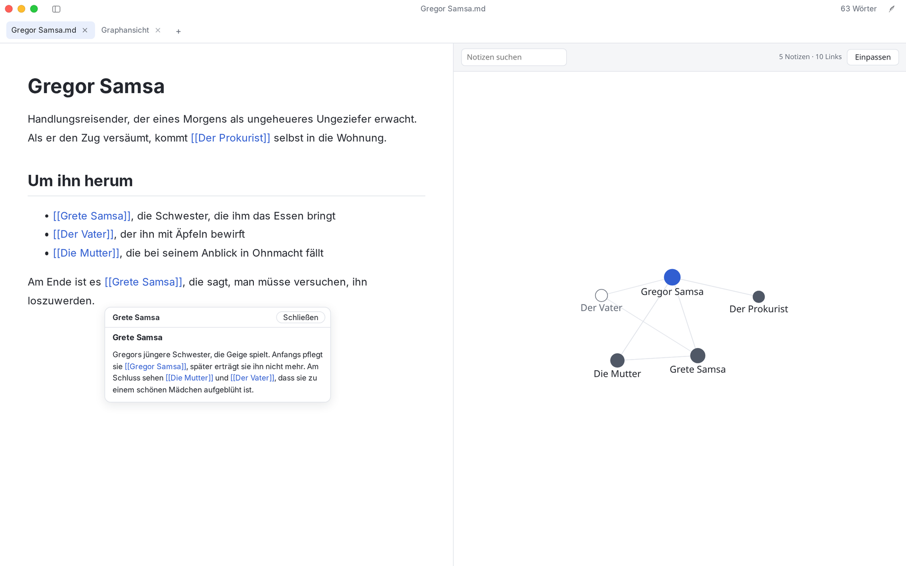

<p align="center">
  
</p>

<h1 align="center">Textus</h1>

<p align="center">
  <strong>Der Markdown-Editor der nächsten Generation.</strong><br>
  Du führst die Feder. Die KI reicht die Tinte.
</p>

<p align="center">
  <a href="https://textus.catvinci.com"><strong>Website</strong></a> ·
  <a href="https://github.com/CatVinci-Studio/Textus/releases/latest"><strong>Download</strong></a>
</p>

<p align="center">
  <a href="./README.md">English</a> ·
  <a href="./README.zh.md">简体中文</a> ·
  <a href="./README.zh-Hant.md">繁體中文</a> ·
  <a href="./README.ja.md">日本語</a> ·
  <a href="./README.ko.md">한국어</a> ·
  <a href="./README.es.md">Español</a> ·
  <a href="./README.fr.md">Français</a> ·
  Deutsch ·
  <a href="./README.ru.md">Русский</a> ·
  <a href="./README.pt.md">Português</a>
</p>

<p align="center">
  <a href="https://github.com/CatVinci-Studio/Textus/releases/latest"></a>
  <a href="./LICENSE"></a>
  <a href="https://github.com/CatVinci-Studio/Textus/actions/workflows/ci.yml"></a>
  <a href="https://textus.catvinci.com/discord"></a>
  <a href="https://github.com/jaywcjlove/awesome-mac"></a>
</p>

https://github.com/user-attachments/assets/f366f282-e3f9-43d9-9a29-edb6d1ace3f5

<p align="center">
  <a href="https://www.youtube.com/watch?v=k_ew9TRljz0">Auf YouTube ansehen</a> ·
  <a href="https://www.bilibili.com/video/BV19LJb6WEWb">Bilibili</a>
</p>

<p align="center">
  <br>
  <sub><i>Die Verwandlung</i>, Franz Kafka</sub>
</p>

## Hol dir Textus

Kostenlos und quelloffen, unter MIT-Lizenz.

| Plattform             | Download                                                                                            |
| --------------------- | --------------------------------------------------------------------------------------------------- |
| macOS · Apple Silicon | [.dmg laden](https://github.com/CatVinci-Studio/Textus/releases/latest)                             |
| macOS · Intel         | [.dmg laden](https://github.com/CatVinci-Studio/Textus/releases/latest)                             |
| Windows · x64         | [.exe laden](https://github.com/CatVinci-Studio/Textus/releases/latest)                             |
| Linux · x64           | [.AppImage laden](https://github.com/CatVinci-Studio/Textus/releases/latest) · Auch als .deb · .rpm |

Oder mit Homebrew:

```sh
brew install --cask textus
```

Arch Linux über das signierte pacman-Repository [`[catvinci]`](https://github.com/CatVinci-Studio/arch-repo) (einmalig; danach hält `sudo pacman -Syu` Textus aktuell):

```sh
bash <(curl -fsSL https://raw.githubusercontent.com/CatVinci-Studio/arch-repo/main/install.sh) textus-bin
```

iPhone und iPad: bald verfügbar. [Alle Versionen auf GitHub](https://github.com/CatVinci-Studio/Textus/releases)

Neue Versionen früher haben? Stell unter **Einstellungen › Allgemein › Über Textus** den **Update-Kanal** auf **Beta**, dann kommen auch Release-Kandidaten; zurück auf **Stabil** geht jederzeit, und du bleibst auf deiner Version, bis eine neuere stabile erscheint.

## Schreiben

Markdown wird schon beim Tippen formatiert. Zeig auf eine Zeile, und du siehst ihr Markdown.

<p align="center">
  
</p>

Formeln entstehen beim Tippen, Tabellen richten sich von selbst aus, und aus wenigen Zeilen Text wird ein Diagramm.

<p align="center">
  
</p>

### Dein Schreibstil? Ganz wie du willst

Vier Schreibmodi und das Design deiner Wahl – auch Typora-Themes.

| Schreibmodi           | Was er tut                                               |
| --------------------- | -------------------------------------------------------- |
| Zen-Modus             | Alles außer deinem Text tritt zurück                     |
| Schreibmaschinenmodus | Die Zeile, an der du schreibst, bleibt auf gleicher Höhe |
| Geteilte Ansicht      | Links das Markdown, rechts die fertige Seite             |
| Quellcodemodus        | Das ganze Dokument als reines Markdown                   |

<p align="center">
  
  
</p>

Exportiere als PDF, Word, HTML und mehr.

## Textus AI

Dein Schreibassistent. Er schreibt mit dir.

### Während du schreibst

Halte kurz inne, und die nächsten Worte erscheinen in Grau. Tab übernimmt sie. Findet Tipp- und Grammatikfehler schon beim Schreiben und achtet auf deine Konventionen. Alt+Enter behebt sie.

### Wenn du fragst

Änderungen kommen als Vorschlag, jeweils mit Begründung. Nimm sie ganz oder Satz für Satz an. Kommentare direkt an der Stelle, um die es geht. Anmerkungen statt Umschreiben. Straffen, Korrektur lesen, übersetzen, den Ton ändern und mehr – ein Schrägstrich genügt.

### Lernt dich kennen

Textus AI erfasst deinen Stil, merkt sich deine Figuren und Orte und folgt deinen Schreibanweisungen.

### Das LLM deiner Wahl

Textus unterstützt mehr als 20 LLMs und jedes LLM mit OpenAI-kompatibler API.

OpenAI · Anthropic · Google Gemini · DeepSeek · xAI · Mistral · Groq · OpenRouter · Kimi · GLM · Qwen · Doubao · Ollama · Jeder OpenAI-kompatible Dienst

<p align="center">
  
</p>

## Plugins (im Test, 1.3 Beta)

Nimm dazu, was du brauchst, und nichts sonst. Ein Graph deiner Notizen und ihrer Links, eine Karte, die zeigt, wohin ein Link führt, zwei Dokumente nebeneinander, Kanban-Boards, Versionsverlauf, PDFs und Word-Dateien im Tab, Zitate aus Zotero – alles unter **Einstellungen › Erweiterungen › Mehr holen**, neben den Themes und Skills. Jedes Plugin fragt, bevor es etwas nutzt.

<p align="center">
  
</p>

## Was du schreibst, gehört nur dir

Was du schreibst, gehört dir. Textus ist so gebaut, dass es dabei bleibt – und der Code ist offen, damit jeder das prüfen kann.

Dokumente sind einfache Markdown-Dateien – gespeichert, wo du willst. API-Schlüssel und Anmeldungen liegen nur auf deinem Rechner. KI-Anfragen gehen direkt von deinem Gerät an den Anbieter deiner Wahl. Laden und losschreiben. Registrieren musst du dich nirgends. Keine Analysen, keine Telemetrie, keine Werbung. MIT-lizenziert und vollständig einsehbar – jeder kann all das prüfen. Mit einem lokalen Modell über Ollama bleibt jedes Wort auf deinem Rechner.

## Gut zu wissen

<details>
<summary><strong>Ist Textus kostenlos?</strong></summary>

Ja. Textus ist kostenlos und quelloffen unter der MIT-Lizenz, ohne Konto und ohne Abo. Nutzt du Textus AI, rechnet dein Anbieter direkt mit dir ab – oder gar nicht, wenn du ein lokales Modell verwendest.

</details>

<details>
<summary><strong>Auf welchen Systemen läuft Textus?</strong></summary>

Auf macOS (Apple Silicon und Intel), Windows und Linux. Versionen für iPhone und iPad sind unterwegs.

</details>

<details>
<summary><strong>Brauche ich ein KI-Konto?</strong></summary>

Nein. Der Editor funktioniert vollständig ohne KI. Für Textus AI verbindest du deinen eigenen Anbieter: Anmeldung mit ChatGPT oder Claude, ein API-Schlüssel oder ein lokales Modell mit Ollama.

</details>

<details>
<summary><strong>Funktioniert Textus offline?</strong></summary>

Der Editor ja, vollständig. Textus AI braucht eine Verbindung zu deinem Anbieter – außer du nutzt ein lokales Modell. Dann verlässt nichts deinen Rechner.

</details>

<details>
<summary><strong>Ist das normales Markdown? Wohin kann ich exportieren?</strong></summary>

Ja: ganz normale .md-Dateien, mit Tabellen, Aufgabenlisten, Fußnoten, Formeln und Mermaid. Exportieren kannst du als PDF, Word, HTML und mehr.

</details>

## Schnellstart

1. Starte Textus. Es öffnet einen leeren Entwurf; eine Datei brauchst du erst beim Speichern.
2. Öffne **Einstellungen → Textus AI**, wähle einen Anbieter und melde dich unter **Anmeldung & Zugangsdaten** an oder füge einen Schlüssel ein.
3. Schreib los. Hältst du inne, erscheint die Fortsetzung in Grau; Tab übernimmt sie.
4. Öffne den KI-Bereich mit dem Knopf **Textus AI** (der Feder) in der Fensterleiste. **Hilfe → Anleitung zu KI-Funktionen** erklärt den Rest.

Alle Tastenkürzel stehen unter **Einstellungen → Tastenkürzel** und lassen sich dort ändern.

## Community

- [Discord](https://textus.catvinci.com/discord): Neuigkeiten, Hilfe und Feedback, auf Englisch.
- Auf Chinesisch: [QQ-Gruppe](https://textus.catvinci.com/qq) (1128285004) · [WeChat-Gruppe](https://textus.catvinci.com/wechat)

Fehlerberichte und Wünsche gern in den [GitHub Issues](https://github.com/CatVinci-Studio/Textus/issues).

## Roadmap und Mitwirken

[ROADMAP.md](ROADMAP.md) (Englisch) zeigt, wohin sich Textus entwickelt. Zum Bauen, für die Prüfungen und für Pull Requests beginnst du mit [CONTRIBUTING.md](CONTRIBUTING.md) (Englisch); KI-Programmierassistenten folgen [AGENTS.md](AGENTS.md). Diskutiert wird auf Englisch oder Chinesisch.

## Sterne im Verlauf

<a href="https://star-history.com/#CatVinci-Studio/Textus&Date">
  <picture>
    <source media="(prefers-color-scheme: dark)" srcset="https://api.star-history.com/svg?repos=CatVinci-Studio/Textus&type=Date&theme=dark">
    
  </picture>
</a>

## Lizenz

[MIT](./LICENSE) © CatVinci Studio
