

  

<h1 align="center">Textus</h1>

  <strong>El entorno integrado de escritura de nueva generación.</strong> 
  La IA pone la tinta. Tú llevas la pluma.

  <a href="https://textus.md"><strong>Sitio web</strong></a> ·
  <a href="https://github.com/CatVinci-Studio/Textus/releases/latest"><strong>Descargar</strong></a> ·
  <a href="https://github.com/CatVinci-Studio/Textus/issues/648"><strong>Patrocinar</strong></a>

  <a href="./README.md">English</a> ·
  <a href="./README.zh.md">简体中文</a> ·
  <a href="./README.zh-Hant.md">繁體中文</a> ·
  <a href="./README.ja.md">日本語</a> ·
  <a href="./README.ko.md">한국어</a> ·
  Español ·
  <a href="./README.fr.md">Français</a> ·
  <a href="./README.de.md">Deutsch</a> ·
  <a href="./README.ru.md">Русский</a> ·
  <a href="./README.pt.md">Português</a>

  
  
  
  
  

  

<strong>Patrocinador principal</strong>

  

a través del Anthropic Startup Program

Patrocinadores: <a href="https://github.com/jzzzzh"> Jiang Zhuohang</a>

  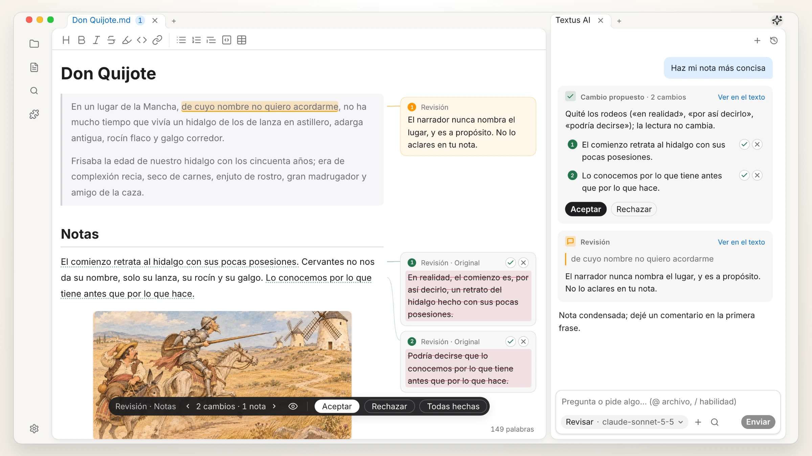 
  <i>Don Quijote de la Mancha</i>, Miguel de Cervantes (1605)

## Consigue Textus

Gratuito y de código abierto, con licencia MIT.

| Plataforma            | Descargar                                                                                                  | Otras formas de instalar                                                                  |
| --------------------- | ---------------------------------------------------------------------------------------------------------- | ----------------------------------------------------------------------------------------- |
| macOS · Apple Silicon | [Descargar .dmg](https://github.com/CatVinci-Studio/Textus/releases/latest)                                | Homebrew: `brew install --cask textus`                                                    |
| macOS · Intel         | [Descargar .dmg](https://github.com/CatVinci-Studio/Textus/releases/latest)                                | Homebrew: `brew install --cask textus`                                                    |
| Windows · x64         | [Descargar .exe](https://github.com/CatVinci-Studio/Textus/releases/latest)                                | —                                                                                         |
| Linux · x64           | [Descargar .AppImage](https://github.com/CatVinci-Studio/Textus/releases/latest) · También como .deb · .rpm | Arch Linux: el [repositorio `[catvinci]`](https://github.com/CatVinci-Studio/arch-repo) |

> iPhone y iPad: muy pronto en la App Store.

Beta: en **Ajustes › Acerca de**, pon el **Canal de actualizaciones** en **Beta**.

## Por qué Textus

Los programadores tienen IDE: un solo lugar donde escribir código, revisarlo y usar sus herramientas. Quien escribe suele tomar prestado un editor de código o saltar entre varias aplicaciones. Textus reúne todo el proceso de escritura en un solo lugar.

- **Markdown como lengua común.** En la era de la IA, Markdown es más que un formato de archivo: lo leen las personas, la IA y otras herramientas, así que tu trabajo pasa libremente de unas a otras.
- **Pensado para escribir, no para programar.** Redactar, revisar y corregir van primero; no son funciones añadidas a un editor de código.
- **Una IA hecha para escribir.** Sugerencias mientras escribes, comentarios mientras revisas, y cambios que aceptas o rechazas uno a uno.
- **A tu manera.** Edición WYSIWYG, un amplio sistema de complementos, sincronización e incluso tus planes del día: toma lo que necesites y deja el resto.
- **Tus notas vienen contigo.** Abre una bóveda de Obsidian tal cual, importa desde Notion y usa temas de Typora.

## Escritura

Lo que ves es lo que obtienes: Markdown que se maqueta mientras escribes, con tablas, código, fórmulas y diagramas, y borradores, notas y fuentes lado a lado. Exporta a PDF, Word, HTML y más.

  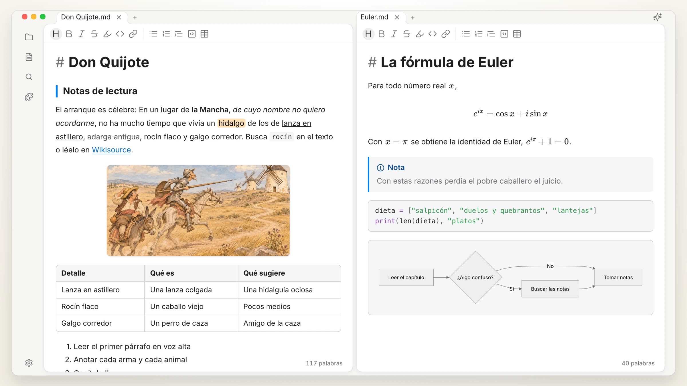

## Textus AI

Funciona con modelos en línea y locales, y participa en la propia escritura.

| Continuación | Erratas y gramática |
| :---: | :---: |
| 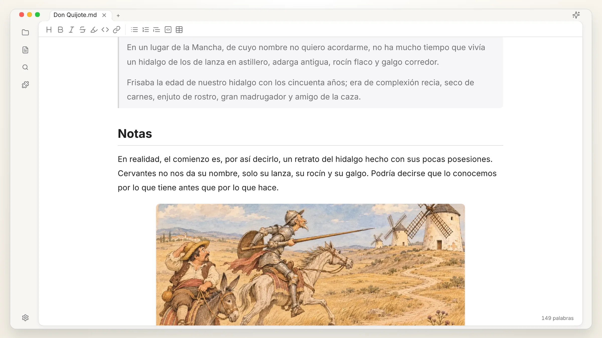 |  |
| **Ediciones propuestas** | **Comentarios de revisión** |
| 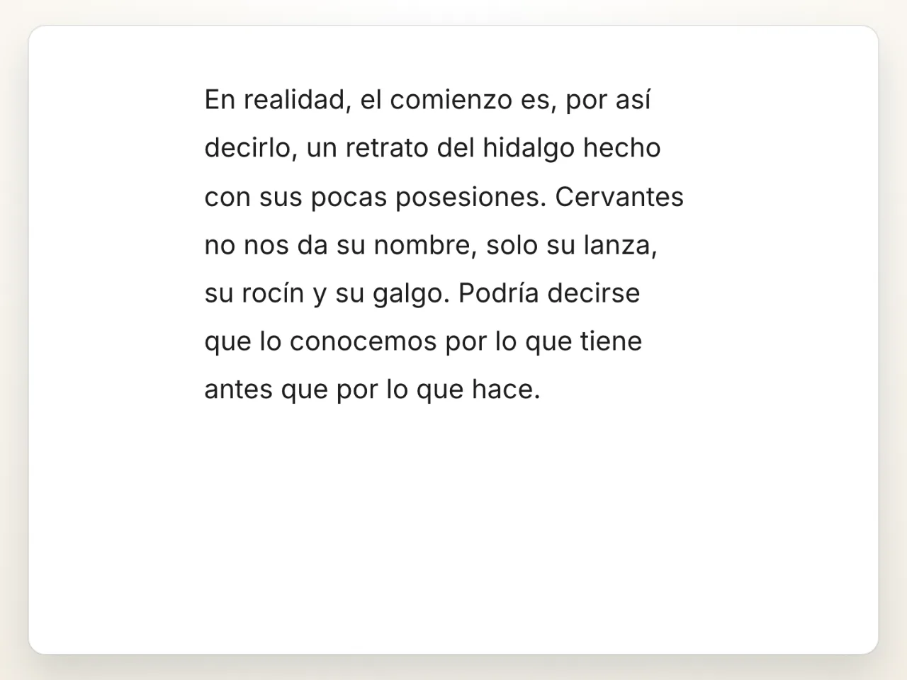 | 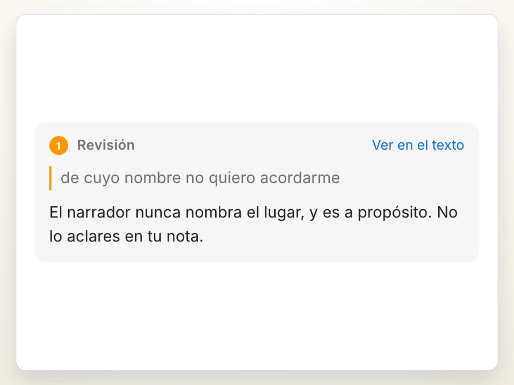 |
| **Habilidades con /** | **Cualquier modelo** |
| 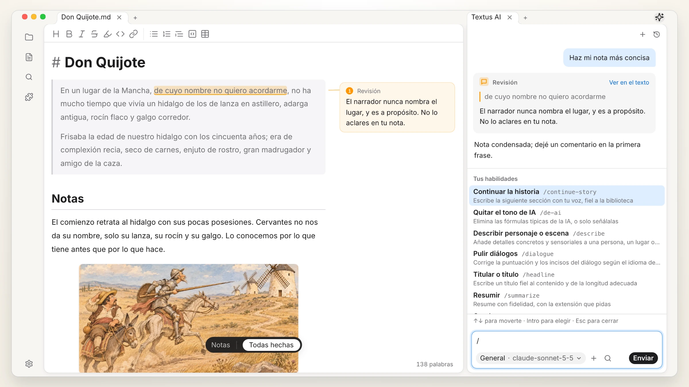 | 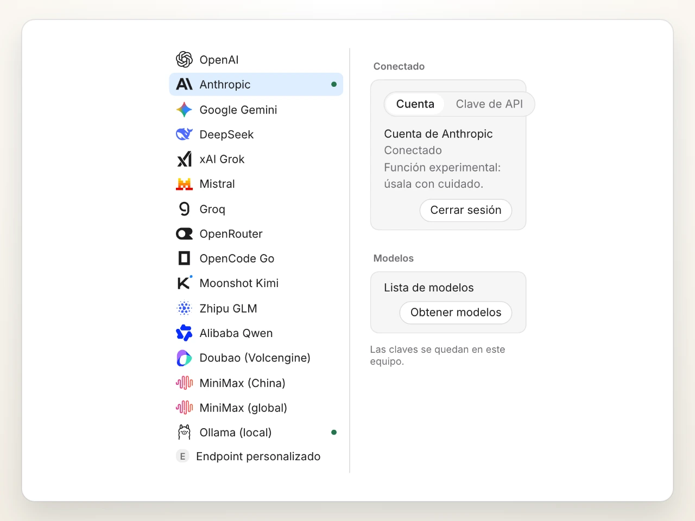 |

Para un uso avanzado, conecta servidores MCP o trae Claude Code y Codex al panel de IA como agentes.

## Complementos

| Vista de grafo | Historial de versiones |
| :---: | :---: |
| 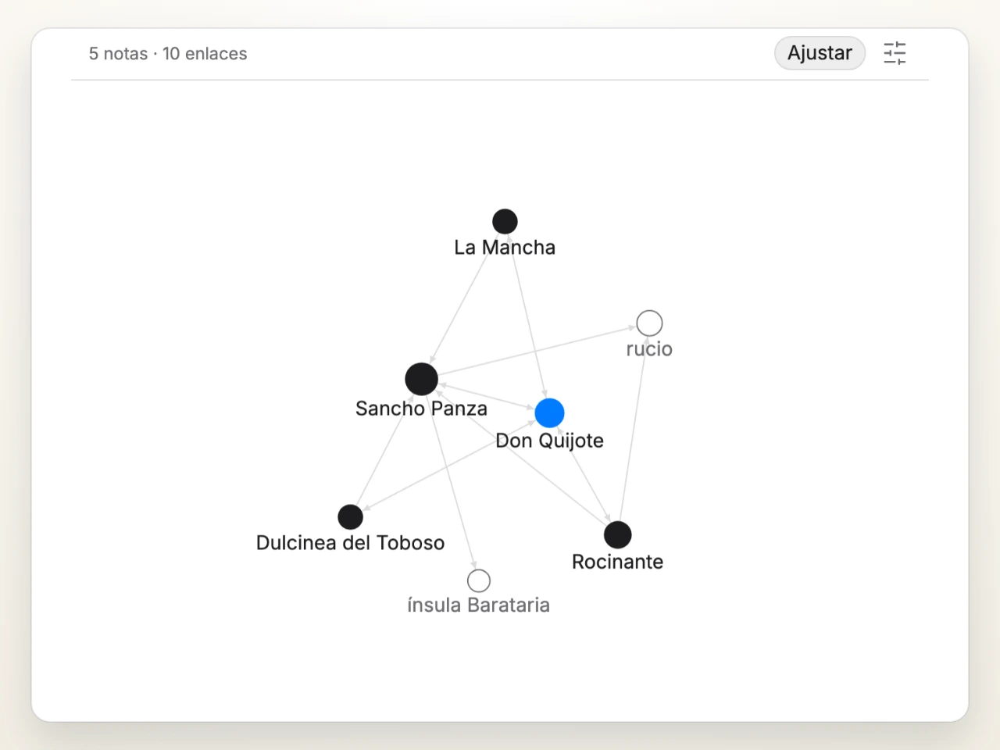 | 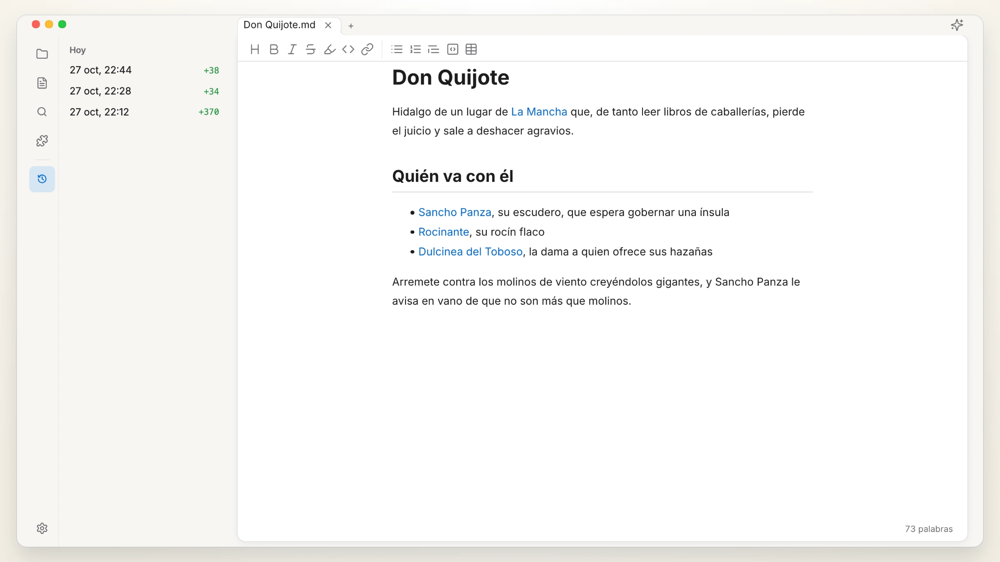 |
| **Vista rápida** | **Base de conocimiento** |
| 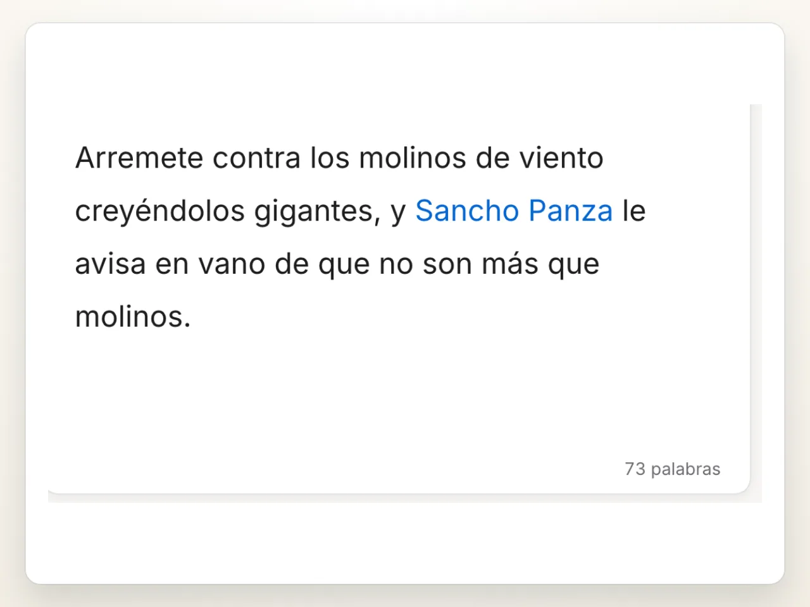 | 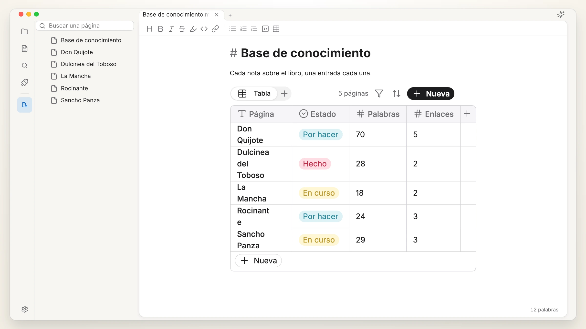 |

Más complementos y temas: [textus.md/extensions](https://textus.md/es/extensions/).

## Patrocinadores

**Patrocinador principal:** [Anthropic](https://www.anthropic.com/), a través del Anthropic Startup Program.

**Patrocinadores:** [Jiang Zhuohang](https://github.com/jzzzzh)

Textus es gratuito y de código abierto. [Patrocínanos](https://github.com/CatVinci-Studio/Textus/issues/648) para apoyar su desarrollo.

## Comunidad

Únete en Discord, QQ o WeChat: [textus.md/community](https://textus.md/es/community/). Los errores y las sugerencias son bienvenidos en [GitHub Issues](https://github.com/CatVinci-Studio/Textus/issues). Para contribuir con código, empieza por [CONTRIBUTING.md](CONTRIBUTING.md).

## Preguntas frecuentes

<strong>¿Es gratis Textus?</strong>

Sí, y siempre lo será. Es de código abierto con licencia MIT, sin cuenta ni suscripción. Si usas Textus AI, te cobra directamente tu proveedor; con un modelo local, nadie.

<strong>¿En qué sistemas funciona?</strong>

En macOS (Apple Silicon e Intel), Windows y Linux, y en iPhone y iPad desde la App Store.

<strong>¿Cuánta memoria usa?</strong>

Nos importa mucho la memoria y la medimos en cada versión. Una ventana ocupa unos 110 MB, y cada ventana más, unos 55 MB adicionales. Los complementos solo se cargan cuando se usan, y una página web que queda en segundo plano se libera y vuelve a cargarse cuando regresas a ella.

<strong>¿Necesito una cuenta de IA?</strong>

No. El editor funciona por completo sin IA. Para usar Textus AI, conecta tu propio proveedor: inicia sesión con ChatGPT o Claude, añade una clave de API o ejecuta un modelo local con Ollama.

<strong>¿Funciona sin conexión?</strong>

El editor, sí, por completo. Textus AI necesita conectarse a tu proveedor, salvo que uses un modelo local.

<strong>¿Es Markdown estándar? ¿A qué formatos exporta?</strong>

Sí: archivos .md normales, con tablas, listas de tareas, notas al pie, fórmulas y Mermaid. Exporta a PDF, Word, HTML y más.

## Historial de estrellas

<a href="https://star-history.com/#CatVinci-Studio/Textus&Date">
  <picture>
    <source media="(prefers-color-scheme: dark)" srcset="https://api.star-history.com/svg?repos=CatVinci-Studio/Textus&type=Date&theme=dark">
    
  </picture>
</a>

## Licencia

[MIT](./LICENSE) © CatVinci Studio
