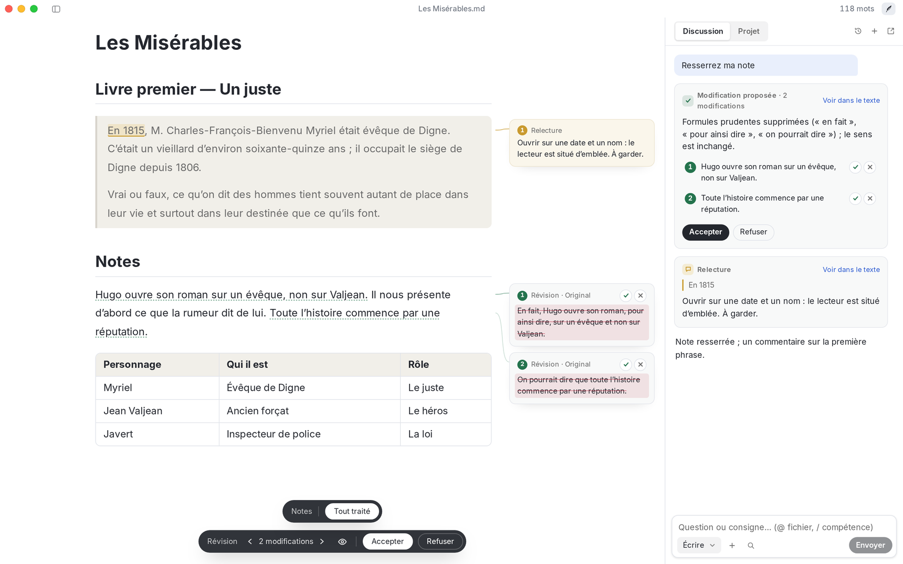
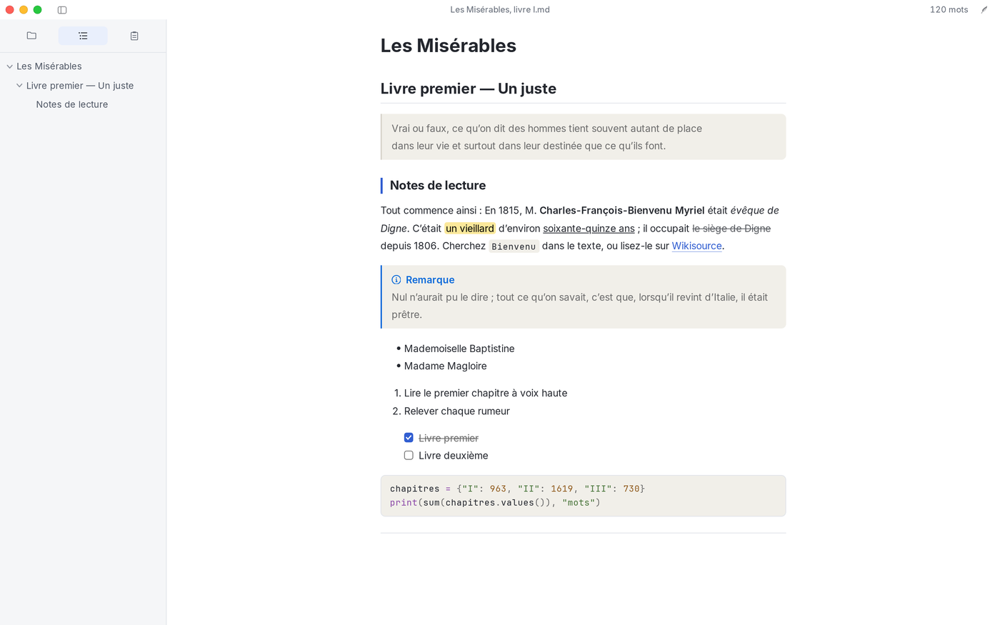
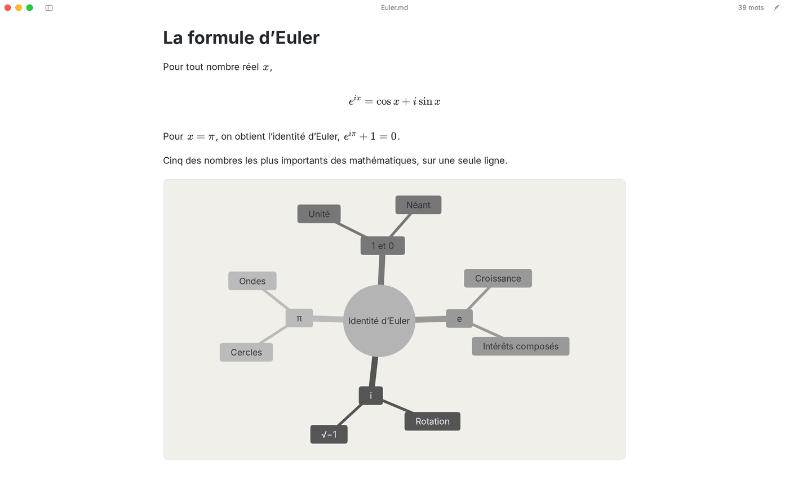
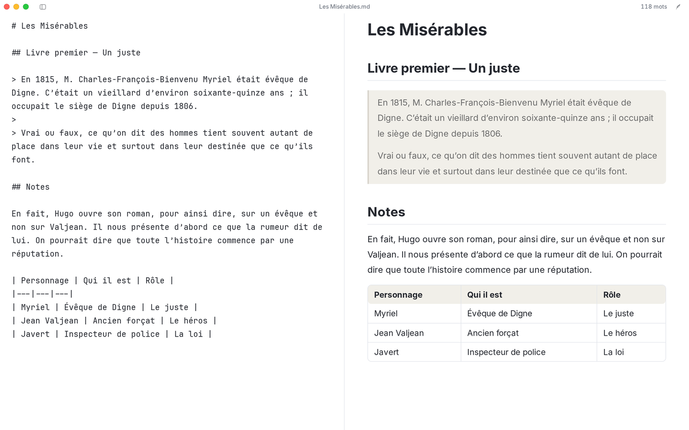
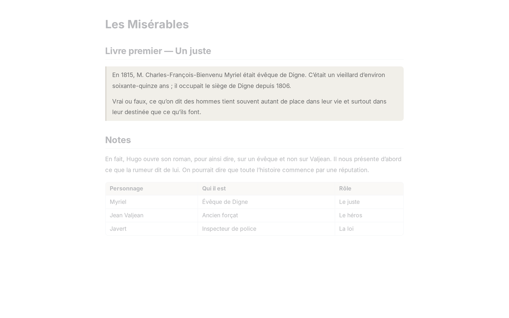
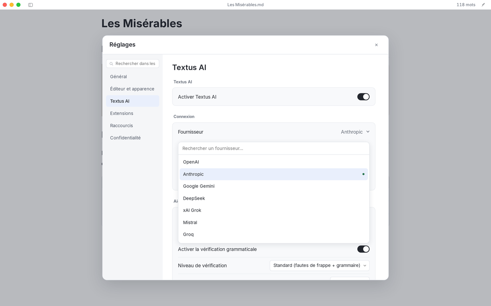
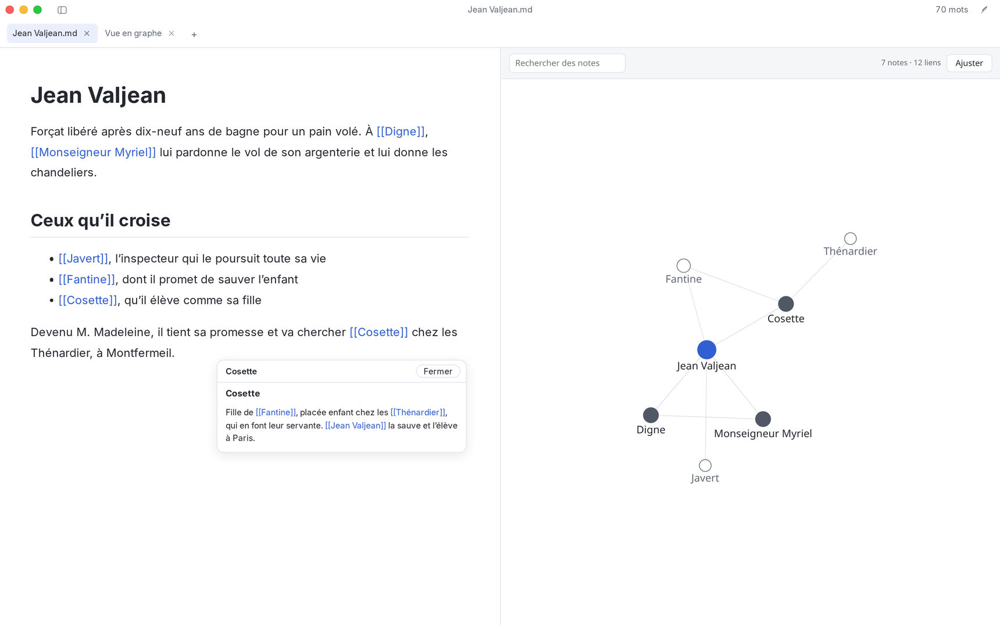

<p align="center">
  
</p>

<h1 align="center">Textus</h1>

<p align="center">
  <strong>L’éditeur Markdown nouvelle génération.</strong><br>
  Vous tenez la plume. L’IA prépare l’encre.
</p>

<p align="center">
  <a href="https://textus.catvinci.com"><strong>Site web</strong></a> ·
  <a href="https://github.com/CatVinci-Studio/Textus/releases/latest"><strong>Télécharger</strong></a>
</p>

<p align="center">
  <a href="./README.md">English</a> ·
  <a href="./README.zh.md">简体中文</a> ·
  <a href="./README.zh-Hant.md">繁體中文</a> ·
  <a href="./README.ja.md">日本語</a> ·
  <a href="./README.ko.md">한국어</a> ·
  <a href="./README.es.md">Español</a> ·
  Français ·
  <a href="./README.de.md">Deutsch</a> ·
  <a href="./README.ru.md">Русский</a> ·
  <a href="./README.pt.md">Português</a>
</p>

<p align="center">
  <a href="https://github.com/CatVinci-Studio/Textus/releases/latest"></a>
  <a href="./LICENSE"></a>
  <a href="https://github.com/CatVinci-Studio/Textus/actions/workflows/ci.yml"></a>
  <a href="https://textus.catvinci.com/discord"></a>
  <a href="https://github.com/jaywcjlove/awesome-mac"></a>
</p>

https://github.com/user-attachments/assets/f366f282-e3f9-43d9-9a29-edb6d1ace3f5

<p align="center">
  <a href="https://www.youtube.com/watch?v=k_ew9TRljz0">Voir sur YouTube</a> ·
  <a href="https://www.bilibili.com/video/BV19LJb6WEWb">Bilibili</a>
</p>

<p align="center">
  <br>
  <sub><i>Les Misérables</i>, Victor Hugo</sub>
</p>

## Prêt à écrire ?

Gratuit et open source, sous licence MIT.

| Plateforme            | Télécharger                                                                                                    |
| --------------------- | -------------------------------------------------------------------------------------------------------------- |
| macOS · Apple Silicon | [Télécharger le .dmg](https://github.com/CatVinci-Studio/Textus/releases/latest)                               |
| macOS · Intel         | [Télécharger le .dmg](https://github.com/CatVinci-Studio/Textus/releases/latest)                               |
| Windows · x64         | [Télécharger le .exe](https://github.com/CatVinci-Studio/Textus/releases/latest)                               |
| Linux · x64           | [Télécharger l’AppImage](https://github.com/CatVinci-Studio/Textus/releases/latest) · Également en .deb · .rpm |

Ou avec Homebrew:

```sh
brew install --cask textus
```

Arch Linux avec le dépôt pacman signé [`[catvinci]`](https://github.com/CatVinci-Studio/arch-repo) (une seule fois ; ensuite `sudo pacman -Syu` garde Textus à jour) :

```sh
bash <(curl -fsSL https://raw.githubusercontent.com/CatVinci-Studio/arch-repo/main/install.sh) textus-bin
```

Bientôt sur iPhone et iPad. [Toutes les versions sur GitHub](https://github.com/CatVinci-Studio/Textus/releases)

Envie des nouvelles versions en avance ? Dans **Réglages › Général › À propos de Textus**, réglez le **Canal de mise à jour** sur **Bêta** pour recevoir aussi les versions candidates ; vous pouvez revenir à **Stable** à tout moment, et vous gardez votre version jusqu'à la sortie d'une version stable plus récente.

## Écriture

Le Markdown se met en forme à mesure que vous écrivez. Survolez une ligne pour afficher sa syntaxe.

<p align="center">
  
</p>

Les formules s’affichent pendant la frappe, les tableaux s’alignent tout seuls, et quelques lignes de texte suffisent pour un diagramme.

<p align="center">
  
</p>

### Votre style d’écriture ? À vous de voir

Quatre modes d’écriture et le thème de votre choix, thèmes Typora compris.

| Modes d’écriture      | Ce qu’il fait                                           |
| --------------------- | ------------------------------------------------------- |
| Mode zen              | Tout s’efface, sauf vos mots                            |
| Mode machine à écrire | La ligne en cours reste toujours à la même hauteur      |
| Vue partagée          | Le Markdown d’un côté, la page mise en forme de l’autre |
| Mode source           | Tout le document en Markdown brut                       |

<p align="center">
  
  
</p>

Exportez en PDF, Word, HTML et plus encore.

## Textus AI

Votre assistant d’écriture. Il écrit avec vous.

### Pendant que vous écrivez

Marquez une pause : la suite s’affiche en gris. Tab pour l’accepter. Coquilles et fautes de grammaire sont signalées à mesure que vous écrivez, selon vos conventions d’écriture. Alt+Entrée pour corriger.

### Quand vous le demandez

Chaque modification arrive sous forme de proposition, avec son explication. Acceptez-la en entier, ou phrase par phrase. Des commentaires épinglés aux passages concernés. Des remarques, pas de réécriture. Resserrer, relire, traduire, changer de ton… Il suffit de taper /.

### Elle vous connaît

Elle apprend votre style, retient vos personnages et vos lieux, et suit vos instructions d’écriture.

### Le LLM de votre choix

Textus fonctionne avec plus de 20 LLM, et avec tout LLM qui propose une API compatible OpenAI.

OpenAI · Anthropic · Google Gemini · DeepSeek · xAI · Mistral · Groq · OpenRouter · Kimi · GLM · Qwen · Doubao · Ollama · Tout service compatible OpenAI

<p align="center">
  
</p>

## Extensions

Ajoutez ce dont vous avez besoin, et rien d’autre. Un graphe de vos notes et des liens entre elles, une carte qui montre où mène un lien, deux documents côte à côte, des tableaux kanban, l’historique des versions, les PDF et fichiers Word dans un onglet, les citations Zotero – tout est dans **Réglages › Extensions › En obtenir plus**, à côté des thèmes et des compétences. Chaque extension demande avant d’utiliser quoi que ce soit.

<p align="center">
  
</p>

## Ce que vous écrivez n’appartient qu’à vous

Ce que vous écrivez vous appartient. Textus est fait pour que cela ne change pas, et son code est ouvert : chacun peut le vérifier.

Vos documents sont de simples fichiers Markdown, rangés où vous le souhaitez. Les clés d’API et les connexions restent uniquement sur votre ordinateur. Les requêtes d’IA partent de votre appareil, droit vers le fournisseur choisi. Téléchargez, écrivez. Aucune inscription. Ni statistiques, ni télémétrie, ni publicité. Sous licence MIT et public, ligne par ligne : chacun peut tout vérifier. Avec un modèle local via Ollama, vos mots ne quittent jamais votre ordinateur.

## Questions fréquentes

<details>
<summary><strong>Textus est-il gratuit ?</strong></summary>

Oui. Il est gratuit et open source, sous licence MIT, sans compte ni abonnement. Si vous utilisez Textus AI, c’est votre fournisseur qui vous facture directement ; avec un modèle local, personne.

</details>

<details>
<summary><strong>Sur quels systèmes fonctionne-t-il ?</strong></summary>

macOS (Apple Silicon et Intel), Windows et Linux. Les versions pour iPhone et iPad arrivent bientôt.

</details>

<details>
<summary><strong>Faut-il un compte d’IA ?</strong></summary>

Non. L’éditeur fonctionne entièrement sans IA. Pour Textus AI, connectez le fournisseur de votre choix : connexion avec ChatGPT ou Claude, clé d’API, ou modèle local avec Ollama.

</details>

<details>
<summary><strong>Fonctionne-t-il hors ligne ?</strong></summary>

L’éditeur, oui, entièrement. Textus AI doit joindre votre fournisseur, sauf avec un modèle local.

</details>

<details>
<summary><strong>Est-ce du Markdown standard ? Quels formats d’export ?</strong></summary>

Oui : de simples fichiers .md, avec tableaux, listes de tâches, notes de bas de page, formules et diagrammes Mermaid. Export en PDF, Word, HTML et plus encore.

</details>

## Prise en main

1. Lancez Textus. Il s’ouvre sur un brouillon vierge ; un fichier n’est nécessaire qu’à l’enregistrement.
2. Ouvrez **Réglages → Textus AI**, choisissez un fournisseur, puis connectez-vous ou collez une clé dans **Authentification**.
3. Commencez à écrire. Quand vous marquez une pause, la suite apparaît en gris ; Tab l’accepte.
4. Ouvrez le Panneau IA avec le bouton **Textus AI** (la plume) de la barre de fenêtre. **Aide → Guide des fonctions IA** présente le reste.

Tous les raccourcis se consultent et se modifient dans **Réglages → Raccourcis**.

## Communauté

- [Discord](https://textus.catvinci.com/discord) : annonces, aide et retours, en anglais.
- En chinois : [groupe QQ](https://textus.catvinci.com/qq) (1128285004) · [groupe WeChat](https://textus.catvinci.com/wechat)

Bugs et suggestions sont les bienvenus dans les [GitHub Issues](https://github.com/CatVinci-Studio/Textus/issues).

## Feuille de route et contributions

[ROADMAP.md](ROADMAP.md) (en anglais) montre où va Textus. Pour compiler Textus, lancer les vérifications ou ouvrir une pull request, commencez par [CONTRIBUTING.md](CONTRIBUTING.md) (en anglais) ; les assistants de programmation IA suivent [AGENTS.md](AGENTS.md). Les échanges se font en anglais ou en chinois.

## Historique des étoiles

<a href="https://star-history.com/#CatVinci-Studio/Textus&Date">
  <picture>
    <source media="(prefers-color-scheme: dark)" srcset="https://api.star-history.com/svg?repos=CatVinci-Studio/Textus&type=Date&theme=dark">
    
  </picture>
</a>

## Licence

[MIT](./LICENSE) © CatVinci Studio
