

  

<h1 align="center">Textus</h1>

  <strong>L’environnement d’écriture intégré nouvelle génération.</strong> 
  L’IA fait couler l’encre. Vous tenez la plume.

  <a href="https://textus.md"><strong>Site web</strong></a> ·
  <a href="https://github.com/CatVinci-Studio/Textus/releases/latest"><strong>Télécharger</strong></a> ·
  <a href="https://github.com/CatVinci-Studio/Textus/issues/648"><strong>Soutenir</strong></a>

  <a href="./README.md">English</a> ·
  <a href="./README.zh.md">简体中文</a> ·
  <a href="./README.zh-Hant.md">繁體中文</a> ·
  <a href="./README.ja.md">日本語</a> ·
  <a href="./README.ko.md">한국어</a> ·
  <a href="./README.es.md">Español</a> ·
  Français ·
  <a href="./README.de.md">Deutsch</a> ·
  <a href="./README.ru.md">Русский</a> ·
  <a href="./README.pt.md">Português</a>

  
  
  
  
  

  

<strong>Sponsor principal</strong>

  <a href="https://www.anthropic.com/">
    <picture>
      <source media="(prefers-color-scheme: dark)" srcset="docs/images/readme/sponsors/anthropic-logo-ivory.png">
      
    </picture>
  </a>

dans le cadre de l’Anthropic Startup Program

  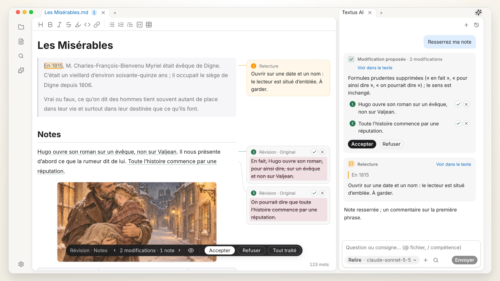 
  <i>Les Misérables</i>, Victor Hugo (1862)

## Obtenir Textus

Gratuit et open source, sous licence MIT.

| Plateforme            | Télécharger                                                                                                     | Autres moyens d’installation                                                         |
| --------------------- | --------------------------------------------------------------------------------------------------------------- | ------------------------------------------------------------------------------------ |
| macOS · Apple Silicon | [Télécharger le .dmg](https://github.com/CatVinci-Studio/Textus/releases/latest)                                | Homebrew : `brew install --cask textus`                                              |
| macOS · Intel         | [Télécharger le .dmg](https://github.com/CatVinci-Studio/Textus/releases/latest)                                | Homebrew : `brew install --cask textus`                                              |
| Windows · x64         | [Télécharger le .exe](https://github.com/CatVinci-Studio/Textus/releases/latest)                                | —                                                                                    |
| Linux · x64           | [Télécharger l’AppImage](https://github.com/CatVinci-Studio/Textus/releases/latest) · Également en .deb · .rpm | Arch Linux : le [dépôt `[catvinci]`](https://github.com/CatVinci-Studio/arch-repo) |

> iPhone et iPad : bientôt sur l’App Store.

Bêta : dans **Réglages › À propos**, réglez le **Canal de mise à jour** sur **Bêta**.

## Pourquoi Textus

Les programmeurs ont leur IDE : un seul endroit où écrire du code, le vérifier et utiliser leurs outils. Les auteurs, eux, empruntent souvent un éditeur de code ou jonglent entre plusieurs applications. Textus réunit tout le travail d’écriture en un seul endroit.

- **Le Markdown comme langue commune.** À l’ère de l’IA, le Markdown est plus qu’un format de fichier : les personnes, l’IA et les autres outils le lisent tous, et votre travail circule librement entre eux.
- **Pensé pour l’écriture, pas pour le code.** Rédiger, relire et réviser passent en premier, au lieu d’être des fonctions ajoutées à un éditeur de code.
- **Une IA faite pour l’écriture.** Des suggestions pendant que vous écrivez, des commentaires pendant que vous relisez, et des modifications que vous acceptez ou refusez une à une.
- **Organisé à votre façon.** Édition WYSIWYG, un système d’extensions riche, la synchronisation, jusqu’à vos plans de la journée : prenez ce qu’il vous faut, laissez le reste.
- **Vos notes vous suivent.** Ouvrez un coffre Obsidian tel quel, importez depuis Notion et utilisez les thèmes Typora.

## Écriture

Ce que vous voyez est ce que vous obtenez : le Markdown se met en page à mesure que vous tapez, avec tableaux, code, formules et diagrammes, et brouillons, notes et sources côte à côte. Export en PDF, Word, HTML et plus encore.

  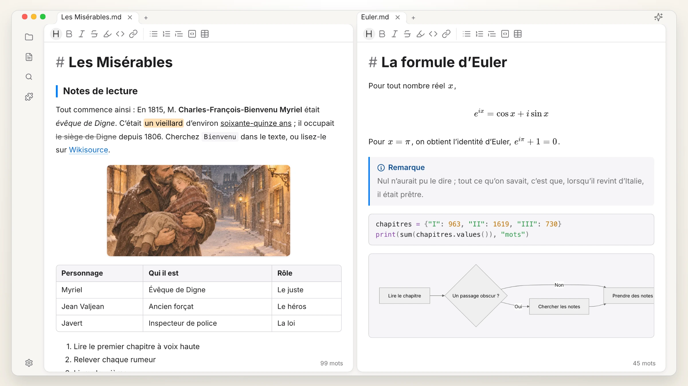

## Textus AI

Fonctionne avec des modèles en ligne comme locaux, et prend part à l’écriture elle-même.

| Suite du texte | Fautes et grammaire |
| :---: | :---: |
| 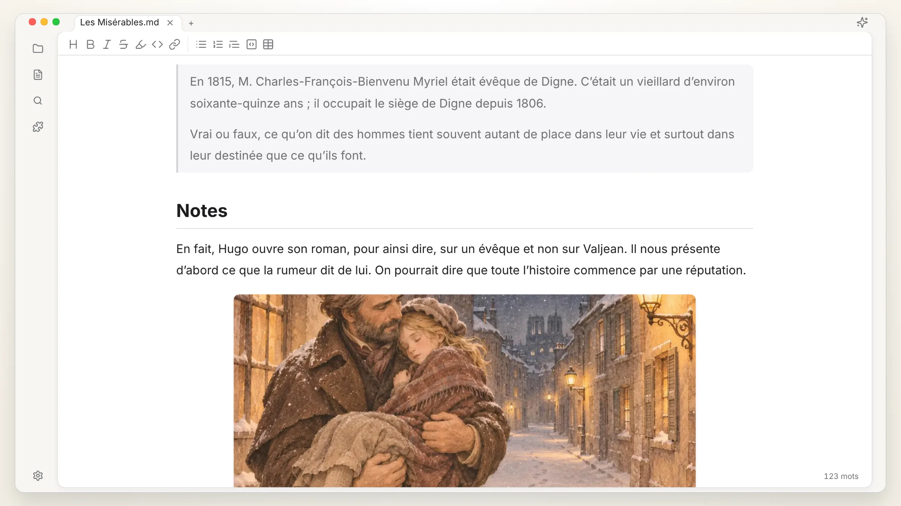 |  |
| **Modifications proposées** | **Commentaires de relecture** |
| 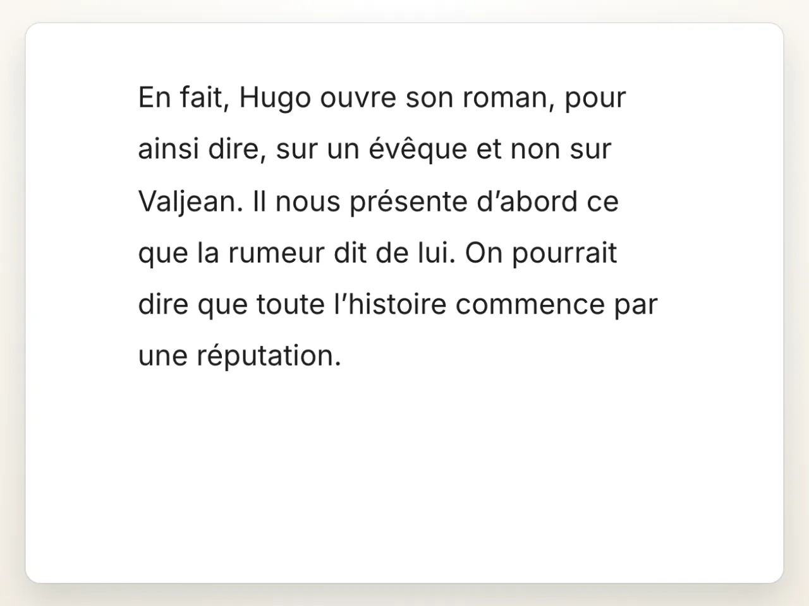 | 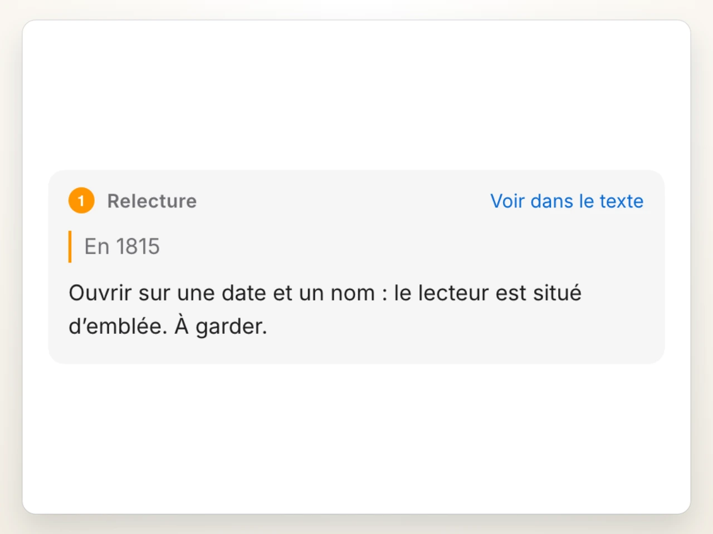 |
| **Compétences avec /** | **Le modèle de votre choix** |
| 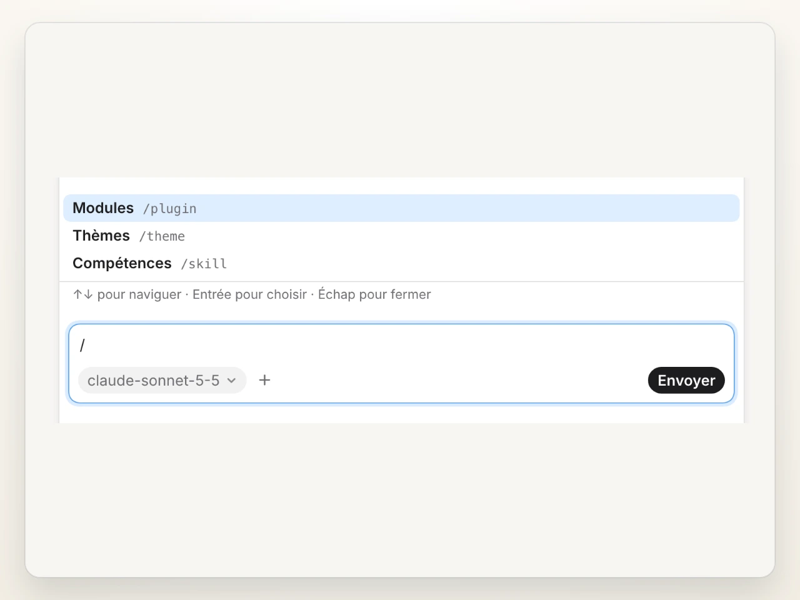 | 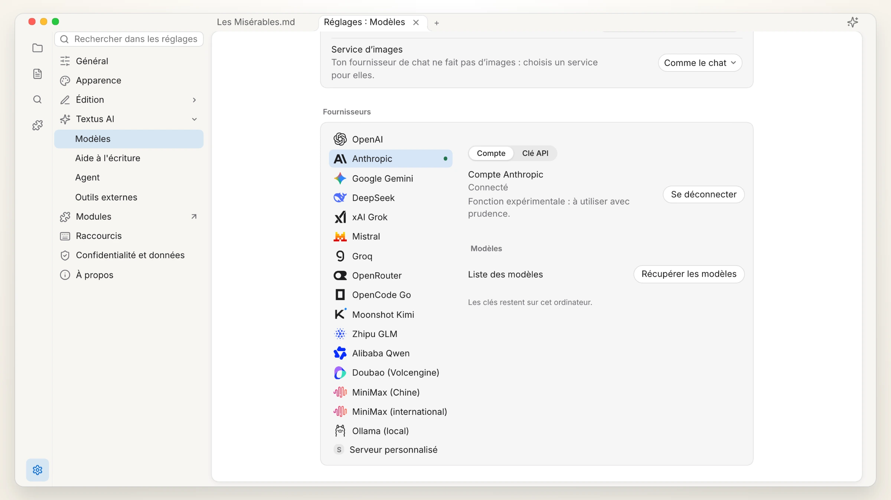 |

Pour aller plus loin, connectez des serveurs MCP, ou faites entrer Claude Code et Codex dans le panneau IA comme agents.

## Extensions

| Vue en graphe | Historique des versions |
| :---: | :---: |
| 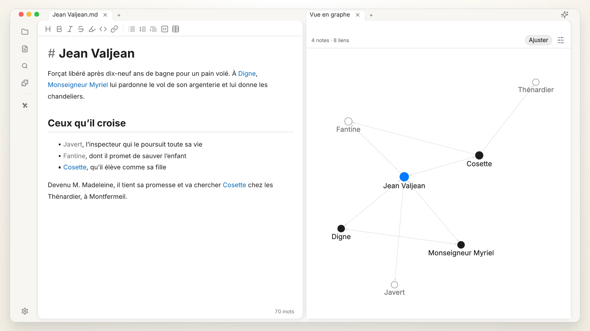 | 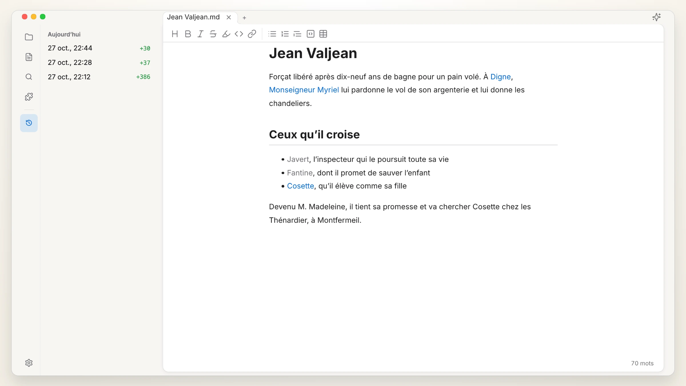 |
| **Aperçu rapide** | **Base de connaissances** |
| 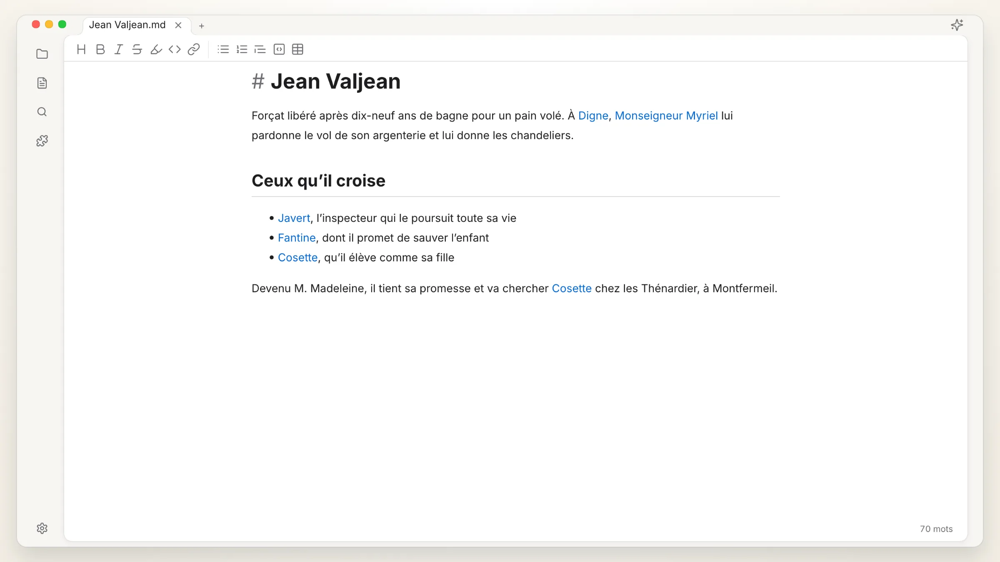 | 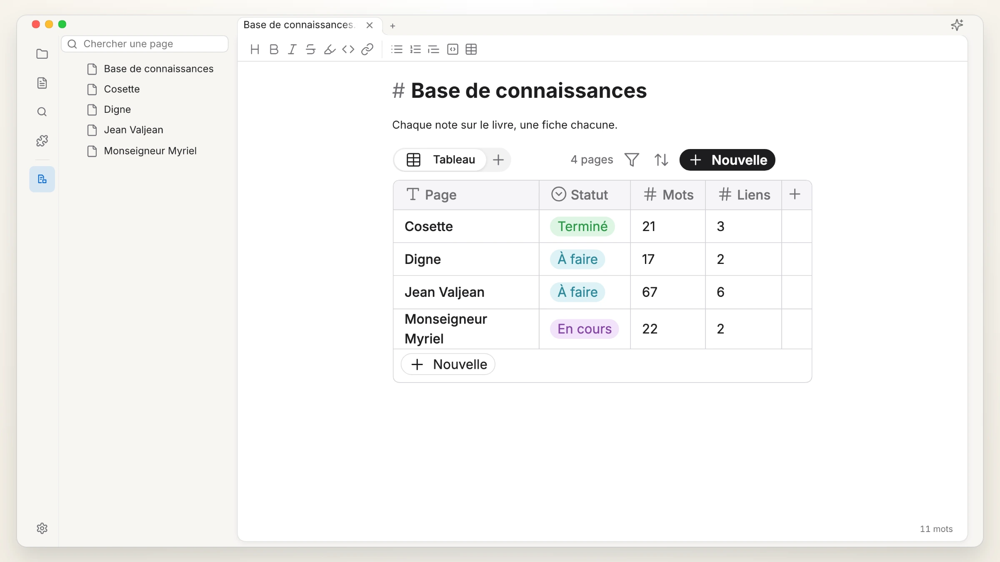 |

Plus d’extensions et de thèmes : [textus.md/extensions](https://textus.md/fr/extensions/).

## Sponsors

**Sponsor principal :** [Anthropic](https://www.anthropic.com/), dans le cadre de l’Anthropic Startup Program.

Textus est gratuit et open source. [Soutenez-nous](https://github.com/CatVinci-Studio/Textus/issues/648) pour aider son développement.

## Communauté

Rejoignez-nous sur Discord, QQ ou WeChat : [textus.md/community](https://textus.md/fr/community/). Bugs et suggestions sont les bienvenus dans les [GitHub Issues](https://github.com/CatVinci-Studio/Textus/issues). Pour contribuer au code, commencez par [CONTRIBUTING.md](CONTRIBUTING.md) (en anglais).

## Questions fréquentes

<strong>Textus est-il gratuit ?</strong>

Oui, et il le restera toujours. Il est open source, sous licence MIT, sans compte ni abonnement. Si vous utilisez Textus AI, c’est votre fournisseur qui vous facture directement ; avec un modèle local, personne.

<strong>Sur quels systèmes fonctionne-t-il ?</strong>

macOS (Apple Silicon et Intel), Windows et Linux, ainsi qu’iPhone et iPad via l’App Store.

<strong>Combien de mémoire utilise-t-il ?</strong>

La mémoire nous tient à cœur et nous la mesurons à chaque version. Une fenêtre occupe environ 110 Mo, et chaque fenêtre supplémentaire environ 55 Mo de plus. Les extensions ne se chargent que lorsqu’on s’en sert, et une page web laissée en arrière-plan est libérée, puis rechargée quand vous y revenez.

<strong>Faut-il un compte d’IA ?</strong>

Non. L’éditeur fonctionne entièrement sans IA. Pour Textus AI, connectez le fournisseur de votre choix : connexion avec ChatGPT ou Claude, clé d’API, ou modèle local avec Ollama.

<strong>Fonctionne-t-il hors ligne ?</strong>

L’éditeur, oui, entièrement. Textus AI doit joindre votre fournisseur, sauf avec un modèle local.

<strong>Est-ce du Markdown standard ? Quels formats d’export ?</strong>

Oui : de simples fichiers .md, avec tableaux, listes de tâches, notes de bas de page, formules et diagrammes Mermaid. Export en PDF, Word, HTML et plus encore.

## Historique des étoiles

<a href="https://star-history.com/#CatVinci-Studio/Textus&Date">
  <picture>
    <source media="(prefers-color-scheme: dark)" srcset="https://api.star-history.com/svg?repos=CatVinci-Studio/Textus&type=Date&theme=dark">
    
  </picture>
</a>

## Licence

[MIT](./LICENSE) © CatVinci Studio
