

  

<h1 align="center">Textus</h1>

  <strong>次世代の統合執筆環境</strong> 
  墨を磨るのはAI。筆をとるのは、あなた。

  <a href="https://textus.md"><strong>公式サイト</strong></a> ·
  <a href="https://github.com/CatVinci-Studio/Textus/releases/latest"><strong>ダウンロード</strong></a> ·
  <a href="https://github.com/CatVinci-Studio/Textus/issues/648"><strong>スポンサー</strong></a>

  <a href="./README.md">English</a> ·
  <a href="./README.zh.md">简体中文</a> ·
  <a href="./README.zh-Hant.md">繁體中文</a> ·
  日本語 ·
  <a href="./README.ko.md">한국어</a> ·
  <a href="./README.es.md">Español</a> ·
  <a href="./README.fr.md">Français</a> ·
  <a href="./README.de.md">Deutsch</a> ·
  <a href="./README.ru.md">Русский</a> ·
  <a href="./README.pt.md">Português</a>

  
  
  
  
  

  

<strong>プレミアスポンサー</strong>

  <a href="https://www.anthropic.com/">
    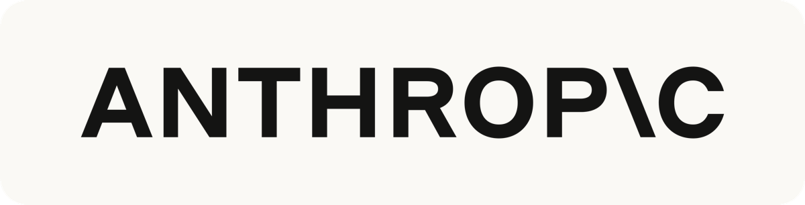
  </a>

  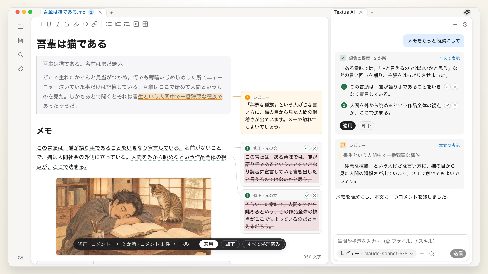 
  夏目漱石『吾輩は猫である』（1905年）

## Textusを入手

無料のオープンソース。MITライセンスで公開しています。

| プラットフォーム          | ダウンロード                                                                                            | その他のインストール方法                                                             |
| ----------------- | ------------------------------------------------------------------------------------------------- | ------------------------------------------------------------------------ |
| macOS · Appleシリコン | [.dmgをダウンロード](https://github.com/CatVinci-Studio/Textus/releases/latest)                         | Homebrew：`brew install --cask textus`                                    |
| macOS · Intel     | [.dmgをダウンロード](https://github.com/CatVinci-Studio/Textus/releases/latest)                         | Homebrew：`brew install --cask textus`                                    |
| Windows · x64     | [.exeをダウンロード](https://github.com/CatVinci-Studio/Textus/releases/latest)                         | —                                                                        |
| Linux · x64       | [.AppImageをダウンロード](https://github.com/CatVinci-Studio/Textus/releases/latest) · .deb · .rpm もあり | Arch Linux：[`[catvinci]` リポジトリ](https://github.com/CatVinci-Studio/arch-repo) |

> iPhone版とiPad版は、まもなくApp Storeで公開します。

ベータ版：**設定 › について** で **アップデートチャンネル** を **ベータ版** にします。

## なぜTextusか

プログラマーにはIDEがあります。コードを書き、確かめ、道具を使うことが一か所にまとまっています。一方で書き手は、コードエディタを借りたり、いくつものアプリを行き来したりしがちです。Textusは、書く作業の全体を一か所にまとめます。

- **共通の言葉としてのMarkdown。** AIの時代、Markdownはただのファイル形式ではありません。人もAIもほかのツールも読めるので、文章がそのあいだを自由に行き来できます。
- **コードではなく、執筆のために。** 下書き、見直し、推敲が主役です。コードエディタに後から足した機能ではありません。
- **執筆のためのAI。** 書いているときは提案を、見直すときはコメントを。修正案は一つずつ採用するか選べます。
- **自分に合った組み合わせで。** 見たまま編集、豊富なプラグイン、同期、毎日の予定まで。必要なものだけ使い、あとは置いておけます。
- **今のノートをそのまま。** Obsidianの保管庫をそのまま開き、Notionから取り込み、Typoraのテーマも使えます。

## 執筆

見たまま、書ける。入力するそばからMarkdownで整い、表、コード、数式、ダイアグラムも扱えます。下書き、ノート、資料を横に並べて開けます。PDF、Word、HTMLなどに書き出せます。

  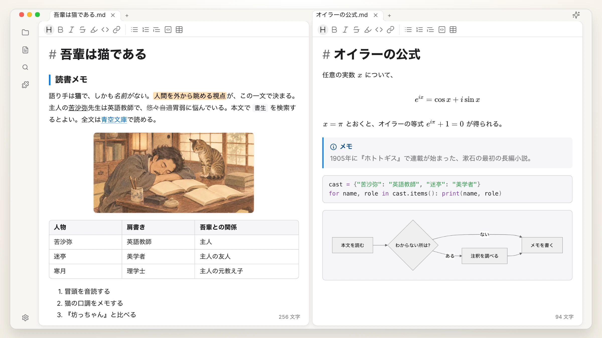

## Textus AI

オンラインのモデルにもローカルのモデルにも対応し、執筆そのものに加わります。

| 続きの提案 | 誤字と文法 |
| :---: | :---: |
| 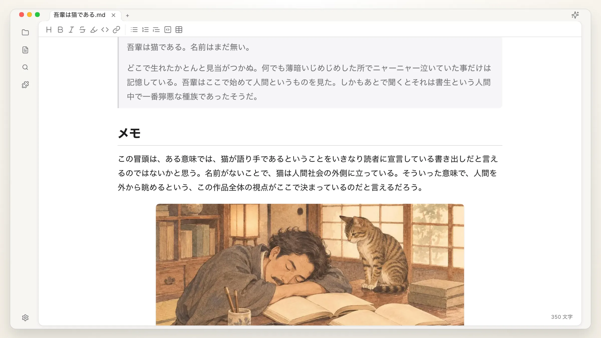 |  |
| **修正の提案** | **レビューコメント** |
| 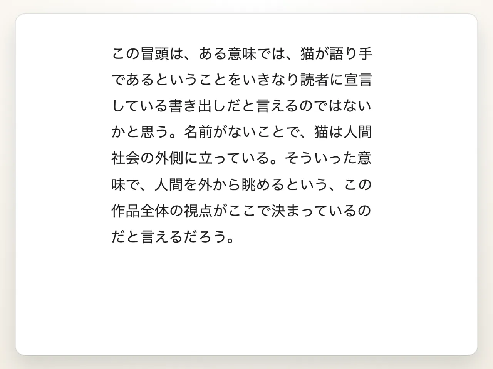 | 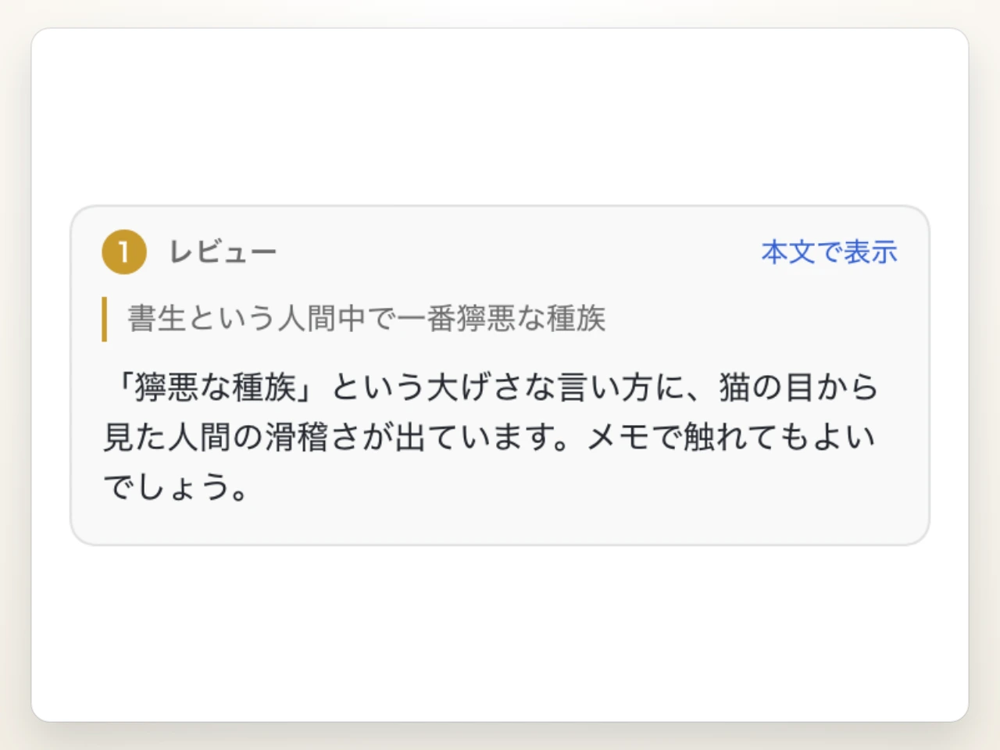 |
| **スラッシュスキル** | **好きなモデルで** |
| 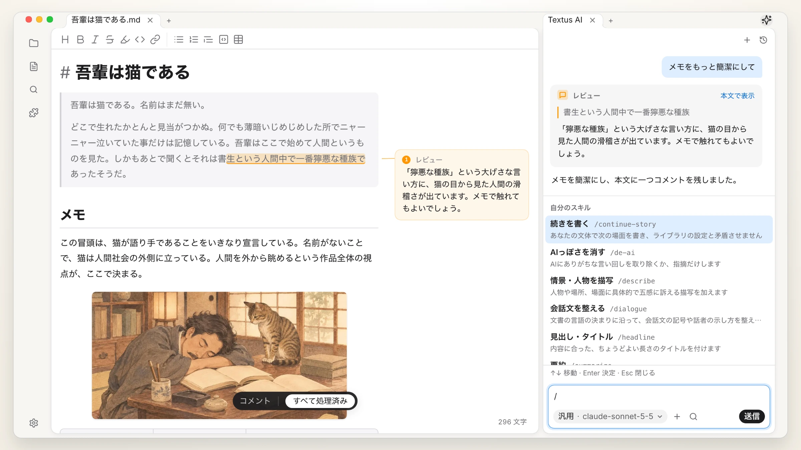 | 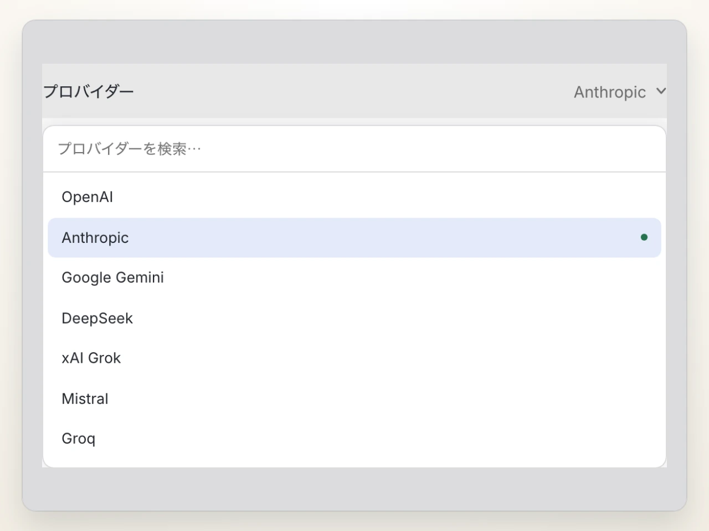 |

さらに使い込むなら、MCPサーバーを接続したり、Claude CodeやCodexをエージェントとしてAIパネルに呼び込んだりできます。

## プラグイン

| グラフビュー | バージョン履歴 |
| :---: | :---: |
| 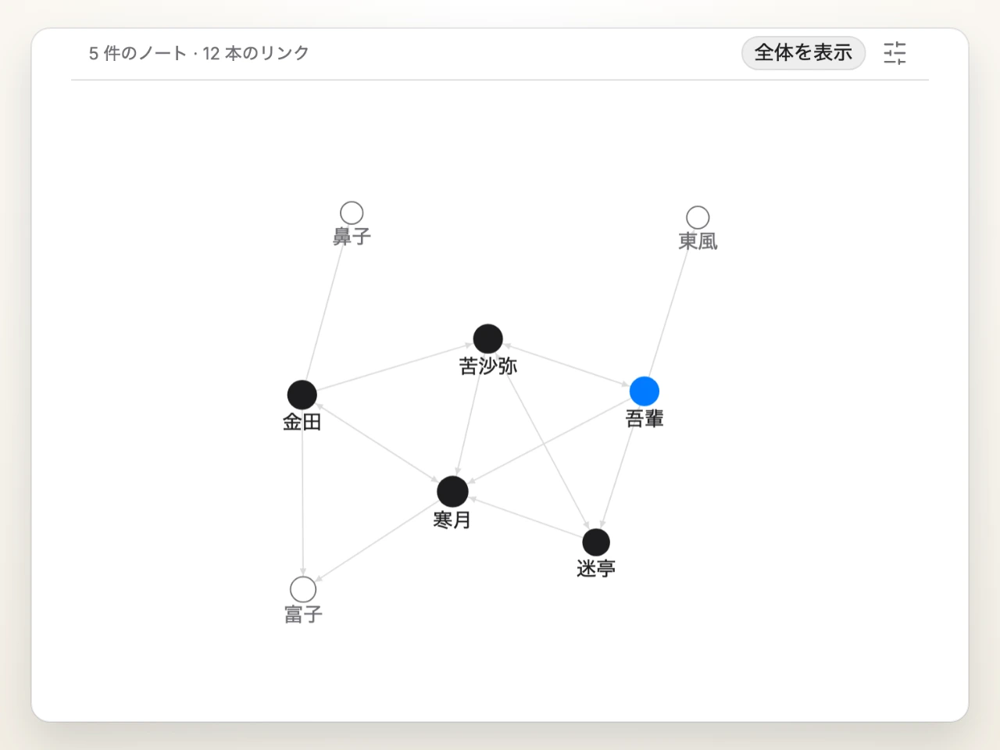 | 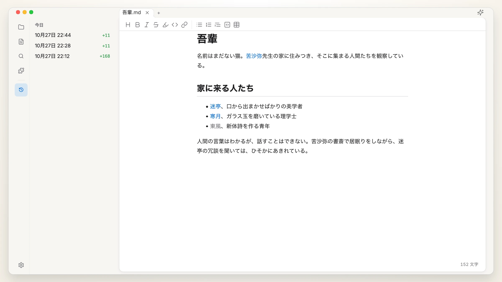 |
| **クイックプレビュー** | **ナレッジベース** |
| 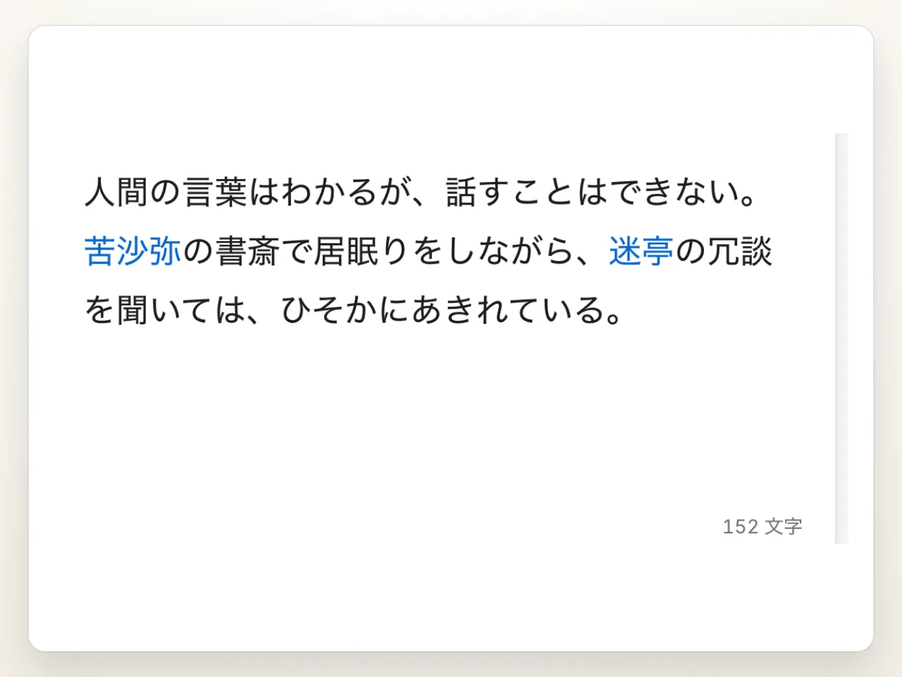 | 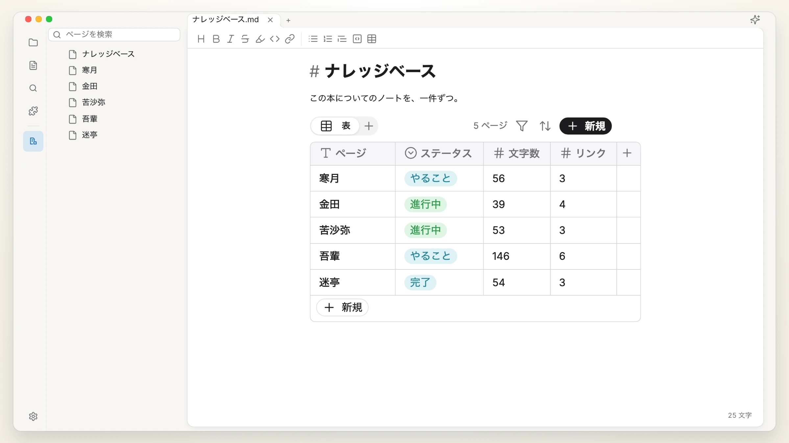 |

ほかのプラグインとテーマ：[textus.md/extensions](https://textus.md/ja/extensions/)。

## スポンサー

Textusは無料のオープンソースです。開発を支えていただけるなら、[スポンサーになってください](https://github.com/CatVinci-Studio/Textus/issues/648)。

**プレミアスポンサー：** [Anthropic](https://www.anthropic.com/)（Anthropic Startup Program を通じて）。

## コミュニティ

Discord、QQ、WeChatで参加できます：[textus.md/community](https://textus.md/ja/community/)。不具合の報告や要望は [GitHub Issues](https://github.com/CatVinci-Studio/Textus/issues) へどうぞ。コードで貢献するなら、まず [CONTRIBUTING.md](CONTRIBUTING.md) をご覧ください。

## よくある質問

<strong>Textusは無料ですか？</strong>

はい、これからもずっと無料です。MITライセンスのオープンソースで、アカウントもサブスクリプションも要りません。Textus AIの利用料は、選んだプロバイダーから直接請求されます。ローカルモデルなら費用はかかりません。

<strong>どの環境で使えますか？</strong>

macOS（AppleシリコンとIntel）、Windows、Linux、そしてApp StoreからiPhoneとiPadで使えます。

<strong>メモリはどれくらい使いますか？</strong>

メモリ使用量はとても重視していて、リリースのたびに計測しています。ウィンドウ1つで約110 MB、ウィンドウを1つ増やすごとに約55 MB増えます。プラグインは使うときだけ読み込まれ、バックグラウンドに置いたWebページは解放されて、戻ったときに読み込み直されます。

<strong>AIのアカウントは必要ですか？</strong>

いいえ。エディタの機能は、AIなしですべて使えます。Textus AIを使うときは、ご自身のプロバイダーを接続します。ChatGPTやClaudeでのサインイン、APIキーの入力、Ollamaによるローカルモデルのどれでも使えます。

<strong>オフラインでも使えますか？</strong>

エディタはすべての機能が使えます。Textus AIにはプロバイダーへの接続が必要ですが、ローカルモデルならオフラインでも動きます。

<strong>普通のMarkdownですか？何に書き出せますか？</strong>

はい、普通の.mdファイルです。表、タスクリスト、脚注、数式、Mermaidに対応し、PDF、Word、HTMLなどに書き出せます。

## スターの推移

<a href="https://star-history.com/#CatVinci-Studio/Textus&Date">
  <picture>
    <source media="(prefers-color-scheme: dark)" srcset="https://api.star-history.com/svg?repos=CatVinci-Studio/Textus&type=Date&theme=dark">
    
  </picture>
</a>

## ライセンス

[MIT](./LICENSE) © CatVinci Studio
