

  

<h1 align="center">Textus</h1>

  <strong>차세대 통합 글쓰기 환경</strong> 
  먹은 AI가 갈고, 붓은 당신이 듭니다.

  <a href="https://textus.md"><strong>웹사이트</strong></a> ·
  <a href="https://github.com/CatVinci-Studio/Textus/releases/latest"><strong>다운로드</strong></a> ·
  <a href="https://github.com/CatVinci-Studio/Textus/issues/648"><strong>후원</strong></a>

  <a href="./README.md">English</a> ·
  <a href="./README.zh.md">简体中文</a> ·
  <a href="./README.zh-Hant.md">繁體中文</a> ·
  <a href="./README.ja.md">日本語</a> ·
  한국어 ·
  <a href="./README.es.md">Español</a> ·
  <a href="./README.fr.md">Français</a> ·
  <a href="./README.de.md">Deutsch</a> ·
  <a href="./README.ru.md">Русский</a> ·
  <a href="./README.pt.md">Português</a>

  
  
  
  
  

  

<strong>프리미어 후원사</strong>

  <a href="https://www.anthropic.com/">
    <picture>
      <source media="(prefers-color-scheme: dark)" srcset="docs/images/readme/sponsors/anthropic-logo-ivory.png">
      
    </picture>
  </a>

Anthropic Startup Program을 통해

  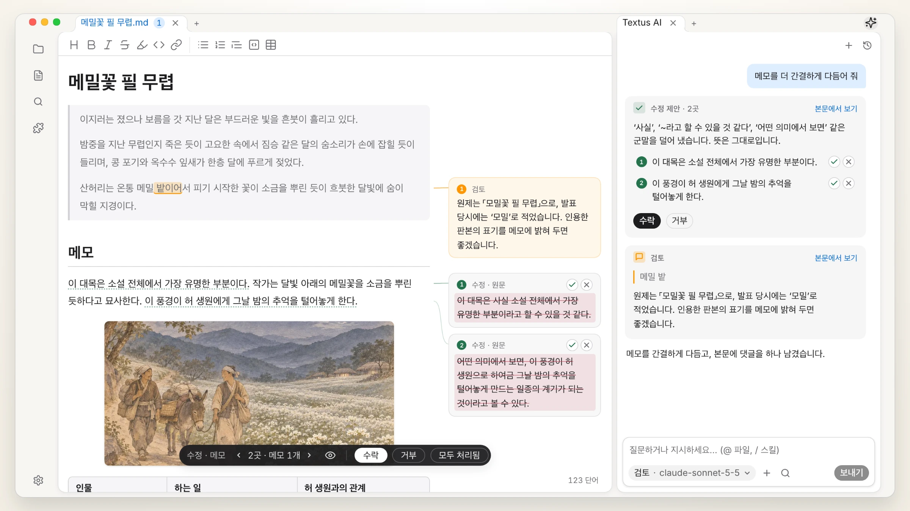 
  이효석, 「메밀꽃 필 무렵」 (1936)

## Textus 시작하기

MIT 라이선스로 공개된 무료 오픈 소스입니다.

| 플랫폼               | 다운로드                                                                                          | 다른 설치 방법                                                                 |
| ----------------- | --------------------------------------------------------------------------------------------- | ------------------------------------------------------------------------ |
| macOS · Apple 실리콘 | [.dmg 다운로드](https://github.com/CatVinci-Studio/Textus/releases/latest)                         | Homebrew: `brew install --cask textus`                                   |
| macOS · Intel     | [.dmg 다운로드](https://github.com/CatVinci-Studio/Textus/releases/latest)                         | Homebrew: `brew install --cask textus`                                   |
| Windows · x64     | [.exe 다운로드](https://github.com/CatVinci-Studio/Textus/releases/latest)                         | —                                                                        |
| Linux · x64       | [.AppImage 다운로드](https://github.com/CatVinci-Studio/Textus/releases/latest) · 또는 .deb · .rpm | Arch Linux: [`[catvinci]` 저장소](https://github.com/CatVinci-Studio/arch-repo) |

> iPhone·iPad 버전이 곧 App Store에 나옵니다.

베타: **설정 › 정보**에서 **업데이트 채널**을 **베타**로 바꾸세요.

## 왜 Textus인가

프로그래머에게는 IDE가 있습니다. 코드를 쓰고, 확인하고, 도구를 쓰는 일이 한곳에 모여 있습니다. 반면 글 쓰는 사람은 코드 편집기를 빌려 쓰거나 여러 앱을 오가기 일쑤입니다. Textus는 글쓰기의 전 과정을 한곳에 모읍니다.

- **공통 언어로서의 Markdown.** AI 시대의 Markdown은 단순한 파일 형식이 아닙니다. 사람도, AI도, 다른 도구도 읽을 수 있어서 글이 그 사이를 자유롭게 오갑니다.
- **코드가 아니라 글쓰기를 중심으로.** 초안, 검토, 퇴고가 주인공입니다. 코드 편집기에 덧붙인 기능이 아닙니다.
- **글쓰기를 위한 AI.** 쓰는 동안에는 제안을, 검토할 때는 댓글을 줍니다. 수정안은 하나씩 받아들이거나 거절할 수 있습니다.
- **원하는 대로 구성.** 보이는 그대로 편집, 다양한 플러그인, 동기화, 하루 일정까지. 필요한 것만 쓰고 나머지는 두면 됩니다.
- **지금 쓰는 노트를 그대로.** Obsidian 보관소를 그대로 열고, Notion에서 가져오고, Typora 테마를 쓸 수 있습니다.

## 글쓰기

보이는 그대로, 입력하는 대로 Markdown 서식이 잡힙니다. 표, 코드, 수식, 다이어그램을 모두 다루고, 초안과 노트와 자료를 나란히 펼쳐 둘 수 있습니다. PDF, Word, HTML 등으로 내보낼 수 있습니다.

  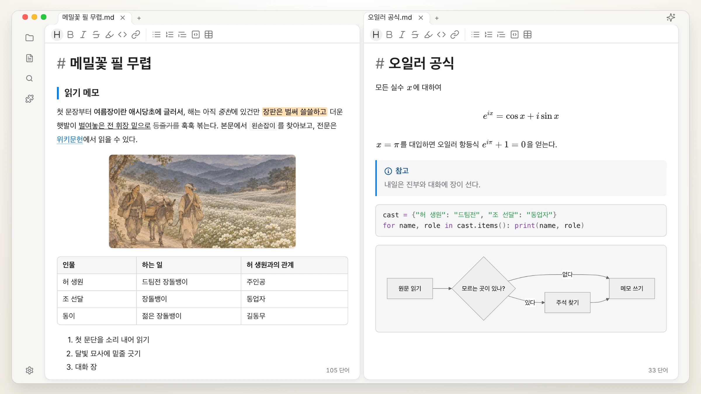

## Textus AI

온라인 모델과 로컬 모델 모두에서 작동하며, 글쓰기 자체에 함께합니다.

| 이어 쓰기 | 오타와 문법 |
| :---: | :---: |
| 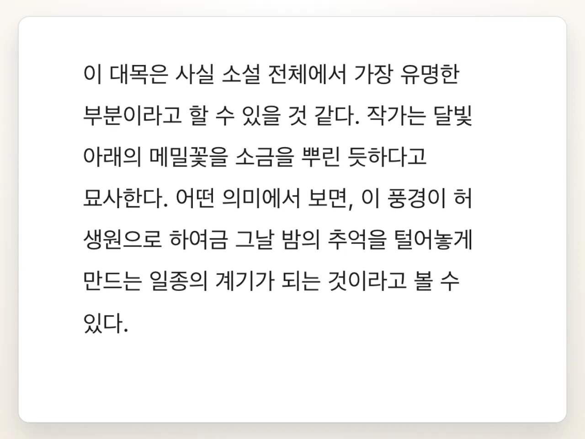 |  |
| **수정 제안** | **검토 댓글** |
| 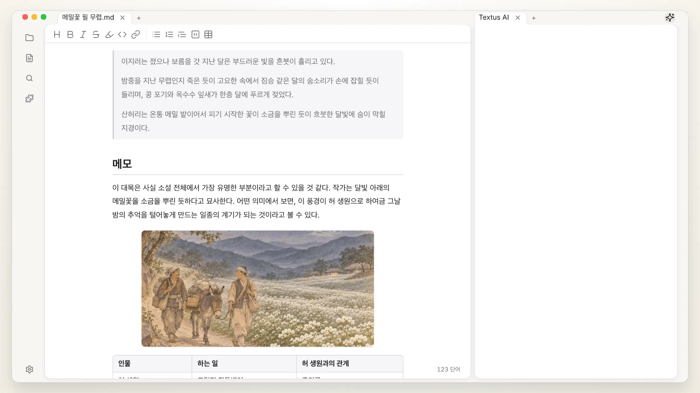 | 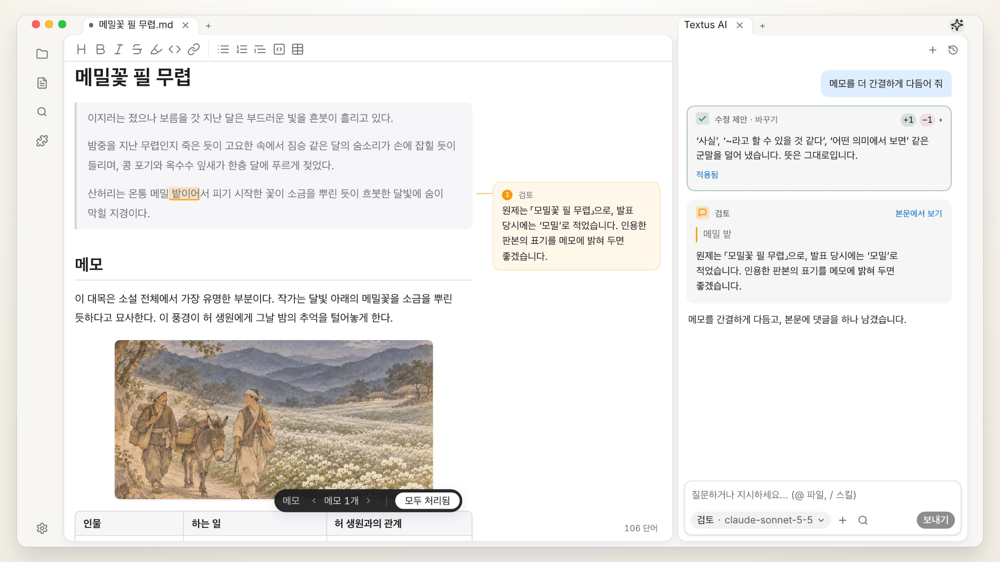 |
| **슬래시 스킬** | **원하는 모델** |
| 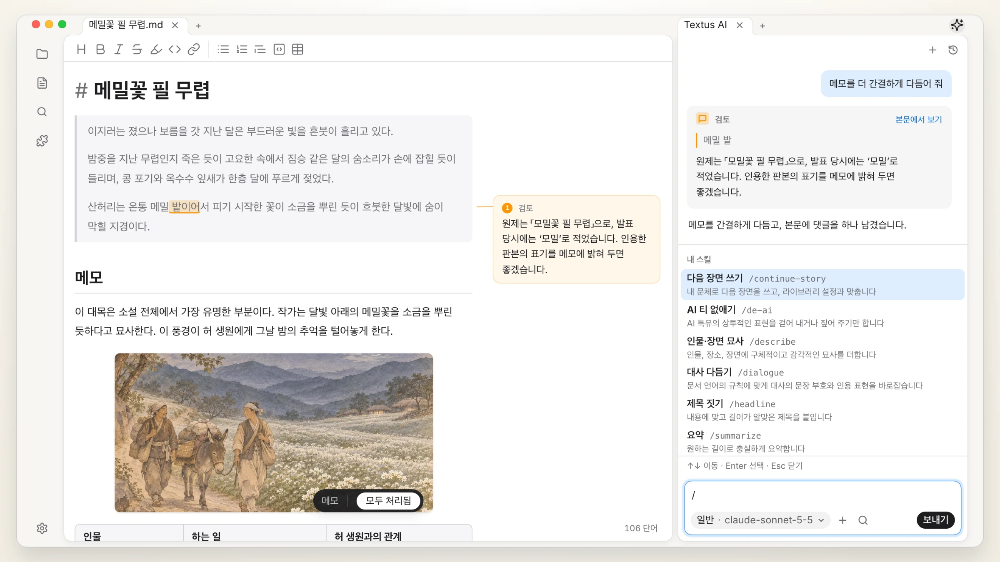 | 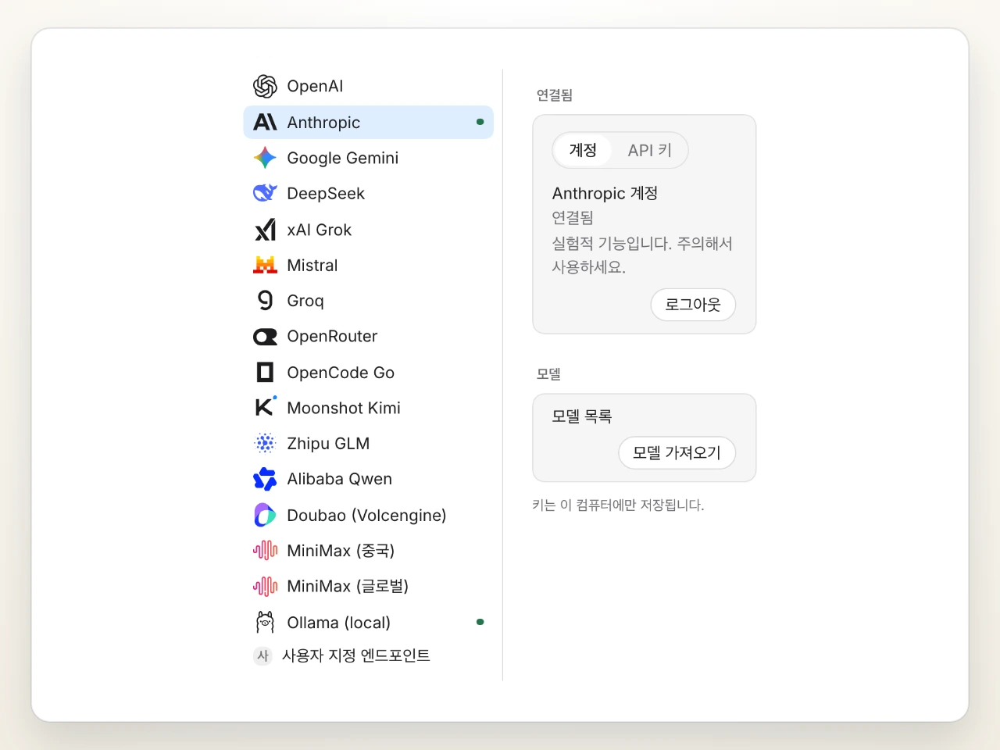 |

더 깊이 쓰려면 MCP 서버를 연결하거나, Claude Code와 Codex를 에이전트로 AI 패널에 불러올 수 있습니다.

## 플러그인

| 그래프 보기 | 버전 기록 |
| :---: | :---: |
| 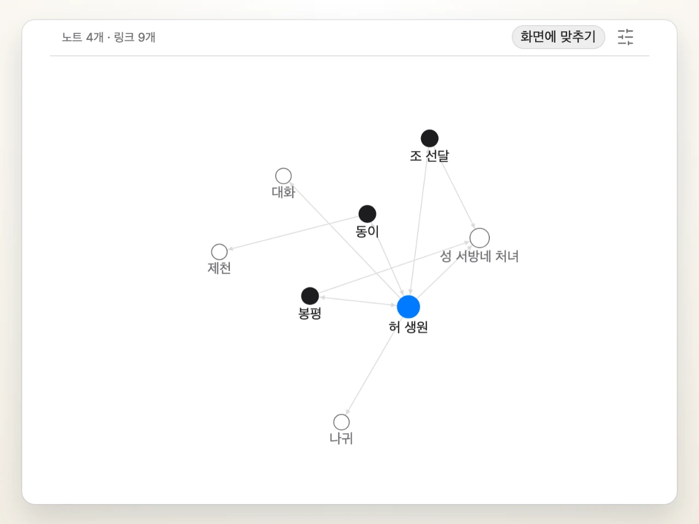 | 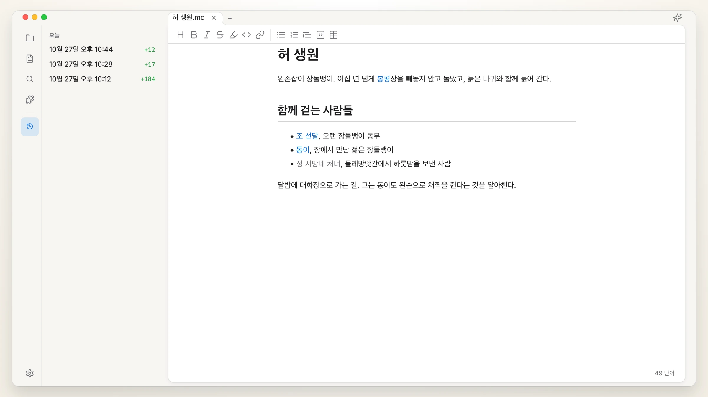 |
| **빠른 미리보기** | **지식 베이스** |
| 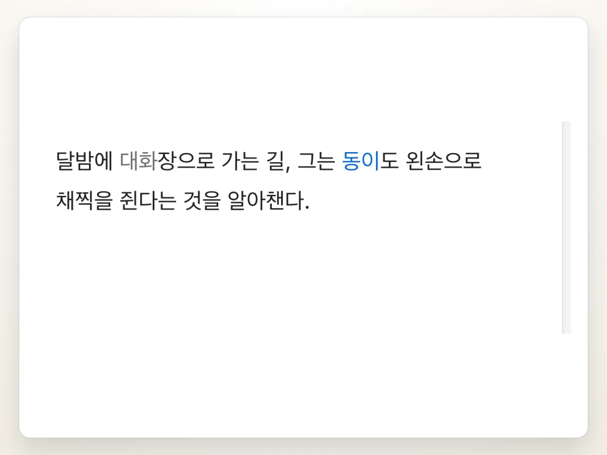 | 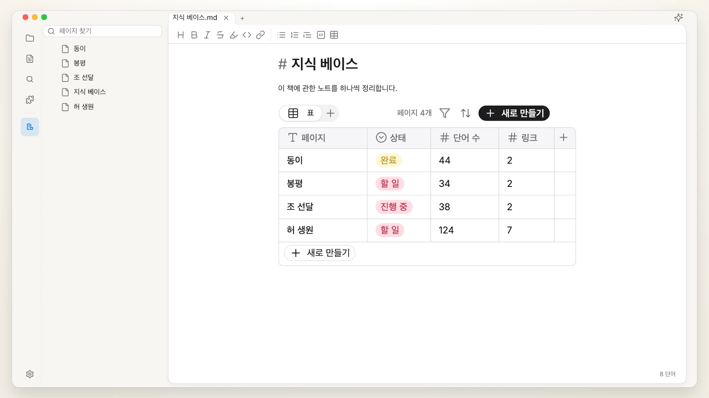 |

더 많은 플러그인과 테마: [textus.md/extensions](https://textus.md/ko/extensions/).

## 후원

**프리미어 후원사:** [Anthropic](https://www.anthropic.com/), Anthropic Startup Program을 통해.

Textus는 무료 오픈 소스입니다. 개발을 응원하고 싶다면 [후원해 주세요](https://github.com/CatVinci-Studio/Textus/issues/648).

## 커뮤니티

Discord, QQ, WeChat에서 함께하세요: [textus.md/community](https://textus.md/ko/community/). 버그 제보와 기능 제안은 [GitHub Issues](https://github.com/CatVinci-Studio/Textus/issues)에 남겨 주세요. 코드로 기여하려면 [CONTRIBUTING.md](CONTRIBUTING.md)부터 읽어 주세요.

## 자주 묻는 질문

<strong>Textus는 무료인가요?</strong>

네, 앞으로도 계속 무료입니다. MIT 라이선스의 오픈 소스이며, 계정도 구독도 필요 없습니다. Textus AI 사용료는 선택한 제공업체가 직접 청구하고, 로컬 모델은 비용이 들지 않습니다.

<strong>어떤 운영체제에서 쓸 수 있나요?</strong>

macOS(Apple 실리콘·Intel), Windows, Linux, 그리고 App Store를 통해 iPhone·iPad에서 쓸 수 있습니다.

<strong>메모리는 얼마나 쓰나요?</strong>

저희는 메모리 사용량을 매우 중요하게 여기고, 릴리스마다 측정합니다. 창 하나에 약 110 MB, 창을 하나 더 열 때마다 약 55 MB가 늘어납니다. 플러그인은 쓸 때만 불러오고, 백그라운드에 둔 웹 페이지는 메모리에서 내려졌다가 다시 돌아오면 새로 불러옵니다.

<strong>AI 계정이 필요한가요?</strong>

아니요. 편집기의 모든 기능은 AI 없이도 쓸 수 있습니다. Textus AI를 쓰려면 제공업체를 직접 연결하세요. ChatGPT나 Claude 계정으로 로그인하거나, API 키를 입력하거나, Ollama로 로컬 모델을 실행하면 됩니다.

<strong>인터넷 없이도 쓸 수 있나요?</strong>

편집기는 완전히 오프라인으로 작동합니다. Textus AI는 제공업체와 연결되어야 하지만, 로컬 모델을 쓰면 인터넷이 필요 없습니다.

<strong>일반 Markdown인가요? 어떤 형식으로 내보낼 수 있나요?</strong>

네. 일반 .md 파일이며 표, 할 일 목록, 각주, 수식, Mermaid를 지원합니다. PDF, Word, HTML 등으로 내보낼 수 있습니다.

## 스타 추이

<a href="https://star-history.com/#CatVinci-Studio/Textus&Date">
  <picture>
    <source media="(prefers-color-scheme: dark)" srcset="https://api.star-history.com/svg?repos=CatVinci-Studio/Textus&type=Date&theme=dark">
    
  </picture>
</a>

## 라이선스

[MIT](./LICENSE) © CatVinci Studio
