<!-- The English README is the reference: every README.<lang>.md follows its
     structure section by section (scripts/check-readmes.mjs). -->

  

<h1 align="center">Textus</h1>

  <strong>The next-generation Integrated Writing Environment.</strong> 
  AI keeps your ink flowing. You hold the pen.

  <a href="https://textus.md"><strong>Website</strong></a> ·
  <a href="https://github.com/CatVinci-Studio/Textus/releases/latest"><strong>Download</strong></a> ·
  <a href="https://github.com/CatVinci-Studio/Textus/issues/648"><strong>Sponsor</strong></a>

  English ·
  <a href="./README.zh.md">简体中文</a> ·
  <a href="./README.zh-Hant.md">繁體中文</a> ·
  <a href="./README.ja.md">日本語</a> ·
  <a href="./README.ko.md">한국어</a> ·
  <a href="./README.es.md">Español</a> ·
  <a href="./README.fr.md">Français</a> ·
  <a href="./README.de.md">Deutsch</a> ·
  <a href="./README.ru.md">Русский</a> ·
  <a href="./README.pt.md">Português</a>

  
  
  
  
  

  

<strong>Premier Sponsor</strong>

  

through the Anthropic Startup Program

Sponsors: <a href="https://github.com/jzzzzh"> Jiang Zhuohang</a>

  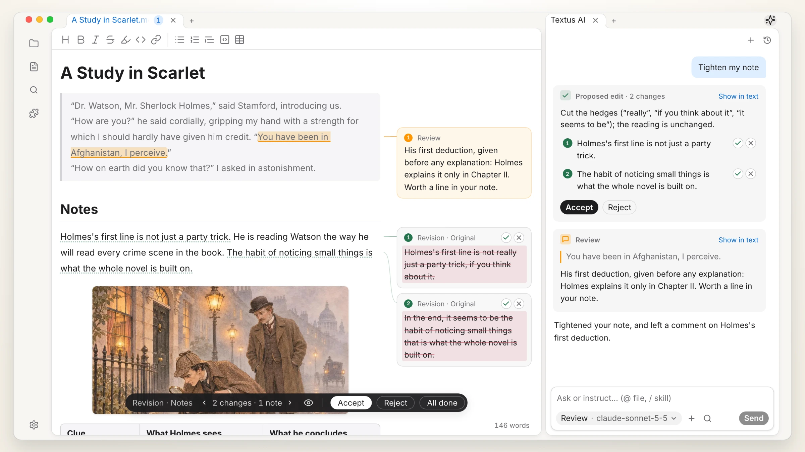 
  <i>A Study in Scarlet</i>, Arthur Conan Doyle (1887)

## Get Textus

Free and open source, under the MIT license.

| Platform              | Download                                                                                              | Other ways to install                                                               |
| --------------------- | ----------------------------------------------------------------------------------------------------- | ----------------------------------------------------------------------------------- |
| macOS · Apple Silicon | [Download .dmg](https://github.com/CatVinci-Studio/Textus/releases/latest)                            | Homebrew: `brew install --cask textus`                                              |
| macOS · Intel         | [Download .dmg](https://github.com/CatVinci-Studio/Textus/releases/latest)                            | Homebrew: `brew install --cask textus`                                              |
| Windows · x64         | [Download .exe](https://github.com/CatVinci-Studio/Textus/releases/latest)                            | —                                                                                   |
| Linux · x64           | [Download .AppImage](https://github.com/CatVinci-Studio/Textus/releases/latest) · Also as .deb · .rpm | Arch Linux: the [`[catvinci]` repository](https://github.com/CatVinci-Studio/arch-repo) |

> iPhone and iPad: on the App Store soon.

Beta: in **Settings › About**, set **Update channel** to **Beta**.

## Why Textus

Programmers have IDEs: one place where writing code, checking it and their tools come together. Writers usually borrow a code editor or juggle several apps. Textus brings the whole writing process into one place.

- **Markdown as the common language.** In the AI era, Markdown is more than a file format: people, AI and other tools all read it, so your work moves freely between them.
- **Built around writing, not code.** Drafting, reviewing and revising come first, not features added to a code editor.
- **AI made for writing.** Suggestions while you write, comments while you review, and revisions you accept or reject one by one.
- **Arranged your way.** WYSIWYG editing, a rich plugin system, sync, even your daily plans: take what you need and leave the rest.
- **Comes with your notes.** Open an Obsidian vault as it is, import from Notion, and use Typora themes.

## Writing

What you see is what you get: Markdown laid out as you type, with tables, code, math and diagrams, and drafts, notes and sources side by side. Export to PDF, Word, HTML and more.

  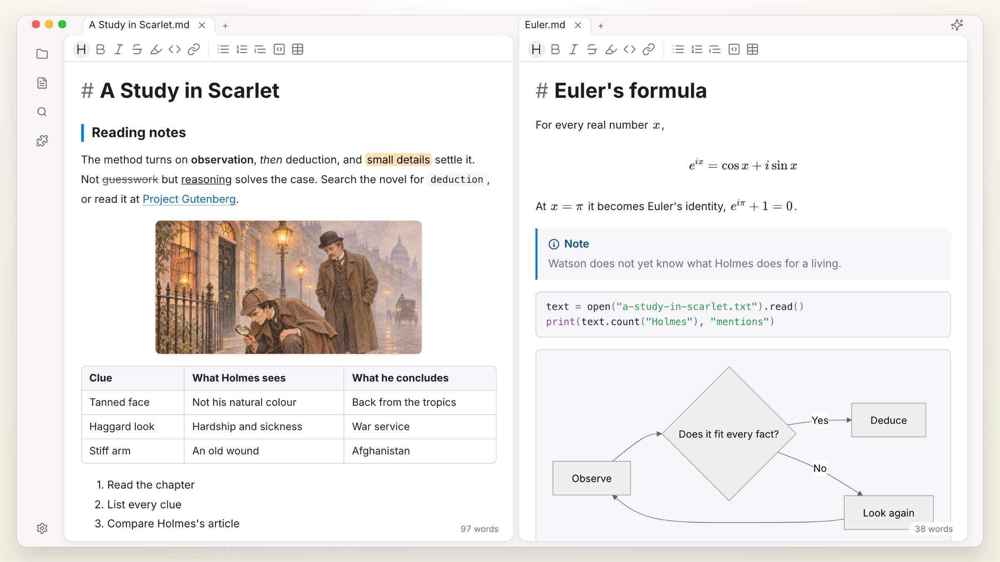

## Textus AI

Works with online and local models, and joins the writing itself.

| Continuation | Typos and grammar |
| :---: | :---: |
| 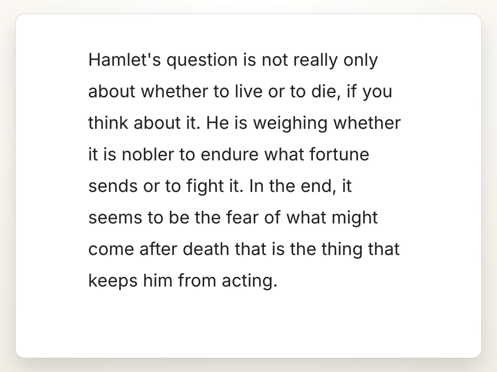 |  |
| **Proposed edits** | **Review comments** |
| 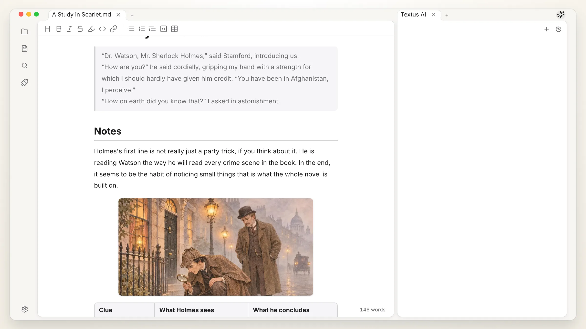 | 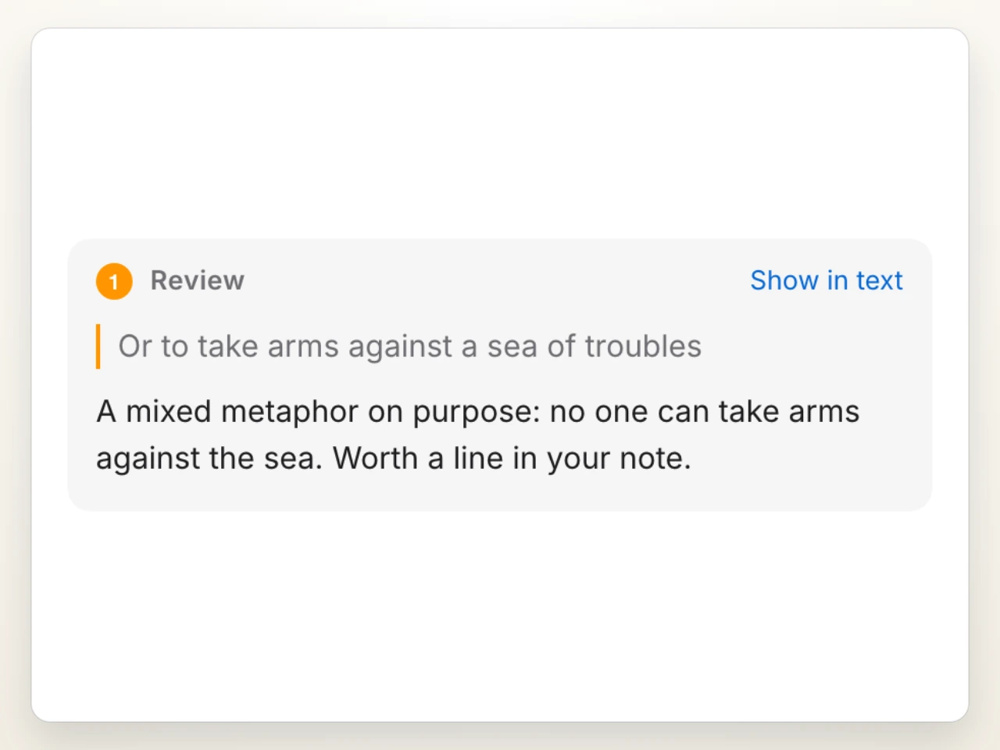 |
| **Slash skills** | **Any model** |
| 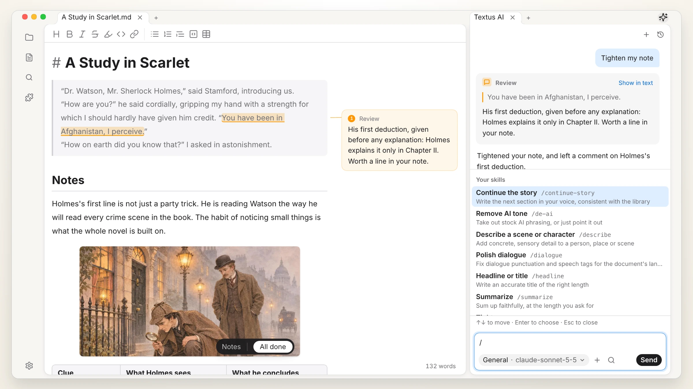 | 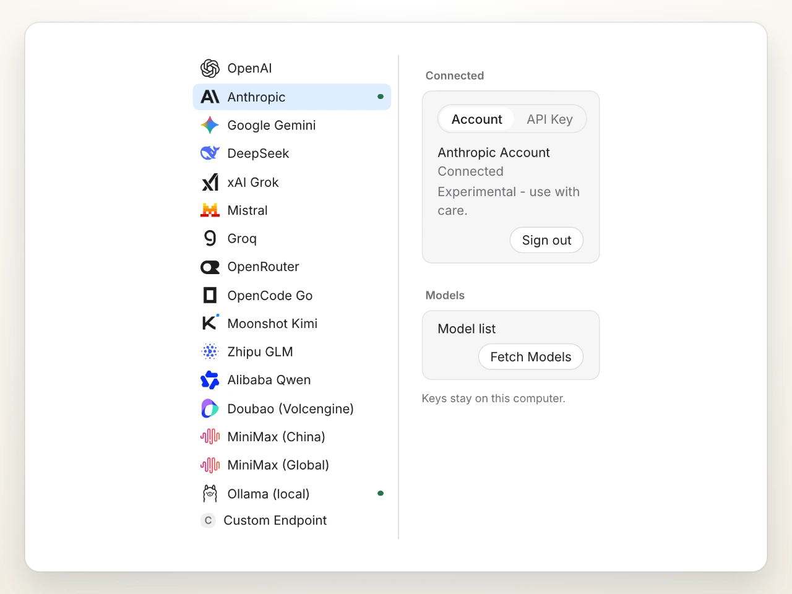 |

For advanced use, connect MCP servers, or bring Claude Code and Codex into the AI panel as agents.

## Plugins

| Graph View | Version History |
| :---: | :---: |
| 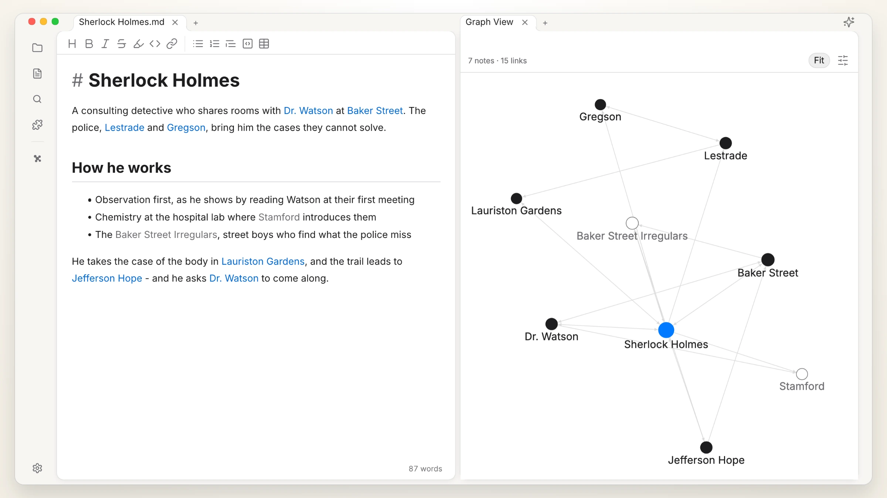 | 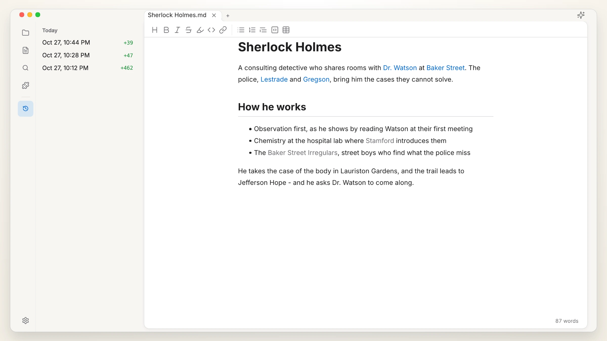 |
| **Quick Preview** | **Knowledge Base** |
| 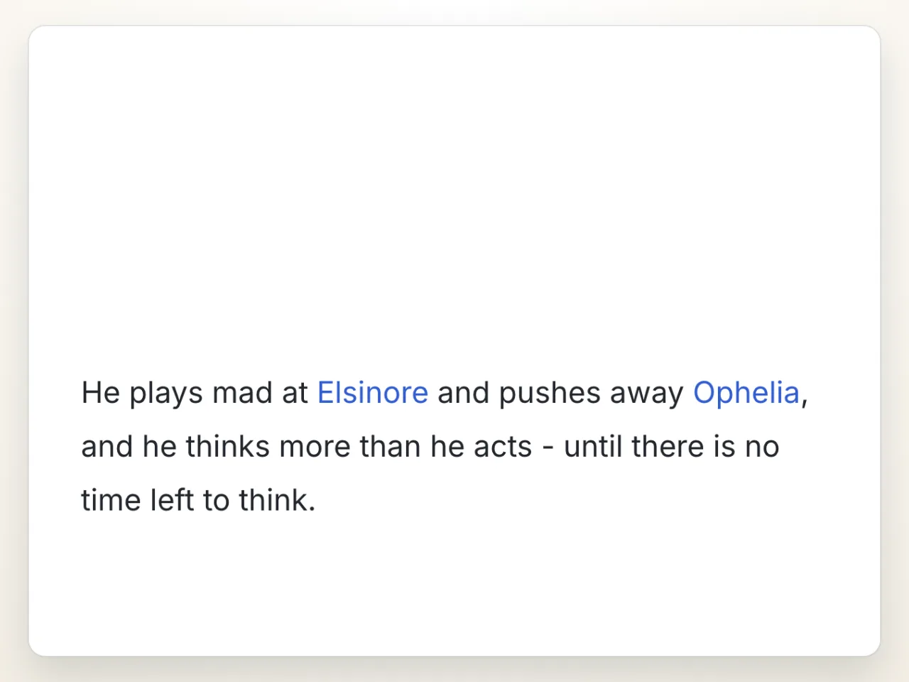 | 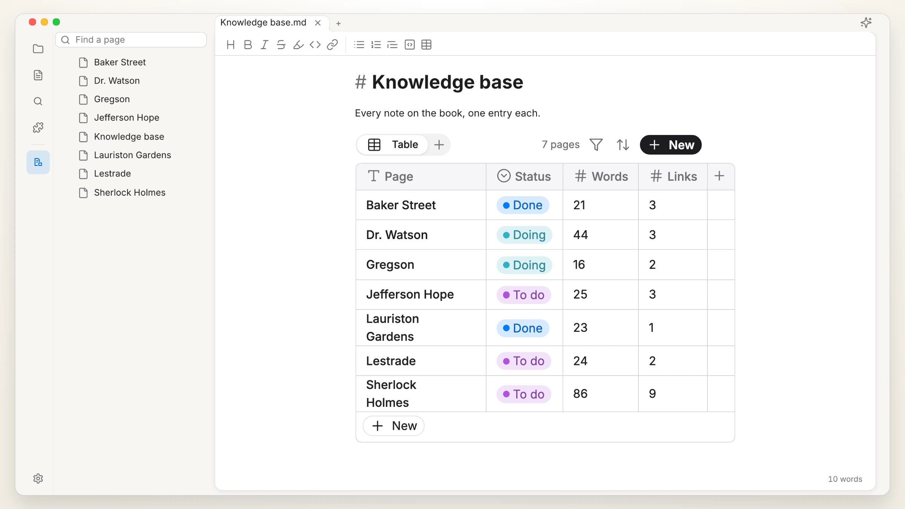 |

More plugins and themes: [textus.md/extensions](https://textus.md/extensions/).

## Sponsors

**Premier Sponsor:** [Anthropic](https://www.anthropic.com/), through the Anthropic Startup Program.

**Sponsors:** [Jiang Zhuohang](https://github.com/jzzzzh)

Textus is free and open source. [Sponsor us](https://github.com/CatVinci-Studio/Textus/issues/648) to support its development.

## Community

Join us on Discord, QQ or WeChat: [textus.md/community](https://textus.md/community/). Bug reports and feature requests are welcome in [GitHub Issues](https://github.com/CatVinci-Studio/Textus/issues). To contribute code, start with [CONTRIBUTING.md](CONTRIBUTING.md).

## Questions

<strong>Is Textus free?</strong>

Yes, and it always will be. It is open source under the MIT license, with no account and no subscription. If you use Textus AI, your provider bills you directly, or not at all with a local model.

<strong>Which platforms does it run on?</strong>

macOS (Apple Silicon and Intel), Windows and Linux, and iPhone and iPad from the App Store.

<strong>How much memory does it use?</strong>

We care a great deal about memory and measure it in every release. A window takes about 110 MB, and each further window about 55 MB more. Plugins load only when they are used, and a web page left in the background is let go and loads again when you come back to it.

<strong>Do I need an AI account?</strong>

No. The editor works fully without AI. For Textus AI, connect a provider of your own: sign in with ChatGPT or Claude, add an API key, or run a local model with Ollama.

<strong>Does it work offline?</strong>

The editor does, completely. Textus AI needs your provider, unless you run a local model.

<strong>Is it plain Markdown? What can I export?</strong>

Yes: plain .md files, with tables, task lists, footnotes, math and Mermaid. You can export to PDF, Word, HTML and more.

## Star history

<a href="https://star-history.com/#CatVinci-Studio/Textus&Date">
  <picture>
    <source media="(prefers-color-scheme: dark)" srcset="https://api.star-history.com/svg?repos=CatVinci-Studio/Textus&type=Date&theme=dark">
    
  </picture>
</a>

## License

[MIT](./LICENSE) © CatVinci Studio
