

  

<h1 align="center">Textus</h1>

  <strong>O ambiente integrado de escrita de nova geração.</strong> 
  A IA mantém a tinta fluindo. A caneta é sua.

  <a href="https://textus.md"><strong>Site</strong></a> ·
  <a href="https://github.com/CatVinci-Studio/Textus/releases/latest"><strong>Baixar</strong></a> ·
  <a href="https://github.com/CatVinci-Studio/Textus/issues/648"><strong>Apoiar</strong></a>

  <a href="./README.md">English</a> ·
  <a href="./README.zh.md">简体中文</a> ·
  <a href="./README.zh-Hant.md">繁體中文</a> ·
  <a href="./README.ja.md">日本語</a> ·
  <a href="./README.ko.md">한국어</a> ·
  <a href="./README.es.md">Español</a> ·
  <a href="./README.fr.md">Français</a> ·
  <a href="./README.de.md">Deutsch</a> ·
  <a href="./README.ru.md">Русский</a> ·
  Português

  
  
  
  
  

  

<strong>Patrocinador principal</strong>

  

pelo Anthropic Startup Program

Patrocinadores: <a href="https://github.com/jzzzzh"> Jiang Zhuohang</a>

  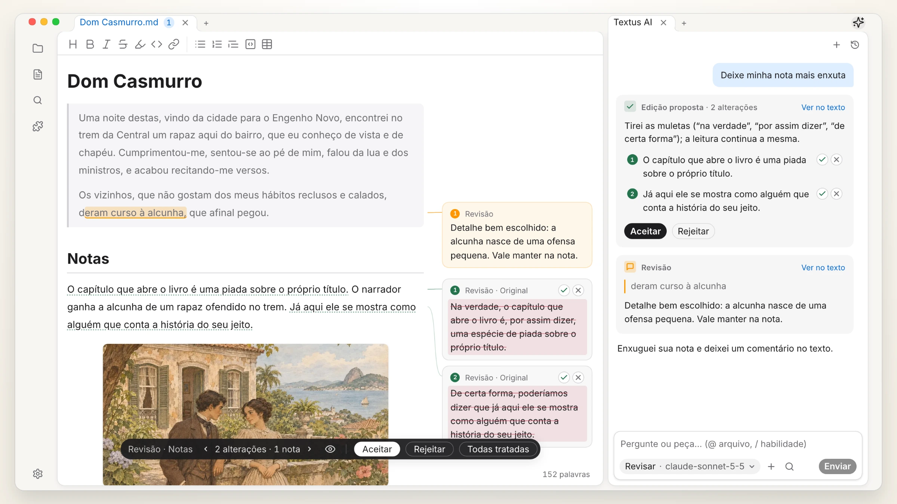 
  <i>Dom Casmurro</i>, Machado de Assis (1899)

## Baixe o Textus

Gratuito e de código aberto, sob a licença MIT.

| Plataforma            | Baixar                                                                                                  | Outras formas de instalar                                                            |
| --------------------- | ------------------------------------------------------------------------------------------------------- | ------------------------------------------------------------------------------------ |
| macOS · Apple Silicon | [Baixar o .dmg](https://github.com/CatVinci-Studio/Textus/releases/latest)                              | Homebrew: `brew install --cask textus`                                               |
| macOS · Intel         | [Baixar o .dmg](https://github.com/CatVinci-Studio/Textus/releases/latest)                              | Homebrew: `brew install --cask textus`                                               |
| Windows · x64         | [Baixar o .exe](https://github.com/CatVinci-Studio/Textus/releases/latest)                              | —                                                                                    |
| Linux · x64           | [Baixar o .AppImage](https://github.com/CatVinci-Studio/Textus/releases/latest) · Também em .deb · .rpm | Arch Linux: o [repositório `[catvinci]`](https://github.com/CatVinci-Studio/arch-repo) |

> iPhone e iPad: em breve na App Store.

Beta: em **Ajustes › Sobre**, mude o **Canal de atualização** para **Beta**.

## Por que o Textus

Programadores têm IDEs: um só lugar onde escrever código, conferi-lo e usar suas ferramentas. Quem escreve costuma pegar emprestado um editor de código ou alternar entre vários aplicativos. O Textus reúne todo o processo de escrita em um só lugar.

- **Markdown como língua comum.** Na era da IA, o Markdown é mais que um formato de arquivo: pessoas, IA e outras ferramentas leem igualmente, e seu trabalho circula livremente entre eles.
- **Feito para a escrita, não para o código.** Rascunhar, revisar e reescrever vêm em primeiro lugar, e não como recursos acrescentados a um editor de código.
- **IA feita para escrever.** Sugestões enquanto você escreve, comentários enquanto revisa e alterações que você aceita ou recusa uma a uma.
- **Do seu jeito.** Edição WYSIWYG, um sistema de plugins rico, sincronização e até seus planos do dia: use o que precisar e deixe o resto.
- **Suas notas vêm junto.** Abra um cofre do Obsidian como está, importe do Notion e use temas do Typora.

## Escrita

O que você vê é o que você obtém: o Markdown é formatado enquanto você digita, com tabelas, código, fórmulas e diagramas, e rascunhos, notas e fontes lado a lado. Exporte para PDF, Word, HTML e mais.

  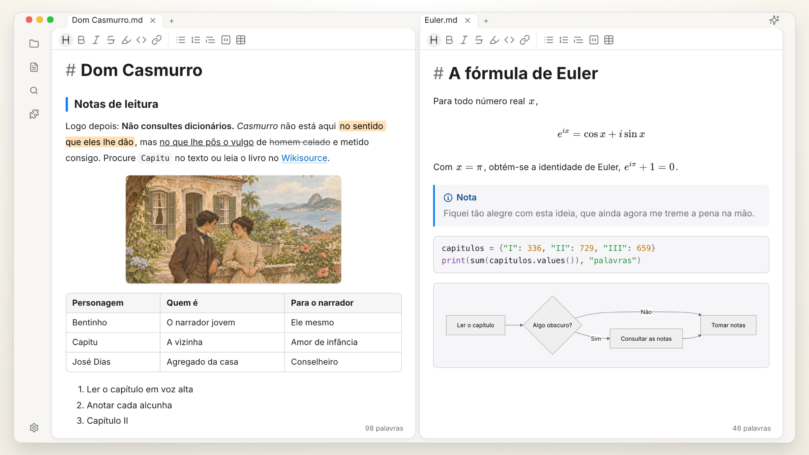

## Textus AI

Funciona com modelos online e locais, e participa da própria escrita.

| Continuação | Erros de digitação e gramática |
| :---: | :---: |
| 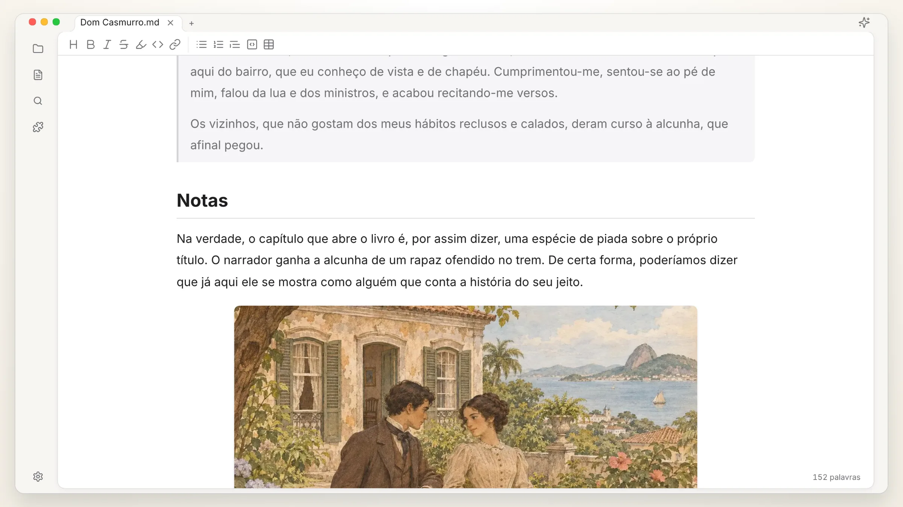 |  |
| **Edições propostas** | **Comentários de revisão** |
| 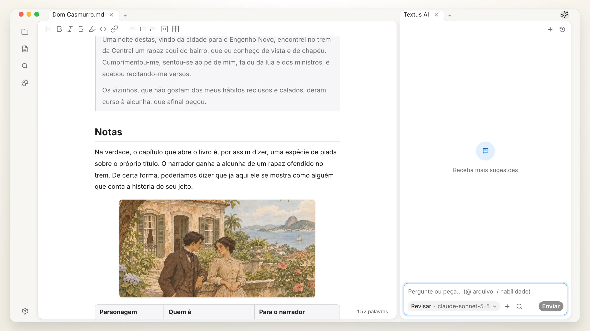 | 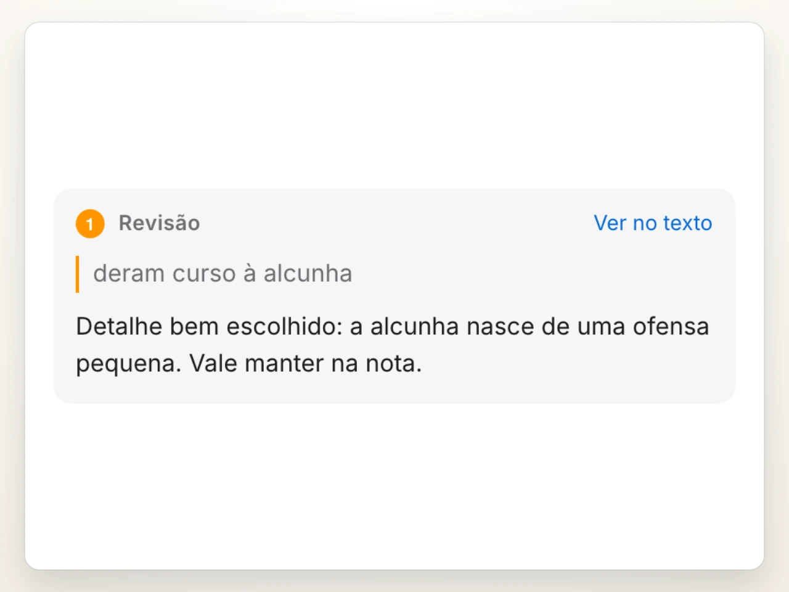 |
| **Habilidades com /** | **Qualquer modelo** |
| 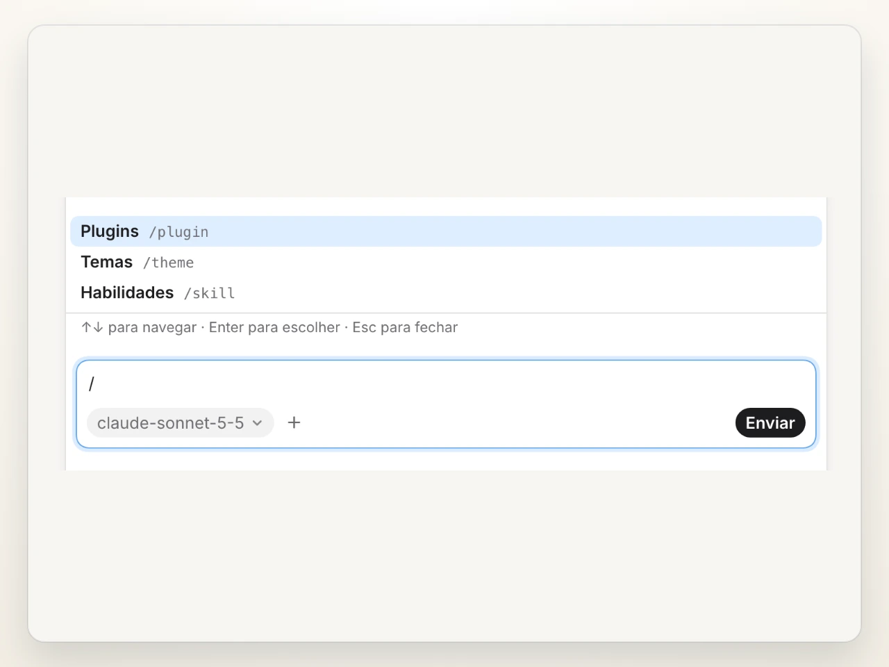 | 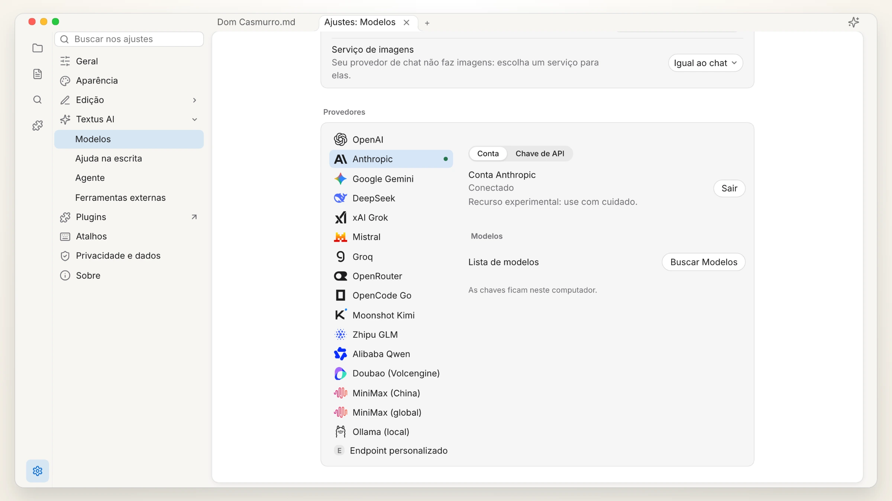 |

Para usos avançados, conecte servidores MCP ou traga o Claude Code e o Codex para o painel de IA como agentes.

## Plugins

| Visão de grafo | Histórico de versões |
| :---: | :---: |
| 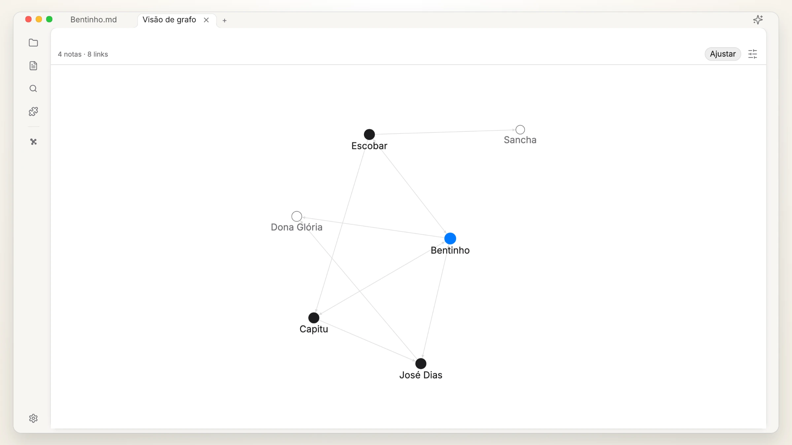 | 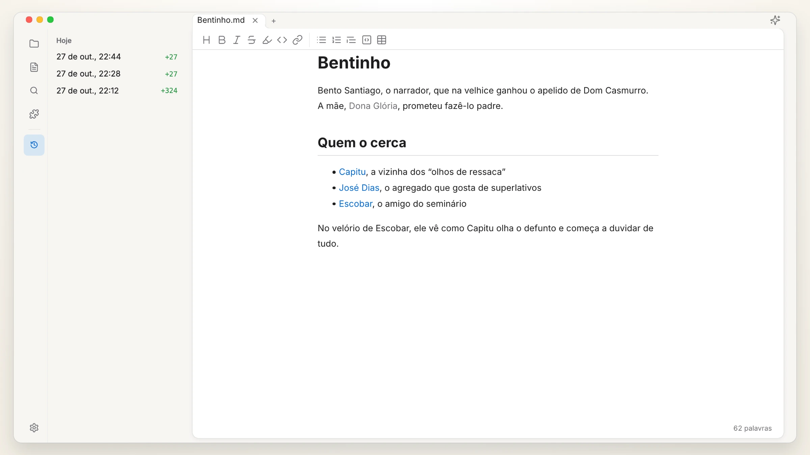 |
| **Prévia rápida** | **Base de conhecimento** |
| 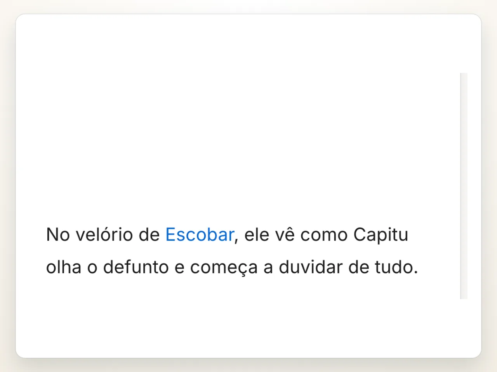 | 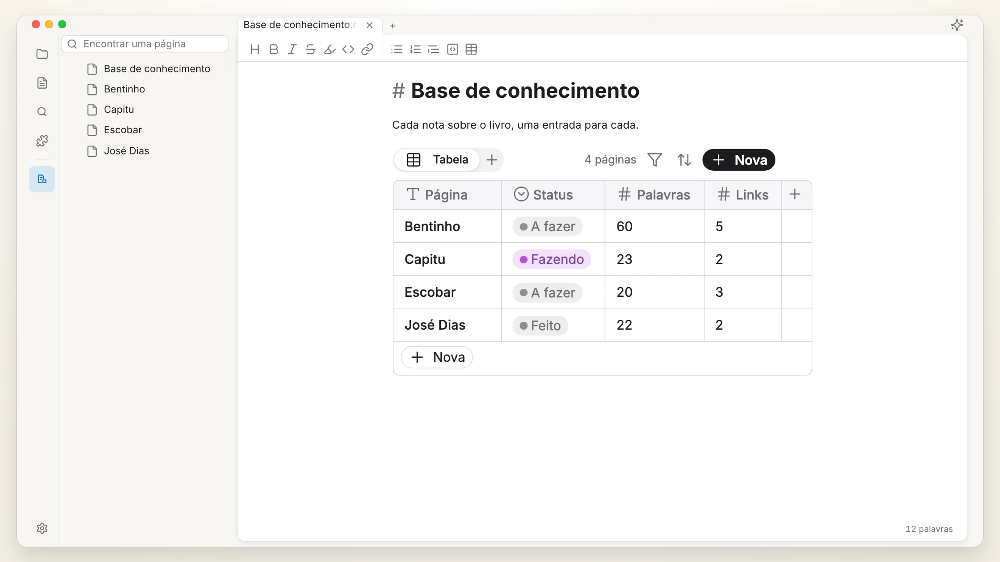 |

Mais plugins e temas: [textus.md/extensions](https://textus.md/pt/extensions/).

## Patrocinadores

**Patrocinador principal:** [Anthropic](https://www.anthropic.com/), pelo Anthropic Startup Program.

**Patrocinadores:** [Jiang Zhuohang](https://github.com/jzzzzh)

O Textus é gratuito e de código aberto. [Apoie-nos](https://github.com/CatVinci-Studio/Textus/issues/648) para ajudar no seu desenvolvimento.

## Comunidade

Junte-se a nós no Discord, QQ ou WeChat: [textus.md/community](https://textus.md/pt/community/). Relatos de bugs e sugestões são bem-vindos nas [GitHub Issues](https://github.com/CatVinci-Studio/Textus/issues). Para contribuir com código, comece por [CONTRIBUTING.md](CONTRIBUTING.md) (em inglês).

## Perguntas frequentes

<strong>O Textus é gratuito?</strong>

Sim, e sempre será. É de código aberto sob a licença MIT, sem conta e sem assinatura. Se você usar o Textus AI, seu provedor cobra diretamente de você, ou nada, com um modelo local.

<strong>Em quais plataformas ele roda?</strong>

macOS (Apple Silicon e Intel), Windows e Linux, além de iPhone e iPad pela App Store.

<strong>Quanta memória ele usa?</strong>

Nos importamos muito com memória e a medimos em cada versão. Uma janela ocupa cerca de 110 MB, e cada janela a mais, cerca de 55 MB. Os plugins só carregam quando são usados, e uma página web deixada em segundo plano é liberada e carrega de novo quando você volta a ela.

<strong>Preciso de uma conta de IA?</strong>

Não. O editor funciona por completo sem IA. Para o Textus AI, conecte um provedor seu: entre com o ChatGPT ou o Claude, adicione uma chave de API ou rode um modelo local com o Ollama.

<strong>Funciona offline?</strong>

O editor, sim, por completo. O Textus AI precisa do seu provedor, a menos que você rode um modelo local.

<strong>É Markdown comum? Para quais formatos posso exportar?</strong>

Sim: arquivos .md simples, com tabelas, listas de tarefas, notas de rodapé, fórmulas e Mermaid. Você pode exportar para PDF, Word, HTML e mais.

## Histórico de estrelas

<a href="https://star-history.com/#CatVinci-Studio/Textus&Date">
  <picture>
    <source media="(prefers-color-scheme: dark)" srcset="https://api.star-history.com/svg?repos=CatVinci-Studio/Textus&type=Date&theme=dark">
    
  </picture>
</a>

## Licença

[MIT](./LICENSE) © CatVinci Studio
