

  

<h1 align="center">Textus</h1>

  <strong>Интегрированная среда для письма нового поколения.</strong> 
  ИИ подливает чернила. Перо — в ваших руках.

  <a href="https://textus.md"><strong>Сайт</strong></a> ·
  <a href="https://github.com/CatVinci-Studio/Textus/releases/latest"><strong>Скачать</strong></a> ·
  <a href="https://github.com/CatVinci-Studio/Textus/issues/648"><strong>Поддержать</strong></a>

  <a href="./README.md">English</a> ·
  <a href="./README.zh.md">简体中文</a> ·
  <a href="./README.zh-Hant.md">繁體中文</a> ·
  <a href="./README.ja.md">日本語</a> ·
  <a href="./README.ko.md">한국어</a> ·
  <a href="./README.es.md">Español</a> ·
  <a href="./README.fr.md">Français</a> ·
  <a href="./README.de.md">Deutsch</a> ·
  Русский ·
  <a href="./README.pt.md">Português</a>

  
  
  
  
  

  

<strong>Главный спонсор</strong>

  

по программе Anthropic Startup Program

Спонсоры: <a href="https://github.com/jzzzzh"> Jiang Zhuohang</a>

  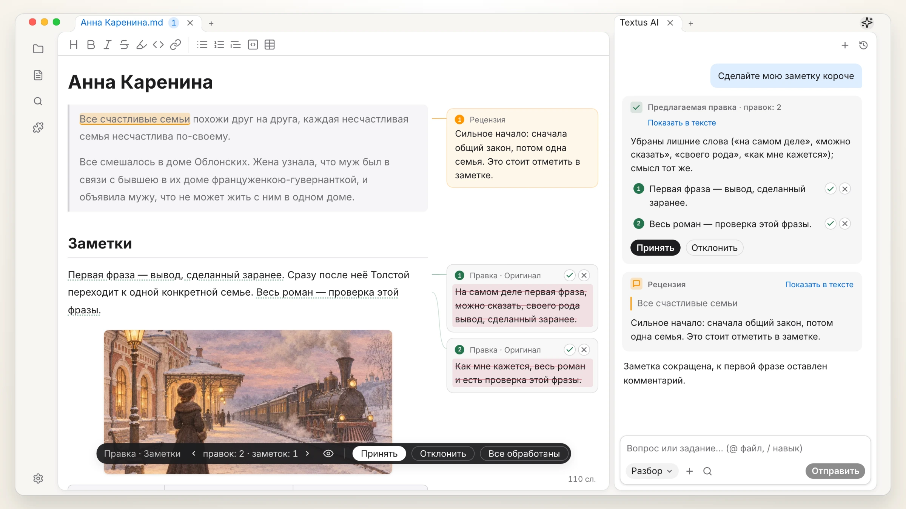 
  «Анна Каренина», Лев Толстой (1878)

## Установите Textus

Бесплатно и с открытым исходным кодом, по лицензии MIT.

| Платформа             | Скачать                                                                                                   | Другие способы установки                                                              |
| --------------------- | --------------------------------------------------------------------------------------------------------- | ------------------------------------------------------------------------------------- |
| macOS · Apple Silicon | [Скачать .dmg](https://github.com/CatVinci-Studio/Textus/releases/latest)                                 | Homebrew: `brew install --cask textus`                                                |
| macOS · Intel         | [Скачать .dmg](https://github.com/CatVinci-Studio/Textus/releases/latest)                                 | Homebrew: `brew install --cask textus`                                                |
| Windows · x64         | [Скачать .exe](https://github.com/CatVinci-Studio/Textus/releases/latest)                                 | —                                                                                     |
| Linux · x64           | [Скачать .AppImage](https://github.com/CatVinci-Studio/Textus/releases/latest) · Также .deb · .rpm        | Arch Linux: [репозиторий `[catvinci]`](https://github.com/CatVinci-Studio/arch-repo) |

> iPhone и iPad: скоро в App Store.

Бета-версии: в **Настройки › О программе** переключите **Канал обновлений** на **Бета**.

## Почему Textus

У программистов есть IDE: одно место, где пишут код, проверяют его и работают со своими инструментами. Авторы же обычно берут взаймы редактор кода или переключаются между несколькими приложениями. Textus собирает весь процесс письма в одном месте.

- **Markdown как общий язык.** В эпоху ИИ Markdown — больше чем формат файлов: его читают и люди, и ИИ, и другие инструменты, так что ваши тексты свободно переходят между ними.
- **Создан для письма, а не для кода.** Черновик, вычитка и правка здесь главное, а не функции, добавленные к редактору кода.
- **ИИ для письма.** Подсказки, пока вы пишете, комментарии, пока вы вычитываете, и правки, которые вы принимаете или отклоняете по одной.
- **Устроен так, как удобно вам.** Визуальное редактирование, богатая система плагинов, синхронизация, даже планы на день: берите нужное, остальное оставьте.
- **Ваши заметки — с вами.** Откройте хранилище Obsidian как есть, импортируйте из Notion и используйте темы Typora.

## Редактор

Что видите, то и получаете: Markdown оформляется прямо при наборе, с таблицами, кодом, формулами и диаграммами, а черновики, заметки и источники можно открыть рядом. Экспорт в PDF, Word, HTML и другие форматы.

  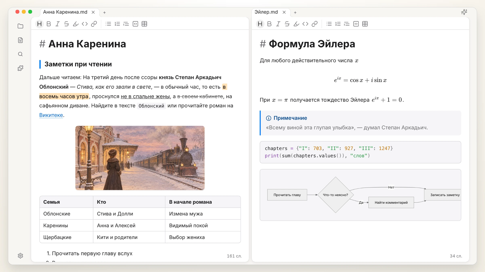

## Textus AI

Работает с онлайн- и локальными моделями и участвует в самом письме.

| Продолжение текста | Опечатки и грамматика |
| :---: | :---: |
| 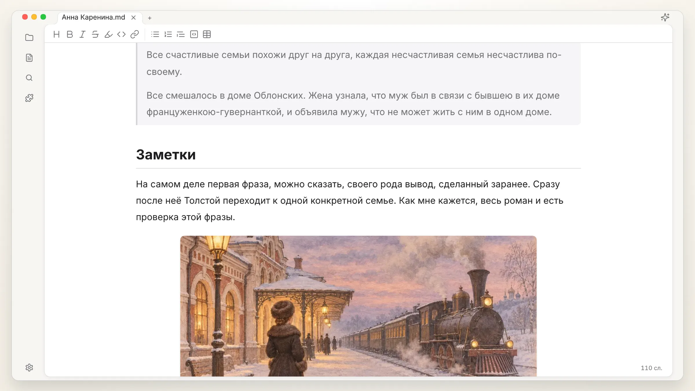 | 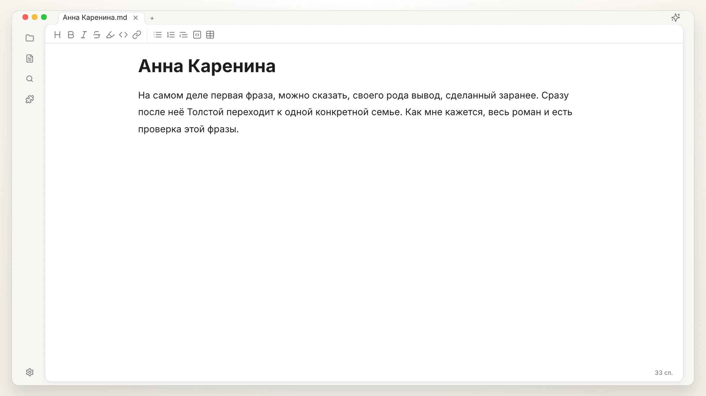 |
| **Предложенные правки** | **Комментарии** |
| 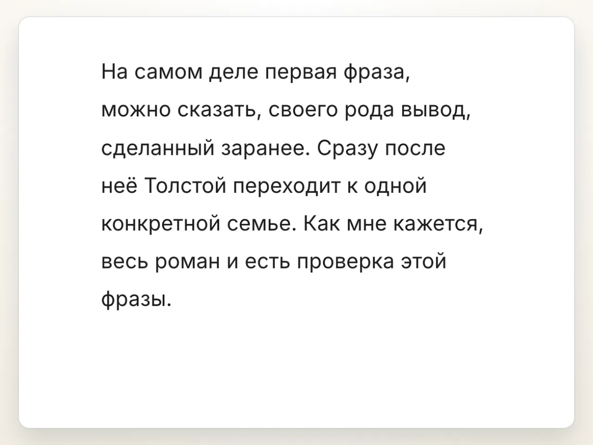 | 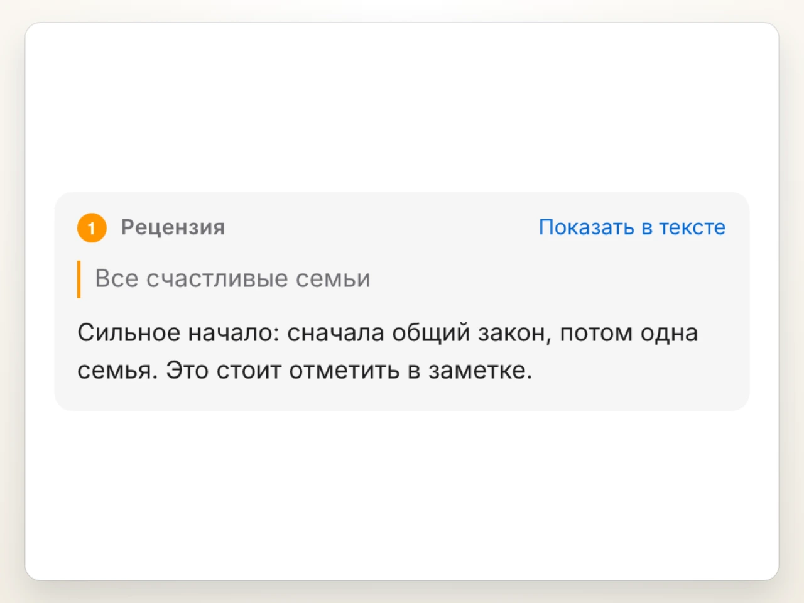 |
| **Навыки через /** | **Любая модель** |
| 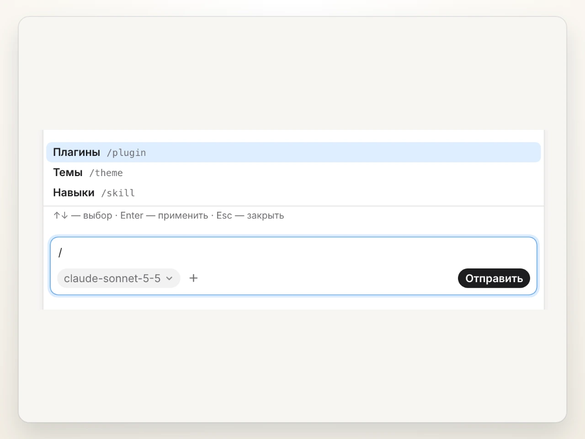 | 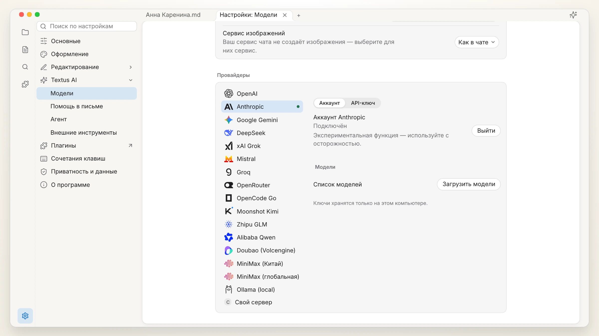 |

Для продвинутых: подключайте MCP-серверы или добавляйте Claude Code и Codex в панель ИИ как агентов.

## Плагины

| Граф заметок | История версий |
| :---: | :---: |
| 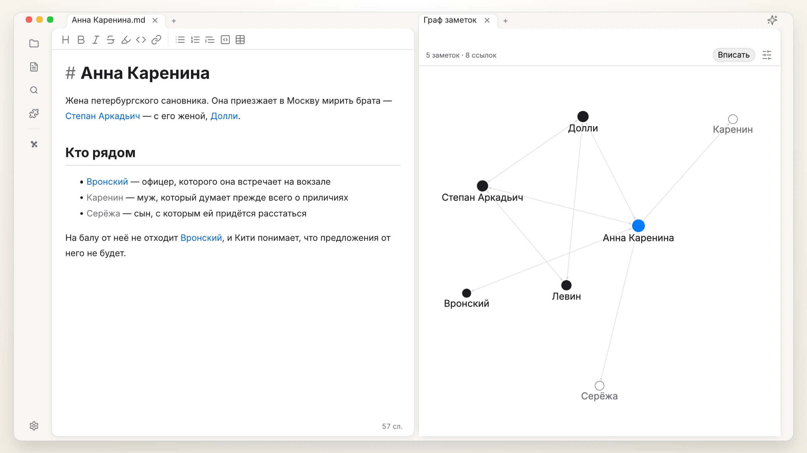 | 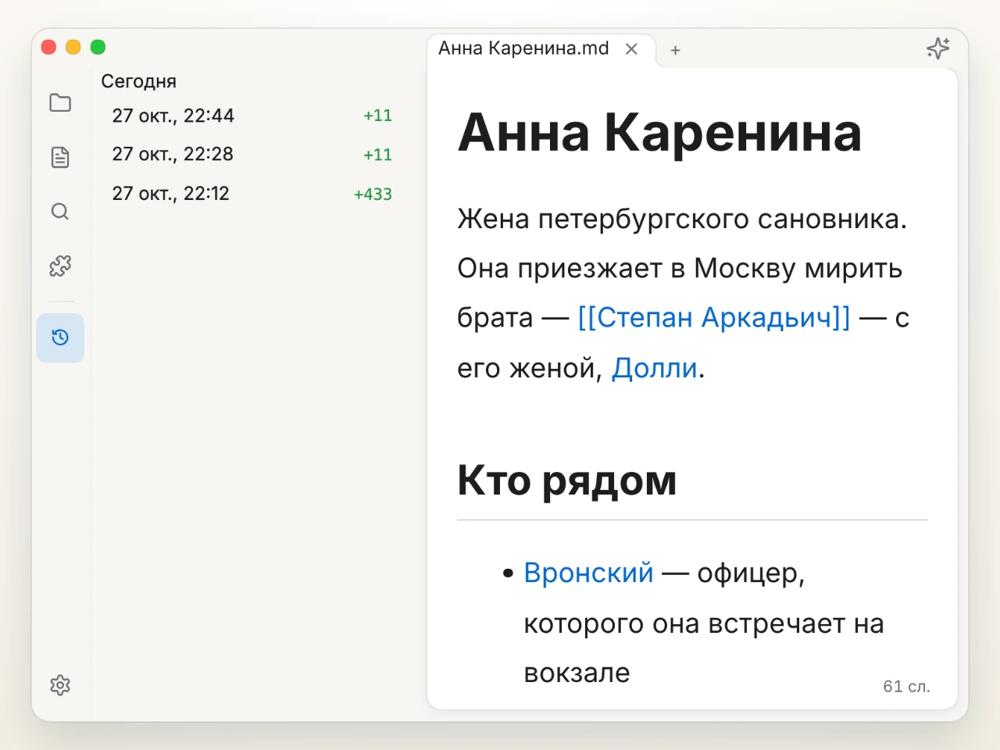 |
| **Быстрый просмотр** | **База знаний** |
| 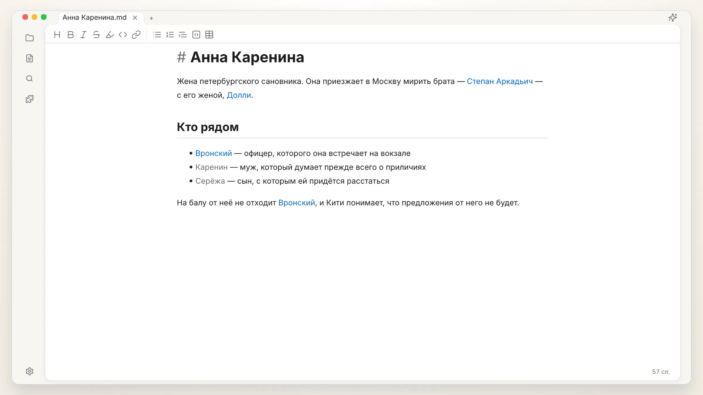 | 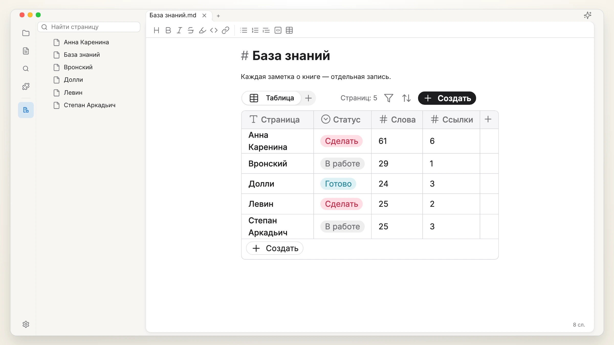 |

Больше плагинов и тем: [textus.md/extensions](https://textus.md/ru/extensions/).

## Спонсоры

**Главный спонсор:** [Anthropic](https://www.anthropic.com/), по программе Anthropic Startup Program.

**Спонсоры:** [Jiang Zhuohang](https://github.com/jzzzzh)

Textus бесплатен и открыт. [Поддержите нас](https://github.com/CatVinci-Studio/Textus/issues/648), чтобы помочь его развитию.

## Сообщество

Присоединяйтесь к нам в Discord, QQ или WeChat: [textus.md/community](https://textus.md/ru/community/). Сообщения об ошибках и пожелания ждём в [GitHub Issues](https://github.com/CatVinci-Studio/Textus/issues). Чтобы помочь с кодом, начните с [CONTRIBUTING.md](CONTRIBUTING.md) (на английском).

## Вопросы и ответы

<strong>Textus бесплатный?</strong>

Да, и всегда будет бесплатным. Это открытый проект под лицензией MIT, без аккаунта и без подписки. Если вы пользуетесь Textus AI, счёт выставляет ваш провайдер напрямую, а с локальной моделью платить не нужно вовсе.

<strong>На каких платформах он работает?</strong>

macOS (Apple Silicon и Intel), Windows и Linux, а также iPhone и iPad через App Store.

<strong>Сколько памяти он занимает?</strong>

Мы очень внимательно относимся к памяти и измеряем её в каждой версии. Одно окно занимает около 110 МБ, каждое следующее — примерно на 55 МБ больше. Плагины загружаются, только когда они нужны, а веб-страница, оставленная в фоне, выгружается и загружается снова, когда вы к ней возвращаетесь.

<strong>Нужен ли аккаунт для ИИ?</strong>

Нет. Редактор полностью работает без ИИ. Для Textus AI подключите своего провайдера: войдите через ChatGPT или Claude, добавьте API-ключ или запустите локальную модель через Ollama.

<strong>Работает ли он офлайн?</strong>

Редактор — полностью. Textus AI нужен доступ к вашему провайдеру, если только вы не запускаете локальную модель.

<strong>Это обычный Markdown? Во что можно экспортировать?</strong>

Да: обычные файлы .md с таблицами, списками задач, сносками, формулами и Mermaid. Экспорт в PDF, Word, HTML и другие форматы.

## История звёзд

<a href="https://star-history.com/#CatVinci-Studio/Textus&Date">
  <picture>
    <source media="(prefers-color-scheme: dark)" srcset="https://api.star-history.com/svg?repos=CatVinci-Studio/Textus&type=Date&theme=dark">
    
  </picture>
</a>

## Лицензия

[MIT](./LICENSE) © CatVinci Studio
