

  

<h1 align="center">Textus</h1>

  <strong>下一代整合寫作環境</strong> 
  AI 研墨，下筆成章

  <a href="https://textus.md"><strong>官網</strong></a> ·
  <a href="https://github.com/CatVinci-Studio/Textus/releases/latest"><strong>下載</strong></a> ·
  <a href="https://github.com/CatVinci-Studio/Textus/issues/648"><strong>贊助</strong></a>

  <a href="./README.md">English</a> ·
  <a href="./README.zh.md">简体中文</a> ·
  繁體中文 ·
  <a href="./README.ja.md">日本語</a> ·
  <a href="./README.ko.md">한국어</a> ·
  <a href="./README.es.md">Español</a> ·
  <a href="./README.fr.md">Français</a> ·
  <a href="./README.de.md">Deutsch</a> ·
  <a href="./README.ru.md">Русский</a> ·
  <a href="./README.pt.md">Português</a>

  
  
  
  
  
  

  

<strong>首席贊助</strong>

  <a href="https://www.anthropic.com/">
    <picture>
      <source media="(prefers-color-scheme: dark)" srcset="docs/images/readme/sponsors/anthropic-logo-ivory.png">
      
    </picture>
  </a>

透過 Anthropic Startup Program

  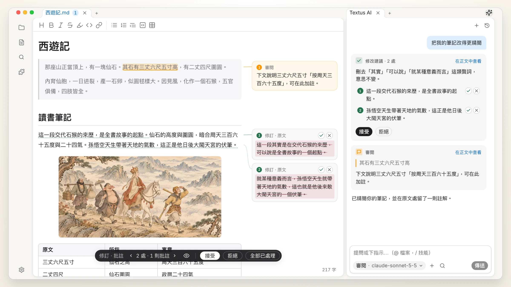 
  《西遊記》吳承恩

## 取得 Textus

免費開源，採用 MIT 授權。

| 平台                | 下載                                                                                          | 其他安裝方式                                                                  |
| ----------------- | ------------------------------------------------------------------------------------------- | ----------------------------------------------------------------------- |
| macOS · Apple 晶片  | [下載 .dmg](https://github.com/CatVinci-Studio/Textus/releases/latest)                        | Homebrew：`brew install --cask textus`                                   |
| macOS · Intel     | [下載 .dmg](https://github.com/CatVinci-Studio/Textus/releases/latest)                        | Homebrew：`brew install --cask textus`                                   |
| Windows · x64     | [下載 .exe](https://github.com/CatVinci-Studio/Textus/releases/latest)                        | —                                                                       |
| Linux · x64       | [下載 .AppImage](https://github.com/CatVinci-Studio/Textus/releases/latest) · 另提供 .deb · .rpm | Arch Linux：[`[catvinci]` 軟體庫](https://github.com/CatVinci-Studio/arch-repo) |

> iPhone 與 iPad 版即將在 App Store 上架。

測試版：在 **設定 › 關於** 中把 **更新通道** 改為 **測試版**。

## 為什麼選擇 Textus

程式設計師有 IDE：寫程式、檢查程式和各種工具都集中在一個地方。寫作者卻往往只能借用程式碼編輯器，或在好幾個軟體之間來回切換。Textus 把整個寫作流程放在一起。

- **Markdown 是共同的語言。** 在 AI 時代，Markdown 不只是檔案格式：人、AI 和其他工具都讀得懂，你的文字可以在它們之間自由流動。
- **圍繞寫作，而不是程式碼。** 起草、審閱、修改才是主角，而不是程式碼編輯器上額外加的功能。
- **為寫作設計的 AI。** 寫作時給建議，審閱時留註解，修改時逐條決定是否採納。
- **依你的方式組合。** 所見即所得的編輯、豐富的外掛程式、同步，甚至每天的計畫安排：需要什麼就用什麼。
- **帶上你的筆記。** 直接開啟 Obsidian 庫，從 Notion 匯入，使用 Typora 主題。

## 寫作

所見即所得，邊寫邊用 Markdown 排好版：表格、程式碼、公式、圖表都在其中，草稿、筆記和資料可以並排擺開。支援匯出 PDF、Word、HTML 等多種格式。

  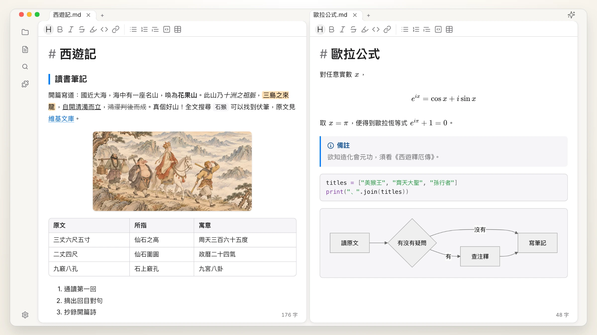

## Textus AI

線上模型和本機模型都能用，並且參與到寫作本身。

| 續寫 | 錯字與語病 |
| :---: | :---: |
| 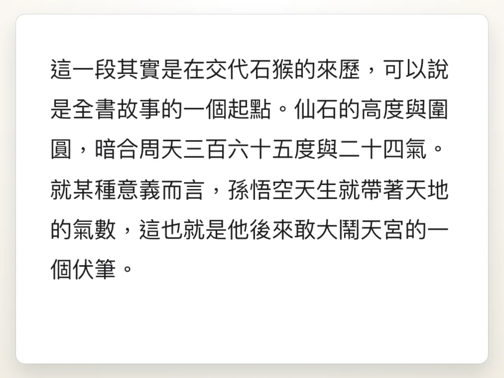 |  |
| **修改提議** | **審閱註解** |
| 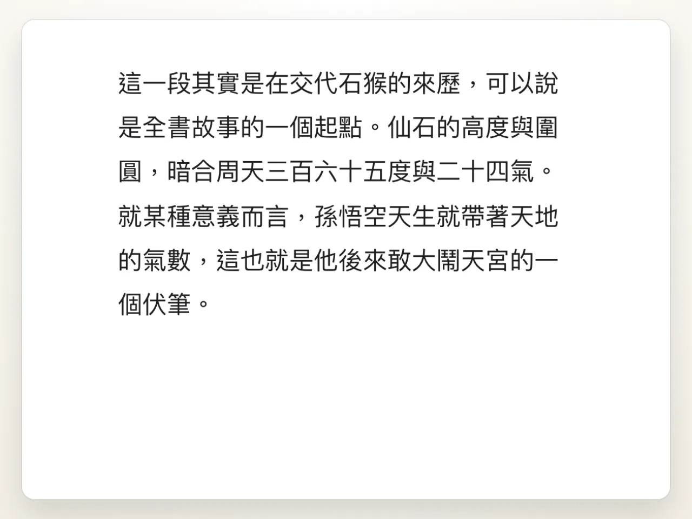 | 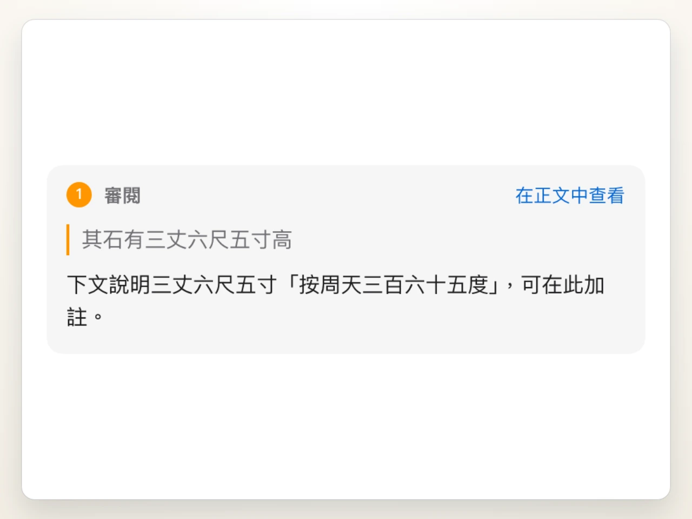 |
| **斜線技能** | **任選模型** |
| 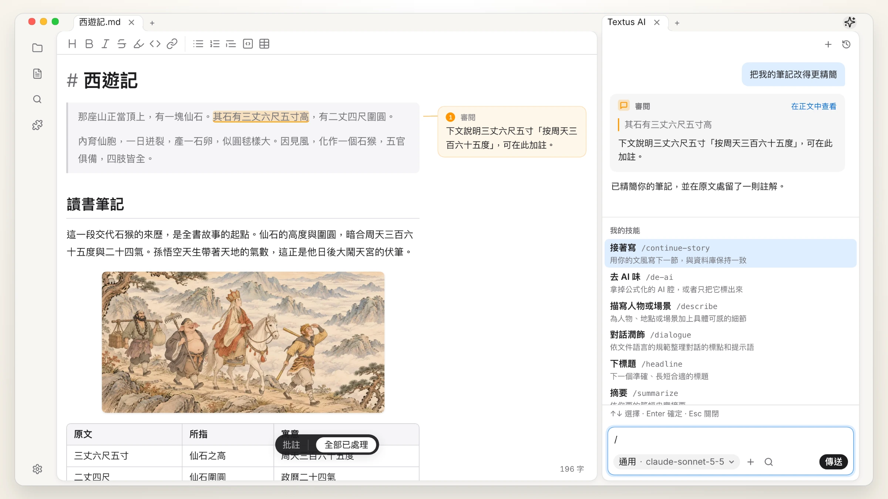 | 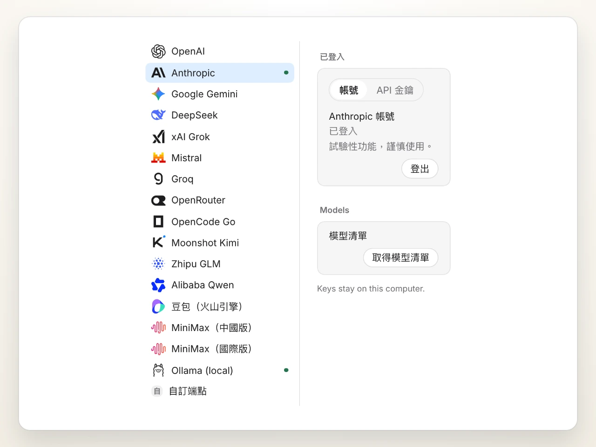 |

進階用法：連接 MCP 伺服器，或把 Claude Code、Codex 作為 Agent 放進 AI 面板。

## 外掛程式

| 知識圖譜 | 版本紀錄 |
| :---: | :---: |
| 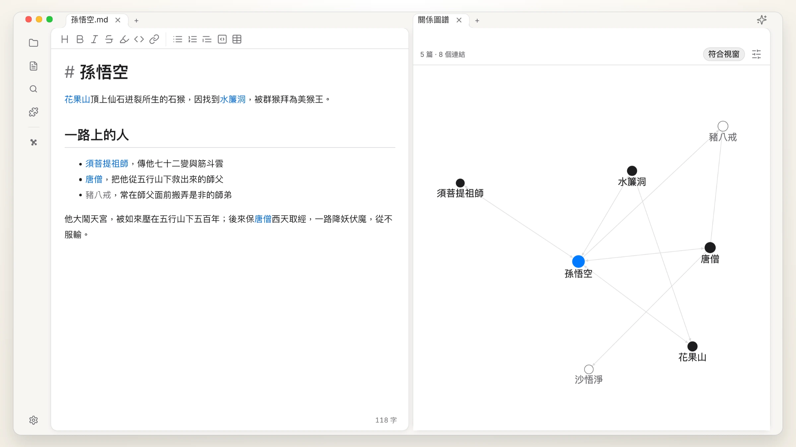 | 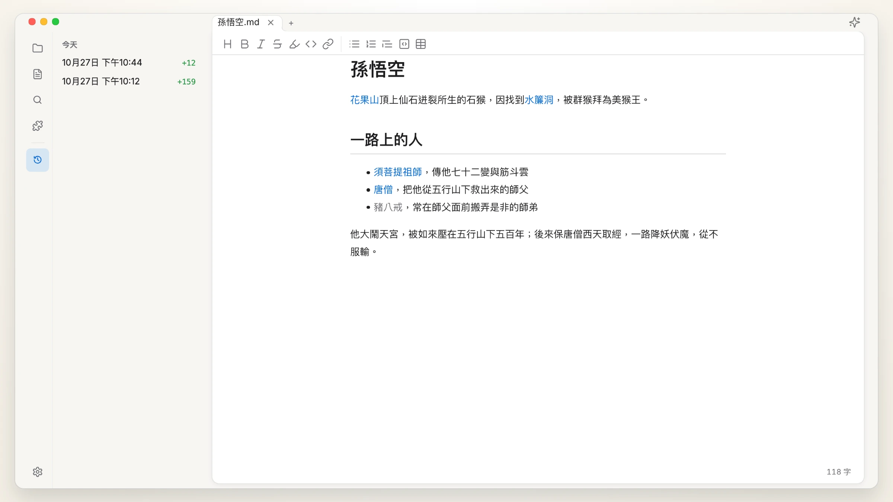 |
| **快速預覽** | **知識庫** |
| 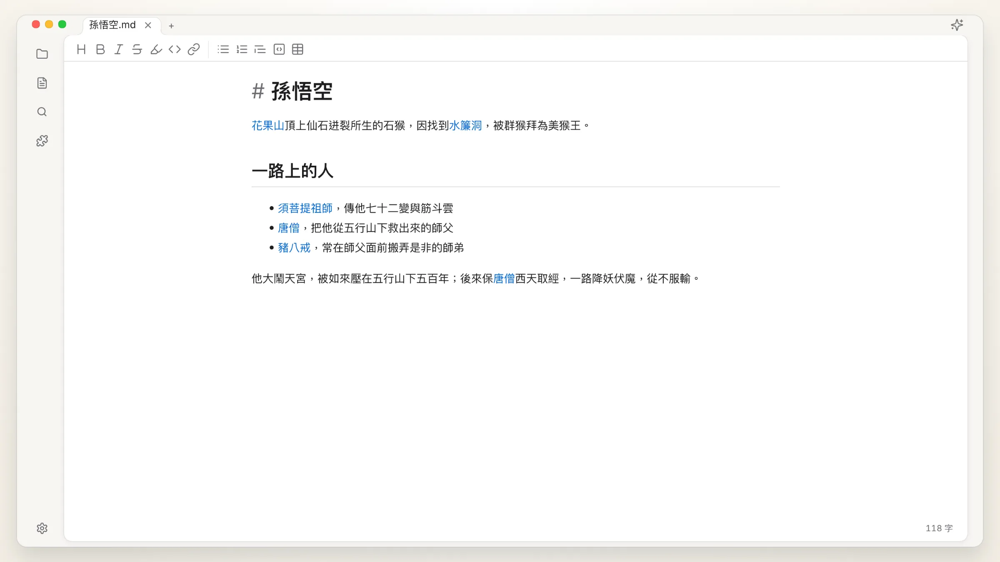 | 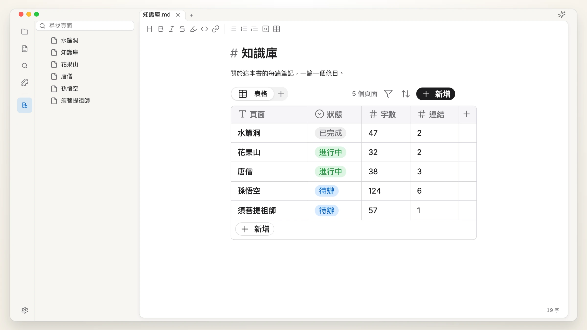 |

更多外掛程式和主題：[textus.md/extensions](https://textus.md/zh-hant/extensions/)。

## 贊助

**首席贊助：** [Anthropic](https://www.anthropic.com/)，透過 Anthropic Startup Program。

Textus 免費開源。歡迎[贊助我們](https://github.com/CatVinci-Studio/Textus/issues/648)，支持它的開發。

## 社群

加入 Discord、QQ 群或微信群：[textus.md/community](https://textus.md/zh-hant/community/)。歡迎在 [GitHub Issues](https://github.com/CatVinci-Studio/Textus/issues) 回報問題、提出建議；想參與開發，請先看 [CONTRIBUTING.md](CONTRIBUTING.md)。

## 常見問題

<strong>Textus 免費嗎？</strong>

免費，而且會一直免費。Textus 以 MIT 授權開源，不需帳號，也沒有訂閱。使用 Textus AI 時，費用由你選擇的服務供應商直接收取；改用本機模型則完全免費。

<strong>支援哪些平台？</strong>

支援 macOS（Apple 晶片與 Intel）、Windows 與 Linux，iPhone 與 iPad 版在 App Store 提供。

<strong>佔用記憶體多嗎？</strong>

我們非常在意記憶體用量，每個版本都會實測。開一個視窗約 110 MB，每多開一個視窗約再多 55 MB。外掛程式用到時才載入；放在背景的網頁會自動釋放，回來時再重新載入。

<strong>一定要有 AI 帳號嗎？</strong>

不用。即使不用 AI，編輯器的所有功能也都能正常使用。想使用 Textus AI，就連接你自己的服務供應商：以 ChatGPT 或 Claude 帳號登入、填入 API 金鑰，或透過 Ollama 執行本機模型。

<strong>可以離線使用嗎？</strong>

編輯器可以完全離線使用。Textus AI 需要連線到你的服務供應商；若執行本機模型，則不必連網。

<strong>是標準的 Markdown 嗎？能匯出哪些格式？</strong>

是。檔案就是一般的 .md 檔，支援表格、待辦清單、註腳、數學公式與 Mermaid，也能匯出為 PDF、Word、HTML 等格式。

## Star 成長趨勢

<a href="https://star-history.com/#CatVinci-Studio/Textus&Date">
  <picture>
    <source media="(prefers-color-scheme: dark)" srcset="https://api.star-history.com/svg?repos=CatVinci-Studio/Textus&type=Date&theme=dark">
    
  </picture>
</a>

## 授權

[MIT](./LICENSE) © CatVinci Studio
