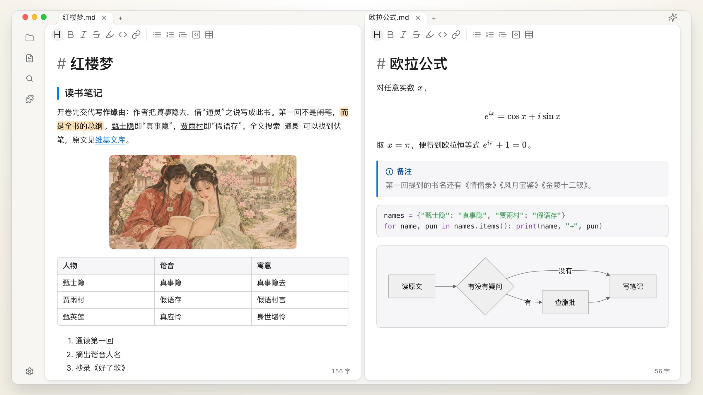
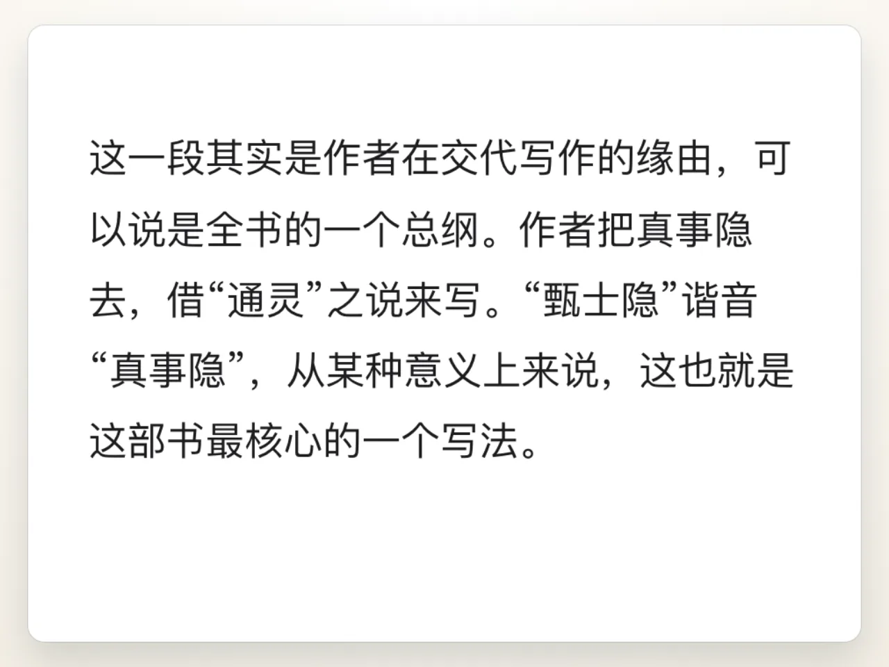
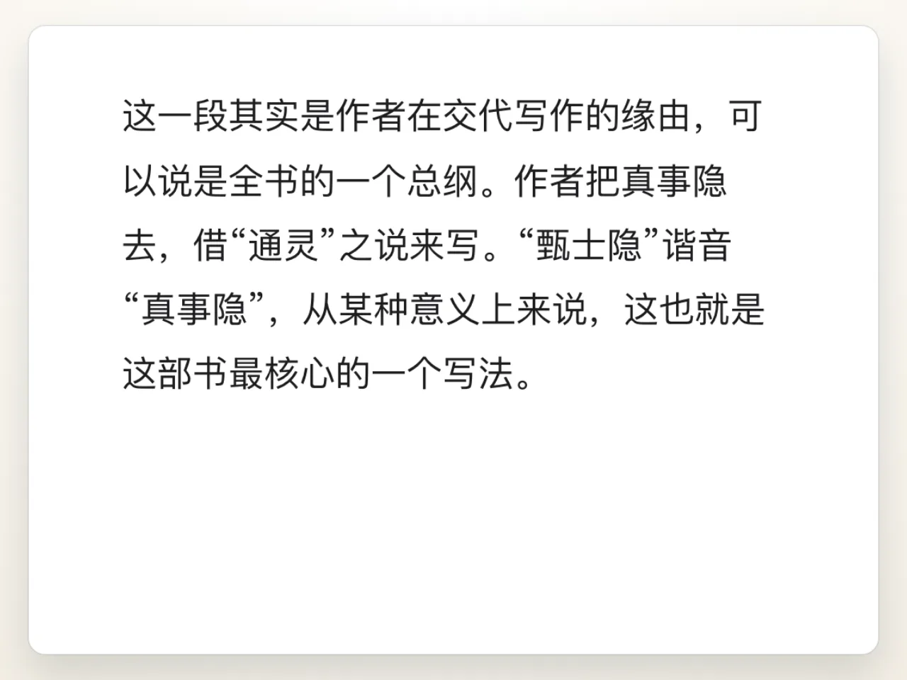
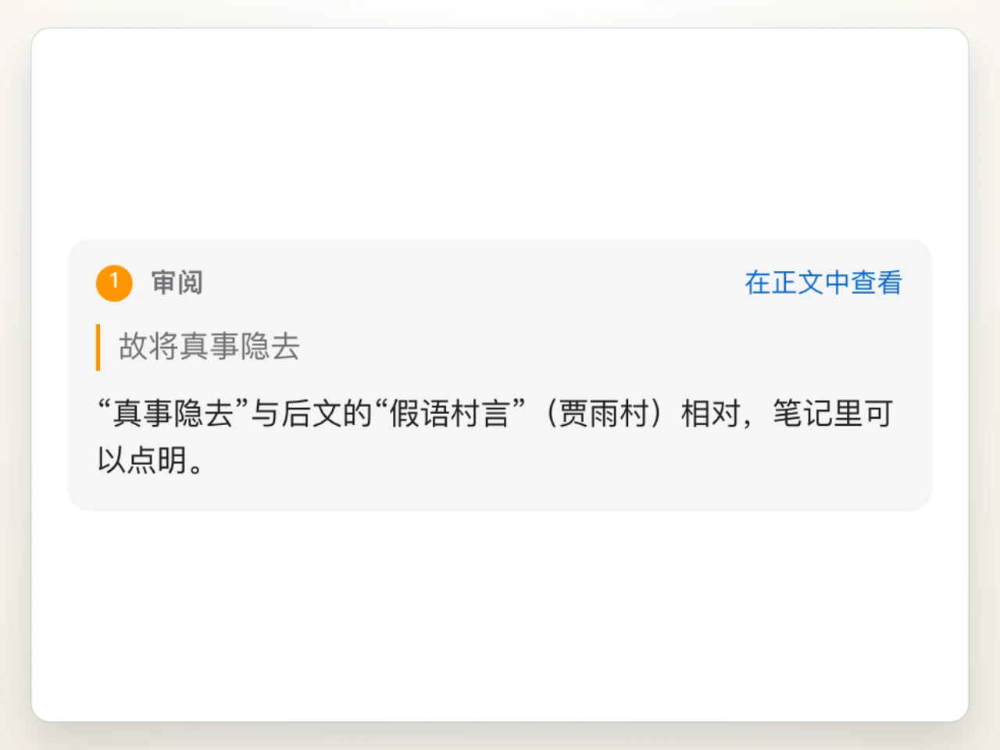
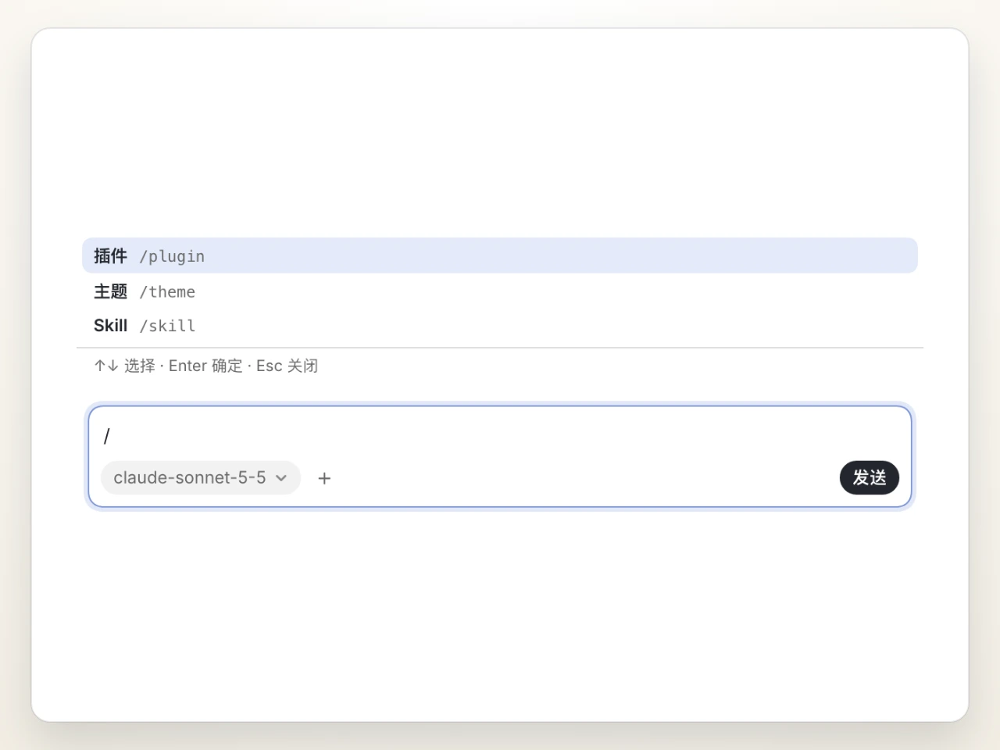
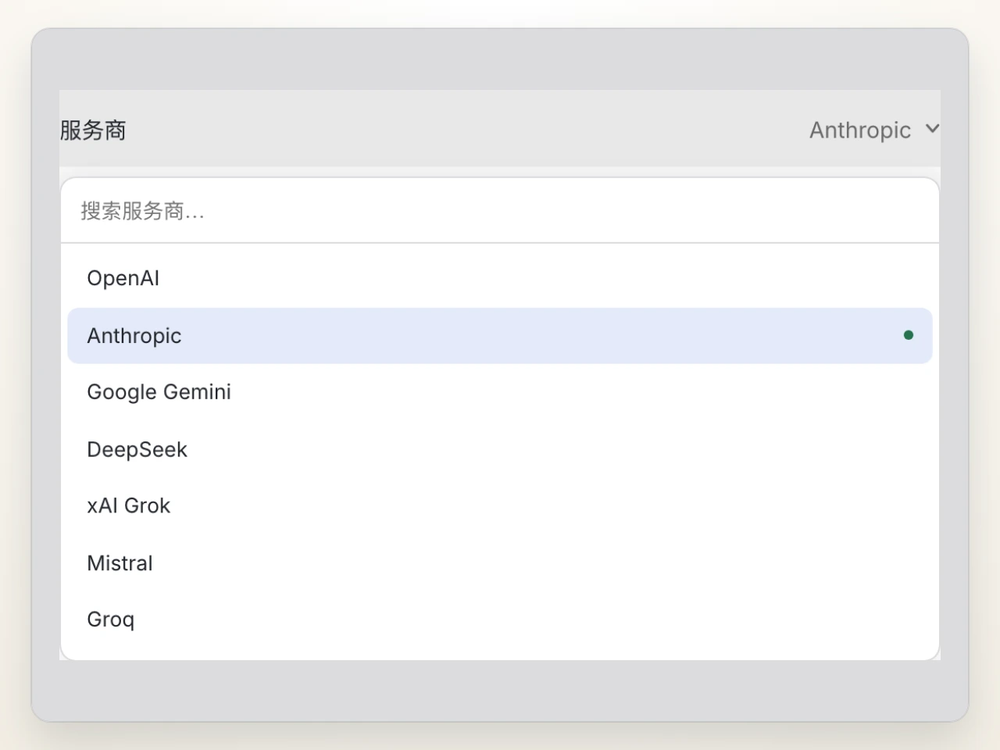
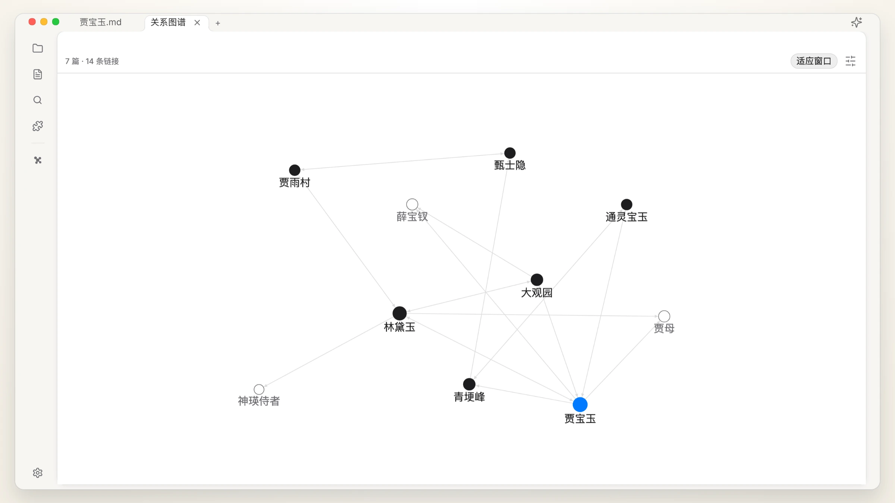
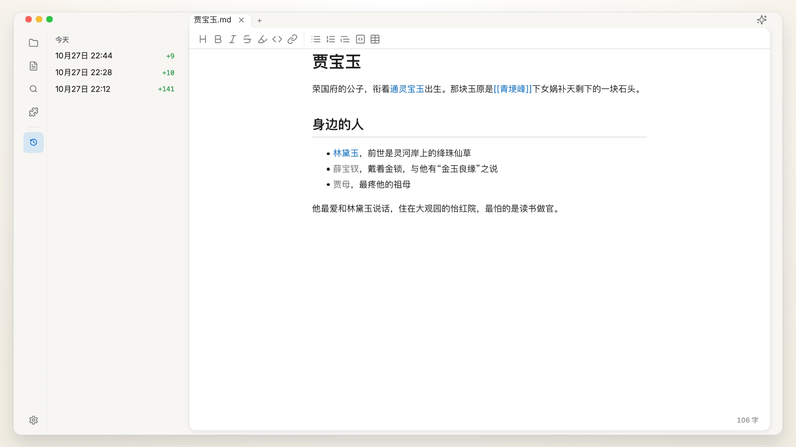
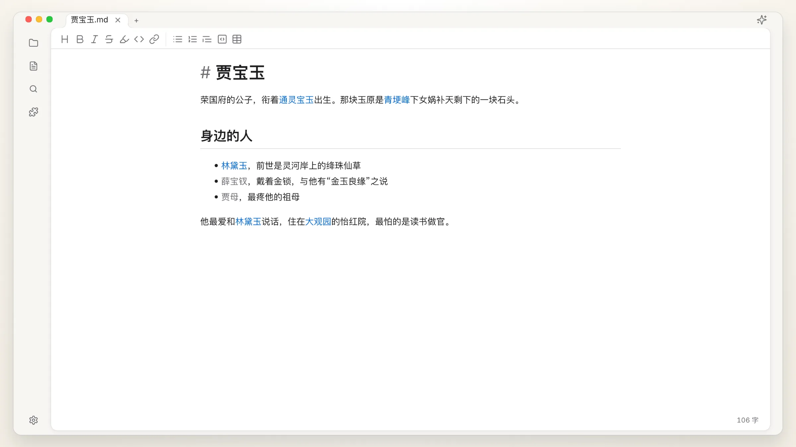
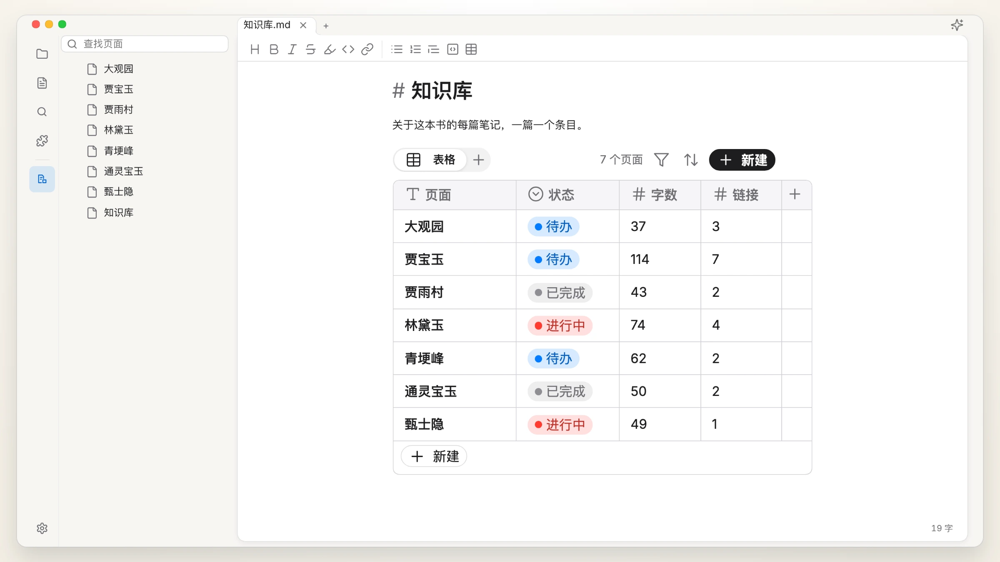

  

<h1 align="center">Textus</h1>

  <strong>下一代集成写作环境</strong> 
  AI 研墨，下笔成章

  <a href="https://textus.md"><strong>官网</strong></a> ·
  <a href="https://github.com/CatVinci-Studio/Textus/releases/latest"><strong>下载</strong></a> ·
  <a href="https://github.com/CatVinci-Studio/Textus/issues/648"><strong>赞助</strong></a>

  <a href="./README.md">English</a> ·
  简体中文 ·
  <a href="./README.zh-Hant.md">繁體中文</a> ·
  <a href="./README.ja.md">日本語</a> ·
  <a href="./README.ko.md">한국어</a> ·
  <a href="./README.es.md">Español</a> ·
  <a href="./README.fr.md">Français</a> ·
  <a href="./README.de.md">Deutsch</a> ·
  <a href="./README.ru.md">Русский</a> ·
  <a href="./README.pt.md">Português</a>

  
  
  
  
  
  

  

<strong>首席赞助</strong>

  

通过 Anthropic Startup Program

赞助者: <a href="https://github.com/jzzzzh"> Jiang Zhuohang</a>

   
  《红楼梦》曹雪芹

## 开始使用 Textus

免费开源，采用 MIT 协议。

| 平台               | 下载                                                                                         | 其他安装方式                                                                 |
| ---------------- | ------------------------------------------------------------------------------------------ | ---------------------------------------------------------------------- |
| macOS · Apple 芯片 | [下载 .dmg](https://github.com/CatVinci-Studio/Textus/releases/latest)                       | Homebrew：`brew install --cask textus`                                  |
| macOS · Intel    | [下载 .dmg](https://github.com/CatVinci-Studio/Textus/releases/latest)                       | Homebrew：`brew install --cask textus`                                  |
| Windows · x64    | [下载 .exe](https://github.com/CatVinci-Studio/Textus/releases/latest)                       | —                                                                      |
| Linux · x64      | [下载 .AppImage](https://github.com/CatVinci-Studio/Textus/releases/latest) · 另有 .deb · .rpm | Arch Linux：[`[catvinci]` 软件源](https://github.com/CatVinci-Studio/arch-repo) |

> iPhone 与 iPad 版即将在 App Store 上架。

测试版：在 **设置 › 关于** 中把 **更新通道** 改为 **测试版**。

## 为什么选择 Textus

程序员有 IDE：写代码、检查代码和各种工具都集中在一个地方。写作者却往往只能借用代码编辑器，或者在好几个软件之间来回切换。Textus 把整个写作流程放到了一起。

- **Markdown 是共同的语言。** 在 AI 时代，Markdown 不只是文稿格式：人、AI 和其他工具都读得懂，你的文字可以在它们之间自由流动。
- **围绕写作，而不是代码。** 起草、审阅、修改都是主角，而不是代码编辑器上外加的功能。
- **为写作设计的 AI。** 写作时给建议，审阅时看批注，修改时逐条决定是否采纳修订。
- **按你的方式组合。** 所见即所得的编辑、丰富的插件、同步，甚至日常的计划安排：需要什么就用什么。
- **带上你的笔记。** 直接打开 Obsidian 库，从 Notion 导入，使用 Typora 主题。

## 写作

所见即所得，边写边用 Markdown 排好版：表格、代码、公式、图表都在其中，草稿、笔记和资料可以并排摆开。支持导出 PDF、Word、HTML 等多种格式。

  

## Textus AI

在线模型和本地模型都能用，并且参与到写作本身。

| 续写 | 错字与语病 |
| :---: | :---: |
|  |  |
| **修改提议** | **审阅批注** |
|  |  |
| **斜杠技能** | **任选模型** |
|  |  |

进阶用法：接入 MCP 服务，或者把 Claude Code、Codex 作为 Agent 放进 AI 面板。

## 插件

| 关系图谱 | 版本历史 |
| :---: | :---: |
|  |  |
| **浮动卡片** | **知识库** |
|  |  |

更多插件和主题：[textus.md/extensions](https://textus.md/zh/extensions/)。

## 赞助

**首席赞助：** [Anthropic](https://www.anthropic.com/)，通过 Anthropic Startup Program。

**赞助者：** [Jiang Zhuohang](https://github.com/jzzzzh)

Textus 免费开源。欢迎[赞助我们](https://github.com/CatVinci-Studio/Textus/issues/648)，支持它的开发。

## 社区

加入 Discord、QQ 群或微信群：[textus.md/community](https://textus.md/zh/community/)。欢迎在 [GitHub Issues](https://github.com/CatVinci-Studio/Textus/issues) 报告问题、提出建议；想参与开发，请先看 [CONTRIBUTING.md](CONTRIBUTING.md)。

## 常见问题

<strong>Textus 免费吗？</strong>

免费，而且会一直免费。Textus 以 MIT 协议开源，不需要账号，也没有订阅。如果使用 Textus AI，费用由你选择的服务商直接结算；使用本地模型则完全免费。

<strong>支持哪些平台？</strong>

支持 macOS（Apple 芯片和 Intel）、Windows 和 Linux，iPhone 与 iPad 版在 App Store 提供。

<strong>占用内存多吗？</strong>

我们非常在乎内存占用，每个版本都会实测。打开一个窗口约 110 MB，每多开一个窗口约多 55 MB。插件用到时才加载；网页标签放在后台久了会自动释放，回来时再重新打开。

<strong>需要 AI 账号吗？</strong>

不需要。不用 AI，编辑器的全部功能照样可用。想用 Textus AI，就接入你自己的服务商：用 ChatGPT 或 Claude 账号登录、填入 API Key，或用 Ollama 运行本地模型。

<strong>可以离线使用吗？</strong>

编辑器完全可以离线使用。Textus AI 需要连接你的服务商，运行本地模型时则无需联网。

<strong>是标准 Markdown 吗？能导出什么格式？</strong>

是的，就是普通的 .md 文件，支持表格、任务列表、脚注、公式和 Mermaid。可以导出为 PDF、Word、HTML 等格式。

## Star 增长趋势

<a href="https://star-history.com/#CatVinci-Studio/Textus&Date">
  <picture>
    <source media="(prefers-color-scheme: dark)" srcset="https://api.star-history.com/svg?repos=CatVinci-Studio/Textus&type=Date&theme=dark">
    
  </picture>
</a>

## 许可证

[MIT](./LICENSE) © CatVinci Studio
