

  

<h1 align="center">Textus</h1>

  <strong>下一代 Markdown 编辑器</strong> 
  下笔成章，AI 研墨

  <a href="https://textus.catvinci.com"><strong>官网</strong></a> ·
  <a href="https://github.com/CatVinci-Studio/Textus/releases/latest"><strong>下载</strong></a>

  <a href="./README.md">English</a> ·
  简体中文 ·
  <a href="./README.zh-Hant.md">繁體中文</a> ·
  <a href="./README.ja.md">日本語</a> ·
  <a href="./README.ko.md">한국어</a> ·
  <a href="./README.es.md">Español</a> ·
  <a href="./README.fr.md">Français</a> ·
  <a href="./README.de.md">Deutsch</a> ·
  <a href="./README.ru.md">Русский</a> ·
  <a href="./README.pt.md">Português</a>

  
  
  
  
  
  

https://github.com/user-attachments/assets/56473ad9-5cb0-4608-b3c8-30882420edcd

  <a href="https://www.bilibili.com/video/BV19LJb6WEWb">在 B 站观看</a> ·
  <a href="https://www.youtube.com/watch?v=k_ew9TRljz0">YouTube</a>

  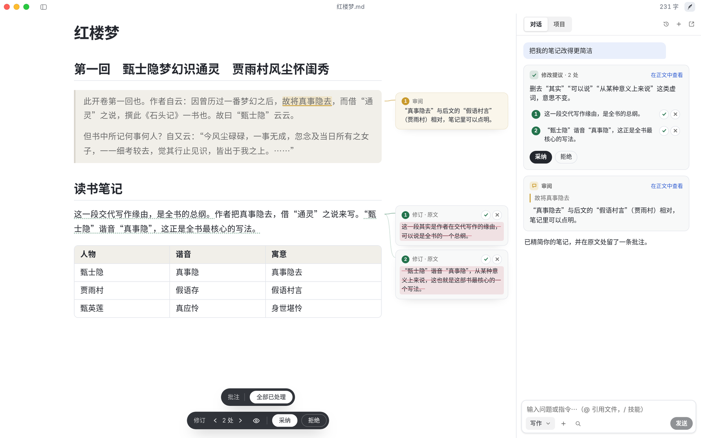 
  《红楼梦》曹雪芹

## 开始使用 Textus

免费开源，采用 MIT 协议。

| 平台               | 下载                                                                                         | 其他安装方式                                                                 |
| ---------------- | ------------------------------------------------------------------------------------------ | ---------------------------------------------------------------------- |
| macOS · Apple 芯片 | [下载 .dmg](https://github.com/CatVinci-Studio/Textus/releases/latest)                       | Homebrew：`brew install --cask textus`                                  |
| macOS · Intel    | [下载 .dmg](https://github.com/CatVinci-Studio/Textus/releases/latest)                       | Homebrew：`brew install --cask textus`                                  |
| Windows · x64    | [下载 .exe](https://github.com/CatVinci-Studio/Textus/releases/latest)                       | —                                                                      |
| Linux · x64      | [下载 .AppImage](https://github.com/CatVinci-Studio/Textus/releases/latest) · 另有 .deb · .rpm | Arch Linux：[`[catvinci]` 软件源](https://github.com/CatVinci-Studio/arch-repo) |

> iOS 与 iPadOS 版即将推出。

测试版：在 **设置 › 通用 › 关于 Textus** 中把 **更新通道** 改为 **测试版**。

## 写作

所见即所得，使用 Markdown 快速排版。支持多种导出格式，包括 PDF、Word、HTML。

  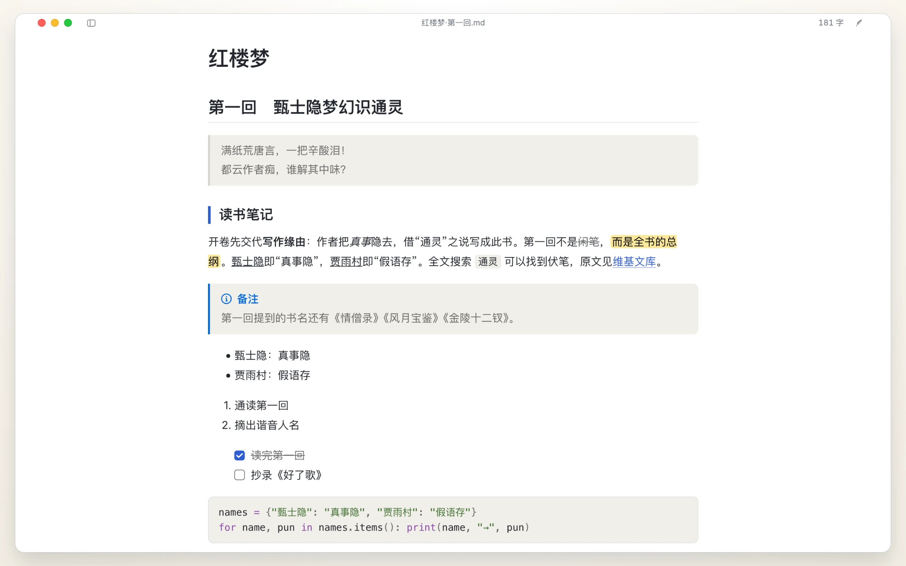

| 代码块 | 表格 |
| :---: | :---: |
| 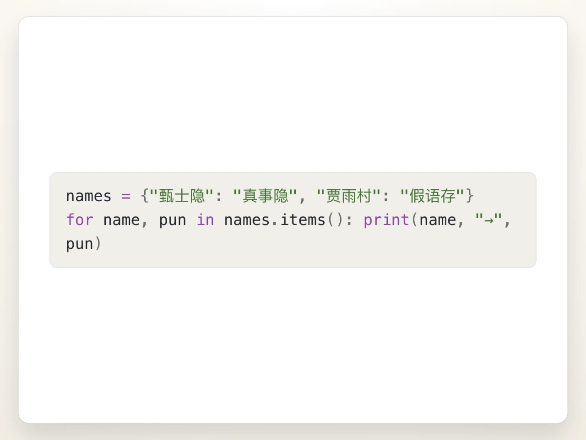 | 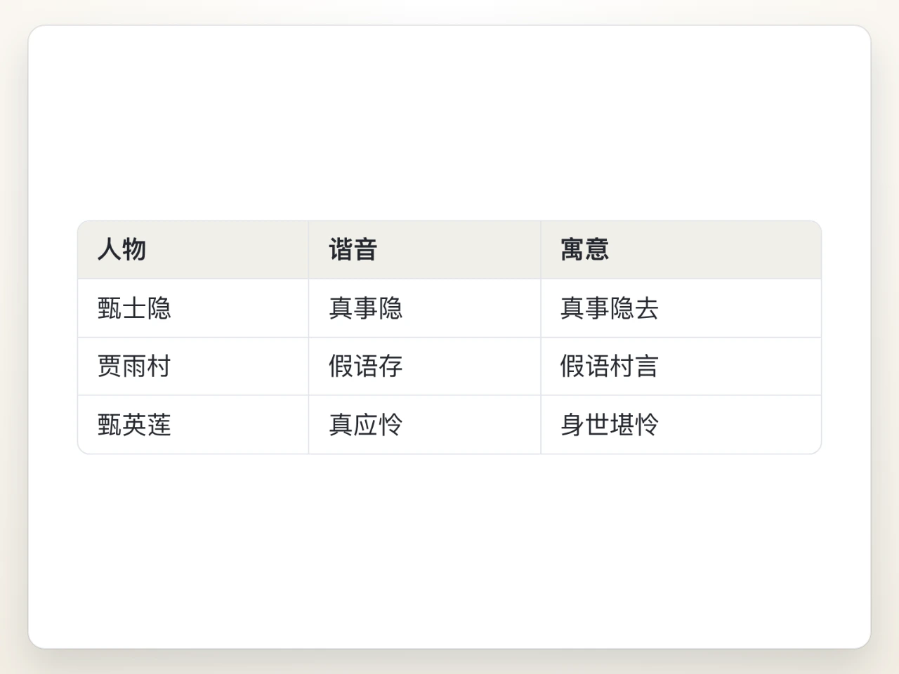 |
| **数学公式** | **图像渲染** |
| 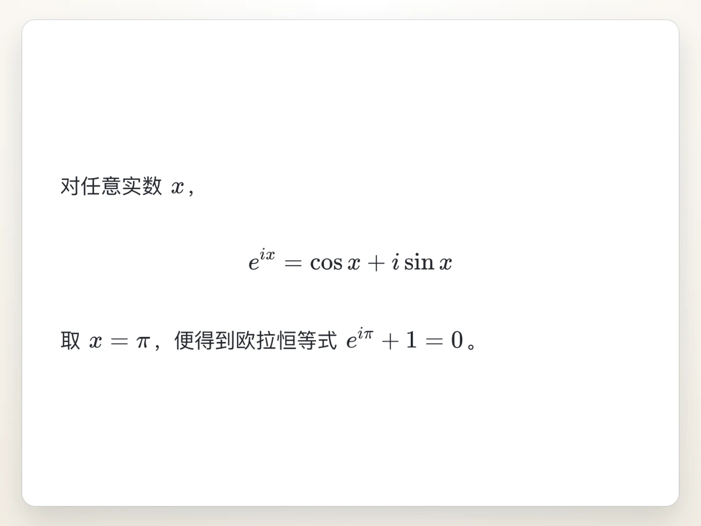 | 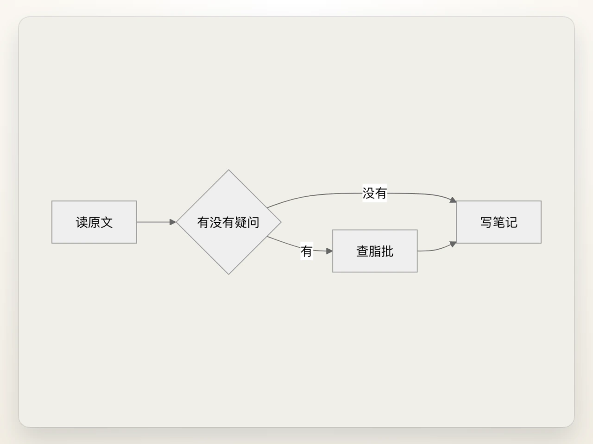 |

## Textus AI

支持在线、本地等多种 LLM 模型服务，让 AI 加速你的写作进程。

| 续写 | 错字与语病 | 修改提议 |
| :---: | :---: | :---: |
|  |  | 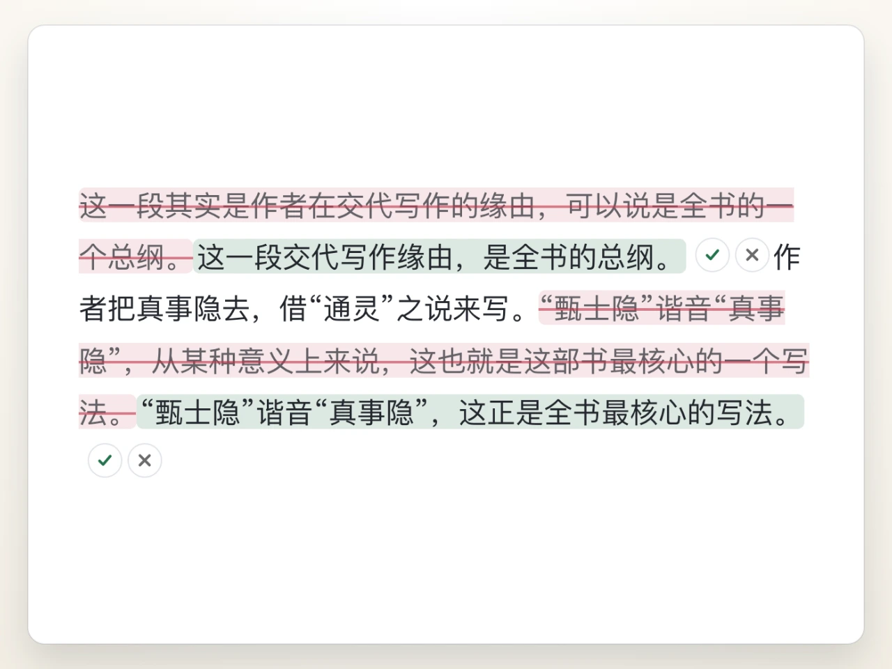 |
| **审阅批注** | **斜杠技能** | **任选模型** |
|  | 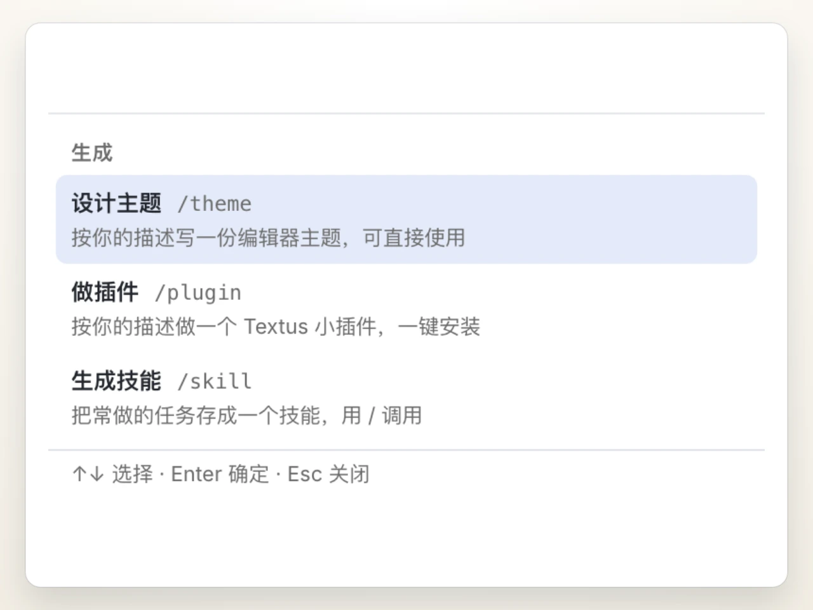 | 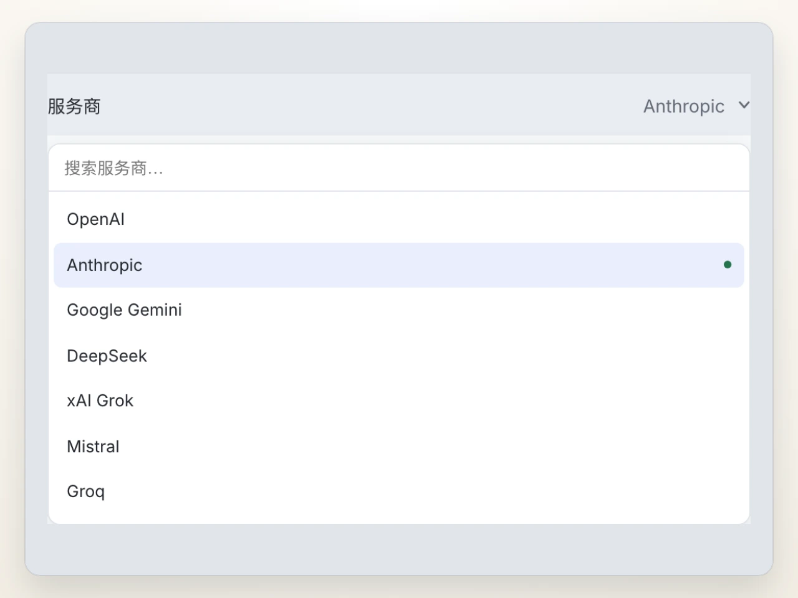 |

## 插件（测试中，1.3 beta）

不仅是写作，通过插件来实现更多功能。

| 知识图谱 | Vim |
| :---: | :---: |
| 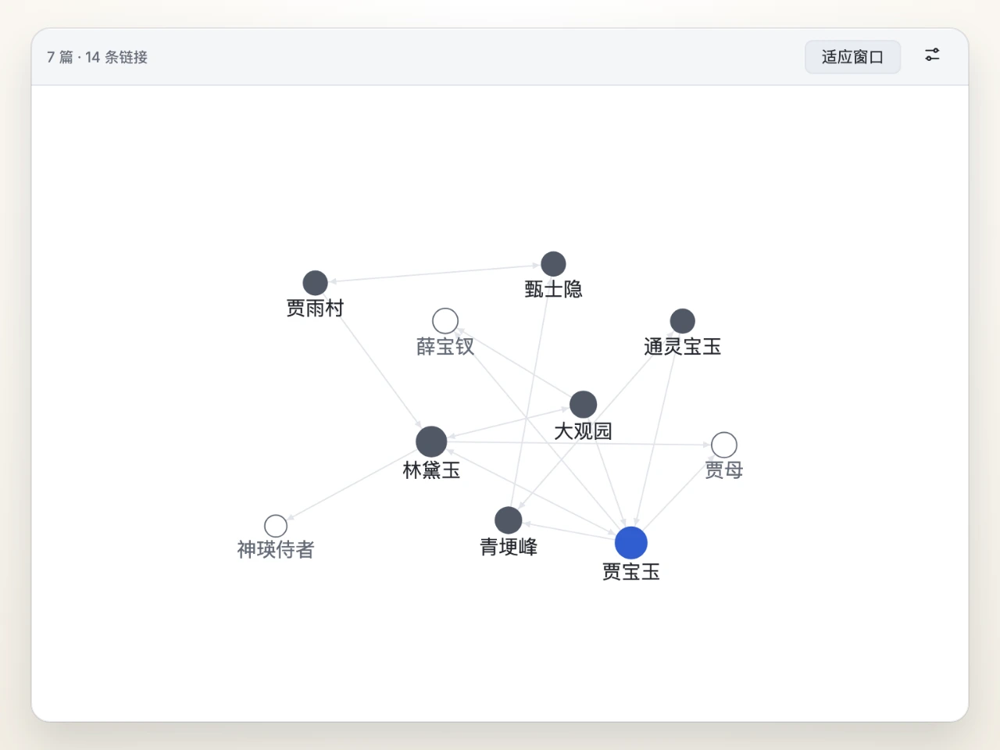 | 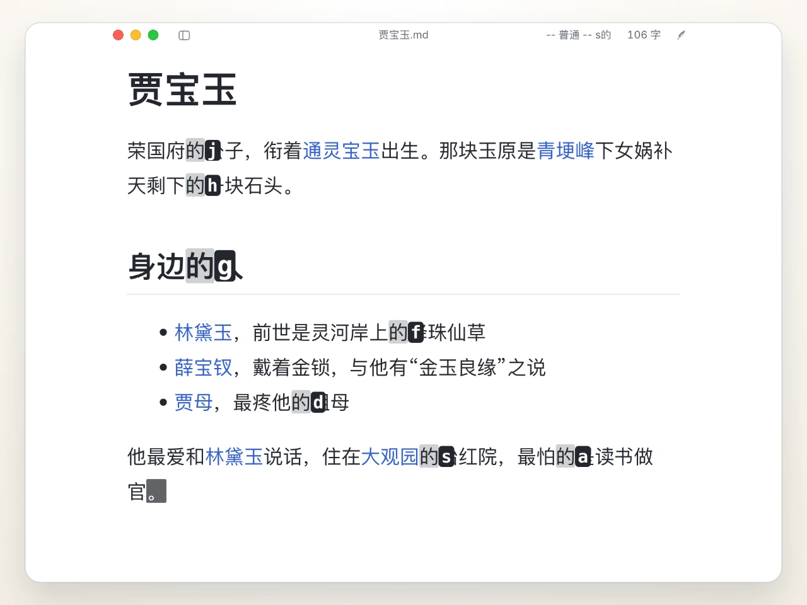 |
| **浮动卡片** | **版本历史** |
|  | 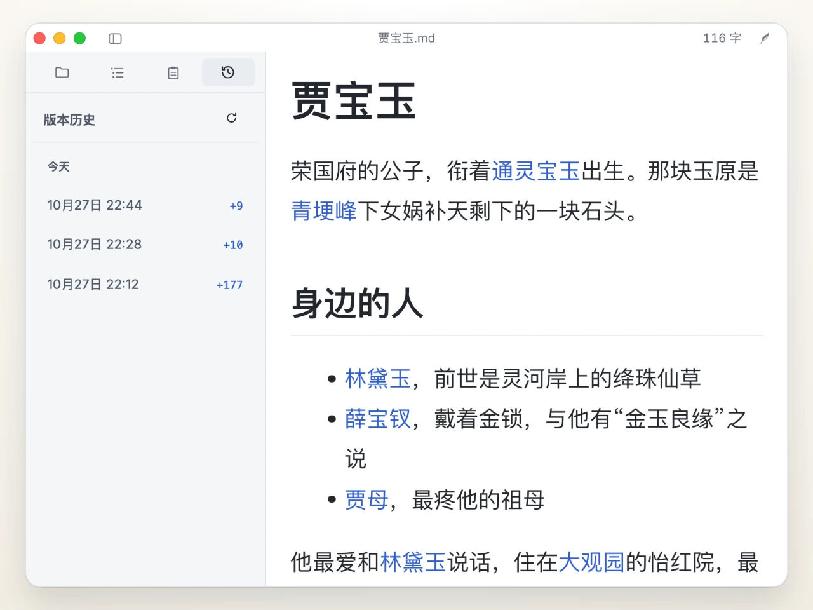 |

还有看板、PDF 与 Word 阅读、Zotero 引用、各类图表等，都在 **设置 › 扩展 › 获取更多**。

## 常见问题

<strong>Textus 免费吗？</strong>

免费。Textus 以 MIT 协议开源，不需要账号，也没有订阅。如果使用 Textus AI，费用由你选择的服务商直接结算；使用本地模型则完全免费。

<strong>支持哪些平台？</strong>

支持 macOS（Apple 芯片和 Intel）、Windows 和 Linux。iOS 与 iPadOS 版即将推出。

<strong>占用内存多吗？</strong>

我们非常在乎内存占用，每个版本都会实测。打开一个窗口约 110 MB，每多开一个窗口约多 55 MB。插件用到时才加载；网页标签放在后台久了会自动释放，回来时再重新打开。

<strong>需要 AI 账号吗？</strong>

不需要。不用 AI，编辑器的全部功能照样可用。想用 Textus AI，就接入你自己的服务商：用 ChatGPT 或 Claude 账号登录、填入 API Key，或用 Ollama 运行本地模型。

<strong>可以离线使用吗？</strong>

编辑器完全可以离线使用。Textus AI 需要连接你的服务商，运行本地模型时则无需联网。

<strong>是标准 Markdown 吗？能导出什么格式？</strong>

是的，就是普通的 .md 文件，支持表格、任务列表、脚注、公式和 Mermaid。可以导出为 PDF、Word、HTML 等格式。

## 社区

- [QQ 群](https://textus.catvinci.com/qq)：1128285004
- [微信群](https://textus.catvinci.com/wechat)：扫码加入
- [Discord](https://textus.catvinci.com/discord)：英文交流

bug 反馈和功能建议也欢迎提到 [GitHub Issues](https://github.com/CatVinci-Studio/Textus/issues)。

## 路线图与参与开发

Textus 接下来的方向见 [路线图](ROADMAP.zh.md)。想自己构建 Textus、运行检查或提交 PR，请从 [CONTRIBUTING.md](CONTRIBUTING.md)（英文）开始；AI 编程助手请遵循 [AGENTS.md](AGENTS.md)。讨论可以用中文或英文。

## Star 增长趋势

<a href="https://star-history.com/#CatVinci-Studio/Textus&Date">
  <picture>
    <source media="(prefers-color-scheme: dark)" srcset="https://api.star-history.com/svg?repos=CatVinci-Studio/Textus&type=Date&theme=dark">
    
  </picture>
</a>

## 许可证

[MIT](./LICENSE) © CatVinci Studio
