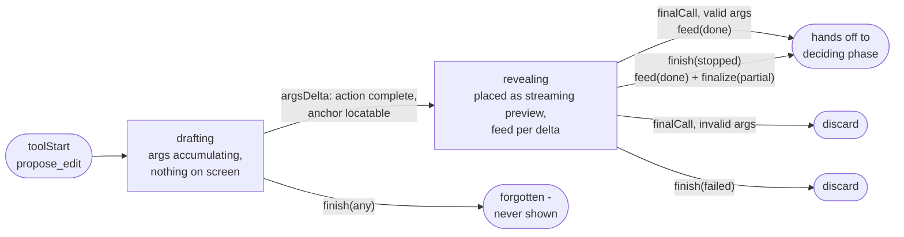
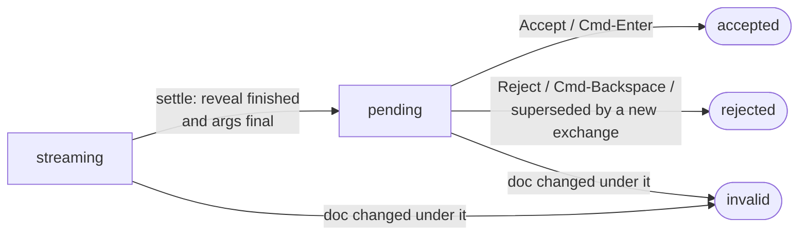

# AI proposals: lifecycle and behavior

How a `propose_edit` tool call travels from streamed arguments to text in the
document, what consecutive prompts do to undecided proposals, and what stop /
failure / close leave behind. Every rule here is enforced in code; the file
that owns each one is named so this document can be checked against reality.

## The surfaces, and the one path into the document

Chat has three surfaces and two conversations, all owned by the editor
(`document-view/MilkdownEditor.tsx`):

- **The AI panel** — docked on the right (`ai/chat/panel/agent-panel.tsx`,
  `AgentPanelView.tsx`). Shows the editor's main conversation, the one saved
  to History.
- **The detached chat window** — the same main conversation popped out into
  its own OS window, one per editor window (desktop only). It owns no
  document state: proposals and accept/reject travel over
  `ai/chat/window/chat-bridge.ts` back to the editor window.
- **Quick Ask** — the in-document bar (`ai/chat/quick-ask/useInlineChat.ts`). It has its
  own short conversation, kept out of History and independent of the
  panel; "Continue in the full conversation" hands its turns to the main
  conversation (`expandQuickAsk`).

All render the same `ChatBody`, and all feed one resolution pipeline:
`MilkdownEditor → usePendingEdits → pending-edit-plugin`. Anchors resolve in
**markdown source space** (`ai/doc-markdown.ts`), matching what the model was
shown. Previews are pure decorations - until the user clicks Accept, the
document text is untouched. Accept (`applyEditRange`) is the **only** write
path: one transaction, one undo step, no direct-apply fallback.

## Modes: which proposals a conversation may make

The composer's mode (`AgentMode`, see
[ai-concepts.md](ai-concepts.md#not-a-file-modes)) decides what reaches
this pipeline, and it is enforced in Rust, not only asked for in the prompt
(`tools.rs`'s `builtin_tools`):

| Mode   | `propose_edit`                                                     |
| ------ | ------------------------------------------------------------------ |
| Write  | `append`, `insert_at_cursor`, `insert_after`, `insert_before` only |
| Review | not offered                                                        |
| Revise | every action                                                       |

Write's schema lists only the insertion actions, and `propose_insertion`
refuses any other action a model sends anyway; the refusal is a tool result
like any validation failure, so its streamed preview is discarded
(`isRefusal`) and nothing that replaces or deletes text reaches the editor.
A Write proposal is the same green pending block as any insertion: shown,
not applied, until Accept. With a selection, Write inserts after it
(`insert_after`), never over it.

## Writing phase: the `ProposalStream` machine

`ai/revision/proposal-stream.ts` - plain logic, no ProseMirror dependency. Every
lifecycle decision for a streamed proposal lives here; `MilkdownEditor` only
wires the machine's effects to the editor (place → streaming preview, feed →
typewriter, finalize → decidable re-show, discard → reject).

`finish` fires when the exchange ends: a user stop is `"stopped"`, a request
failure is `"failed"`. A normal completion delivered a `finalCall` for every
draft, so the machine is already empty and `finish` is a no-op.

The two endings that matter:

- **Stop keeps.** A user stop freezes a revealing draft at the text streamed
  so far and re-shows it as an ordinary decidable preview. The user watched
  that content arrive; stopping means "that's enough", not "throw it away".
- **Failure discards.** The error path offers Retry, and a kept preview
  would duplicate the retried proposal.

Smaller rules the machine also owns:

- A textless proposal (`delete`) still gets its `feed(done)` - without it
  the typewriter entry stays "more may come" forever and the preview never
  becomes decidable.
- Final arguments that don't validate (e.g. `replace` without an anchor)
  discard the placed preview: such a proposal can never be applied, and
  leaving it would strand an un-decidable preview.
- With edit animation off (or reduced motion) the machine is bypassed
  entirely; proposals appear complete, at once, via `ChatBody`'s
  completed-turn batches.

## Deciding phase: `PendingStatus`

`ai/revision/usePendingEdits.ts` + `ai/revision/pending-edit-plugin.ts`.

| Status      | Meaning                                      | Behavior                                                                                                   |
| ----------- | -------------------------------------------- | ---------------------------------------------------------------------------------------------------------- |
| `streaming` | Args still arriving, or typewriter playing   | Accept refuses (not a failure - works once settled)                                                        |
| `pending`   | Decidable                                    | Strike (red) + new text (green); Quick Ask nav bar walks previews in **document order**, not arrival order |
| `accepted`  | Applied                                      | Decoration removed in the same transaction as the write - no orphan frame                                  |
| `rejected`  | Declined, or superseded                      | Preview removed; chat card shows Rejected                                                                  |
| `invalid`   | Target text changed / anchor no longer found | Preview dropped; chat card offers relocation (asks the model to re-issue against the current document)     |

**Hover only points.** A rewrite decided sentence by sentence pairs each
struck original with its replacement. With the pointer on either side, on
the ✓ / ✕ after them, or on the pair's card in the margin, that pair is
outlined - dark green round the new text, dark red round the original -
and its red and green tints deepen a little; its margin card gets the
outline of the side it holds. The review bar's pointer uses the same two
colours. All of them are theme variables (`--revision-*`,
[design-language.md](design-language.md#theme-rules)). That is all hover does, in
every revision view: nothing is hidden, faded or previewed, and the pair
looks as before once the pointer leaves (or leaves the editor). To read
the result without the markup, pick **Result only, no markup** in the
review bar's view menu.

The outline goes through the plugins, never onto the text's DOM
(`ai/margin/useReviewNotes.ts` → a `hot` meta → `pending-edit-plugin`'s
`hotDecorations`). ProseMirror reads a class written onto a decorated span
as an edit of its own and redraws the paragraph, and every strike and
replacement in it replays its entrance - in `1.1.0-rc.4` that made the red
and the green vanish under the pointer and fade back. The review bar's
**‹ / ›** follow the same rule: the outline they move is a class the plugin
sets on its widgets (no widget is keyed by it), and the paragraph's flash
(`editor/reveal-position.ts`) is a Web Animation, not a class.

## Revision views

The review bar's view menu (and **Settings › AI**) picks how pending
revisions are drawn, as Word's markup views:

| View                                        | Original    | New text                    |
| ------------------------------------------- | ----------- | --------------------------- |
| **All in the text** (`inline`)              | struck, red | green, with ✓ / ✕           |
| **Original in the text, changes in margin** | struck, red | margin card                 |
| **Changes in the text, original in margin** | margin card | green                       |
| **Result only, no markup** (`final`)        | hidden      | unmarked, faint dotted line |

A rewrite is shown sentence by sentence when its sentences can be found
in the text - also when its anchor spans several paragraphs, which resolve
to their whole blocks (`sentence-locate.ts` skips the text before the
anchor). One that can't be (a heading or list turned into something else)
is shown whole, and the views apply to it as one change with one card.

New text alone - what Write proposes - has no original, so the margin views
have nothing to set beside it: it stays a green block in the text there,
and the view menu says so. In **Result only** it reads as the result.

Every view's parts are always drawn, and the view is an attribute on the
editor (`data-revision-display`, `pending-edit-plugin`'s `syncDisplay`)
that the stylesheet reads. Switching views redraws nothing: what stays is
the same elements at full opacity, and what the new view brings in fades
in briefly (a Web Animation, off with reduced motion). In `1.1.0-rc.6` the
widgets were keyed by the view, so every switch drew them again and the
text came back from nothing. An original the view takes out of the text is
hidden in the flow (`font-size: 0`), not `display: none`, which would start
its entrance over when it came back.

Staleness mirrors the grammar checker: every `docChanged` maps each preview's
range through the transaction and re-checks its text - a mismatch drops the
preview rather than risk applying to the wrong text. Accept re-checks once
more, defensively. Terminal statuses are remembered even after the preview
leaves the document, so a chat card never regresses to a misleading
"Pending".

## Exchange boundaries: consecutive prompts

Four rules, one implementation point (`MilkdownEditor`'s `addPreviews`
wrapper plus a `supersedePending` flag):

1. **A new prompt supersedes.** The FIRST proposal a new exchange writes into
   the document first rejects every preview the user left undecided, then
   places itself. Old and new suggestions never stack.
2. **Question turns don't clear.** The flag is armed when an exchange starts
   and consumed by the first preview add - an exchange that proposes nothing
   leaves existing previews alone.
3. **Same-exchange proposals coexist.** The flag is consumed once; a second
   proposal in the same exchange lands beside the first.
4. **The model is told the truth.** Each send annotates every past
   `propose_edit` tool result in the history with its current status - see
   the next section.

Arming differs per surface: the panel and Quick Ask use their
conversation's `busy` rising edge (each conversation arms on its own); a
detached send never flips that, so it arms via `onContextRequest` - the
fetch-fresh-document signal that precedes every detached send.

## Conversation layer

`ai/chat/useAgentConversation.ts`, `ai/chat/cancelled-turns.ts`,
`ai/revision/proposal-status.ts`, `ai/chat/useRevealedText.ts`; Rust side
`src-tauri/src/ai/agent.rs` / `tools.rs`.

**Every send.** History travels to the backend in full; the document goes
into the system prompt as markdown source (long documents truncate to an
outline plus start/end - the model uses `search_document` for the middle).
The document contains **only accepted edits** - undecided previews are
decorations, absent from it. `annotateProposalStatuses` stamps each past
proposal's tool result with its current status (undecided / accepted /
rejected / invalid), computed fresh per send and never persisted; only call
ids present in the status map are touched, so other tools and
failed-validation proposals pass through unchanged. `agent.rs`'s
instructions tell the model to trust the notes, never anchor to undecided
text, and that proposing new edits replaces undecided ones automatically.

**Stop (user-initiated).** Everything that already streamed is kept: the
completed intermediate turns plus the cut-off reply (as a final Assistant
turn) enter history, saved and displayed like any completed exchange. A
ToolCall the stop left unanswered gets a synthetic result
(`STOPPED_TOOL_RESULT`) - providers reject a replayed history containing an
unanswered tool call. If nothing beyond the user's own message ever
streamed, the whole exchange is dropped (a user message with no reply at all
would read as the model ignoring it).

**Failure.** Sets `error` and `retryable`; Retry resends the same message
verbatim against the document it was composed for. Streamed half-finished
previews are rolled back (writing phase, above).

**Streaming.** Text deltas can arrive several times a frame, and each state
update re-renders the editor that owns the conversation, so a delta only
marks the streaming state dirty and one render per animation frame picks
them all up (`setStreaming` with `textOnly`). Everything else - a landed
turn, the end of the exchange - renders at once. What the chat shows is
paced separately: `ai/chat/useRevealedText.ts` draws the reply through
`ai/stream-reveal.ts`'s `StreamReveal`, a steady pace a little behind the
network, the same pacing the typewriter uses for a proposal in the
document. The end of a stream (finished, stopped or failed) shows the whole
text at once; with reduced motion the reply shows in the steps it arrived.

## Margin availability

The revision views "original" and "new" put one side of each change in the
margin, and review notes are margin cards. Whether there is room is
measured, not assumed (`ai/margin/margin-room.ts`): the text column first
moves left to open a margin, and when even that leaves too little - a
narrow window, both side panels open, a large zoom - there is no margin.
The active document's `ReviewMargin` measures on every resize and writes
the answer to a per-window store (`useMarginAvailable`).

- **The margin views fall back to inline.** With no margin, both sides of
  each change are drawn in the text (`effectiveRevisionDisplay`) and
  review notes go behind numbered badges, which the chat's note cards
  repeat.
- **The chosen view waits and returns.** The setting is not changed: the
  review bar's view button shows what is drawn meanwhile, and the chosen
  view comes back as soon as there is room again.
- **The options say why they are off.** In the review bar's menu and in
  Settings the margin views stay listed but disabled
  (`marginViewBlocked`), with a note to close the sidebar or the AI panel.
  A phone never has a margin, so it lists only the views that need none
  and explains nothing.

## Draft snapshots and closing

`draft-autosave.ts`, `startup-restore.ts`, `App.tsx`.

- **Writing.** A dirty tab's content snapshots to disk 3 s after typing
  settles, at most every 30 s during an unbroken burst. A tab that turns
  clean or leaves the tab list has its snapshot cleared.
- **Closing the last tab** ("Don't Save"): the window dies with it, so the
  autosave hook's cleanup effect never gets another run - `removeTab`
  cancels all scheduled snapshot writes and clears the tab's snapshot
  explicitly BEFORE destroying the window.
- **Closing the whole window** (save or discard): `clearWindowDrafts` also
  cancels scheduled writes first - otherwise a debounce timer firing between
  the clears and `destroy()` re-saves what was just deleted, resurrecting a
  discarded document as a "recovered draft". Only this window's tabs are
  cleared; other windows' drafts survive.
- **Startup**, in priority order: a tab dragged in from another window
  (short-circuits everything), recovered drafts (path-backed drafts whose
  disk content already matches are skipped; never steals focus), a Help doc
  this window was spawned for, OS-handed file paths, first-run onboarding.

## File index

| File                                                                | Owns                                                                       |
| ------------------------------------------------------------------- | -------------------------------------------------------------------------- |
| `ai/revision/proposal-stream.ts`                                    | Writing-phase machine: place/feed/finalize/discard                         |
| `ai/revision/usePendingEdits.ts`                                    | Anchor resolution, accept/reject/rejectAll, status map, review navigation  |
| `ai/revision/pending-edit-plugin.ts`                                | Decorations, hover outline, typewriter + settle, staleness, shortcuts      |
| `ai/revision/proposal-status.ts`                                    | Status notes annotated onto history at send time                           |
| `ai/chat/cancelled-turns.ts`                                        | What a stop keeps; dangling tool-call closure                              |
| `ai/chat/useAgentConversation.ts`                                   | Conversation state: send/stop/retry/restore, history persistence           |
| `ai/stream-reveal.ts`                                               | The pace streamed text is revealed at: the typewriter and chat replies     |
| `ai/chat/useRevealedText.ts`                                        | A chat reply as drawn while it streams, paced by `StreamReveal`            |
| `ai/chat/ChatBody.tsx`                                              | Shared conversation UI; streamed-turn → proposal, idempotent afterSend     |
| `ai/chat/window/ChatWindowApp.tsx`, `ai/chat/window/chat-bridge.ts` | Detached window and its bridge: context/status pushes, proposal forwarding |
| `ai/margin/margin-room.ts`                                          | Whether there is room for a margin; the per-window store both menus read   |
| `ai/revision/revision-display.ts`                                   | The view drawn without a margin; which margin views can't be picked        |
| `document-view/MilkdownEditor.tsx`                                  | Wiring: machine effects, supersede flag, exchange-boundary effect          |
| `draft-autosave.ts`, `startup-restore.ts`, `App.tsx`                | Draft snapshots, startup restore, close-time cleanup                       |
| `src-tauri/src/ai/tools.rs`, `agent.rs`                             | `propose_edit` validation, system prompt, the status-note contract         |
