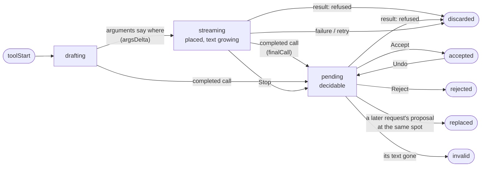

# AI proposals: lifecycle and behavior

How a `propose_edit` tool call travels from streamed arguments to text in the
document, what consecutive prompts do to undecided proposals, and what stop /
failure / close leave behind. Every rule here is enforced in code; the file
that owns each one is named so this document can be checked against reality.

## The surfaces, and the one path into the document

Chat has three surfaces and two conversations, all owned by the editor
(`document-view/MilkdownEditor.tsx`):

- **The AI panel** — docked on the right (`ai/chat/panel/agent-panel.tsx`,
  `AgentPanelView.tsx`). Shows the editor's main conversation, the one saved
  to History.
- **The detached chat window** — the same main conversation popped out into
  its own OS window, one per editor window (desktop only). It owns no
  document state: proposals and accept/reject travel over
  `ai/chat/window/chat-bridge.ts` back to the editor window.
- **Quick Ask** — the in-document bar (`ai/chat/quick-ask/useInlineChat.ts`). It has its
  own short conversation, kept out of History and independent of the
  panel; "Continue in the full conversation" hands its turns to the main
  conversation (`expandQuickAsk`).

All render the same `ChatBody`, and all feed one resolution pipeline:
`MilkdownEditor → usePendingEdits → pending-edit-plugin`. Anchors resolve in
**markdown source space** (`ai/doc-markdown.ts`), matching what the model was
shown. Previews are pure decorations - until the user clicks Accept, the
document text is untouched. Accept (`applyEditRange`) is the **only** write
path: one transaction, one undo step, no direct-apply fallback.

## Modes: which proposals a conversation may make

The composer's mode (`AgentMode`, see
[ai-concepts.md](ai-concepts.md#not-a-file-modes)) decides what reaches
this pipeline, and it is enforced in Rust, not only asked for in the prompt
(`tools.rs`'s `builtin_tools`):

| Mode   | `propose_edit`                                                     |
| ------ | ------------------------------------------------------------------ |
| Write  | `append`, `insert_at_cursor`, `insert_after`, `insert_before` only |
| Review | not offered                                                        |
| Revise | every action                                                       |

The panel and the detached window offer all three; Quick Ask offers Revise
and Review only (`COMPOSER_MODES`, [ai-concepts.md](ai-concepts.md#not-a-file-modes)).

Write gets the same propose_edit as Revise (one tool list for both, so a
switch keeps the provider's cached prefix); the mode section in the
message says it only adds text, and `propose_insertion` refuses any other
action a model sends; the refusal is a tool result
like any validation failure, so its streamed preview is discarded
(`isRefusal`) and nothing that replaces or deletes text reaches the editor.
A Write proposal is the same green pending block as any insertion: shown,
not applied, until Accept. With a selection, Write inserts after it
(`insert_after`), never over it.

### Pictures: `generate_image`

With an image model set (Settings › Textus AI › Image model; none by
default), Write and Revise also get `generate_image`, whose call is a
proposal too: an insertion of one Markdown image, or the `replace` of a
picture already in the document. The tool starts the picture in the
background (`ai/images.rs`'s `ImageRun::run_call`) and returns at once with
its id recorded in the call's arguments, so the reply goes on while the
picture is made; the frontend waits for it (`ai_generated_image`, up to 200
seconds) and shows the picture's frame in its place and shape meanwhile.
Its text names the picture by a placeholder src; only the preview swaps in
the bytes (`generated-images.ts`). Accept waits for a picture still being
made, then saves it the way Settings › Images says for a pasted one and
writes the image with the saved src through the same `applyEditRange`;
undo brings the proposal back, and accepting it again reuses that file.
Reject lets the picture go in the backend too. A call that made no picture
(refused by the service, out of quota, past the per-send limit) is a
refusal like any other: no preview, and its card is the service's reason.

New text with pictures writes each one into its text as a line of its own
(``); the backend starts the picture
the moment that line has streamed in (`images/inline.rs`) and tells the
frontend (`StreamEvent::Picture`), which draws the line as its frame
(`withBegunPictures`). The text and its pictures are one proposal.

## Where a proposal points: blocks

The model is shown the document with each block's id before it
(`[#k3f9] `, `ai/doc_blocks.rs`; mirrored in `ai/doc-blocks.ts` for drafts),
and every call that points into the document names its block instead of
quoting it - `propose_edit` (`block`, `last_block` for a run), `add_comment`
and `generate_image` (`block`) - with `anchor` only for a few words inside
that block. The backend turns the id into an anchor before anything else
sees the call (`agent.rs`' `postfix_step`: `resolve_edit_arguments`,
`resolve_target_arguments`), so validation, history and the frontend work
in anchors as before; a draft still streaming does the same
(`resolveBlockEdit`, `resolveBlockTarget`). Quoting cost a whole passage of
output before anything could show, and a quote that didn't match the
document's own Markdown (a picture given a width, written as ``) found
nothing. An id names nothing once its block changed: the tool says so.

## The lifecycle

Every proposal - an edit, a picture, a review note - goes through one
lifecycle. Its states and what moves it on:

Who owns each move:

| Move                                                                      | Owner                                                                                                                                     |
| ------------------------------------------------------------------------- | ----------------------------------------------------------------------------------------------------------------------------------------- |
| drafting → streaming, its text growing, stop / failure endings, a refusal | `ai/revision/proposal-stream.ts` (`ProposalStream`): pure, no editor                                                                      |
| how a draft is shown - typed in, or drawn again as it grows               | `ai/revision/proposal-display.ts` (`typewriter`, `drawn`, chosen per call)                                                                |
| streaming → pending                                                       | the completed call's add (`ChatBody`'s completed turns) and, for a typed-in draft, the reveal settling (`pending-edit-plugin`'s `settle`) |
| pending → accepted / rejected / replaced / invalid, undo                  | `ai/revision/usePendingEdits.ts` + `pending-edit-plugin.ts`                                                                               |
| what the model is told of each, next request                              | `ai/revision/proposal-status.ts`                                                                                                          |

### Writing: `ProposalStream`

`toolStart` opens a draft (propose_edit and generate_image; a note is
drawn from its arguments by the conversation, below). The draft is placed
the moment its arguments say where it goes - an action and a block, or an
anchor - and from then on fed the text as it arrives. The same call said
to start again (the backend announces a picture it runs) is the same
call: a fresh draft in its place stranded the placed one, and a redone
picture read "Writing…" for good (`1.2.0-rc.6`).

Endings:

- **The completed call** (`finalCall`) closes the reveal; the call's own
  add makes the proposal decidable. A picture's frame goes and the
  picture's proposal takes its place.
- **Its result** (`result`): one the backend refused goes, streamed or
  placed; the model sends it again, fixed.
- **Stop keeps** what the user watched arrive: a draft is frozen as a
  decidable proposal - a rewrite with the sentences it completed, the
  originals it hadn't reached left plain (`stopRewrite`); none completed,
  nothing.
- **Failure discards** (and a step asked for again after a garbled one):
  Retry would otherwise duplicate it.

### Showing a draft: `proposal-display.ts`

With edit animation on, a draft is placed once and typed in
(`streamPendingInsertText`); a rewrite is laid out sentence by sentence as
it goes (below, "Streaming in place"). With edit animation off, or the
system's Reduce motion, there is no typewriter, but the draft still shows
as it is written: drawn again with what has arrived, at most every 150 ms.
Until `1.2.0-rc.6` it showed nothing then, and every edit appeared at once
when the reply was done. Each call keeps the display it started with.

The status line under the reply says what is coming whenever nothing else
moves: "Writing the edit…", "Writing notes…", "Generating an image…", or
"Thinking…" (`ChatMessages`' `ThinkingIndicator`).

### Notes

A note (`add_comment`) changes nothing, so it has no preview: the
conversation draws it into `StreamingState.comments` as soon as its
passage and its text are complete in the streaming arguments
(`useAgentConversation`), and the margin shows it from there
(`useReviewNotes`). The completed call places it again, should its
`context` have settled a repeated passage differently.

### Deciding: `PendingStatus`

| Status      | Meaning                                                        | Behavior                                                                                                          |
| ----------- | -------------------------------------------------------------- | ----------------------------------------------------------------------------------------------------------------- |
| `streaming` | Arguments still arriving, or the typewriter still revealing    | Accept waits (not a failure - it works once settled)                                                              |
| `pending`   | Decidable                                                      | Strike (red) + new text (green), ✓ / ✕ per change; the review bar walks changes in document order                 |
| `accepted`  | Applied                                                        | Decoration removed in the same transaction as the write; Undo brings it back                                      |
| `rejected`  | The user turned it down                                        | Preview removed; the card says Rejected                                                                           |
| `replaced`  | A later request's proposal at the same spot took its place     | Preview removed; the card says "Replaced by a newer proposal", and the model is told it wasn't the user's verdict |
| `invalid`   | Its text is gone                                               | Preview dropped; the card offers to ask for it again                                                              |
| `joined`    | A picture or an edit that went into a proposal not decided yet | Decided with that proposal                                                                                        |

**The writer's edits stand.** Every `docChanged` maps each preview through
the transaction and re-reads its text. Unchanged, nothing is redrawn.
Changed (`pending-edit-plugin`'s `rebase`):

- a proposal decided change by change keeps each change whose original
  still reads as it did (`PendingSentence.expected`); one whose original
  the writer changed is set aside (`parked`), not shown or applied, and
  back if it reads so again; none left, it goes (`invalid`);
- a rewrite still streaming in keeps streaming, its original's ranges
  following the edit; its completed call is found again change by change
  against the text as it then is (`usePendingEdits`' `rebasedSentences`);
- a proposal shown and decided whole goes, as before - its Accept would
  write the whole range, the edit with it.

A proposal that went through an edit is `rebased`: Accept writes its taken
changes one by one, back to front, and nothing else, so what the writer
typed in between stays.

## Revision views

The review bar's view menu (and **Settings › AI**) picks how pending
revisions are drawn, as Word's markup views:

| View                                        | Original    | New text                    |
| ------------------------------------------- | ----------- | --------------------------- |
| **All in the text** (`inline`)              | struck, red | green, with ✓ / ✕           |
| **Original in the text, changes in margin** | struck, red | margin card                 |
| **Changes in the text, original in margin** | margin card | green                       |
| **Result only, no markup** (`final`)        | hidden      | unmarked, faint dotted line |

How finely a rewrite is decided follows what it did (`sentence-diff.ts`'
`regroup`). It is cut into the smallest runs both sides of which end a
paragraph together, and each run:

- kept its paragraphs: decided sentence by sentence - or as one change,
  struck whole with the new paragraph after it, where the paragraph was
  rewritten (more than half its sentences changed and it reads unlike its
  original); a polish that touched every sentence stays sentence by
  sentence;
- joined, split or regrouped paragraphs: one change for the new
  paragraph(s), set against the paragraphs they came from - also when every
  sentence was kept, since accepting joins them.

A rewrite is shown this way when its pieces can be found in the text -
also when its anchor spans several paragraphs, which resolve to their whole
blocks (`sentence-locate.ts` skips the text before the anchor). One that
can't be (a heading or list turned into something else) is shown whole,
and the views apply to it as one change with one card.

**The text reads as the result.** Where a view takes the originals out of
the text ("Changes in the text", "Result only"), a block whose text is
all struck and holds no new text - a paragraph the rewrite joins to the
one before it - goes out of the flow with it (`struckBlocks`,
`.pending-struck-block`); left standing it was an empty line with a
paragraph's margins, a blank gap (`1.2.0-rc.1`). One that holds a deleted
sentence's mark keeps its line in "Changes in the text". The margin never
moves the text: cards stack downward and move instead, and a card the
stack pushed below its passage draws its line only while it is under the
pointer or the review bar's pointer - drawn all the time, those lines ran
together down the gap between text and cards as stray strokes.

**Streaming in place.** Such a rewrite is laid out sentence by sentence
while it is still streaming in, not only once it settles
(`sentence-stream.ts`, `pending-edit-plugin`'s `streamDecorations`). Each
completed sentence of the new text is aligned against the original the
way the finished rewrite is (`diffSentenceLists`), except for the last run
of changes, where an original the stream hasn't reached is still to come,
not deleted. So:

- a changed sentence is struck where it stands with its new text beside it
  the moment it completes, in every view; a kept one shows nothing of its
  own, but the progress cursor (`readingDecoration`, a tint in
  `--revision-reading-bg`) stands on the original the stream has reached,
  so a light polish moves through the text rather than standing still;
- the sentence being written types in beside the original it rewrites,
  which is struck while it is written - or, a sentence of its own, where it
  goes. While it still repeats an original word for word, or is too short
  to tell which one it rewrites, it shows nothing;
- an original is struck only once the stream reaches or passes it, and an
  original once reached is never handed back (`reachedAtLeast`); a
  re-alignment that moves a sentence's new text (a dropped sentence joins
  the change before it) cross-fades it there;
- each completed change's margin card comes with it, and the review bar is
  there from the start of the stream, its count growing one change at a
  time (`streamChanges`, `usePendingEdits`' `reviewed`); ‹ › and the view
  menu already work. In "Original in the text" the sentence being written
  doesn't show in the text - it would only come and go - but in its card
  once complete;
- each completed change's ✓ / ✕ (in the text and on its card) come in
  faint and inert and take clicks once the whole rewrite is in, and so do
  the review bar's Accept and Reject: half a rewrite isn't something to
  take. The AI panel's Stop ends it early, with what it completed.

When the stream ends, the layout is exactly the one the finished proposal
has, on the same elements: nothing is redrawn, nothing moves. The alignment
runs once per completed sentence, on an animation frame; the sentence being
written is placed every frame. A rewrite whose sentences can't be found
and Write's new text stream in as one block, after the struck original;
with edit animation off, drawn again as it grows.

New text alone - what Write proposes - has no original, so the margin views
have nothing to set beside it: it stays a green block in the text there,
and the view menu says so. In **Result only** it reads as the result.

Every view's parts are always drawn, and the view is an attribute on the
editor (`data-revision-display`, `pending-edit-plugin`'s `syncDisplay`)
that the stylesheet reads. Switching views redraws nothing: what stays is
the same elements at full opacity, and what the new view brings in fades
in briefly (a Web Animation, off with reduced motion). In `1.1.0-rc.6` the
widgets were keyed by the view, so every switch drew them again and the
text came back from nothing. An original the view takes out of the text is
hidden in the flow (`font-size: 0`), not `display: none`, which would start
its entrance over when it came back.

Staleness is the lifecycle's ("The writer's edits stand", above). Accept
re-checks once more, defensively. Terminal statuses are remembered even
after the preview leaves the document, so a chat card never regresses to a
misleading "Pending".

## Exchange boundaries: consecutive prompts

Messages sent while a reply is coming wait in a queue and go one at a
time, each against the document as it then is (`MessageQueue`). Between
exchanges, one implementation point (`useEditorProposals`' `addPreviews`
plus a `supersedePending` flag):

1. **A new proposal takes the place of an undecided one at its spot.** The
   first proposal a new exchange writes notes which previews came before
   it; any of those it stands on - the same spot, of the same kind (text
   for text, a picture for a picture) - is `replaced`. The rest, elsewhere,
   stay for the user to decide: a picture asked for after a paragraph that
   wasn't accepted yet doesn't take that paragraph away.
2. **An edit of text proposed and not decided yet goes into that
   proposal** (`joinEdit`), and a picture next to it joins it
   (`joinPicture`): the user decides on them together.
3. **Question turns don't clear.** The flag is armed when an exchange
   starts and consumed by the first preview add.
4. **The model is told the truth.** Each send annotates every past
   proposal's tool result with its current status - undecided, accepted,
   rejected, replaced, invalid - see the next section.

Arming differs per surface: the panel and Quick Ask use their
conversation's `busy` rising edge (each conversation arms on its own); a
detached send never flips that, so it arms via `onContextRequest` - the
fetch-fresh-document signal that precedes every detached send.

## Conversation layer

`ai/chat/useAgentConversation.ts`, `ai/chat/cancelled-turns.ts`,
`ai/revision/proposal-status.ts`, `ai/chat/useRevealedText.ts`; Rust side
`src-tauri/src/ai/agent.rs` / `tools.rs`.

**Every send.** History travels to the backend in full; the document goes
into the system prompt as markdown source (long documents truncate to an
outline plus start/end - the model uses `search_document` for the middle).
The document contains **only accepted edits** - undecided previews are
decorations, absent from it. `annotateProposalStatuses` stamps each past
proposal's tool result with its current status (undecided / accepted /
rejected / invalid), computed fresh per send and never persisted; only call
ids present in the status map are touched, so other tools and
failed-validation proposals pass through unchanged. `agent.rs`'s
instructions tell the model to trust the notes, never anchor to undecided
text, and that proposing new edits replaces undecided ones automatically.

**Stop (user-initiated).** Everything that already streamed is kept: the
completed intermediate turns plus the cut-off reply (as a final Assistant
turn) enter history, saved and displayed like any completed exchange. A
ToolCall the stop left unanswered gets a synthetic result
(`STOPPED_TOOL_RESULT`) - providers reject a replayed history containing an
unanswered tool call. If nothing beyond the user's own message ever
streamed, the whole exchange is dropped (a user message with no reply at all
would read as the model ignoring it).

**Failure.** Sets `error` and `retryable`; Retry resends the same message
verbatim against the document it was composed for. Streamed half-finished
previews are rolled back (writing phase, above).

**Streaming.** Text deltas can arrive several times a frame, and each state
update re-renders the editor that owns the conversation, so a delta only
marks the streaming state dirty and one render per animation frame picks
them all up (`setStreaming` with `textOnly`). Everything else - a landed
turn, the end of the exchange - renders at once. What the chat shows is
paced separately: `ai/chat/useRevealedText.ts` draws the reply through
`ai/stream-reveal.ts`'s `StreamReveal`, a steady pace a little behind the
network, the same pacing the typewriter uses for a proposal in the
document. The end of a stream (finished, stopped or failed) shows the whole
text at once; with reduced motion the reply shows in the steps it arrived.

## Margin availability

The revision views "original" and "new" put one side of each change in the
margin, and review notes are margin cards. Whether there is room is
measured, not assumed (`ai/margin/margin-room.ts`): the text column first
moves left to open a margin, and when even that leaves too little - a
narrow window, both side panels open, a large zoom - there is no margin.
The active document's `ReviewMargin` measures on every resize and writes
the answer to a per-window store (`useMarginAvailable`).

- **The margin views fall back to inline.** With no margin, both sides of
  each change are drawn in the text (`effectiveRevisionDisplay`) and
  review notes go behind numbered badges, which the chat's note cards
  repeat.
- **The chosen view waits and returns.** The setting is not changed: the
  review bar's view button shows what is drawn meanwhile, and the chosen
  view comes back as soon as there is room again.
- **The options say why they are off.** In the review bar's menu and in
  Settings the margin views stay listed but disabled
  (`marginViewBlocked`), with a note to close the sidebar or the AI panel.
  A phone never has a margin, so it lists only the views that need none
  and explains nothing.

## Draft snapshots and closing

`draft-autosave.ts`, `startup-restore.ts`, `App.tsx`.

- **Writing.** A dirty tab's content snapshots to disk 3 s after typing
  settles, at most every 30 s during an unbroken burst. A tab that turns
  clean or leaves the tab list has its snapshot cleared.
- **Closing the last tab** ("Don't Save"): the window dies with it, so the
  autosave hook's cleanup effect never gets another run - `removeTab`
  cancels all scheduled snapshot writes and clears the tab's snapshot
  explicitly BEFORE destroying the window.
- **Closing the whole window** (save or discard): `clearWindowDrafts` also
  cancels scheduled writes first - otherwise a debounce timer firing between
  the clears and `destroy()` re-saves what was just deleted, resurrecting a
  discarded document as a "recovered draft". Only this window's tabs are
  cleared; other windows' drafts survive.
- **Startup**, in priority order: a tab dragged in from another window
  (short-circuits everything), recovered drafts (path-backed drafts whose
  disk content already matches are skipped; never steals focus), a Help doc
  this window was spawned for, OS-handed file paths, first-run onboarding.

## File index

| File                                                                | Owns                                                                                                 |
| ------------------------------------------------------------------- | ---------------------------------------------------------------------------------------------------- |
| `ai/revision/proposal-stream.ts`                                    | Writing-phase machine: place/feed/finalize/discard, a call's result                                  |
| `ai/revision/proposal-display.ts`                                   | How a draft is shown: typed in, or drawn again as it grows                                           |
| `ai/doc-blocks.ts`, `src-tauri/src/ai/doc_blocks.rs`                | Block ids, and a call naming its block turned into an anchor                                         |
| `ai/revision/sentence-diff.ts`                                      | A rewrite's changes, and how finely each is decided (`regroup`)                                      |
| `ai/revision/usePendingEdits.ts`                                    | Anchor resolution, accept/reject/rejectAll, status map, review navigation                            |
| `ai/revision/pending-edit-plugin.ts`                                | Decorations, hover tint, typewriter + settle, the progress cursor, staleness and `rebase`, shortcuts |
| `ai/revision/sentence-stream.ts`                                    | A rewrite's sentence layout while it streams in                                                      |
| `ai/revision/proposal-status.ts`                                    | Status notes annotated onto history at send time                                                     |
| `ai/chat/cancelled-turns.ts`                                        | What a stop keeps; dangling tool-call closure                                                        |
| `ai/chat/useAgentConversation.ts`                                   | Conversation state: send/stop/retry/restore, history persistence                                     |
| `ai/stream-reveal.ts`                                               | The pace streamed text is revealed at: the typewriter and chat replies                               |
| `ai/chat/useRevealedText.ts`                                        | A chat reply as drawn while it streams, paced by `StreamReveal`                                      |
| `ai/chat/ChatBody.tsx`                                              | Shared conversation UI; streamed-turn → proposal, idempotent afterSend                               |
| `ai/chat/window/ChatWindowApp.tsx`, `ai/chat/window/chat-bridge.ts` | Detached window and its bridge: context/status pushes, proposal forwarding                           |
| `ai/margin/margin-room.ts`                                          | Whether there is room for a margin; the per-window store both menus read                             |
| `ai/revision/revision-display.ts`                                   | The view drawn without a margin; which margin views can't be picked                                  |
| `document-view/useEditorProposals.ts`                               | Wiring: the machine and its displays, supersede flag, exchange boundaries                            |
| `draft-autosave.ts`, `startup-restore.ts`, `App.tsx`                | Draft snapshots, startup restore, close-time cleanup                                                 |
| `src-tauri/src/ai/tools.rs`, `agent.rs`                             | `propose_edit` validation, system prompt, the status-note contract                                   |
