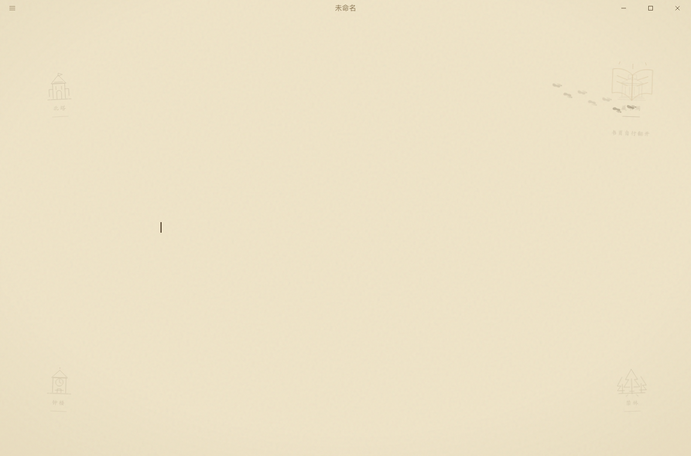

# The Magic Diary

A hidden mode, contributed by Zhuohang Jiang. While it is on, the window
becomes an old book: the page ages, a pagekeeper's footprints walk the
margins between four places on a map, and each line the writer finishes is
answered on the page, in another hand, by the connected AI provider.
Nothing in the interface names it.

## Opening and closing it

Settings › General › About Textus: tap the version five times, quickly. It
opens only when the selected AI provider is signed in or has its key, and
only in the desktop app; without a provider the taps do nothing at all.
Settings close and the page is the book. Five more taps close it, and the
user's own theme is back - the diary sits over the theme, it doesn't
replace it (`enableDiary` in Settings, `html[data-magic-diary]`).

While it is on, ghost-text completion and grammar underlines stand down:
they would write over the answer on the same line.

## Where it lives

| Part                                       | What it does                                                   |
| ------------------------------------------ | -------------------------------------------------------------- |
| `src/ai/magic-diary/magic-diary-plugin.ts` | Notices a finished line, asks for the answer, writes it in ink |
| `src/ai/magic-diary/FootprintLayer.tsx`    | The pagekeeper walking the margins                             |
| `src/ai/magic-diary/MagicMapOrnaments.tsx` | The map's four places                                          |
| `src/theme/magic-diary-page.css`           | The aged page over the whole window, light and dark            |
| `src-tauri/src/ai/diary.rs`                | `ai_diary_reply`: the answer, through the user's provider      |
| `src-tauri/src/ai/diary-story.txt`         | The world and the story the model tells from                   |

## The handwriting

The answer's hand is LXGW WenKai (SIL OFL 1.1). It is not bundled with the
app: `theme/apply-appearance.ts` links
`https://textus.catvinci.com/fonts/lxgw-wenkai/1.7.0/regular.css` only while
the diary is on. That stylesheet splits the face by `unicode-range` with
`font-display: swap`, so a page downloads only the slices its text uses and
the browser caches them. Offline, the hand falls back to the system's kai
(Kaiti, STKaiti, Klee One), then serif. The files and their licences live in
the website repository under `public/fonts/lxgw-wenkai/1.7.0/`; its
`functions/_middleware.js` serves `/fonts/` with
`Access-Control-Allow-Origin: *` and a year-long immutable cache. A new font
version goes to a new versioned path, never over the old one.

## The story

The world is Textus's own, borrowed from no other book, film or game.
Textus is a blank book bound by Vela, a mapmaker who spent her life drawing
the Unfinished City, where every brick is a sentence someone never
finished. A thread of ink from her last map became the pagekeeper, who walks
the margins for anyone writing at night. The map keeps four places: the
Star Loft, the Endless Stacks, the Echo Clock and the Firefly Wood. Every
answer on the page is the model's, told in the reader's language from the
English text in `src-tauri/src/ai/diary-story.txt` - change the story there.

To hear it, start with "Who are you?" or "Tell me your story", then "What
happened next?"; or ask about Vela, the footprints, the Star Loft or the ink
wolf directly.
