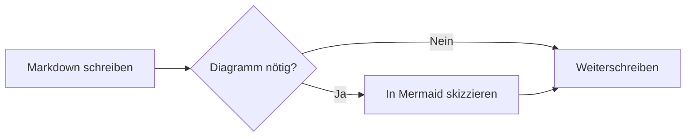
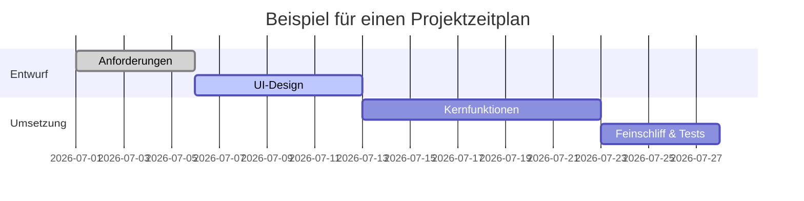
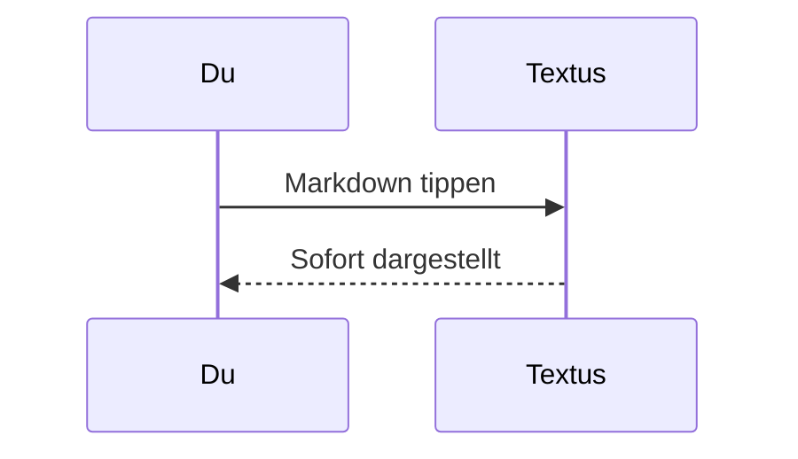

# Markdown-Anleitung für Textus

Willkommen. Dieses eingebaute Dokument zeigt, welche Markdown-Elemente Textus darstellt. Es ist nur ein ungespeicherter Entwurf – bearbeite es nach Belieben, probiere alles aus und schließe es danach, ohne zu speichern.

> [!TIP]
> Mit `Cmd+/` wechselst du zwischen WYSIWYG und Quellcodemodus und siehst die Syntax hinter jedem Beispiel hier.

## Überschriften und Zitate

Tippe am Zeilenanfang `#` und ein Leerzeichen für eine Überschrift der Ebene 1 oder `##` und ein Leerzeichen für Ebene 2. Die Überschriften oben zeigen das Ergebnis.

Ein Zitat:

> Zitierter Text kann weitere Auszeichnungen enthalten, etwa **Fettdruck** und `Code`.

Hinweise im GitHub-Stil:

> [!NOTE]
> Eine Notiz mit zusätzlichem Kontext.

> [!WARNING]
> Eine Warnung vor Dingen, auf die du achten solltest.

## Textauszeichnung

**Fett** (`**Text**`), *kursiv* (`*Text*`), ***fett und kursiv***, ~~durchgestrichen~~ (`~~Text~~`), ==hervorgehoben== (`==Text==`) und `Inline-Code`.

Links sehen so aus: [das Textus-Repository](https://github.com/CatVinci-Studio/Textus). Mit Strg/⌘+Klick folgst du einem Link: Ein Weblink öffnet sich im Browser, ein Link auf eine andere Markdown-Datei öffnet sie in einem Tab, und ein Link auf `#eine-überschrift` scrollt dorthin. Auch HTML im Text wird dargestellt, etwa Tasten wie <kbd>Cmd</kbd> + <kbd>S</kbd>. Ebenso aufklappbare `<details>`-Blöcke, HTML-Tabellen, einige Inline-Stile (Farbe, Hintergrund, Größe, Stärke, Ausrichtung, Unter- und Durchstreichung) und eingebettetes `<svg>`, das als Bild erscheint. Skripte und anderes HTML bleiben als Quelltext stehen.

Formeln im Text: die Äquivalenz von Masse und Energie $E = mc^2$, die eulersche Identität $e^{i\pi} + 1 = 0$.

## Listen

- Ungeordnete Liste
- Mit Verschachtelung
  - Ein Eintrag der zweiten Ebene
  - Noch einer

1. Geordnete Liste
2. Zweiter Eintrag

Aufgabenliste (ein Klick auf ein Kästchen setzt oder entfernt den Haken):

- [x] Etwas Erledigtes
- [ ] Etwas, das noch zu tun ist

## Tabellen

| Funktion | Syntax | Ergebnis |
| --- | --- | --- |
| Fett | `**Text**` | **Text** |
| Hervorhebung | `==Text==` | ==Text== |
| Formel im Text | `$x^2$` | $x^2$ |

Bewege den Zeiger über eine Tabelle, um Zeilen und Spalten hinzuzufügen oder zu entfernen. Tippe `| Name | Alter |` und drücke Enter, um eine Tabelle anzulegen. Enter springt eine Zeile nach unten, fügt in der letzten Zeile eine neue hinzu und verlässt die Tabelle, wenn die neue Zeile leer bleibt; mit Ctrl/⌘+Enter verlässt du sie jederzeit.

## Codeblöcke

Umgrenzte Codeblöcke mit Syntaxhervorhebung (die Sprache stellst du oben rechts im Block um). Enter in der leeren letzten Zeile verlässt den Block, Ctrl/⌘+Enter jederzeit; dasselbe gilt für Zitate.

```python
def fib(n: int) -> int:
    """Die klassische Fibonacci-Folge."""
    a, b = 0, 1
    for _ in range(n):
        a, b = b, a + b
    return a
```

```rust
fn main() {
    let greeting = "Hallo, Textus!";
    println!("{greeting}");
}
```

## Formelblöcke

Formeln zwischen `$$` setzt KaTeX als eigenen Block:

$$
\int_{-\infty}^{\infty} e^{-x^2} \, dx = \sqrt{\pi}
$$

## Diagramme (Mermaid)

Ein ```` ```mermaid ````-Codeblock wird als Live-Diagramm dargestellt. Ein Flussdiagramm:



Ein Gantt-Diagramm:



Ein Sequenzdiagramm:



## Bilder

Füge ein Bild direkt aus der Zwischenablage ein – Textus speichert es und fügt den Verweis ein. Wohin, legst du unter **Einstellungen → Editor & Design → Bilder** fest. **Auf diesem Computer** ist es ein **Unterordner** im Ordner des Dokuments, standardmäßig `assets/`, dessen Namen du ändern kannst, oder **Derselbe Ordner wie das Dokument**; die Einstellungen zeigen den Link, den ein eingefügtes Bild bekommt. Mit **Zu einem Bildhoster hochladen** geht es an PicGo / PicList, SM.MS, Imgur oder deinen eigenen Endpunkt (**Eigener Server**).

Ein eigener Endpunkt empfängt `multipart/form-data` mit einem Feld `file` und kann die öffentliche URL entweder als reinen Text oder in einem einstellbaren JSON-Feld zurückgeben. Hochgeladene Dateien können automatisch umbenannt werden oder ihren Originalnamen behalten, oder Textus fragt dich vor jedem Upload nach einem Namen. Wenn du den Speicherort wechselst, bleiben vorhandene Bildverweise unverändert.

Oder schreib den Verweis von Hand:

```markdown

```

Obsidian-Einbettungen wie `![[image.png]]` oder `![[attachments/image.png|300]]` zeigen ebenfalls das Bild: Textus sucht die Datei im Obsidian-Tresor des Dokuments und speichert die Einbettung genau so, wie sie geschrieben ist.

## Ansichten und Modi

Neben dem WYSIWYG-Editor und dem Quellcodemodus (`Cmd+/`) bietet Textus drei Arten zu schreiben (unter Windows und Linux `Ctrl` statt `Cmd`; die aktuellen Belegungen stehen unter Einstellungen → Tastenkürzel):

- **Geteilte Ansicht** (`Cmd+Shift+E`): links der Markdown-Quelltext, rechts die gerenderte Vorschau, beide scrollen gemeinsam.
- **Schreibmaschinenmodus** (Einstellungen → Editor & Design → Ansicht): Die Zeile, in der du tippst, bleibt in der Mitte des Fensters – im Editor, im Quellcodemodus und in der geteilten Ansicht.
- **Zen-Modus** (`Cmd+Shift+J`): blendet alles außer dem Text aus, wechselt in den Vollbildmodus und dimmt jeden Absatz außer dem, an dem du gerade schreibst. Mit `Esc` verlässt du ihn.

Alle drei findest du auch im Menü **Ansicht**.

## Schnellnotizen

**Datei → Neue Schnellnotiz** öffnet ein kleines Fenster, um schnell etwas festzuhalten. Mit `Esc` (oder `Cmd+Enter`, `Cmd+S`, `Cmd+W`) wird die Notiz gespeichert und das Fenster geschlossen; eine leere Notiz wird einfach geschlossen. **In Textus öffnen** speichert sie und öffnet sie als Tab.

Notizen landen in `Textus/Schnellnotizen` in deinem Dokumente-Ordner, eine Datei pro Notiz, benannt nach der ersten Zeile. Unter **Einstellungen → Allgemein → Schnellnotizen** kannst du einen anderen Ordner wählen, stattdessen **eine Datei pro Tag** führen und ein **globales Tastenkürzel** einschalten, das aus jeder App eine Schnellnotiz öffnet: `Control+Option+N` auf dem Mac, `Strg+Alt+N` unter Linux, `Win+Alt+N` unter Windows. Öffnest du innerhalb weniger Minuten wieder eine, setzt du die letzte Notiz fort. Unter Wayland legst du den dort angezeigten Befehl `textus --quick-note` in den Einstellungen deines Desktops auf eine Taste.

## Fußnoten und Trennlinien

Fußnoten sehen so aus[^1], und darunter folgt eine horizontale Trennlinie:

---

[^1]: Der Inhalt der Fußnoten wird am Ende des Dokuments gesammelt.

Viel Freude beim Schreiben.
