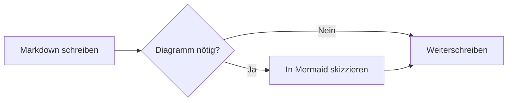
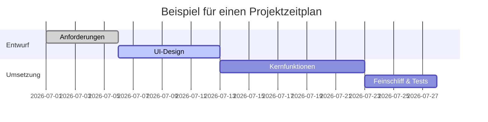
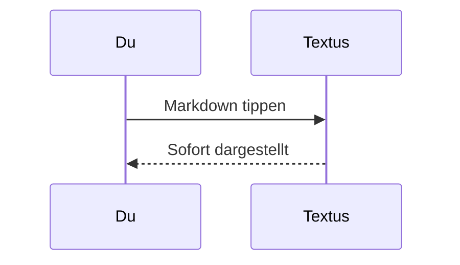

# Markdown-Anleitung für Textus

Willkommen. Dieses eingebaute Dokument zeigt, welche Markdown-Elemente Textus darstellt. Es ist nur ein ungespeicherter Entwurf – bearbeite es nach Belieben, probiere alles aus und schließe es danach, ohne zu speichern.

> [!TIP]
> Mit `Cmd+/` wechselst du zwischen WYSIWYG und Quellcodemodus und siehst die Syntax hinter jedem Beispiel hier.

## Überschriften und Zitate

Tippe am Zeilenanfang `#` und ein Leerzeichen für eine Überschrift der Ebene 1 oder `##` und ein Leerzeichen für Ebene 2. Die Überschriften oben zeigen das Ergebnis. `Ctrl+1` bis `Ctrl+6` (`Cmd+1` bis `Cmd+6` auf dem Mac) machen die aktuelle Zeile zu einer Überschrift dieser Ebene.

Ein Zitat:

> Zitierter Text kann weitere Auszeichnungen enthalten, etwa **Fettdruck** und `Code`.

Hinweise im GitHub-Stil:

> [!NOTE]
> Eine Notiz mit zusätzlichem Kontext.

> [!WARNING]
> Eine Warnung vor Dingen, auf die du achten solltest.

## Textauszeichnung

**Fett** (`**Text**`), *kursiv* (`*Text*`), ***fett und kursiv***, ~~durchgestrichen~~ (`~~Text~~`), ==hervorgehoben== (`==Text==`) und `Inline-Code`.

Tippst du `(`, `[`, `{`, ein Anführungszeichen oder eine Klammer aus einer chinesischen oder japanischen Eingabemethode wie `（`, `【` oder `「`, kommt das schließende Gegenstück hinter den Cursor: Das getippte Schlusszeichen springt darüber, Rücktaste direkt nach dem öffnenden löscht beide, und markierter Text wird eingeschlossen. **Einstellungen → Editor & Design → Klammern und Anführungszeichen automatisch schließen** schaltet das ab.

Links sehen so aus: [das Textus-Repository](https://github.com/CatVinci-Studio/Textus). Mit Strg/⌘+Klick folgst du einem Link: Ein Weblink öffnet sich im Browser, ein Link auf eine andere Markdown-Datei öffnet sie in einem Tab, und ein Link auf `#eine-überschrift` scrollt dorthin. Ein einfacher Klick setzt den Cursor in den Link und zeigt sein Markdown, `[Text](URL)`, zum Bearbeiten an Ort und Stelle; verlässt der Cursor ihn, ist er wieder ein Link. Auch HTML im Text wird dargestellt, etwa Tasten wie <kbd>Cmd</kbd> + <kbd>S</kbd>. Ebenso aufklappbare `<details>`-Blöcke, HTML-Tabellen, einige Inline-Stile (Farbe, Hintergrund, Größe, Stärke, Ausrichtung, Unter- und Durchstreichung) und eingebettetes `<svg>`, das als Bild erscheint. Skripte und anderes HTML bleiben als Quelltext stehen. Ein Link auf eine Überschrift in einer anderen Datei, etwa `[siehe](notizen.md#eine-überschrift)`, öffnet diese Datei an der Überschrift. Obsidian-Wikilinks (`[[Notiz]]`, `[[Notiz|Text]]` und `[[Notiz#Überschrift]]`) öffnen sich genauso, aus dem Ordner des Dokuments oder von überall in seinem Vault; sie und `#Tags` am Zeilenanfang werden genau so gespeichert, wie sie geschrieben sind.

**Einstellungen → Editor & Design → Farbfelder vor Farbcodes** setzt ein kleines Quadrat in der Farbe vor einen Farbcode. **Nur in Code** zeigt es in Inline-Code, der eine Farbe ist, etwa `#0af` oder `rgb(0 128 255)`, und vor den Farbwerten in Codeblöcken; **Überall** auch vor im Text mit sechs oder acht Stellen geschriebenen Farbcodes, etwa #ff8800, und Farbfunktionen, etwa hsl(210 100% 50%). Kurzformen im Text, Tags wie #cafe, Nummern wie #234 und Links bleiben, wie sie sind.

Formeln im Text: die Äquivalenz von Masse und Energie $E = mc^2$, die eulersche Identität $e^{i\pi} + 1 = 0$.

## Listen

- Ungeordnete Liste
- Mit Verschachtelung
  - Ein Eintrag der zweiten Ebene
  - Noch einer

1. Geordnete Liste
2. Zweiter Eintrag

Aufgabenliste (ein Klick auf ein Kästchen setzt oder entfernt den Haken):

- [x] Etwas Erledigtes
- [ ] Etwas, das noch zu tun ist

## Tabellen

| Funktion | Syntax | Ergebnis |
| --- | --- | --- |
| Fett | `**Text**` | **Text** |
| Hervorhebung | `==Text==` | ==Text== |
| Formel im Text | `$x^2$` | $x^2$ |

Bewege den Zeiger über eine Tabelle, um Zeilen und Spalten hinzuzufügen oder zu entfernen. Tippe `| Name | Alter |` und drücke Enter, um eine Tabelle anzulegen. Enter springt eine Zeile nach unten, fügt in der letzten Zeile eine neue hinzu und verlässt die Tabelle, wenn die neue Zeile leer bleibt; mit Ctrl/⌘+Enter verlässt du sie jederzeit. In einer Tabelle springen Tab und Umschalt+Tab zur nächsten und zur vorigen Zelle, und Umschalt+Enter beginnt eine neue Zeile in der Zelle.

## Codeblöcke

Umgrenzte Codeblöcke mit Syntaxhervorhebung (die Sprache stellst du oben rechts im Block um). Enter in der leeren letzten Zeile verlässt den Block, Ctrl/⌘+Enter jederzeit; dasselbe gilt für Zitate. Die Schaltfläche **Kopieren** neben der Sprache kopiert den Code des Blocks, und **Einstellungen → Editor & Design → Zeilennummern in Codeblöcken** nummeriert seine Zeilen; beides erscheint weder in Exporten noch im Ausdruck.

```python
def fib(n: int) -> int:
    """Die klassische Fibonacci-Folge."""
    a, b = 0, 1
    for _ in range(n):
        a, b = b, a + b
    return a
```

```rust
fn main() {
    let greeting = "Hallo, Textus!";
    println!("{greeting}");
}
```

## Formelblöcke

Formeln zwischen `$$` setzt KaTeX als eigenen Block:

$$
\int_{-\infty}^{\infty} e^{-x^2} \, dx = \sqrt{\pi}
$$

## Diagramme (Mermaid)

Ein ```` ```mermaid ````-Codeblock wird als Live-Diagramm dargestellt. Ein Flussdiagramm:



Ein Gantt-Diagramm:



Ein Sequenzdiagramm:



**Einstellungen → Editor & Design → Diagramm-Engine** legt fest, was diese Blöcke zeichnet: Mermaid, die Voreinstellung, oder Pele, das schneller ist, Diagramme aber auf seine eigene Art anordnet und einige Funktionen weglässt; ein Diagramm, das Pele nicht zeichnen kann, zeichnet Mermaid.

## Bilder

Füge ein Bild direkt aus der Zwischenablage ein – Textus speichert es und fügt den Verweis ein. Wohin, legst du unter **Einstellungen → Editor & Design → Bilder** fest. **Auf diesem Computer** ist es ein **Unterordner** im Ordner des Dokuments, standardmäßig `assets/`, dessen Namen du ändern kannst, oder **Derselbe Ordner wie das Dokument**; die Einstellungen zeigen den Link, den ein eingefügtes Bild bekommt. Mit **Zu einem Bildhoster hochladen** geht es an PicGo / PicList, SM.MS, Imgur oder deinen eigenen Endpunkt (**Eigener Server**).

Ein eigener Endpunkt empfängt `multipart/form-data` mit einem Feld `file` und kann die öffentliche URL entweder als reinen Text oder in einem einstellbaren JSON-Feld zurückgeben. Hochgeladene Dateien können automatisch umbenannt werden oder ihren Originalnamen behalten, oder Textus fragt dich vor jedem Upload nach einem Namen. Wenn du den Speicherort wechselst, bleiben vorhandene Bildverweise unverändert.

Oder schreib den Verweis von Hand:

```markdown

```

Obsidian-Einbettungen wie `![[image.png]]` oder `![[attachments/image.png|300]]` zeigen ebenfalls das Bild: Textus sucht die Datei im Obsidian-Tresor des Dokuments und speichert die Einbettung genau so, wie sie geschrieben ist.

## Ansichten und Modi

Neben dem WYSIWYG-Editor und dem Quellcodemodus (`Cmd+/`) bietet Textus drei Arten zu schreiben (unter Windows und Linux `Ctrl` statt `Cmd`; die aktuellen Belegungen stehen unter Einstellungen → Tastenkürzel):

- **Geteilte Ansicht** (`Cmd+Shift+E`): links der Markdown-Quelltext, rechts die gerenderte Vorschau, beide scrollen gemeinsam.
- **Schreibmaschinenmodus** (Einstellungen → Editor & Design → Ansicht): Die Zeile, in der du tippst, bleibt in der Mitte des Fensters – im Editor, im Quellcodemodus und in der geteilten Ansicht.
- **Zen-Modus** (`Cmd+Shift+J`): blendet alles außer dem Text aus, wechselt in den Vollbildmodus und dimmt jeden Absatz außer dem, an dem du gerade schreibst. Mit `Esc` verlässt du ihn.

Alle drei findest du auch im Menü **Ansicht**.

**Einstellungen → Editor & Design → Schriftgröße der Oberfläche** vergrößert oder verkleinert den Text von Seitenleiste, Tabs, Menüs, KI-Bereich und Einstellungen; das Dokument behält seinen eigenen Zoom. `Ctrl+Tab` und `Ctrl+Shift+Tab` wechseln zum nächsten und zum vorigen Tab.

## Ordner und Dateisuche

**Datei → Ordner öffnen…** öffnet einen ganzen Ordner in der Seitenleiste: Der Dateibaum bleibt dort, während du Dokumente darin öffnest, der Ordner kommt mit deiner Sitzung zurück, und **Datei → Ordner schließen** lässt den Baum wieder dem Dokument folgen. Das Feld oben im Tab **Dateien** der Seitenleiste sucht Dateinamen im ganzen Ordner; `Cmd+Shift+O` springt dorthin. Tippe zum Filtern, `↑`/`↓` zum Bewegen, `Enter` zum Öffnen, `Esc` zum Leeren. Beides gibt es nur auf dem Desktop.

Der Baum ist auch eine kleine Dateiverwaltung. Der Name des übergeordneten Ordners darüber führt eine Ebene hinauf. **Sortieren** ordnet ihn nach Name oder nach Änderungsdatum, und der Filter neben dem Suchfeld, **Alle Dateien** oder **Nur Dokumente**, gilt für den Baum wie für die Suche. Ein Rechtsklick auf einen Ordner, eine Datei oder die leere Fläche darunter legt dort ein **Neues Dokument** oder einen **Neuen Ordner** an, und eine Datei oder ein Ordner, auf einen anderen Ordner gezogen, wird dorthin verschoben; ein geöffnetes Dokument folgt an den neuen Ort. Nichts wird ersetzt: Ein vergebener Name wird abgelehnt.

**Datei → Öffnen…** öffnet auch ein Word-Dokument (`.docx`), ebenso das Ablegen auf dem Fenster: Es wird ein neues, noch nicht gespeichertes Markdown-Dokument gleichen Namens mit seinen Überschriften, Listen, Tabellen, Links, Fußnoten und Bildern. Die Bilder kommen beim Speichern dorthin, wo **Einstellungen → Editor & Design → Bilder** eingefügte Bilder ablegt, und **Speichern** schlägt eine `.md`-Datei neben der Word-Datei vor. Manche Formatierung kann anders aussehen; die Word-Datei selbst wird nie verändert. Nur auf dem Desktop.

## Im Hintergrund weiterlaufen

Schalte **Einstellungen → Allgemein → Anwendung → Im Hintergrund weiterlaufen** ein, dann läuft Textus nach dem Schließen des letzten Fensters weiter, mit seinem Symbol im Infobereich (Windows), im System-Tray (Linux) oder in der Menüleiste (Mac). **Textus öffnen** im Menü des Symbols bringt deine Dokumente zurück; **Textus beenden** dort beendet Textus wirklich. GNOME zeigt das Tray-Symbol nur mit der AppIndicator-Erweiterung.

## Fußnoten und Trennlinien

Fußnoten sehen so aus[^1], und darunter folgt eine horizontale Trennlinie:

---

[^1]: Der Inhalt der Fußnoten wird am Ende des Dokuments gesammelt.

Viel Freude beim Schreiben.
