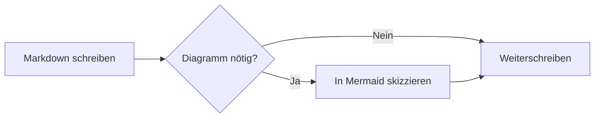
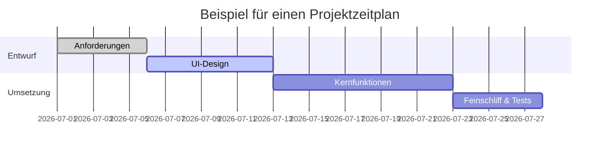
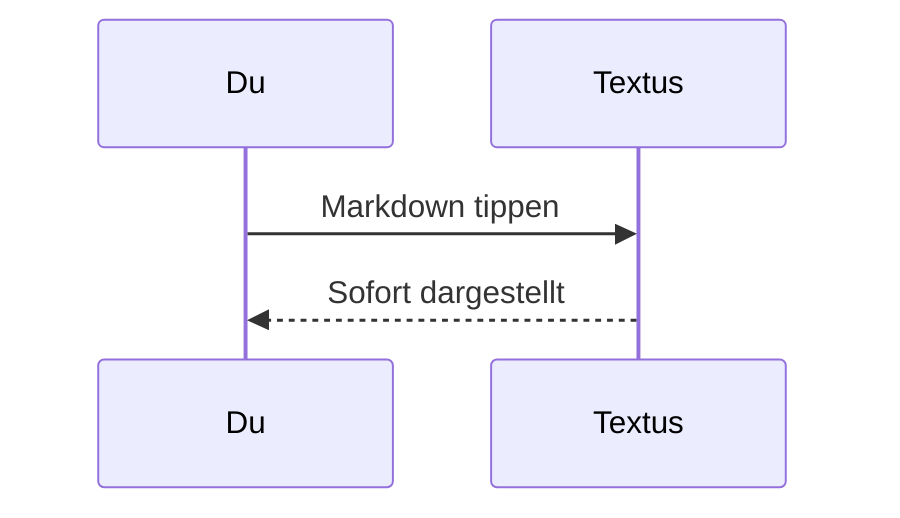

# Markdown-Anleitung für Textus

Diese Anleitung ist selbst ein Dokument, das du ändern kannst: fünf Minuten für das, was du am häufigsten brauchst, danach der Rest, sortiert nach dem, was du tun willst. Schließ sie am Ende einfach, ohne zu speichern.

> [!TIP]
> Mit `Cmd+/` (`Ctrl+/` unter Windows und Linux) wechselst du in den Quelltext und siehst, wie jedes Beispiel geschrieben ist.

## In fünf Minuten loslegen

Markdown kennzeichnet Formatierung mit ein paar Zeichen, und Textus setzt sie schon beim Tippen um. Tippe am Zeilenanfang:

- `# ` und ein paar Wörter: eine Überschrift; `## `: eine kleinere.
- `- `: eine Liste; `1. `: eine nummerierte Liste; `- [ ] `: eine Aufgabe.
- `> `: ein Zitat.

Um Wörter herum: `**fett**`, `*kursiv*`, `==hervorgehoben==`, `` `Code` ``. Ein Link ist `[Wörter](https://example.com)`; ein Bild fügst du einfach ein.

Keine Lust, dir die Zeichen zu merken? Nimm die **Formatleiste** über dem Dokument oder klicke mit rechts auf markierten Text. Du findest etwas nicht? Drück `Cmd+Shift+P` für die Befehlspalette und tippe ein paar Buchstaben.

## Lange Texte schreiben

**Erste Zeile einrücken** (Einstellungen › Bearbeiten › Text) rückt die erste Zeile jedes Absatzes um zwei Zeichen ein; Listen, Zitate und Tabellen bleiben, wie sie sind.

### Schreibweisen und Modi

Neben dem WYSIWYG-Editor und dem Quellcodemodus (`Cmd+/`) bietet Textus drei Arten zu schreiben (unter Windows und Linux `Ctrl` statt `Cmd`; die aktuellen Belegungen stehen unter Einstellungen › Tastenkürzel):

- **Quelltext und Vorschau** (`Cmd+Shift+E`): links der Markdown-Quelltext, rechts die gerenderte Vorschau, beide scrollen gemeinsam.
- **Schreibmaschinenmodus**: Die Zeile, in der du tippst, bleibt in der Mitte des Fensters – im Editor, im Quellcodemodus und in Quelltext und Vorschau.
- **Zen-Modus** (`Cmd+Shift+J`): blendet alles außer dem Dokument aus, in dem du bist, und dimmt jeden Absatz außer dem, an dem du gerade schreibst. Das × oben rechts oder noch einmal das Tastenkürzel beendet ihn.

Alle findest du im Menü **Ansicht** (die ersten beiden unter **Ansicht › Modus**) und in der Gruppe **Ansicht** unter **Einstellungen › Bearbeiten › Text**. Jeder ist eine Einstellung für ganz Textus: Schaltest du ihn in einem Fenster um, wechselt jeder Tab in jedem Fenster mit, die Dokumente, die du als Nächstes öffnest, erscheinen darin, und Textus öffnet sich beim nächsten Mal wieder darin.

**Ansicht › Modus › Lesemodus** (auch im Rechtsklickmenü eines Tabs) schützt ein Dokument vor Änderungen – durch Tippen, Einfügen, Ablegen, Rückgängig, Textus AI oder Plugins. Ein Vorhängeschloss neben dem Titel zeigt es an; ein Klick darauf erlaubt wieder Änderungen.

**Ansicht › Befehlspalette…** (`Cmd+Shift+P`) findet alles, was die Menüs können, und jeden Befehl, den ein Plugin hinzufügt, wenn du ein paar Buchstaben seines Namens tippst. Sie wechselt außerdem das Erscheinungsbild (hell, dunkel oder wie das System) und das Editor-Design und schaltet Textus AI ein oder aus. **Bearbeiten › Suchen & Ersetzen…** (`Cmd+F`) sucht im Dokument, **Bearbeiten › Ersetzen…** (`Cmd+Option+F`) öffnet es mit der Ersetzen-Zeile, und `Cmd+G` springt zum nächsten Treffer.

Der Bereich **Gliederung** der Seitenleiste listet die Überschriften des Dokuments auf; ein Klick auf eine führt dorthin. Ein Rechtsklick auf die Gliederung bietet **Alle aufklappen** und **Alle zuklappen**, oder klappe mit `Option`-Klick (`Alt`-Klick) auf den Pfeil einer Überschrift alle auf einmal auf oder zu.

**Schriftgröße der Oberfläche** (Einstellungen › Darstellung) vergrößert oder verkleinert den Text von Seitenleiste, Tabs, Menüs, KI-Tabs und Einstellungen; jedes Dokument behält seinen eigenen Zoom (`Cmd+=`, `Cmd+-`). `Ctrl+Tab` und `Ctrl+Shift+Tab` wechseln zum nächsten und zum vorigen Tab.

### Fußnoten, Trennlinien und ein Inhaltsverzeichnis

Fußnoten sehen so aus[^1], und darunter folgt eine horizontale Trennlinie:

---

[^1]: Der Inhalt der Fußnoten wird am Ende des Dokuments gesammelt.

Tippe `[TOC]` allein in eine Zeile und drücke Enter für ein Inhaltsverzeichnis: Es listet die Überschriften des Dokuments auf und folgt ihnen, während du schreibst; ein Klick springt zur Überschrift.

## Tabellen, Code, Formeln und Diagramme

### Tabellen

| Funktion | Syntax | Ergebnis |
| --- | --- | --- |
| Fett | `**Text**` | **Text** |
| Hervorhebung | `==Text==` | ==Text== |
| Formel im Text | `$x^2$` | $x^2$ |

Bewege den Zeiger über eine Tabelle, um Zeilen und Spalten hinzuzufügen oder zu entfernen. Tippe `| Name | Alter |` und drücke Enter, um eine Tabelle anzulegen. Enter springt eine Zeile nach unten, fügt in der letzten Zeile eine neue hinzu und verlässt die Tabelle, wenn die neue Zeile leer bleibt; mit Ctrl/⌘+Enter verlässt du sie jederzeit. In einer Tabelle springen Tab und Umschalt+Tab zur nächsten und zur vorigen Zelle, und Umschalt+Enter beginnt eine neue Zeile in der Zelle.

### Codeblöcke

Umgrenzte Codeblöcke mit Syntaxhervorhebung (die Sprache stellst du oben rechts im Block um). Enter in der leeren letzten Zeile verlässt den Block, Ctrl/⌘+Enter jederzeit; dasselbe gilt für Zitate. **Kopieren** und **Alles auswählen** neben der Sprache kopieren oder markieren den Code des Blocks, und **Zeilennummern in Codeblöcken** (Einstellungen › Bearbeiten › Text) nummeriert seine Zeilen; beides erscheint weder in Exporten noch im Ausdruck.

```python
def fib(n: int) -> int:
    """Die klassische Fibonacci-Folge."""
    a, b = 0, 1
    for _ in range(n):
        a, b = b, a + b
    return a
```

```rust
fn main() {
    let greeting = "Hallo, Textus!";
    println!("{greeting}");
}
```

### Formelblöcke

Formeln zwischen `$$` setzt KaTeX als eigenen Block:

$$
\int_{-\infty}^{\infty} e^{-x^2} \, dx = \sqrt{\pi}
$$

### Diagramme (Mermaid)

Ein ```` ```mermaid ````-Codeblock wird als Live-Diagramm dargestellt. Ein Flussdiagramm:



Ein Gantt-Diagramm:



Ein Sequenzdiagramm:



**Diagramm-Engine** (Einstellungen › Bearbeiten › Text) legt fest, was diese Blöcke zeichnet: Mermaid, die Voreinstellung, oder Pele, das schneller ist, Diagramme aber auf seine eigene Art anordnet und einige Funktionen weglässt; ein Diagramm, das Pele nicht zeichnen kann, zeichnet Mermaid.

Die Farben folgen dem Erscheinungsbild – im hellen eine ruhige graue Palette, im dunklen ihr dunkles Gegenstück –, und ein importiertes Theme oder eigenes CSS kann mit `--doc-mermaid-theme: forest` eine andere eingebaute Palette wählen.

## Bilder und Einfügen

### Bilder

Füge ein Bild direkt aus der Zwischenablage ein – Textus speichert es und fügt den Verweis ein. Wohin, legst du unter **Einstellungen › Bearbeiten › Bilder** fest. **Auf diesem Computer** ist es ein **Unterordner** im Ordner des Dokuments, standardmäßig `assets/`, dessen Namen du ändern kannst; die andere Wahl ist **Derselbe Ordner wie das Dokument**. Die Einstellungen zeigen den Link, den ein eingefügtes Bild bekommt. Mit **Zu einem Bildhoster hochladen** geht es stattdessen an PicGo / PicList, SM.MS, Imgur oder deinen eigenen Endpunkt (**Eigener Server**).

Ein eigener Endpunkt empfängt `multipart/form-data` mit einem Feld `file` und kann die öffentliche URL entweder als reinen Text oder in einem einstellbaren JSON-Feld zurückgeben. Hochgeladene Dateien können automatisch umbenannt werden oder ihren Originalnamen behalten, oder Textus fragt dich vor jedem Upload nach einem Namen. Wenn du den Speicherort wechselst, bleiben vorhandene Bildverweise unverändert.

Oder schreib den Verweis von Hand:

```markdown

```

Obsidian-Einbettungen wie `![[image.png]]` oder `![[attachments/image.png|300]]` zeigen ebenfalls das Bild: Textus sucht die Datei im Obsidian-Vault des Dokuments und speichert die Einbettung genau so, wie sie geschrieben ist.

Um ein Bild genau anzusehen, doppelklicke darauf oder drücke **Bild vergrößern** oben rechts darin (Diagramme haben dieselbe Schaltfläche): Scrollen oder Aufziehen zoomt, Ziehen verschiebt, ein Doppelklick passt es wieder ein, und `Esc` schließt es. Zieh den Griff am rechten Rand eines Bildes, um seine Größe zu ändern. **Bilder in eigener Zeile** (Einstellungen › Bearbeiten › Bilder) setzt Bilder, die allein in einer Zeile stehen, in die Mitte oder an den linken Rand – im Editor und in HTML- und PDF-Exporten.

### Kopieren und Einfügen

**Kopieren** legt das Markdown als reinen Text in die Zwischenablage und die Formatierung daneben, sodass GitHub, Obsidian, VS Code und Chat-Apps Markdown bekommen, während Word, Pages, Mail und Notion es formatiert einfügen. Ein Bild, das du per Rechtsklick kopierst, kommt als Bild selbst in die Zwischenablage, bereit zum Einfügen in einen Chat oder ein Dokument. **Bearbeiten › Als reinen Text einfügen** (`Cmd+Shift+V`) fügt den Text der Zwischenablage genau so ein, wie er ist, ohne Markdown darin zu lesen.

## Dateien und Ordner

### Ordner und Suche

**Datei › Ordner öffnen…** öffnet einen ganzen Ordner in der Seitenleiste: Der Dateibaum bleibt dort, während du Dokumente darin öffnest, der Ordner kommt mit deiner Sitzung zurück, und **Datei › Ordner schließen** lässt den Baum wieder dem Dokument folgen. Der Bereich **Suchen** (die Lupe in der Aktivitätsleiste, oder `Cmd+Shift+O`) findet Dateien nach Namen und Zeilen nach ihren Wörtern im ganzen Ordner; ein Klick auf eine Zeile öffnet das Dokument an dieser Stelle. Beides gibt es nur auf dem Desktop.

Der Baum ist auch eine kleine Dateiverwaltung. Der Name des übergeordneten Ordners darüber führt eine Ebene hinauf. Sein Menü sortiert ihn nach Name oder nach Änderungsdatum und zeigt **Alle Dateien** oder **Nur Dokumente**. Ein Rechtsklick auf einen Ordner, eine Datei oder die leere Fläche darunter legt dort ein **Neues Dokument** oder einen **Neuen Ordner** an, und eine Datei oder ein Ordner, auf einen anderen Ordner gezogen, wird dorthin verschoben; ein geöffnetes Dokument folgt an den neuen Ort. Nichts wird ersetzt: Ein vergebener Name wird abgelehnt.

Zieh Dateien aus dem Finder oder dem Datei-Explorer auf das Fenster, um sie zu öffnen: Dokumente öffnen sich in Tabs, Bilder kommen dort ins Dokument, wo du sie loslässt, und ein Ordner öffnet sich in der Seitenleiste. **Datei › Pfad kopieren** kopiert den vollständigen Pfad des vorderen Dokuments.

Im Terminal öffnet `textus notes.md` eine Datei in Textus; **Einstellungen › Allgemein** installiert den Befehl `textus`, falls er noch fehlt. Er kann mehr, ohne ein Fenster zu öffnen: `textus search <Wörter>` findet sie in den Dateien eines Ordners, `textus read` gibt eine PDF- oder Word-Datei als Markdown aus, und `textus help` listet alle Befehle auf, auch die der Plugins.

**Datei › Öffnen…** öffnet auch ein Word-Dokument (`.docx`), ebenso das Ablegen auf dem Fenster: Es wird ein neues, noch nicht gespeichertes Markdown-Dokument gleichen Namens mit seinen Überschriften, Listen, Tabellen, Links, Fußnoten und Bildern. Die Bilder kommen beim Speichern dorthin, wo **Einstellungen › Bearbeiten › Bilder** eingefügte Bilder ablegt, und **Speichern** schlägt eine `.md`-Datei neben der Word-Datei vor. Manche Formatierung kann anders aussehen; die Word-Datei selbst wird nie verändert. Nur auf dem Desktop.

### Exportieren

**Datei › Exportieren** speichert das Dokument als HTML oder PDF; mit installiertem [Pandoc](https://pandoc.org) auch als Word (`.docx`), OpenDocument, RTF, EPUB, LaTeX und mehr. Auf dem Mac druckt **PDFs in hellen Farben exportieren** (Einstellungen › Bearbeiten › Exportieren) ein PDF auf Weiß in den hellen Farben deines Themes, auch wenn du im dunklen Modus schreibst.

### Im Hintergrund weiterlaufen

Schalte **Einstellungen › Allgemein › Anwendung › Im Hintergrund weiterlaufen** ein, dann läuft Textus nach dem Schließen des letzten Fensters weiter, mit seinem Symbol im Infobereich (Windows), im System-Tray (Linux) oder in der Menüleiste (Mac). **Textus öffnen** im Menü des Symbols bringt deine Dokumente zurück; **Textus beenden** dort beendet Textus wirklich. GNOME zeigt das Tray-Symbol nur mit der AppIndicator-Erweiterung.

## Das Fenster

### Was im Fenster ist

Von links nach rechts:

- **Die Aktivitätsleiste**: die Spalte mit Symbolen. **Dateien** (der Dateibaum), **Gliederung** (die Überschriften des Dokuments), **Suchen** (im ganzen Ordner), **Plugins**, dann die Bereiche, die Plugins hinzufügen. **Einstellungen** (das Zahnrad) steht ganz unten. Ein Klick auf ein Symbol öffnet seinen Bereich in der Seitenleiste; ein zweiter Klick schließt die Seitenleiste. Zieh Symbole, um sie umzuordnen; ein Rechtsklick blendet sie ein oder aus.
- **Die Seitenleiste**: immer ein Bereich auf einmal. `Cmd+\` oder die Seitenleisten-Schaltfläche oben blendet sie ein und aus; zieh ihren Rand, um sie breiter zu machen.
- **Inseln**: die Dokumente. Jede Insel ist eine Reihe Tabs mit der Seite darunter; die Tabs sitzen in der Leiste am oberen Fensterrand. Teilst du das Fenster, stehen mehrere Inseln nebeneinander (siehe **Inseln und Tabs** unten). Die **Formatleiste** oben über jedem Dokument hat die Schaltflächen des Menüs Format; **Ansicht › Formatleiste** blendet sie aus.
- **Textus AI**: Die Funken rechts in der oberen Leiste (`Cmd+Shift+L`) öffnen ihre Unterhaltungen als Tabs, in einer eigenen Insel rechts. Die **Anleitung zu KI-Funktionen** im Menü Hilfe erklärt sie.
- **Einstellungen** (`Cmd+,` oder das Zahnrad): die Liste der Seiten in der Seitenleiste, die Seite selbst in einem Tab.

Unter Windows und Linux steckt das Menü hinter der Schaltfläche ☰ oben links, oder es steht mit **Menüleiste anzeigen** in Einstellungen › Darstellung quer über dem Fenster. Die Wortzahl steht unten rechts in jedem Dokument.

### Inseln und Tabs

Jede Gruppe von Tabs mit der Seite darunter ist eine **Insel**. Eine Insel zeigt immer ein Dokument; teilst du das Fenster, stehen mehrere nebeneinander oder übereinander.

- **Zieh einen Tab** aus seiner Reihe, und die Inseln machen dort Platz, wohin du zielst; lässt du los, öffnet er sich dort: neben einer Insel (ziele auf ihr äußeres Fünftel), über oder unter ihr (ihr oberer oder unterer Rand) oder zwischen den Tabs einer anderen Insel. Halte beim Ziehen `Option` (`Alt`), um die ganze Insel zu verschieben. `Esc` legt ihn zurück. Eine Datei aus der Seitenleiste ziehst du genauso.
- **Zieh einen Tab aus dem Fenster**, um ihm ein eigenes Fenster zu geben.
- **Ansicht › Rechts teilen** (`Cmd+Option+S`) und **Ansicht › Unten teilen** teilen die Insel, in der du bist; **Ansicht › Teilung schließen** führt zurück zu einer.
- Zieh die Linie zwischen zwei Inseln, um ihre Größe zu ändern.
- **Halte `Cmd`** (`Ctrl`) einen Moment gedrückt, wenn zwei oder mehr Inseln offen sind: Jede zeigt eine Nummer, und `Cmd+1` … `Cmd+6` springt zu dieser Insel.
- Schließt du den letzten Tab einer Insel, verschwindet die Insel. Die ganze Anordnung kommt zurück, wenn du Textus wieder öffnest.

`Cmd+N` (oder `Cmd+T`) öffnet einen neuen Tab, `Cmd+Shift+N` ein neues Fenster, und **Datei › Geschlossenen Tab wieder öffnen** (`Cmd+Shift+T`) holt die Dokumente zurück, die du geschlossen hast, das zuletzt geschlossene zuerst. Das **+** am Ende einer Reihe öffnet einen neuen Tab in dieser Insel. Ein Mittelklick schließt einen Tab; das Rechtsklickmenü eines Tabs hat **Andere schließen**, **Tabs links schließen**, **Tabs rechts schließen** und **Gespeicherte schließen** (Tabs mit ungespeicherten Änderungen bleiben offen), **Pfad kopieren** und **In der Dateiliste zeigen**. Wenn Textus wieder öffnet, kommt jedes Fenster mit seinen eigenen Tabs zurück.

## Plugins, Themes und Skills

Der Bereich **Plugins** (das Puzzleteil in der Aktivitätsleiste) listet unter **Verfügbar** Plugins zum Hinzufügen auf: Vim- und Emacs-Tasten, einen PDF-Reader, Diagramme, einen Wissensgraphen, Schreibwerkzeuge und mehr. Themes findest du im Theme-Store unter **Einstellungen › Darstellung**, Skills unter **Einstellungen › Textus AI › Agent**. Jedes hat eine Schaltfläche – **Installieren**, dann **Aktualisieren**, **Ausschalten** oder **Einschalten** – und **Deinstallieren** im Menü daneben. Die Seite eines Plugins zeigt, wie es benutzt wird, und seine Befehle erscheinen im Menü **Plugins** und in der Befehlspalette.

## Hilfe bekommen

**Hilfe › Problem melden…** (auch unter **Einstellungen › Über**, bei Hilfe) öffnet ein kurzes Formular. Gib an, welche Art von Meldung es ist, welchen Teil von Textus sie betrifft und bei einem Fehler, wie schlimm er ist, und beschreibe dann, was schiefgegangen ist; Textus fügt seine Version, dein System, deine Plugins, deine Einstellungen ohne alles Private und die letzten Fehler hinzu – alles wird dir gezeigt, bevor etwas gesendet wird. **Senden** legt sie für dich als Issue auf GitHub an, ganz ohne GitHub-Konto, und nennt dir die Nummer; **Auf GitHub senden** öffnet stattdessen das Formular von GitHub; **Kopieren** legt sie in die Zwischenablage, für einen Chat oder eine E-Mail. Was du schreibst, wird ein öffentliches Issue; eine E-Mail-Adresse oder WeChat-ID, die du hinterlässt, falls wir nachfragen dürfen, geht nur an das Team.

Unter **Einstellungen › Über › Hilfe** kannst du außerdem die Einführung noch einmal ansehen, die Anleitungen öffnen und **Über Textus** aufrufen, mit der Version und **Nach Updates suchen** (auf dem Mac auch **Textus › Nach Updates suchen…**). **Hilfe › Zur Community** öffnet die Community-Seite.

## Nachschlagen: alles, was du schreiben kannst

Hier ist jedes Stück Markdown, das Textus versteht; vergleiche es mit dem Quelltext (`Cmd+/`).

### Überschriften und Zitate

Tippe am Zeilenanfang `#` und ein Leerzeichen für eine Überschrift der Ebene 1 oder `##` und ein Leerzeichen für Ebene 2. Die Überschriften oben zeigen das Ergebnis. `Ctrl+1` bis `Ctrl+6` (`Cmd+1` bis `Cmd+6` auf dem Mac) machen die aktuelle Zeile zu einer Überschrift dieser Ebene.

Ein Zitat:

> Zitierter Text kann weitere Auszeichnungen enthalten, etwa **Fettdruck** und `Code`.

Hinweise im GitHub-Stil:

> [!NOTE]
> Eine Notiz mit zusätzlichem Kontext.

> [!WARNING]
> Eine Warnung vor Dingen, auf die du achten solltest.

### Textauszeichnung

**Fett** (`**Text**`), *kursiv* (`*Text*`), ***fett und kursiv***, ~~durchgestrichen~~ (`~~Text~~`), ==hervorgehoben== (`==Text==`) und `Inline-Code`. ``Ctrl+` `` (auch auf dem Mac Control) macht die Auswahl zu Inline-Code, ``Ctrl+Shift+` `` streicht sie durch, und `Cmd+K` macht sie zum Link, mit dem Cursor dort, wo die Adresse hinkommt.

Emoji-Kurzcodes wie auf GitHub erscheinen als Emoji: :tada: (`:tada:`), :rocket: (`:rocket:`). Die Datei behält den Kurzcode; setz den Cursor darauf, um ihn zu bearbeiten.

Tief- und Hochstellung wie in Typora und Pandoc: H~2~O (`H~2~O`), x^2^ (`x^2^`); ohne Leerzeichen dazwischen.

Tippst du `(`, `[`, `{`, ein Anführungszeichen oder eine Klammer aus einer chinesischen oder japanischen Eingabemethode wie `（`, `【` oder `「`, kommt das schließende Gegenstück hinter den Cursor: Das getippte Schlusszeichen springt darüber, Rücktaste direkt nach dem öffnenden löscht beide, und markierter Text wird eingeschlossen. **(), [] und „“ schließen** unter **Einstellungen › Bearbeiten › Text** schaltet das ab.

Links sehen so aus: [das Textus-Repository](https://github.com/CatVinci-Studio/Textus). Mit Strg/⌘+Klick folgst du einem Link: Ein Weblink öffnet sich im Browser, ein Link auf eine andere Markdown-Datei öffnet sie in einem Tab, und ein Link auf `#a-heading` scrollt dorthin. Ein einfacher Klick setzt den Cursor in den Link und zeigt sein Markdown, `[text](url)`, zum Bearbeiten an Ort und Stelle; verlässt der Cursor ihn, ist er wieder ein Link. Auch HTML im Text wird dargestellt, etwa Tasten wie <kbd>Cmd</kbd> + <kbd>S</kbd>. Ebenso aufklappbare `<details>`-Blöcke, HTML-Tabellen, einige Inline-Stile (Farbe, Hintergrund, Größe, Stärke, Ausrichtung, Unter- und Durchstreichung) und eingebettetes `<svg>`, das als Bild erscheint. Skripte und anderes HTML bleiben als Quelltext stehen. Ein Link auf eine Überschrift in einer anderen Datei, etwa `[see](notes.md#a-heading)`, öffnet diese Datei an der Überschrift. Obsidian-Wikilinks (`[[Note]]`, `[[Note|text]]` und `[[Note#Heading]]`) öffnen sich genauso, aus dem Ordner des Dokuments oder von überall in seinem Vault; sie und `#tags` am Zeilenanfang werden genau so gespeichert, wie sie geschrieben sind.

**Farbfelder vor Farbcodes** (Einstellungen › Bearbeiten › Text) setzt ein kleines Quadrat in der Farbe vor einen Farbcode. **Nur in Code** zeigt es in Inline-Code, der eine Farbe ist, etwa `#0af` oder `rgb(0 128 255)`, und vor den Farbwerten in Codeblöcken; **Überall** auch vor im Text mit sechs oder acht Stellen geschriebenen Farbcodes, etwa #ff8800, und Farbfunktionen, etwa hsl(210 100% 50%). Kurzformen im Text, Tags wie #cafe, Nummern wie #234 und Links bleiben, wie sie sind.

Formeln im Text: die Äquivalenz von Masse und Energie $E = mc^2$, die eulersche Identität $e^{i\pi} + 1 = 0$.

### Listen

- Ungeordnete Liste
- Mit Verschachtelung
  - Ein Eintrag der zweiten Ebene
  - Noch einer

1. Geordnete Liste
2. Zweiter Eintrag

Aufgabenliste (ein Klick auf ein Kästchen setzt oder entfernt den Haken):

- [x] Etwas Erledigtes
- [ ] Etwas, das noch zu tun ist

Viel Freude beim Schreiben!
