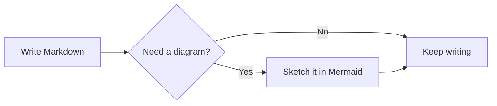
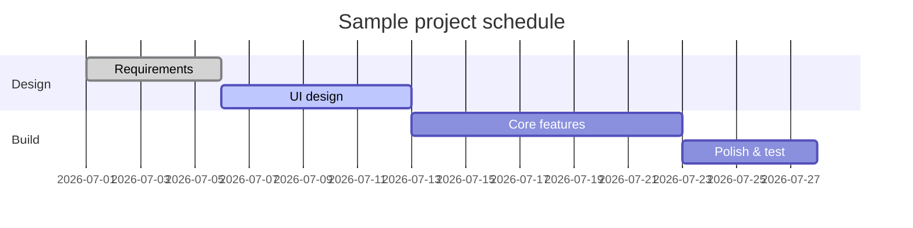
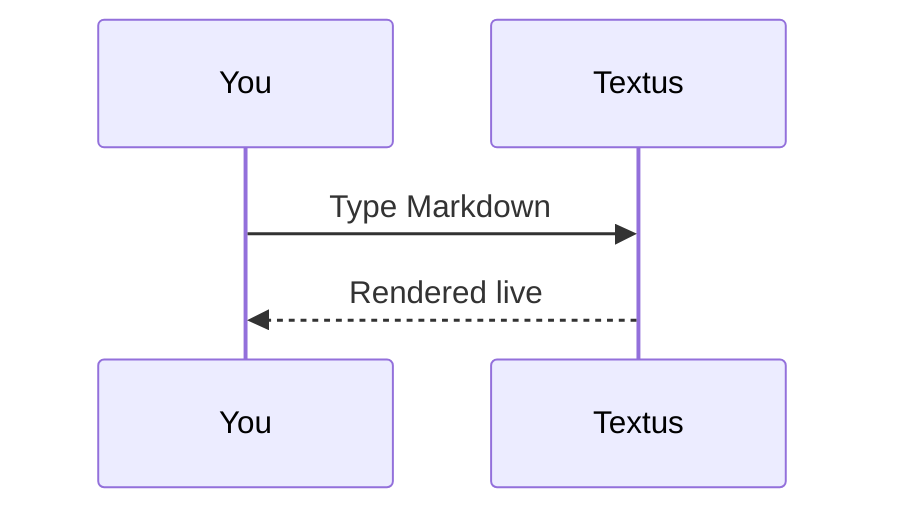

# Textus Markdown Guide

Welcome! This built-in document demonstrates the Markdown rendering Textus supports. It is just an unsaved draft — feel free to edit and experiment, then close it without saving.

> [!TIP]
> Press `Cmd+/` to toggle between WYSIWYG and source mode and see the raw syntax behind any example here.

## Headings and quotes

Type `#` plus a space at the start of a line for a level-1 heading, or `##` plus a space for level 2. The headings above show the rendered result.

A blockquote:

> Quoted text can nest other marks, like **bold** and `code`.

GitHub-style alerts:

> [!NOTE]
> A note, for extra context.

> [!WARNING]
> A warning, for things to watch out for.

## Inline styles

**Bold** (`**text**`), *italic* (`*text*`), ***bold italic***, ~~strikethrough~~ (`~~text~~`), ==highlight== (`==text==`), and `inline code`.

Links look like this: [the Textus repository](https://github.com/CatVinci-Studio/Textus). Ctrl/⌘+click one to follow it: a web link opens in your browser, a link to another Markdown file opens it in a tab, and a link to `#a-heading` scrolls there. Inline HTML renders too, e.g. keyboard keys <kbd>Cmd</kbd> + <kbd>S</kbd>. So do `<details>` folds, HTML tables, a few inline styles (colour, background, size, weight, alignment, underline and strikethrough) and inline `<svg>`, which shows as a picture. Scripts and other HTML stay as source. A link to a heading in another file, such as `[see](notes.md#a-heading)`, opens that file at the heading. Obsidian wikilinks (`[[Note]]`, `[[Note|text]]` and `[[Note#Heading]]`) open the same way, from the document's folder or anywhere in its vault; they and `#tags` at the start of a line are saved exactly as written.

With **Settings → Editor & Appearance → Show a swatch before colour codes** on, inline code that is a colour, such as `#ff8800` or `rgb(0 128 255)`, shows a small square of that colour.

Inline math: mass–energy equivalence $E = mc^2$, Euler's identity $e^{i\pi} + 1 = 0$.

## Lists

- Unordered list
- With nesting
  - A second-level item
  - Another one

1. Ordered list
2. Second item

Task list (click a checkbox to toggle it):

- [x] Something done
- [ ] Something to do

## Tables

| Feature | Syntax | Result |
| --- | --- | --- |
| Bold | `**text**` | **text** |
| Highlight | `==text==` | ==text== |
| Inline math | `$x^2$` | $x^2$ |

Hover over a table to add or remove rows and columns. Type `| Name | Age |` and press Enter to make a table. Enter moves down a row, adds one at the last row, and leaves the table from a new row left empty; Ctrl/⌘+Enter leaves it at any time.

## Code blocks

Fenced code blocks with syntax highlighting (switch the language from the block's top-right corner). Enter on the empty last line leaves the block, as does Ctrl/⌘+Enter at any time; the same goes for quotes. The **Copy** button beside the language copies the block's code, and **Settings → Editor & Appearance → Line numbers in code blocks** numbers its lines; neither shows in exports or printouts.

```python
def fib(n: int) -> int:
    """The classic Fibonacci sequence."""
    a, b = 0, 1
    for _ in range(n):
        a, b = b, a + b
    return a
```

```rust
fn main() {
    let greeting = "Hello, Textus!";
    println!("{greeting}");
}
```

## Math blocks

Block formulas wrapped in `$$` are rendered by KaTeX:

$$
\int_{-\infty}^{\infty} e^{-x^2} \, dx = \sqrt{\pi}
$$

## Diagrams (Mermaid)

A ```` ```mermaid ```` code block renders as a live diagram. A flowchart:



A Gantt chart:



A sequence diagram:



**Settings → Editor & Appearance → Diagram engine** chooses what draws these blocks: Mermaid, the default, or Pele, which is faster but lays diagrams out its own way and leaves out a few features; a diagram Pele can't draw is drawn by Mermaid.

## Images

Paste an image straight from the clipboard — Textus saves it and inserts the reference. Where it goes is set in **Settings → Editor & Appearance → Images**. **On this computer**, it is a **Subfolder** of the document's folder, `assets/` by default, whose name you can change; **Same folder as the document** is the other choice. Settings shows the link a pasted image gets. **Upload to an image host** sends it to PicGo / PicList, SM.MS, Imgur or an endpoint of your own (**Custom**) instead.

A custom endpoint receives `multipart/form-data` with a `file` field and may return either the public URL as plain text or in a configurable JSON field. Uploaded files can be renamed automatically, keep their original name, or ask you for a name before every upload. Existing image references are never changed when you switch storage modes.

Or write the reference by hand:

```markdown

```

Obsidian embeds like `![[image.png]]` or `![[attachments/image.png|300]]` show the picture too: Textus finds the file in the Obsidian vault the document belongs to, and saves the embed exactly as written.

## Views and modes

Besides the WYSIWYG editor and source mode (`Cmd+/`), Textus has three ways to write (on Windows and Linux use `Ctrl` for `Cmd`; Settings → Shortcuts has the current bindings):

- **Split view** (`Cmd+Shift+E`): the Markdown source on the left, the rendered preview on the right, scrolling together.
- **Typewriter mode** (Settings → Editor & Appearance → Theme): the line you are typing stays in the middle of the window — in the editor, source mode and split view.
- **Zen mode** (`Cmd+Shift+J`): hides everything but the text, goes fullscreen and dims every paragraph except the one you are writing. Press `Esc` to leave.

All three are also in the **View** menu.

**Settings → Editor & Appearance → Interface text size** makes the text of the sidebar, tabs, menus, the AI panel and Settings larger or smaller; the document keeps its own zoom. `Ctrl+Tab` and `Ctrl+Shift+Tab` move to the next and the previous tab.

## Folders and file search

**File → Open Folder…** opens a whole folder in the sidebar: the file tree stays there while you open documents inside it, the folder comes back with your session, and **File → Close Folder** lets the tree follow the document again. The box at the top of the sidebar's **Files** tab searches file names across the folder; `Cmd+Shift+O` jumps to it. Type to filter, `↑`/`↓` to move, `Enter` to open, `Esc` to clear. Both are on the desktop only.

## Quick Notes

**File → New Quick Note** opens a small window for jotting something down. Press `Esc` (or `Cmd+Enter`, `Cmd+S`, `Cmd+W`) and the note is saved and the window closes; an empty note is simply closed. **Open in Textus** saves it and opens it as a tab.

Notes go to `Textus/Quick Notes` in your Documents folder, one file each, named after the first line. In **Settings → General → Quick Notes** you can choose another folder, keep **one file per day** instead, and turn on a **global shortcut** that opens a quick note from any app: `Control+Option+N` on a Mac, `Ctrl+Alt+N` on Linux, `Win+Alt+N` on Windows. Opening one again within a few minutes continues the last note. On Wayland, bind the `textus --quick-note` command shown there to a key in your desktop's settings.

To keep Textus within reach when no window is open, turn on **Settings → General → Background → Keep running in the background**: closing the last window then leaves Textus running, with an icon in the notification area (Windows), the system tray (Linux) or the menu bar (Mac). Its menu opens a new quick note, your documents, the Quick Notes folder and Settings; **Quit Textus** there quits for real. **Start in the background at login** starts Textus that way when you log in. GNOME shows the tray icon only with the AppIndicator extension.

## Footnotes and rules

Footnotes look like this[^1], and below is a horizontal rule:

---

[^1]: Footnote content is collected at the end of the document.

Happy writing!
