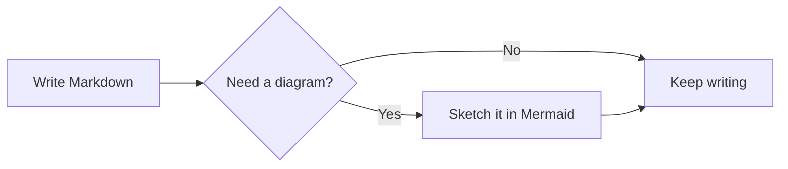
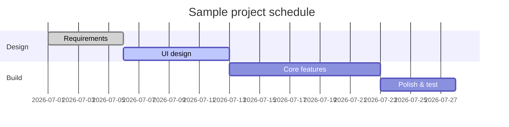
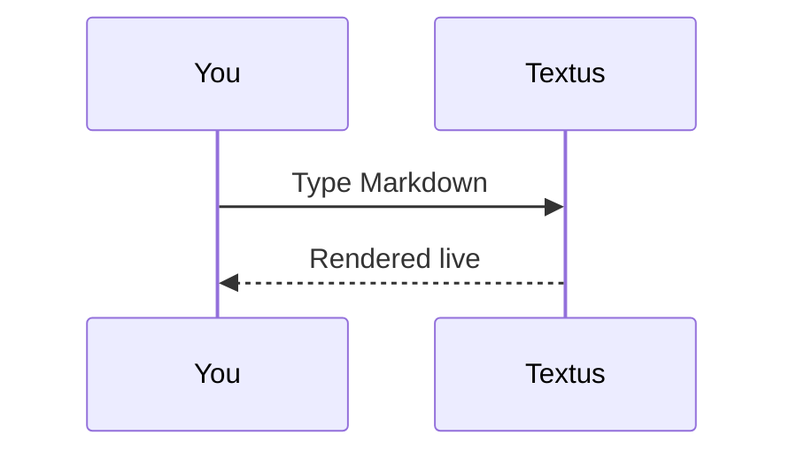

# Textus Markdown Guide

Welcome! This built-in document demonstrates the Markdown rendering Textus supports. It is just an unsaved draft — feel free to edit and experiment, then close it without saving.

> [!TIP]
> Press `Cmd+/` to toggle between WYSIWYG and source mode and see the raw syntax behind any example here.

## Headings and quotes

Type `#` plus a space at the start of a line for a level-1 heading, or `##` plus a space for level 2. The headings above show the rendered result. `Ctrl+1` to `Ctrl+6` (`Cmd+1` to `Cmd+6` on a Mac) make the current line a heading of that level.

A blockquote:

> Quoted text can nest other marks, like **bold** and `code`.

GitHub-style alerts:

> [!NOTE]
> A note, for extra context.

> [!WARNING]
> A warning, for things to watch out for.

## Inline styles

**Bold** (`**text**`), *italic* (`*text*`), ***bold italic***, ~~strikethrough~~ (`~~text~~`), ==highlight== (`==text==`), and `inline code`.

Subscript and superscript as in Typora and Pandoc: H~2~O (`H~2~O`), x^2^ (`x^2^`); no spaces inside.

Typing `(`, `[`, `{`, a quote, or a bracket from a Chinese or Japanese input method such as `（`, `【` or `「` puts its closing partner in after the caret: typing the closer steps over it, Backspace right after the opener takes both, and with text selected the pair goes around it. **Settings → Editor & Appearance → Close (), [] and “”** turns this off.

Links look like this: [the Textus repository](https://github.com/CatVinci-Studio/Textus). Ctrl/⌘+click one to follow it: a web link opens in your browser, a link to another Markdown file opens it in a tab, and a link to `#a-heading` scrolls there. A plain click puts the caret in a link and shows its Markdown, `[text](url)`, to edit in place; move the caret away and it is a link again. Inline HTML renders too, e.g. keyboard keys <kbd>Cmd</kbd> + <kbd>S</kbd>. So do `<details>` folds, HTML tables, a few inline styles (colour, background, size, weight, alignment, underline and strikethrough) and inline `<svg>`, which shows as a picture. Scripts and other HTML stay as source. A link to a heading in another file, such as `[see](notes.md#a-heading)`, opens that file at the heading. Obsidian wikilinks (`[[Note]]`, `[[Note|text]]` and `[[Note#Heading]]`) open the same way, from the document's folder or anywhere in its vault; they and `#tags` at the start of a line are saved exactly as written.

**Settings → Editor & Appearance → Swatches before colour codes** puts a small square of the colour before a colour code. **In code only** draws it in inline code that is a colour, such as `#0af` or `rgb(0 128 255)`, and before the colour literals in code blocks; **Everywhere** also before one written in the text with six or eight digits, such as #ff8800, or as a colour function, such as hsl(210 100% 50%). Short codes in the text, tags like #cafe, issue numbers like #234 and links stay as they are.

Inline math: mass–energy equivalence $E = mc^2$, Euler's identity $e^{i\pi} + 1 = 0$.

## Lists

- Unordered list
- With nesting
  - A second-level item
  - Another one

1. Ordered list
2. Second item

Task list (click a checkbox to toggle it):

- [x] Something done
- [ ] Something to do

## Tables

| Feature | Syntax | Result |
| --- | --- | --- |
| Bold | `**text**` | **text** |
| Highlight | `==text==` | ==text== |
| Inline math | `$x^2$` | $x^2$ |

Hover over a table to add or remove rows and columns. Type `| Name | Age |` and press Enter to make a table. Enter moves down a row, adds one at the last row, and leaves the table from a new row left empty; Ctrl/⌘+Enter leaves it at any time. In a table, Tab and Shift+Tab move to the next and the previous cell, and Shift+Enter starts a new line inside a cell.

## Code blocks

Fenced code blocks with syntax highlighting (switch the language from the block's top-right corner). Enter on the empty last line leaves the block, as does Ctrl/⌘+Enter at any time; the same goes for quotes. **Copy** and **Select All** beside the language copy or select the block's code, and **Settings → Editor & Appearance → Line numbers in code blocks** numbers its lines; neither shows in exports or printouts.

```python
def fib(n: int) -> int:
    """The classic Fibonacci sequence."""
    a, b = 0, 1
    for _ in range(n):
        a, b = b, a + b
    return a
```

```rust
fn main() {
    let greeting = "Hello, Textus!";
    println!("{greeting}");
}
```

## Math blocks

Block formulas wrapped in `$$` are rendered by KaTeX:

$$
\int_{-\infty}^{\infty} e^{-x^2} \, dx = \sqrt{\pi}
$$

## Diagrams (Mermaid)

A ```` ```mermaid ```` code block renders as a live diagram. A flowchart:



A Gantt chart:



A sequence diagram:



**Settings → Editor & Appearance → Diagram engine** chooses what draws these blocks: Mermaid, the default, or Pele, which is faster but lays diagrams out its own way and leaves out a few features; a diagram Pele can't draw is drawn by Mermaid.

## Images

Paste an image straight from the clipboard — Textus saves it and inserts the reference. Where it goes is set in **Settings → Editor & Appearance → Images**. **On this computer**, it is a **Subfolder** of the document's folder, `assets/` by default, whose name you can change; **Same folder as the document** is the other choice. Settings shows the link a pasted image gets. **Upload to an image host** sends it to PicGo / PicList, SM.MS, Imgur or an endpoint of your own (**Custom**) instead.

A custom endpoint receives `multipart/form-data` with a `file` field and may return either the public URL as plain text or in a configurable JSON field. Uploaded files can be renamed automatically, keep their original name, or ask you for a name before every upload. Existing image references are never changed when you switch storage modes.

Or write the reference by hand:

```markdown

```

Obsidian embeds like `![[image.png]]` or `![[attachments/image.png|300]]` show the picture too: Textus finds the file in the Obsidian vault the document belongs to, and saves the embed exactly as written.

To look at a picture closely, double-click it or press **Enlarge picture** in its top-right corner (diagrams have the same button): scroll or pinch to zoom, drag to move, double-click to fit it again, and `Esc` to close. Drag the handle on a picture's right edge to resize it. **Settings → Editor & Appearance → Images on their own line** puts pictures that stand alone on a line in the centre or on the left, in the editor and in HTML and PDF exports.

## Copy and paste

**Copy** puts the Markdown in the clipboard's plain text and the formatting beside it, so GitHub, Obsidian, VS Code and chat apps get Markdown while Word, Pages, mail and Notion paste it formatted. A picture you right-click and copy goes to the clipboard as the picture itself, ready to paste into a chat or a document. **Edit → Paste as Plain Text** (`Cmd+Shift+V`) pastes the clipboard's text exactly as it is, without reading Markdown in it.

## Views and modes

Besides the WYSIWYG editor and source mode (`Cmd+/`), Textus has three ways to write (on Windows and Linux use `Ctrl` for `Cmd`; Settings → Shortcuts has the current bindings):

- **Source and Preview** (`Cmd+Shift+E`): the Markdown source on the left, the rendered preview on the right, scrolling together.
- **Typewriter mode**: the line you are typing stays in the middle of the window — in the editor, source mode and Source and Preview.
- **Zen mode** (`Cmd+Shift+J`): hides everything but the text and dims every paragraph except the one you are writing. Press `Esc` to leave.

All of them are in the **View** menu and in **Settings → Editor & Appearance → View**. Each is one setting for all of Textus: switch it in any window and every tab of every window switches with it, the documents you open next come up in it, and Textus opens in it again next time.

**View → Read Only** (also in a tab's right-click menu) keeps a document from being changed - by typing, pasting, dropping, undo, Textus AI or plugins. A padlock beside the title shows it; click it to make the document editable again.

**View → Command Palette…** (`Cmd+Shift+P`) finds anything the menus do, and every command a plugin adds, by typing a few letters of its name. It also changes the appearance (light, dark or the system's) and the editor theme, and turns Textus AI on or off.

The **Outline** tab of the sidebar lists the document's headings; click one to go there. Right-click the outline for **Expand All** and **Collapse All**, or `Option`-click (`Alt`-click) a heading's arrow to fold or unfold them all at once.

**Settings → Editor & Appearance → Interface text size** makes the text of the sidebar, tabs, menus, the AI panel and Settings larger or smaller; the document keeps its own zoom. `Ctrl+Tab` and `Ctrl+Shift+Tab` move to the next and the previous tab.

## Several documents at once

**View → Split Right** (`Cmd+Option+S`) shows the document in front beside another, and **View → Split Down** puts one above the other. Each pane has its own tabs: a document you open goes into the pane you are in, and Split Right or Split Down splits that pane again, as often as you like.

- Drag a tab - or a file from the sidebar - to the edge of a pane, and it opens in a new pane on that side. Drag it to the outer edge of the editor and it opens beside all the panes: at the right edge of two panes one above the other, it fills the right side from top to bottom. Drop it on another pane's tabs to move it there.
- Drag the line between two panes to resize them; double-click it to make them equal. Right-click it to turn them from side by side to one above the other, swap them, or close the split.
- **Open to the Side** in a tab's right-click menu shows it beside the one in front.
- Close a pane's last tab and the pane goes. The whole layout comes back when you reopen Textus.

## Tabs and windows

`Cmd+T` opens a new tab, `Cmd+N` a new window, and **File → Reopen Closed Tab** (`Cmd+Shift+T`) brings back the documents you closed, the latest first. A middle click closes a tab; a tab's right-click menu has **Close Others**, **Close Tabs to the Left** and **Close Tabs to the Right** (tabs with unsaved changes stay open), **Copy Path** and **Move to New Window**. You can also drag a tab out of the window to give it a window of its own. When Textus reopens, each window comes back with its own tabs.

## Folders and file search

**File → Open Folder…** opens a whole folder in the sidebar: the file tree stays there while you open documents inside it, the folder comes back with your session, and **File → Close Folder** lets the tree follow the document again. The box at the top of the sidebar's **Files** tab searches file names across the folder; `Cmd+Shift+O` jumps to it. Type to filter, `↑`/`↓` to move, `Enter` to open, `Esc` to clear. Both are on the desktop only.

The tree is a small file manager too. The parent folder's name above it takes you up a level. **Sort** orders it by name or by date modified, and the filter beside the search box, **All files** or **Documents only**, applies to the tree as well as to the search. Right-click a folder, a file or the empty space below to make a **New Document** or a **New Folder** there, and drag a file or folder onto another folder to move it; an open document follows it to its new place. Nothing is ever replaced: a name already taken is refused.

Drag files from Finder or File Explorer onto the window to open them: documents open in tabs, pictures go into the document where you let go, and a folder opens in the sidebar. **File → Copy Path** copies the full path of the document in front.

From a terminal, `textus notes.md` opens a file in Textus; **Settings → General** installs the `textus` command if it isn't there yet.

**File → Open…** also opens a Word document (`.docx`), and so does dropping one on the window: it becomes a new Markdown document of the same name, not yet saved, with its headings, lists, tables, links, footnotes and pictures. The pictures go where **Settings → Editor & Appearance → Images** puts pasted ones once you save it, and **Save** suggests a `.md` file next to the Word file. Some formatting may look different; the Word file itself is never changed. On the desktop only.

## Keep running in the background

Turn on **Settings → General → Application → Keep running in the background** and closing the last window leaves Textus running, with its icon in the notification area (Windows), the system tray (Linux) or the menu bar (Mac). **Open Textus** in the icon's menu brings your documents back; **Quit Textus** there quits for real. GNOME shows the tray icon only with the AppIndicator extension.

## Exporting

**File → Export** saves the document as HTML or PDF; with [Pandoc](https://pandoc.org) installed, also as Word (`.docx`), OpenDocument, RTF, EPUB, LaTeX and more. On a Mac, **Settings → Editor & Appearance → Export PDFs in light colors** prints a PDF on white in your theme's light colours, even while you write in dark mode.

## Plugins, themes and skills

**Settings → Extensions → Get more** lists plugins, themes and skills to add: Vim and Emacs keys, a PDF reader, charts, a knowledge graph, writing tools and more. Each has one button - **Install**, then **Update**, **Turn Off** or **Turn On** - and **Uninstall** in the menu beside it. A plugin's page shows how it is used, and its commands appear in the **Plugins** menu and the command palette.

## Getting help

**Help → Report a Problem…** (also in **Settings → General**, under Help) opens a short form. Say what kind of report it is, what part of Textus it is about and, for a bug, how bad it is, then what went wrong; Textus adds its version, your system, your plugins, your settings without anything private, and recent errors - all shown before anything is sent. **Send** files it as an issue on GitHub for you, with no GitHub account needed, and tells you its number; **Submit on GitHub** opens GitHub's form instead; **Copy** puts it on the clipboard for a chat or an email. What you write becomes a public issue; an email or WeChat you leave, if we may ask you more, goes to the team only.

**Settings → General → Help** also replays the welcome tour, opens the guides, and leads to **About Textus**, with the version and **Check for Updates** (on a Mac also **Textus → Check for Updates…**). **Help → Join the Community** opens the community page.

## Footnotes and rules

Footnotes look like this[^1], and below is a horizontal rule:

---

[^1]: Footnote content is collected at the end of the document.

Type `[TOC]` on a line of its own and press Enter for a table of contents: it lists the document's headings and follows them as you write; click one to jump to it.

Happy writing!
