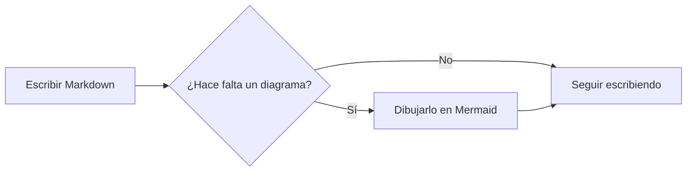
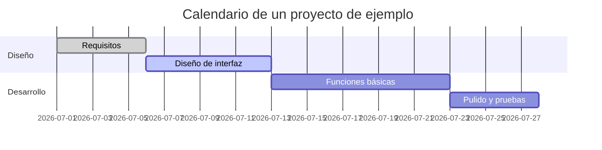
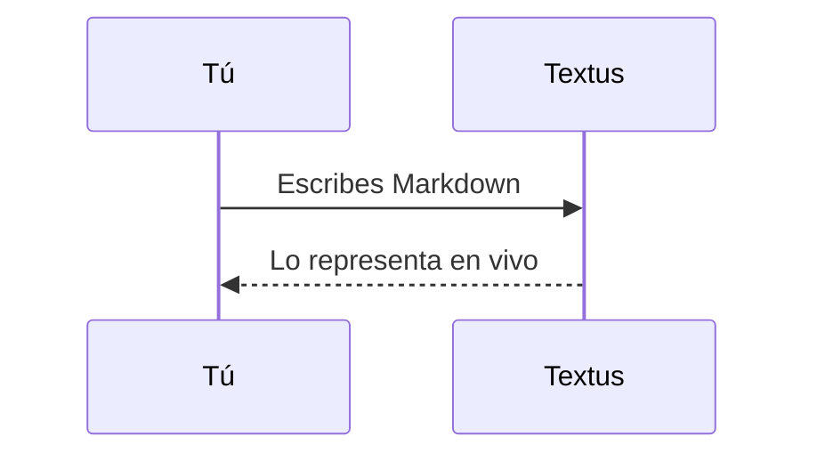

# Guía de Markdown de Textus

Te damos la bienvenida. Este documento integrado muestra el Markdown que admite Textus y cómo se ve. Es solo un borrador sin guardar: edítalo y experimenta con libertad, y después ciérralo sin guardar.

> [!TIP]
> Pulsa `Cmd+/` para alternar entre WYSIWYG y el modo código fuente, y ver la sintaxis que hay detrás de cualquier ejemplo.

## Encabezados y citas

Escribe `#` y un espacio al principio de una línea para crear un encabezado de nivel 1, o `##` y un espacio para uno de nivel 2. Los encabezados de arriba muestran el resultado. `Ctrl+1` a `Ctrl+6` (`Cmd+1` a `Cmd+6` en un Mac) convierten la línea actual en un encabezado de ese nivel.

Una cita:

> El texto citado puede contener otras marcas, como **negrita** y `código`.

Alertas al estilo de GitHub:

> [!NOTE]
> Una nota, para dar contexto adicional.

> [!WARNING]
> Una advertencia, para lo que conviene tener en cuenta.

## Estilos de texto

**Negrita** (`**texto**`), *cursiva* (`*texto*`), ***negrita y cursiva***, ~~tachado~~ (`~~texto~~`), ==resaltado== (`==texto==`) y `código en línea`.

Al escribir `(`, `[`, `{`, unas comillas o un paréntesis de un método de entrada chino o japonés, como `（`, `【` o `「`, se añade su pareja de cierre tras el cursor: escribir el cierre lo salta, Retroceso justo después de la apertura borra los dos y, con texto seleccionado, la pareja lo rodea. **Ajustes → Editor y aspecto → Cerrar paréntesis y comillas automáticamente** lo desactiva.

Los enlaces se ven así: [el repositorio de Textus](https://github.com/CatVinci-Studio/Textus). Con Ctrl/⌘+clic se sigue un enlace: uno web se abre en el navegador, uno a otro archivo Markdown lo abre en una pestaña y uno a `#un-encabezado` desplaza hasta él. Un clic normal pone el cursor en el enlace y muestra su Markdown, `[texto](url)`, para editarlo ahí mismo; al salir el cursor vuelve a ser un enlace. También se representa el HTML en línea, como las teclas <kbd>Cmd</kbd> + <kbd>S</kbd>. También se representan los bloques plegables `<details>`, las tablas HTML, algunos estilos en línea (color, fondo, tamaño, grosor, alineación, subrayado y tachado) y el `<svg>` en línea, que se muestra como imagen. Los scripts y el resto del HTML se quedan como código. Un enlace a un encabezado de otro archivo, como `[ver](notas.md#un-encabezado)`, abre ese archivo en ese encabezado. Los wikilinks de Obsidian (`[[Nota]]`, `[[Nota|texto]]` y `[[Nota#Encabezado]]`) se abren igual, desde la carpeta del documento o desde cualquier parte de su bóveda; ellos y las `#etiquetas` al principio de una línea se guardan tal como se escribieron.

**Ajustes → Editor y aspecto → Muestras antes de los códigos de color** pone un pequeño cuadrado del color delante de un código de color. **Solo en el código** lo muestra en el código en línea que es un color, como `#0af` o `rgb(0 128 255)`, y delante de los valores de color de los bloques de código; **En todo el texto**, también delante de los escritos en el texto con seis u ocho dígitos, como #ff8800, o como función de color, como hsl(210 100% 50%). Los códigos cortos en el texto, las etiquetas como #cafe, los números como #234 y los enlaces se quedan como están.

Fórmulas en línea: la equivalencia entre masa y energía $E = mc^2$, la identidad de Euler $e^{i\pi} + 1 = 0$.

## Listas

- Lista no ordenada
- Con anidación
  - Un elemento de segundo nivel
  - Otro más

1. Lista ordenada
2. Segundo elemento

Lista de tareas (haz clic en una casilla para marcarla o desmarcarla):

- [x] Algo ya hecho
- [ ] Algo por hacer

## Tablas

| Función | Sintaxis | Resultado |
| --- | --- | --- |
| Negrita | `**texto**` | **texto** |
| Resaltado | `==texto==` | ==texto== |
| Fórmula en línea | `$x^2$` | $x^2$ |

Pasa el puntero sobre una tabla para añadir o quitar filas y columnas. Escribe `| Nombre | Edad |` y pulsa Enter para crear una tabla. Enter baja una fila, añade otra al llegar a la última y, en una fila nueva que sigue vacía, sale de la tabla; Ctrl/⌘+Enter sale en cualquier momento. En una tabla, Tab y Mayús+Tab pasan a la celda siguiente y a la anterior, y Mayús+Enter empieza una línea nueva dentro de la celda.

## Bloques de código

Bloques de código delimitados con resaltado de sintaxis (cambia el lenguaje desde la esquina superior derecha del bloque). Enter en la última línea vacía sale del bloque, igual que Ctrl/⌘+Enter en cualquier momento; lo mismo vale para las citas. El botón **Copiar**, junto al lenguaje, copia el código del bloque, y **Ajustes → Editor y aspecto → Números de línea en los bloques de código** numera sus líneas; ninguno de los dos aparece en las exportaciones ni al imprimir.

```python
def fib(n: int) -> int:
    """La clásica sucesión de Fibonacci."""
    a, b = 0, 1
    for _ in range(n):
        a, b = b, a + b
    return a
```

```rust
fn main() {
    let greeting = "¡Hola, Textus!";
    println!("{greeting}");
}
```

## Bloques de fórmulas

KaTeX representa las fórmulas en bloque delimitadas con `$$`:

$$
\int_{-\infty}^{\infty} e^{-x^2} \, dx = \sqrt{\pi}
$$

## Diagramas (Mermaid)

Un bloque de código ```` ```mermaid ```` se representa como un diagrama en vivo. Un diagrama de flujo:



Un diagrama de Gantt:



Un diagrama de secuencia:



**Ajustes → Editor y aspecto → Motor de diagramas** elige quién dibuja estos bloques: Mermaid, el predeterminado, o Pele, que es más rápido pero distribuye los diagramas a su manera y omite algunas funciones; un diagrama que Pele no puede dibujar lo dibuja Mermaid.

## Imágenes

Pega una imagen directamente desde el portapapeles: Textus la guarda e inserta la referencia. Dónde va se decide en **Ajustes → Editor y aspecto → Imágenes**. **En este equipo**, va a una **Subcarpeta** de la carpeta del documento, `assets/` por defecto, cuyo nombre puedes cambiar, o a **La misma carpeta que el documento**; Ajustes muestra el enlace que recibe la imagen pegada. Con **Subir a un servidor de imágenes**, se envía a PicGo / PicList, SM.MS, Imgur o a un endpoint tuyo (**Personalizado**).

Un endpoint personalizado recibe `multipart/form-data` con un campo `file` y puede devolver la URL pública como texto sin formato o en un campo JSON configurable. Los archivos subidos pueden renombrarse automáticamente, mantener su nombre original o pedirte un nombre antes de cada subida. Las referencias a imágenes existentes no se modifican al cambiar el modo de almacenamiento.

O escribe la referencia a mano:

```markdown

```

Las incrustaciones de Obsidian, como `![[image.png]]` o `![[attachments/image.png|300]]`, también muestran la imagen: Textus busca el archivo en la bóveda de Obsidian del documento y guarda la incrustación tal como está escrita.

## Vistas y modos

Además del editor WYSIWYG y del modo código fuente (`Cmd+/`), Textus ofrece tres formas de escribir (en Windows y Linux, usa `Ctrl` en lugar de `Cmd`; Ajustes → Atajos de teclado muestra los atajos vigentes):

- **Vista dividida** (`Cmd+Shift+E`): el código Markdown a la izquierda y la vista previa a la derecha, con el desplazamiento sincronizado.
- **Modo máquina de escribir** (Ajustes → Editor y aspecto → Visualización): la línea que escribes se queda en el centro de la ventana, en el editor, en el modo código fuente y en la vista dividida.
- **Modo zen** (`Cmd+Shift+J`): oculta todo menos el texto, pasa a pantalla completa y atenúa todos los párrafos salvo el que estás escribiendo. Pulsa `Esc` para salir.

Los tres están también en el menú **Visualización**.

**Ajustes → Editor y aspecto → Tamaño del texto de la interfaz** agranda o reduce el texto de la barra lateral, las pestañas, los menús, el panel de IA y los Ajustes; el documento conserva su propio zoom. `Ctrl+Tab` y `Ctrl+Shift+Tab` pasan a la pestaña siguiente y a la anterior.

## Carpetas y búsqueda de archivos

**Archivo → Abrir carpeta…** abre una carpeta entera en la barra lateral: el árbol de archivos se queda en ella mientras abres los documentos que contiene, la carpeta vuelve con tu sesión y **Archivo → Cerrar carpeta** hace que el árbol vuelva a seguir al documento. El cuadro de la parte superior de la pestaña **Archivos** de la barra lateral busca nombres de archivo en toda la carpeta; `Cmd+Shift+O` salta a él. Escribe para filtrar, usa `↑`/`↓` para moverte, `Enter` para abrir y `Esc` para borrar. Ambas funciones son solo de escritorio.

El árbol también es un pequeño gestor de archivos. El nombre de la carpeta superior, encima, te lleva un nivel arriba. **Ordenar** lo ordena por nombre o por fecha de modificación, y el filtro junto al cuadro de búsqueda, **Todos los archivos** o **Solo documentos**, se aplica al árbol igual que a la búsqueda. Haz clic derecho en una carpeta, un archivo o el espacio vacío de abajo para crear allí un **Nuevo documento** o una **Nueva carpeta**, y arrastra un archivo o carpeta sobre otra carpeta para moverlo; un documento abierto lo sigue a su nuevo lugar. Nunca se reemplaza nada: un nombre ya usado se rechaza.

**Archivo → Abrir…** también abre un documento de Word (`.docx`), y lo mismo pasa al soltarlo en la ventana: se convierte en un documento Markdown nuevo con el mismo nombre, aún sin guardar, con sus títulos, listas, tablas, enlaces, notas al pie e imágenes. Las imágenes van, al guardarlo, adonde **Ajustes → Editor y aspecto → Imágenes** pone las pegadas, y **Guardar** propone un archivo `.md` junto al de Word. Parte del formato puede verse distinto; el archivo de Word nunca cambia. Solo en escritorio.

## Seguir abierto en segundo plano

Activa **Ajustes → General → Aplicación → Seguir abierto en segundo plano** y, al cerrar la última ventana, Textus sigue abierto, con su icono en el área de notificación (Windows), la bandeja del sistema (Linux) o la barra de menús (Mac). **Abrir Textus** en el menú del icono te devuelve a tus documentos; **Salir de Textus** ahí cierra Textus del todo. GNOME solo muestra el icono de bandeja con la extensión AppIndicator.

## Notas al pie y líneas horizontales

Las notas al pie se ven así[^1], y debajo hay una línea horizontal:

---

[^1]: El contenido de las notas al pie se reúne al final del documento.

Que disfrutes escribiendo.
