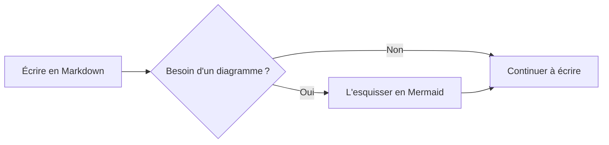
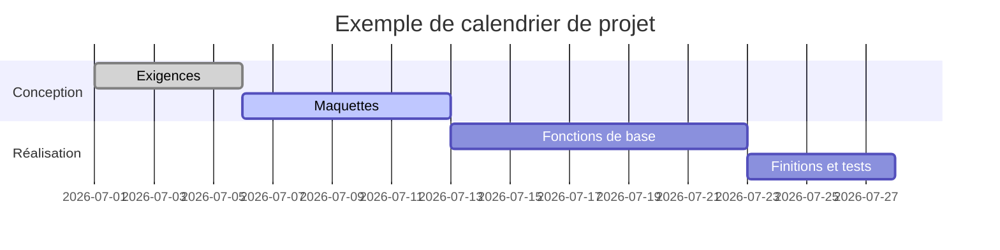
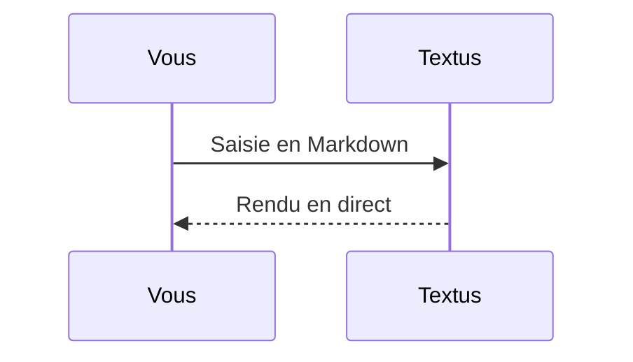

# Guide Markdown de Textus

Bienvenue dans ce document intégré, qui présente le rendu Markdown pris en charge par Textus. Ce n'est qu'un brouillon non enregistré : modifiez-le et faites des essais librement, puis fermez-le sans l'enregistrer.

> [!TIP]
> Appuyez sur `Cmd+/` pour basculer entre le mode WYSIWYG et le mode source, et voir la syntaxe brute de chaque exemple.

## Titres et citations

Tapez `#` suivi d'un espace en début de ligne pour un titre de niveau 1, ou `##` suivi d'un espace pour le niveau 2. Les titres ci-dessus montrent le résultat. `Ctrl+1` à `Ctrl+6` (`Cmd+1` à `Cmd+6` sur Mac) font de la ligne courante un titre de ce niveau.

Une citation :

> Le texte cité peut contenir d'autres mises en forme, comme du **gras** et du `code`.

Les encadrés de style GitHub :

> [!NOTE]
> Une note, pour donner du contexte.

> [!WARNING]
> Un avertissement, pour ce qui demande de la vigilance.

## Styles de texte

**Gras** (`**texte**`), *italique* (`*texte*`), ***gras italique***, ~~barré~~ (`~~texte~~`), ==surligné== (`==texte==`) et `code en ligne`.

Indices et exposants comme dans Typora et Pandoc : H~2~O (`H~2~O`), x^2^ (`x^2^`) ; sans espace à l’intérieur.

Taper `(`, `[`, `{`, un guillemet ou une parenthèse d'une méthode de saisie chinoise ou japonaise, comme `（`, `【` ou `「`, ajoute son partenaire fermant après le curseur : taper le fermant passe par-dessus, Retour arrière juste après l'ouvrant efface les deux, et avec du texte sélectionné la paire l'entoure. **Réglages → Éditeur et apparence → Fermer (), [] et « »** le désactive.

Les liens s'écrivent ainsi : [le dépôt de Textus](https://github.com/CatVinci-Studio/Textus). Ctrl/⌘+clic suit un lien : un lien web s'ouvre dans le navigateur, un lien vers un autre fichier Markdown l'ouvre dans un onglet, et un lien vers `#un-titre` fait défiler jusqu'à ce titre. Un simple clic place le curseur dans le lien et affiche son Markdown, `[texte](url)`, à modifier sur place ; quand le curseur en sort, c'est de nouveau un lien. Le HTML en ligne s'affiche aussi, par exemple les touches du clavier <kbd>Cmd</kbd> + <kbd>S</kbd>. De même pour les blocs repliables `<details>`, les tableaux HTML, quelques styles en ligne (couleur, fond, taille, graisse, alignement, soulignement et barré) et le `<svg>` en ligne, affiché comme une image. Les scripts et le reste du HTML restent en code source. Un lien vers un titre d'un autre fichier, comme `[voir](notes.md#un-titre)`, ouvre ce fichier à ce titre. Les wikiliens d'Obsidian (`[[Note]]`, `[[Note|texte]]` et `[[Note#Titre]]`) s'ouvrent de la même façon, depuis le dossier du document ou n'importe où dans son coffre ; eux et les `#étiquettes` en début de ligne sont enregistrés tels qu'ils ont été écrits.

**Réglages → Éditeur et apparence → Pastilles avant les codes couleur** place un petit carré de la couleur devant un code couleur. **Dans le code seulement** l'affiche dans le code en ligne qui désigne une couleur, comme `#0af` ou `rgb(0 128 255)`, et devant les valeurs de couleur des blocs de code ; **Partout**, aussi devant ceux écrits dans le texte avec six ou huit chiffres, comme #ff8800, ou sous forme de fonction, comme hsl(210 100% 50%). Les codes courts dans le texte, les étiquettes comme #cafe, les numéros comme #234 et les liens restent tels quels.

Formules en ligne : l'équivalence masse-énergie $E = mc^2$, l'identité d'Euler $e^{i\pi} + 1 = 0$.

## Listes

- Liste à puces
- Avec imbrication
  - Un élément de deuxième niveau
  - Un autre

1. Liste numérotée
2. Deuxième élément

Liste de tâches (cliquez sur une case pour la cocher ou la décocher) :

- [x] Une tâche terminée
- [ ] Une tâche à faire

## Tableaux

| Fonction | Syntaxe | Résultat |
| --- | --- | --- |
| Gras | `**texte**` | **texte** |
| Surlignage | `==texte==` | ==texte== |
| Formule en ligne | `$x^2$` | $x^2$ |

Survolez un tableau pour ajouter ou supprimer des lignes et des colonnes. Tapez `| Nom | Âge |` puis appuyez sur Entrée pour créer un tableau. Dans un tableau, Entrée passe à la ligne suivante, en ajoute une sur la dernière ligne et quitte le tableau sur une nouvelle ligne restée vide ; Ctrl/⌘+Entrée le quitte à tout moment. Dans un tableau, Tab et Maj+Tab passent à la cellule suivante et à la précédente, et Maj+Entrée commence une nouvelle ligne dans la cellule.

## Blocs de code

Blocs de code délimités, avec coloration syntaxique (changez de langage dans le coin supérieur droit du bloc). Entrée sur la dernière ligne vide quitte le bloc, tout comme Ctrl/⌘+Entrée à tout moment ; il en va de même pour les citations. **Copier** et **Tout sélectionner**, à côté du langage, copient ou sélectionnent le code du bloc, et **Réglages → Éditeur et apparence → Numéros de ligne dans les blocs de code** numérote ses lignes ; ni l'un ni les autres n'apparaissent dans les exports ou à l'impression.

```python
def fib(n: int) -> int:
    """La suite de Fibonacci classique."""
    a, b = 0, 1
    for _ in range(n):
        a, b = b, a + b
    return a
```

```rust
fn main() {
    let greeting = "Bonjour, Textus";
    println!("{greeting}");
}
```

## Formules en bloc

Les formules en bloc entourées de `$$` sont rendues par KaTeX :

$$
\int_{-\infty}^{\infty} e^{-x^2} \, dx = \sqrt{\pi}
$$

## Diagrammes (Mermaid)

Un bloc de code ```` ```mermaid ```` s'affiche sous forme de diagramme en direct. Un organigramme :



Un diagramme de Gantt :



Un diagramme de séquence :



**Réglages → Éditeur et apparence → Moteur de diagrammes** choisit ce qui dessine ces blocs : Mermaid, par défaut, ou Pele, plus rapide, mais qui dispose les diagrammes à sa façon et laisse de côté quelques fonctions ; un diagramme que Pele ne sait pas dessiner est dessiné par Mermaid.

## Images

Collez une image directement depuis le presse-papiers : Textus l'enregistre et insère la référence. L'endroit se choisit dans **Réglages → Éditeur et apparence → Images**. **Sur cet ordinateur**, c'est un **Sous-dossier** du dossier du document, `assets/` par défaut, dont vous pouvez changer le nom, ou le **Même dossier que le document** ; les réglages montrent le lien que reçoit l'image collée. Avec **Envoyer vers un hébergeur d'images**, elle part vers PicGo / PicList, SM.MS, Imgur ou votre propre URL d'envoi (**Personnalisé**).

Une URL d'envoi personnalisée reçoit des données `multipart/form-data` avec un champ `file` et peut renvoyer l'URL publique soit en texte brut, soit dans un champ JSON configurable. Les fichiers envoyés peuvent être renommés automatiquement, garder leur nom d'origine, ou vous demander un nom avant chaque envoi. Les références d'images existantes ne sont jamais modifiées quand vous changez de mode de stockage.

Vous pouvez aussi écrire la référence à la main :

```markdown

```

Les intégrations Obsidian comme `![[image.png]]` ou `![[attachments/image.png|300]]` affichent aussi l'image : Textus cherche le fichier dans le coffre Obsidian du document et enregistre l'intégration telle qu'elle est écrite.

Pour regarder une image de près, double-cliquez dessus ou appuyez sur **Agrandir l'image** dans son coin supérieur droit (les diagrammes ont le même bouton) : faites défiler ou pincez pour zoomer, faites glisser pour la déplacer, double-cliquez pour l'ajuster de nouveau, et `Esc` la ferme. Faites glisser la poignée du bord droit d'une image pour la redimensionner. **Réglages → Éditeur et apparence → Images seules sur leur ligne** place les images seules sur une ligne au centre ou à gauche, dans l'éditeur comme dans les exports HTML et PDF.

## Copier et coller

**Copier** met le Markdown dans le texte brut du presse-papiers et la mise en forme à côté : GitHub, Obsidian, VS Code et les messageries reçoivent du Markdown, tandis que Word, Pages, le courrier et Notion le collent mis en forme. Une image copiée par clic droit part dans le presse-papiers en tant qu'image, prête à être collée dans une discussion ou un document. **Édition → Coller en texte brut** (`Cmd+Shift+V`) colle le texte du presse-papiers tel quel, sans y lire de Markdown.

## Vues et modes

Outre l'éditeur WYSIWYG et le mode source (`Cmd+/`), Textus offre trois façons d'écrire (sous Windows et Linux, utilisez `Ctrl` au lieu de `Cmd` ; Réglages → Raccourcis indique les raccourcis en vigueur) :

- **Source et aperçu** (`Cmd+Shift+E`) : la source Markdown à gauche, l'aperçu mis en forme à droite, qui défilent ensemble.
- **Mode machine à écrire** : la ligne que vous tapez reste au milieu de la fenêtre, dans l'éditeur, en mode source comme en Source et aperçu.
- **Mode zen** (`Cmd+Shift+J`) : masque tout sauf le texte et atténue tous les paragraphes sauf celui que vous écrivez. Appuyez sur `Esc` pour en sortir.

Tous se trouvent dans le menu **Présentation** et dans **Réglages → Éditeur et apparence → Affichage**. Chacun est un seul réglage pour tout Textus : changez-le dans n'importe quelle fenêtre et chaque onglet de chaque fenêtre change avec lui, les documents que vous ouvrez ensuite s'y affichent, et Textus s'y rouvre la fois suivante.

**Présentation → Lecture seule** (aussi dans le menu contextuel d'un onglet) empêche toute modification d'un document : frappe, collage, dépôt, annulation, Textus AI ou extensions. Un cadenas à côté du titre l'indique ; cliquez dessus pour rendre le document de nouveau modifiable.

**Présentation → Palette de commandes…** (`Cmd+Shift+P`) trouve tout ce que font les menus, ainsi que chaque commande ajoutée par une extension, en tapant quelques lettres de son nom. Elle change aussi l'apparence (claire, sombre ou celle du système) et le thème de l'éditeur, et active ou désactive Textus AI.

L'onglet **Plan** de la barre latérale liste les titres du document ; cliquez sur l'un d'eux pour vous y rendre. Un clic droit sur le plan propose **Tout déplier** et **Tout replier**, ou `Option`-clic (`Alt`-clic) sur la flèche d'un titre les déplie ou les replie tous d'un coup.

**Réglages → Éditeur et apparence → Taille du texte de l'interface** agrandit ou réduit le texte de la barre latérale, des onglets, des menus, du panneau de l'IA et des Réglages ; le document garde son propre zoom. `Ctrl+Tab` et `Ctrl+Shift+Tab` passent à l'onglet suivant et au précédent.

## Plusieurs documents à la fois

**Présentation → Partager à droite** (`Cmd+Option+S`) affiche le document au premier plan à côté d'un autre, et **Présentation → Partager en bas** les place l'un au-dessus de l'autre. Chaque volet a ses propres onglets : un document que vous ouvrez va dans le volet où vous êtes, et Partager à droite ou Partager en bas divise de nouveau ce volet, autant de fois que vous le voulez.

- Faites glisser un onglet, ou un fichier de la barre latérale, vers le bord d'un volet : il s'ouvre dans un nouveau volet de ce côté. Faites-le glisser vers le bord extérieur de l'éditeur et il s'ouvre à côté de tous les volets : au bord droit de deux volets superposés, il occupe tout le côté droit, de haut en bas. Déposez-le sur les onglets d'un autre volet pour l'y déplacer.
- Faites glisser la ligne entre deux volets pour les redimensionner ; double-cliquez dessus pour les rendre égaux. Un clic droit dessus les fait passer de côte à côte à l'un au-dessus de l'autre, les intervertit ou ferme le partage.
- **Ouvrir à côté**, dans le menu contextuel d'un onglet, l'affiche à côté de celui au premier plan.
- Fermez le dernier onglet d'un volet et le volet disparaît. Toute la disposition revient quand vous rouvrez Textus.

## Onglets et fenêtres

`Cmd+T` ouvre un nouvel onglet, `Cmd+N` une nouvelle fenêtre, et **Fichier → Rouvrir l'onglet fermé** (`Cmd+Shift+T`) rouvre les documents que vous avez fermés, le plus récent d'abord. Un clic du milieu ferme un onglet ; le menu contextuel d'un onglet propose **Fermer les autres**, **Fermer les onglets à gauche** et **Fermer les onglets à droite** (les onglets aux modifications non enregistrées restent ouverts), **Copier le chemin** et **Déplacer dans une nouvelle fenêtre**. Vous pouvez aussi faire glisser un onglet hors de la fenêtre pour lui donner sa propre fenêtre. Quand Textus rouvre, chaque fenêtre revient avec ses propres onglets.

## Dossiers et recherche de fichiers

**Fichier → Ouvrir un dossier…** ouvre tout un dossier dans la barre latérale : l'arborescence y reste pendant que vous ouvrez les documents qu'il contient, le dossier revient avec votre session, et **Fichier → Fermer le dossier** laisse de nouveau l'arborescence suivre le document. La zone en haut de l'onglet **Fichiers** de la barre latérale cherche des noms de fichier dans tout le dossier ; `Cmd+Shift+O` y mène directement. Tapez pour filtrer, `↑`/`↓` pour vous déplacer, `Entrée` pour ouvrir, `Échap` pour effacer. Les deux ne sont disponibles que sur ordinateur.

L'arbre est aussi un petit gestionnaire de fichiers. Le nom du dossier parent, au-dessus, remonte d'un niveau. **Trier** le classe par nom ou par date de modification, et le filtre à côté du champ de recherche, **Tous les fichiers** ou **Documents seulement**, s'applique à l'arbre comme à la recherche. Un clic droit sur un dossier, un fichier ou l'espace vide en dessous y crée un **Nouveau document** ou un **Nouveau dossier**, et un fichier ou un dossier glissé sur un autre dossier y est déplacé ; un document ouvert le suit à sa nouvelle place. Rien n'est jamais remplacé : un nom déjà pris est refusé.

Faites glisser des fichiers depuis le Finder ou l'Explorateur de fichiers sur la fenêtre pour les ouvrir : les documents s'ouvrent dans des onglets, les images vont dans le document là où vous les lâchez, et un dossier s'ouvre dans la barre latérale. **Fichier → Copier le chemin** copie le chemin complet du document au premier plan.

Depuis un terminal, `textus notes.md` ouvre un fichier dans Textus ; **Réglages → Général** installe la commande `textus` si elle n'est pas encore là.

**Fichier → Ouvrir…** ouvre aussi un document Word (`.docx`), tout comme le déposer sur la fenêtre : il devient un nouveau document Markdown du même nom, pas encore enregistré, avec ses titres, listes, tableaux, liens, notes de bas de page et images. Les images vont, à l'enregistrement, là où **Réglages → Éditeur et apparence → Images** place les images collées, et **Enregistrer** propose un fichier `.md` à côté du fichier Word. Une partie de la mise en forme peut différer ; le fichier Word lui-même n'est jamais modifié. Sur ordinateur uniquement.

## Rester ouvert en arrière-plan

Activez **Réglages → Général → Application → Rester ouvert en arrière-plan** : fermer la dernière fenêtre laisse alors Textus ouvert, avec son icône dans la zone de notification (Windows), la zone de notification du système (Linux) ou la barre des menus (Mac). **Ouvrir Textus** dans le menu de l’icône vous ramène à vos documents ; **Quitter Textus** dans ce menu quitte vraiment. GNOME n’affiche l’icône qu’avec l’extension AppIndicator.

## Exporter

**Fichier → Exporter** enregistre le document en HTML ou en PDF ; avec [Pandoc](https://pandoc.org) installé, aussi en Word (`.docx`), OpenDocument, RTF, EPUB, LaTeX et d'autres formats. Sur Mac, **Réglages → Éditeur et apparence → Exporter les PDF en couleurs claires** imprime un PDF sur fond blanc dans les couleurs claires de votre thème, même quand vous écrivez en mode sombre.

## Extensions, thèmes et compétences

**Réglages → Extensions → En obtenir plus** liste des extensions, des thèmes et des compétences à ajouter : touches Vim et Emacs, lecteur PDF, graphiques, graphe de connaissances, outils d'écriture et plus encore. Chacun a un seul bouton, **Installer**, puis **Mettre à jour**, **Désactiver** ou **Activer**, et **Désinstaller** dans le menu à côté. La page d'une extension montre comment s'en servir, et ses commandes apparaissent dans le menu **Extensions** et dans la palette de commandes.

## Obtenir de l'aide

**Aide → Signaler un problème…** (aussi dans **Réglages → Général**, sous Aide) ouvre un court formulaire. Indiquez de quel type de signalement il s'agit, quelle partie de Textus il concerne et, pour un bug, sa gravité, puis ce qui n'a pas marché ; Textus ajoute sa version, votre système, vos extensions, vos réglages sans rien de privé et les erreurs récentes, le tout affiché avant tout envoi. **Envoyer** le dépose pour vous comme ticket sur GitHub, sans compte GitHub, et vous donne son numéro ; **Envoyer sur GitHub** ouvre plutôt le formulaire de GitHub ; **Copier** le met dans le presse-papiers pour une discussion ou un e-mail. Ce que vous écrivez devient un ticket public ; l'e-mail ou l'identifiant WeChat que vous laissez, si nous pouvons vous poser d'autres questions, ne va qu'à l'équipe.

**Réglages → Général → Aide** permet aussi de revoir le tutoriel de bienvenue, d'ouvrir les guides et d'accéder à **À propos de Textus**, avec la version et **Rechercher les mises à jour** (sur Mac, aussi **Textus → Rechercher les mises à jour…**). **Aide → Rejoindre la communauté** ouvre la page de la communauté.

## Notes de bas de page et filets

Les notes de bas de page s'écrivent ainsi[^1], et voici un filet horizontal :

---

[^1]: Le contenu des notes est regroupé à la fin du document.

Bonne écriture.
