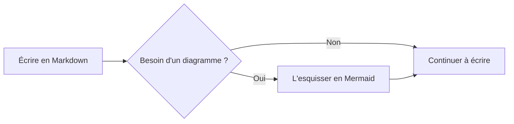
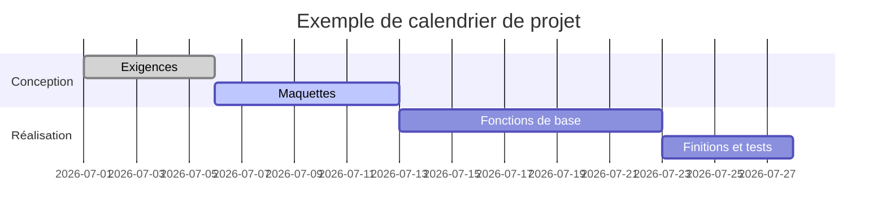
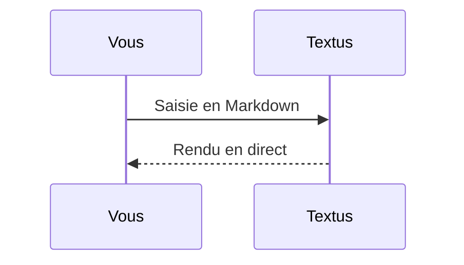

# Guide Markdown de Textus

Ce guide est lui-même un document que vous pouvez modifier : cinq minutes pour ce dont vous vous servirez le plus, puis le reste, classé selon ce que vous voulez faire. Fermez-le sans l'enregistrer quand vous avez fini.

> [!TIP]
> Appuyez sur `Cmd+/` (`Ctrl+/` sous Windows et Linux) pour passer à la source et voir comment chaque exemple est écrit.

## Cinq minutes pour commencer

Markdown indique la mise en forme avec quelques symboles, et Textus la met en page pendant que vous tapez. En début de ligne, tapez :

- `# ` suivi de quelques mots : un titre ; `## ` : un titre plus petit.
- `- ` : une liste ; `1. ` : une liste numérotée ; `- [ ] ` : une tâche.
- `> ` : une citation.

Autour des mots : `**gras**`, `*italique*`, `==surligné==`, `` `code` ``. Un lien s'écrit `[mots](https://example.com)` ; pour une image, collez-la simplement.

Pas envie de retenir les symboles ? Utilisez la **barre de mise en forme** au-dessus du document, ou faites un clic droit sur le texte sélectionné. Vous ne trouvez pas quelque chose ? Appuyez sur `Cmd+Shift+P` pour la palette de commandes et tapez quelques lettres.

## Écrire un texte long

**Retrait de première ligne** (Réglages › Édition › Texte) décale la première ligne de chaque paragraphe de deux caractères ; les listes, les citations et les tableaux restent tels quels.

### Façons d'écrire et modes

Outre l'éditeur WYSIWYG et le mode source (`Cmd+/`), Textus offre trois façons d'écrire (sous Windows et Linux, utilisez `Ctrl` au lieu de `Cmd` ; Réglages › Raccourcis indique les raccourcis en vigueur) :

- **Source et aperçu** (`Cmd+Shift+E`) : la source Markdown à gauche, l'aperçu mis en forme à droite, qui défilent ensemble.
- **Mode machine à écrire** : la ligne que vous tapez reste au milieu de la fenêtre, dans l'éditeur, en mode source comme en Source et aperçu.
- **Mode zen** (`Cmd+Shift+J`) : masque tout sauf le document où vous êtes et atténue tous les paragraphes sauf celui que vous écrivez. Le × en haut à droite, ou de nouveau le raccourci, permet d'en sortir.

Tous se trouvent dans le menu **Présentation** (les deux premiers sous **Présentation › Mode**) et dans le groupe **Affichage** de **Réglages › Édition › Texte**. Chacun est un seul réglage pour tout Textus : changez-le dans n'importe quelle fenêtre et chaque onglet de chaque fenêtre change avec lui, les documents que vous ouvrez ensuite s'y affichent, et Textus s'y rouvre la fois suivante.

**Présentation › Mode › Mode lecture** (aussi dans le menu contextuel d'un onglet) empêche toute modification d'un document : frappe, collage, dépôt, annulation, Textus AI ou extensions. Un cadenas à côté du titre l'indique ; cliquez dessus pour autoriser de nouveau les modifications.

**Présentation › Palette de commandes…** (`Cmd+Shift+P`) trouve tout ce que font les menus, ainsi que chaque commande ajoutée par une extension, en tapant quelques lettres de son nom. Elle change aussi l'apparence (claire, sombre ou celle du système) et le thème de l'éditeur, et active ou désactive Textus AI. **Édition › Rechercher et remplacer…** (`Cmd+F`) cherche dans le document, **Édition › Remplacer…** (`Cmd+Option+F`) l'ouvre avec la ligne de remplacement, et `Cmd+G` passe à l'occurrence suivante.

Le panneau **Plan** de la barre latérale liste les titres du document ; cliquez sur l'un d'eux pour vous y rendre. Un clic droit sur le plan propose **Tout déplier** et **Tout replier**, ou `Option`-clic (`Alt`-clic) sur la flèche d'un titre les déplie ou les replie tous d'un coup.

**Taille de l'interface** (Réglages › Apparence) agrandit ou réduit la barre latérale, les onglets, les menus, les onglets de l'IA et les Réglages, texte et commandes ensemble ; chaque document garde son propre zoom (`Cmd+=`, `Cmd+-`). `Ctrl+Tab` et `Ctrl+Shift+Tab` passent à l'onglet suivant et au précédent.

### Notes de bas de page, filets et table des matières

Les notes de bas de page s'écrivent ainsi[^1], et voici un filet horizontal :

---

[^1]: Le contenu des notes est regroupé à la fin du document.

Tapez `[TOC]` seul sur une ligne et appuyez sur Entrée pour une table des matières : elle liste les titres du document et les suit pendant que vous écrivez ; cliquez sur un titre pour y aller.

## Tableaux, code, formules et diagrammes

### Tableaux

| Fonction | Syntaxe | Résultat |
| --- | --- | --- |
| Gras | `**texte**` | **texte** |
| Surlignage | `==texte==` | ==texte== |
| Formule en ligne | `$x^2$` | $x^2$ |

Survolez un tableau pour ajouter ou supprimer des lignes et des colonnes. Tapez `| Nom | Âge |` puis appuyez sur Entrée pour créer un tableau. Entrée passe à la ligne suivante, en ajoute une sur la dernière ligne et quitte le tableau sur une nouvelle ligne restée vide ; Ctrl/⌘+Entrée le quitte à tout moment. Dans un tableau, Tab et Maj+Tab passent à la cellule suivante et à la précédente, et Maj+Entrée commence une nouvelle ligne dans la cellule.

### Blocs de code

Blocs de code délimités, avec coloration syntaxique (changez de langage dans le coin supérieur droit du bloc). Entrée sur la dernière ligne vide quitte le bloc, tout comme Ctrl/⌘+Entrée à tout moment ; il en va de même pour les citations. **Copier** et **Tout sélectionner**, à côté du langage, copient ou sélectionnent le code du bloc, et **Numéros de ligne dans les blocs de code** (Réglages › Édition › Texte) numérote ses lignes ; ni l'un ni les autres n'apparaissent dans les exports ou à l'impression.

```python
def fib(n: int) -> int:
    """La suite de Fibonacci classique."""
    a, b = 0, 1
    for _ in range(n):
        a, b = b, a + b
    return a
```

```rust
fn main() {
    let greeting = "Bonjour, Textus !";
    println!("{greeting}");
}
```

### Formules en bloc

Les formules en bloc entourées de `$$` sont rendues par KaTeX :

$$
\int_{-\infty}^{\infty} e^{-x^2} \, dx = \sqrt{\pi}
$$

### Diagrammes (Mermaid)

Un bloc de code ```` ```mermaid ```` s'affiche sous forme de diagramme en direct. Un organigramme :



Un diagramme de Gantt :



Un diagramme de séquence :



**Moteur de diagrammes** (Réglages › Édition › Texte) choisit ce qui dessine ces blocs : Mermaid, par défaut, ou Pele, plus rapide, mais qui dispose les diagrammes à sa façon et laisse de côté quelques fonctions ; un diagramme que Pele ne sait pas dessiner est dessiné par Mermaid.

Leurs couleurs suivent l'apparence — une palette grise et sobre en clair, sa version sombre en sombre — et un thème importé ou le CSS personnalisé peut en choisir une autre intégrée avec `--doc-mermaid-theme: forest`.

## Images et collage

### Images

Collez une image directement depuis le presse-papiers : Textus l'enregistre et insère la référence. L'endroit se choisit dans **Réglages › Édition › Images**. **Sur cet ordinateur**, c'est un **Sous-dossier** du dossier du document, `assets/` par défaut, dont vous pouvez changer le nom ; l'autre choix est **Même dossier que le document**. Les réglages montrent le lien que reçoit une image collée. **Envoyer vers un hébergeur d'images** l'envoie plutôt vers PicGo / PicList, SM.MS, Imgur ou votre propre URL d'envoi (**Personnalisé**).

Une URL d'envoi personnalisée reçoit des données `multipart/form-data` avec un champ `file` et peut renvoyer l'URL publique soit en texte brut, soit dans un champ JSON configurable. Les fichiers envoyés peuvent être renommés automatiquement, garder leur nom d'origine, ou vous demander un nom avant chaque envoi. Les références d'images existantes ne sont jamais modifiées quand vous changez de mode de stockage.

Vous pouvez aussi écrire la référence à la main :

```markdown

```

Les intégrations Obsidian comme `![[image.png]]` ou `![[attachments/image.png|300]]` affichent aussi l'image : Textus cherche le fichier dans le coffre Obsidian auquel appartient le document et enregistre l'intégration telle qu'elle est écrite.

Pour regarder une image de près, double-cliquez dessus ou appuyez sur **Agrandir l'image** dans son coin supérieur droit (les diagrammes ont le même bouton) : faites défiler ou pincez pour zoomer, faites glisser pour la déplacer, double-cliquez pour l'ajuster de nouveau, et `Esc` la ferme. Faites glisser la poignée du bord droit d'une image pour la redimensionner. **Images seules sur leur ligne** (Réglages › Édition › Images) place les images seules sur une ligne au centre ou à gauche, dans l'éditeur comme dans les exports HTML et PDF.

### Copier et coller

**Copier** met le Markdown dans le texte brut du presse-papiers et la mise en forme à côté : GitHub, Obsidian, VS Code et les messageries reçoivent du Markdown, tandis que Word, Pages, le courrier et Notion le collent mis en forme. Une image copiée par clic droit part dans le presse-papiers en tant qu'image, prête à être collée dans une discussion ou un document. **Édition › Coller en texte brut** (`Cmd+Shift+V`) colle le texte du presse-papiers tel quel, sans y lire de Markdown.

## Fichiers et dossiers

### Dossiers et recherche

**Fichier › Ouvrir un dossier…** ouvre tout un dossier dans la barre latérale : l'arborescence y reste pendant que vous ouvrez les documents qu'il contient, le dossier revient avec votre session, et **Fichier › Fermer le dossier** laisse de nouveau l'arborescence suivre le document. Le panneau **Rechercher** (la loupe dans la barre d'activité, ou `Cmd+Shift+O`) trouve les fichiers par leur nom et les lignes par leurs mots dans tout le dossier ; cliquez sur une ligne pour ouvrir le document à cet endroit. Les deux ne sont disponibles que sur ordinateur.

L'arborescence est aussi un petit gestionnaire de fichiers. Le nom du dossier parent, au-dessus, remonte d'un niveau. Son menu la classe par nom ou par date de modification, et affiche **Tous les fichiers** ou **Documents seulement**. Un clic droit sur un dossier, un fichier ou l'espace vide en dessous y crée un **Nouveau document** ou un **Nouveau dossier**, et un fichier ou un dossier glissé sur un autre dossier y est déplacé ; un document ouvert le suit à sa nouvelle place. Rien n'est jamais remplacé : un nom déjà pris est refusé.

Faites glisser des fichiers depuis le Finder ou l'Explorateur de fichiers sur la fenêtre pour les ouvrir : les documents s'ouvrent dans des onglets, les images vont dans le document là où vous les lâchez, et un dossier s'ouvre dans la barre latérale. **Fichier › Copier le chemin** copie le chemin complet du document au premier plan.

Depuis un terminal, `textus notes.md` ouvre un fichier dans Textus ; **Réglages › Général** installe la commande `textus` si elle n'est pas encore là. Elle en fait plus sans ouvrir de fenêtre : `textus search <mots>` les trouve dans les fichiers d'un dossier, `textus read` affiche un PDF ou un fichier Word en Markdown, et `textus help` liste toutes les commandes, y compris celles des extensions.

**Fichier › Ouvrir…** ouvre aussi un document Word (`.docx`), tout comme le déposer sur la fenêtre : il devient un nouveau document Markdown du même nom, pas encore enregistré, avec ses titres, listes, tableaux, liens, notes de bas de page et images. Les images vont, à l'enregistrement, là où **Réglages › Édition › Images** place les images collées, et **Enregistrer** propose un fichier `.md` à côté du fichier Word. Une partie de la mise en forme peut différer ; le fichier Word lui-même n'est jamais modifié. Sur ordinateur uniquement.

### Exporter

**Fichier › Exporter** enregistre le document en HTML ou en PDF ; avec [Pandoc](https://pandoc.org) installé, aussi en Word (`.docx`), OpenDocument, RTF, EPUB, LaTeX et d'autres formats. Sur Mac, **Exporter les PDF en couleurs claires** (Réglages › Édition › Exporter) imprime un PDF sur fond blanc dans les couleurs claires de votre thème, même quand vous écrivez en mode sombre.

### Rester ouvert en arrière-plan

Activez **Réglages › Général › Application › Rester ouvert en arrière-plan** : fermer la dernière fenêtre laisse alors Textus ouvert, avec son icône dans la zone de notification (Windows), la zone de notification du système (Linux) ou la barre des menus (Mac). **Ouvrir Textus** dans le menu de l'icône vous ramène à vos documents ; **Quitter Textus** dans ce menu quitte vraiment. GNOME n'affiche l'icône qu'avec l'extension AppIndicator.

## La fenêtre

### Ce qu'il y a dans la fenêtre

De gauche à droite :

- **La barre d'activité** : la colonne d'icônes. **Fichiers** (l'arborescence), **Plan** (les titres du document), **Rechercher** (dans tout le dossier), **Extensions**, puis les panneaux qu'ajoutent les extensions. **Réglages** (l'engrenage) est tout en bas. Cliquez sur une icône pour ouvrir son panneau dans la barre latérale ; cliquez de nouveau pour fermer la barre latérale. Faites glisser les icônes pour les réordonner ; un clic droit les affiche ou les masque.
- **La barre latérale** : un panneau à la fois. `Cmd+\` ou le bouton de la barre latérale en haut l'affiche et la masque ; faites glisser son bord pour l'élargir.
- **Les îlots** : les documents. Chaque îlot est une rangée d'onglets avec la page en dessous ; les onglets se trouvent dans la barre en haut de la fenêtre. Divisez la fenêtre et plusieurs îlots se tiennent côte à côte (voir **Îlots et onglets** plus bas). La **barre de mise en forme**, en haut de chaque document, reprend les boutons du menu Format ; **Présentation › Barre de mise en forme** la masque.
- **Textus AI** : les étincelles à droite de la barre du haut (`Cmd+Shift+L`) ouvrent ses conversations en onglets, dans un îlot à part, à droite. Le **Guide des fonctions IA**, dans le menu Aide, la présente.
- **Réglages** (`Cmd+,` ou l'engrenage) : la liste des pages dans la barre latérale, la page elle-même dans un onglet.

Sous Windows et Linux, le menu se trouve derrière le bouton ☰ en haut à gauche, ou en travers du haut de la fenêtre avec **Afficher la barre de menus** dans Réglages › Apparence. Le nombre de mots est en bas à droite de chaque document.

### Îlots et onglets

Chaque groupe d'onglets avec la page en dessous est un **îlot**. Un îlot affiche un document à la fois ; divisez la fenêtre et plusieurs se tiennent côte à côte ou l'un au-dessus de l'autre.

- **Faites glisser un onglet** hors de sa rangée et les îlots font de la place là où vous visez ; lâchez-le et il s'ouvre à cet endroit : à côté d'un îlot (visez son cinquième extérieur), au-dessus ou en dessous (son bord haut ou bas), ou parmi les onglets d'un autre îlot. Maintenez `Option` (`Alt`) pendant le glissement pour déplacer tout l'îlot. `Esc` le remet en place. Un fichier de la barre latérale se fait glisser de la même façon.
- **Faites glisser un onglet hors de la fenêtre** pour lui donner sa propre fenêtre.
- **Présentation › Partager à droite** (`Cmd+Option+S`) et **Présentation › Partager en bas** divisent l'îlot où vous êtes ; **Présentation › Fermer le partage** revient à un seul.
- Faites glisser la ligne entre deux îlots pour les redimensionner.
- **Maintenez `Cmd`** (`Ctrl`) un instant avec deux îlots ouverts ou plus : chacun affiche un numéro, et `Cmd+1`… `Cmd+6` va à cet îlot.
- Fermez le dernier onglet d'un îlot et l'îlot disparaît. Toute la disposition revient quand vous rouvrez Textus.

`Cmd+N` (ou `Cmd+T`) ouvre un nouvel onglet, `Cmd+Shift+N` une nouvelle fenêtre, et **Fichier › Rouvrir l'onglet fermé** (`Cmd+Shift+T`) rouvre les documents que vous avez fermés, le plus récent d'abord. Le **+** au bout d'une rangée ouvre un nouvel onglet dans cet îlot. Un clic du milieu ferme un onglet ; le menu contextuel d'un onglet propose **Fermer les autres**, **Fermer les onglets à gauche**, **Fermer les onglets à droite** et **Fermer les enregistrés** (les onglets aux modifications non enregistrées restent ouverts), **Copier le chemin** et **Afficher dans l'arborescence**. Quand Textus rouvre, chaque fenêtre revient avec ses propres onglets.

## Extensions, thèmes et compétences

Le panneau **Extensions** (la pièce de puzzle dans la barre d'activité) liste sous **Disponibles** des extensions à ajouter : touches Vim et Emacs, lecteur PDF, graphiques, graphe de connaissances, outils d'écriture et plus encore. Les thèmes sont dans la boutique de thèmes de **Réglages › Apparence**, les compétences dans **Réglages › Textus AI › Agent**. Chacun a un seul bouton, **Installer**, puis **Mettre à jour**, **Désactiver** ou **Activer**, et **Désinstaller** dans le menu à côté. La page d'une extension montre comment s'en servir, et ses commandes apparaissent dans le menu **Extensions** et dans la palette de commandes.

## Obtenir de l'aide

**Aide › Signaler un problème…** (aussi dans **Réglages › À propos**, sous Aide) ouvre un court formulaire. Indiquez de quel type de signalement il s'agit, quelle partie de Textus il concerne et, pour un bug, sa gravité, puis ce qui n'a pas marché ; Textus ajoute sa version, votre système, vos extensions, vos réglages sans rien de privé et les erreurs récentes, le tout affiché avant tout envoi. **Envoyer** le dépose pour vous comme ticket sur GitHub, sans compte GitHub, et vous donne son numéro ; **Envoyer sur GitHub** ouvre plutôt le formulaire de GitHub ; **Copier** le met dans le presse-papiers pour une discussion ou un e-mail. Ce que vous écrivez devient un ticket public ; l'e-mail ou l'identifiant WeChat que vous laissez, si nous pouvons vous poser d'autres questions, ne va qu'à l'équipe.

**Réglages › À propos › Aide** permet aussi de revoir la visite de bienvenue, d'ouvrir les guides et d'accéder à **À propos de Textus**, avec la version et **Rechercher les mises à jour** (sur Mac, aussi **Textus › Rechercher les mises à jour…**). **Aide › Rejoindre la communauté** ouvre la page de la communauté.

## Référence : tout ce que vous pouvez écrire

Voici tout le Markdown que Textus comprend ; comparez avec la source (`Cmd+/`).

### Titres et citations

Tapez `#` suivi d'un espace en début de ligne pour un titre de niveau 1, ou `##` suivi d'un espace pour le niveau 2. Les titres ci-dessus montrent le résultat. `Ctrl+1` à `Ctrl+6` (`Cmd+1` à `Cmd+6` sur Mac) font de la ligne courante un titre de ce niveau.

Une citation :

> Le texte cité peut contenir d'autres mises en forme, comme du **gras** et du `code`.

Les encadrés de style GitHub :

> [!NOTE]
> Une note, pour donner du contexte.

> [!WARNING]
> Un avertissement, pour ce qui demande de la vigilance.

### Styles de texte

**Gras** (`**texte**`), *italique* (`*texte*`), ***gras italique***, ~~barré~~ (`~~texte~~`), ==surligné== (`==texte==`) et `code en ligne`. ``Ctrl+` `` (Contrôle aussi sur Mac) met la sélection en code en ligne, ``Ctrl+Shift+` `` la barre et `Cmd+K` en fait un lien, le curseur là où va l'adresse.

Les codes courts d'emoji de GitHub s'affichent en emoji : :tada: (`:tada:`), :rocket: (`:rocket:`). Le fichier garde le code ; placez le curseur dessus pour le modifier.

Indices et exposants comme dans Typora et Pandoc : H~2~O (`H~2~O`), x^2^ (`x^2^`) ; sans espace à l'intérieur.

Taper `(`, `[`, `{`, un guillemet ou une parenthèse d'une méthode de saisie chinoise ou japonaise, comme `（`, `【` ou `「`, ajoute son partenaire fermant après le curseur : taper le fermant passe par-dessus, Retour arrière juste après l'ouvrant efface les deux, et avec du texte sélectionné la paire l'entoure. **Fermer (), [] et « »** dans **Réglages › Édition › Texte** le désactive.

Les liens s'écrivent ainsi : [le dépôt de Textus](https://github.com/CatVinci-Studio/Textus). Ctrl/⌘+clic suit un lien : un lien web s'ouvre dans le navigateur, un lien vers un autre fichier Markdown l'ouvre dans un onglet, et un lien vers `#a-heading` fait défiler jusqu'à ce titre. Un simple clic place le curseur dans le lien et affiche son Markdown, `[text](url)`, à modifier sur place ; quand le curseur en sort, c'est de nouveau un lien. Le HTML en ligne s'affiche aussi, par exemple les touches du clavier <kbd>Cmd</kbd> + <kbd>S</kbd>. De même pour les blocs repliables `<details>`, les tableaux HTML, quelques styles en ligne (couleur, fond, taille, graisse, alignement, soulignement et barré) et le `<svg>` en ligne, affiché comme une image. Les scripts et le reste du HTML restent en code source. Un lien vers un titre d'un autre fichier, comme `[see](notes.md#a-heading)`, ouvre ce fichier à ce titre. Les wikiliens d'Obsidian (`[[Note]]`, `[[Note|text]]` et `[[Note#Heading]]`) s'ouvrent de la même façon, depuis le dossier du document ou n'importe où dans son coffre ; eux et les `#tags` en début de ligne sont enregistrés tels qu'ils ont été écrits.

**Pastilles avant les codes couleur** (Réglages › Édition › Texte) place un petit carré de la couleur devant un code couleur. **Dans le code seulement** l'affiche dans le code en ligne qui désigne une couleur, comme `#0af` ou `rgb(0 128 255)`, et devant les valeurs de couleur des blocs de code ; **Partout**, aussi devant ceux écrits dans le texte avec six ou huit chiffres, comme #ff8800, ou sous forme de fonction, comme hsl(210 100% 50%). Les codes courts dans le texte, les étiquettes comme #cafe, les numéros comme #234 et les liens restent tels quels.

Formules en ligne : l'équivalence masse-énergie $E = mc^2$, l'identité d'Euler $e^{i\pi} + 1 = 0$.

### Listes

- Liste à puces
- Avec imbrication
  - Un élément de deuxième niveau
  - Un autre

1. Liste numérotée
2. Deuxième élément

Liste de tâches (cliquez sur une case pour la cocher ou la décocher) :

- [x] Une tâche terminée
- [ ] Une tâche à faire

Bonne écriture !
