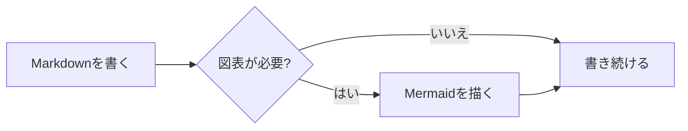
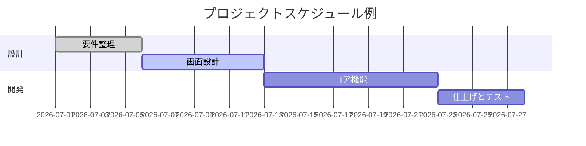
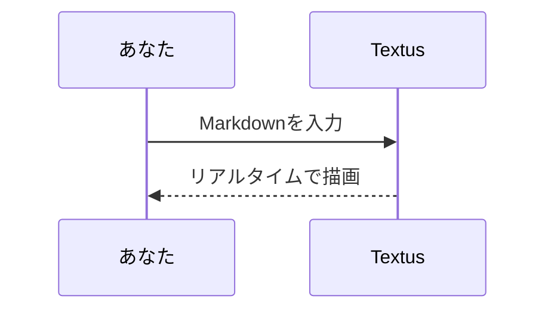

# Textus Markdown ガイド

ようこそ！これはTextusが対応するMarkdownレンダリング機能を紹介する、内蔵のデモ文書です。これは保存されていない草稿なので、自由に編集して試してかまいません —— 閉じるときに保存しなければそれで大丈夫です。

> [!TIP]
> `Cmd+/` でWYSIWYGとソースコードモードを切り替えられます。どの例も元の書き方を見比べてみてください。

## 見出しと引用

行頭に `#` とスペースを入力するとレベル1、`##` とスペースならレベル2の見出しになります。上の見出しが実際の表示例です。`Ctrl+1`〜`Ctrl+6`（Mac では `Cmd+1`〜`Cmd+6`）で、今の行をそのレベルの見出しにできます。

引用ブロック：

> 引用文の中には **太字** や `コード` など他の記法もネストできます。

GitHub形式のアラートブロック:

> [!NOTE]
> これは補足説明に適したノートです。

> [!WARNING]
> これは注意すべき点を伝える警告です。

## インラインスタイル

**太字**、*斜体*、***太字斜体***、~~取り消し線~~、==ハイライト==、そして `インラインコード`。

`(`、`[`、`{`、引用符や、日本語・中国語の入力システムで入れた `（`、`【`、`「` などの括弧を入力すると、カーソルの後ろに閉じ側が自動で入ります。閉じ側を入力するとそれを飛び越え、開き側の直後で Backspace を押すと両方が消え、テキストを選択して入力するとその前後を囲みます。**設定 → 編集と外観 → 括弧と引用符を自動で閉じる**でオフにできます。

リンクの書き方：[Textus リポジトリ](https://github.com/CatVinci-Studio/Textus)。Ctrl/⌘ を押しながらクリックするとリンク先へ移動します。Web のリンクはブラウザで、別の Markdown ファイルへのリンクはタブで開き、`#見出し` へのリンクはその見出しまでスクロールします。インラインHTMLも描画されます。例えばキーボードキー <kbd>Cmd</kbd> + <kbd>S</kbd>。`<details>` の折りたたみ、HTML の表、一部のインラインスタイル（色、背景色、サイズ、太さ、配置、下線、取り消し線）、インラインの `<svg>`（画像として表示）も描画されます。スクリプトなどそれ以外の HTML はソースのまま表示されます。別のファイルの見出しへのリンク（例：`[参照](notes.md#見出し)`）は、そのファイルをその見出しの位置で開きます。Obsidian のウィキリンク `[[ノート]]`、`[[ノート|表示テキスト]]`、`[[ノート#見出し]]` も同じように開けます。ノートは文書と同じフォルダーにあっても、保管庫内のどこにあってもかまいません。ウィキリンクと行頭の `#タグ` は、書いたとおりに保存されます。

**設定 → 編集と外観 → カラーコードの前の色見本**で、カラーコードの前にその色の小さな四角を表示できます。**コード内のみ**では、色を表すインラインコード（`#0af` や `rgb(0 128 255)` など）とコードブロック内の色の値の前に表示し、**すべて**では、本文に書いた 6 桁か 8 桁のカラーコード（#ff8800 など）やカラー関数（hsl(210 100% 50%) など）の前にも表示します。本文の短い形、#cafe のようなタグ、#234 のような番号、リンクはそのままです。

インライン数式：質量とエネルギーの関係式 $E = mc^2$、オイラーの等式 $e^{i\pi} + 1 = 0$。

## リスト

- 箇条書きリスト
- ネストに対応
  - 2階層目の項目
  - もう1つの2階層目の項目

1. 番号付きリスト
2. 2番目の項目

タスクリスト(チェックボックスをクリックするだけで切り替え可能):

- [x] 完了した項目
- [ ] 未完了の項目

## 表

| 機能 | 記法 | 結果 |
| --- | --- | --- |
| 太字 | `**テキスト**` | **テキスト** |
| ハイライト | `==テキスト==` | ==テキスト== |
| インライン数式 | `$x^2$` | $x^2$ |

表の上にマウスを乗せると行・列の追加や削除ができます。`| 名前 | 年齢 |` と入力して Enter を押すと表になります。表の中で Enter を押すと次の行へ移り、最終行では行が追加され、空のままの新しい行でもう一度 Enter を押すと表から出ます。Ctrl/⌘+Enter ならいつでも出られます。表の中では Tab と Shift+Tab で次と前のセルへ移り、Shift+Enter でセル内で改行できます。

## コードブロック

シンタックスハイライト付きのフェンスコードブロック(右上で言語を切り替え可能)。末尾の空行で Enter を押すとブロックから出ます。Ctrl/⌘+Enter ならいつでも出られ、引用でも同じです。言語の横にある**コピー**ボタンでブロックのコードをコピーでき、**設定 → 編集と外観 → コードブロックに行番号を表示**で各行に行番号が付きます。どちらもエクスポートや印刷には含まれません。

```python
def fib(n: int) -> int:
    """お馴染みのフィボナッチ数列。"""
    a, b = 0, 1
    for _ in range(n):
        a, b = b, a + b
    return a
```

```rust
fn main() {
    let greeting = "こんにちは、Textus!";
    println!("{greeting}");
}
```

## 数式ブロック

`$$` で囲んだブロック数式はKaTeXによって描画されます:

$$
\int_{-\infty}^{\infty} e^{-x^2} \, dx = \sqrt{\pi}
$$

## 図表(Mermaid)

`mermaid` コードブロックはリアルタイムで図表に描画されます。フローチャート:



ガントチャート:



シーケンス図:



**設定 → 編集と外観 → 図表エンジン**で、これらのブロックを描くエンジンを選べます。既定の Mermaid か、より高速な Pele です。Pele は独自のレイアウトで描画し、一部の機能には対応していません。Pele で描けない図表は Mermaid が描きます。

## 画像

クリップボードから画像を直接貼り付けると、Textusは画像を保存して参照を挿入します。保存先は**設定 → 編集と外観 → 画像**で決めます。**このコンピューター**なら、ドキュメントのフォルダー内の**サブフォルダー**（既定は `assets/`、名前は変更できます）か、**ドキュメントと同じフォルダー**を選べます。貼り付けた画像に付くリンクは設定画面に表示されます。**画像ホストにアップロード**なら、PicGo / PicList、SM.MS、Imgur、または自分のエンドポイント(**カスタム**)へ送ります。

カスタムのエンドポイントは `multipart/form-data` の `file` フィールドで画像を受信し、公開 URL をプレーンテキストまたは設定可能な JSON フィールドで返します。ファイル名は自動変更、元の名前の保持、アップロード前の毎回確認から選べます。保存先を切り替えても既存の画像参照は変更されません。

参照を手書きすることもできます:

```markdown

```

Obsidian の埋め込み（`![[image.png]]` や `![[attachments/image.png|300]]`）も画像として表示されます。Textus は文書が属する Obsidian の保管庫からファイルを探し、埋め込みは書いたとおりに保存します。

## 表示とモード

WYSIWYGエディタとソースコードモード(`Cmd+/`)のほかに、Textusには3つの書き方があります(WindowsとLinuxでは `Cmd` を `Ctrl` に読み替えてください。ショートカットを変更した場合は 設定 → ショートカット の設定が優先されます):

- **分割表示**(`Cmd+Shift+E`):左にMarkdownソース、右にレンダリング結果のプレビューを表示し、スクロールも連動します。
- **タイプライターモード**(設定 → 編集と外観 → テーマ):入力中の行を常にウィンドウ中央に保ちます。エディター、ソースモード、分割表示で有効です。
- **禅モード**(`Cmd+Shift+J`):本文以外をすべて隠して全画面にし、書いている段落以外を薄く表示します。`Esc` で終了します。

3つとも **表示**(View)メニューからも使えます。

**設定 → 編集と外観 → インターフェイスの文字サイズ**で、サイドバー、タブ、メニュー、AI パネル、設定の文字を大きくしたり小さくしたりできます。文書自体のズームはそのままです。`Ctrl+Tab` と `Ctrl+Shift+Tab` で次のタブ、前のタブに移動します。

## フォルダーとファイル検索

**ファイル → フォルダーを開く…**で、フォルダー全体をサイドバーに開けます。中の文書を開いてもファイルツリーはそのフォルダーのままで、次回起動時にはセッションとともに戻ります。**ファイル → フォルダーを閉じる**を選ぶと、ツリーは再び文書に合わせて切り替わります。サイドバーの**ファイル**タブ上部の検索欄では、フォルダー全体からファイル名を検索できます。`Cmd+Shift+O` で検索欄に移動し、入力で絞り込み、`↑`/`↓` で移動、`Enter` で開き、`Esc` でクリアします。どちらもデスクトップ版だけの機能です。

**ファイル → 開く…**では Word 文書（`.docx`）も開けます。ウィンドウにドロップしても同じです。見出し、リスト、表、リンク、脚注、画像を保ったまま、同じ名前の、まだ保存されていない新しい Markdown 文書になります。画像は保存したときに、**設定 → 編集と外観 → 画像**で貼り付けた画像に決めた場所へ入ります。**保存**では Word ファイルの隣の `.md` ファイルが提案されます。一部の書式は Word と異なって見える場合があります。元の Word ファイルは変更されません。デスクトップ版のみです。

## バックグラウンドで実行し続ける

**設定 → 一般 → アプリ → バックグラウンドで実行し続ける**をオンにすると、最後のウインドウを閉じても Textus は実行を続け、通知領域（Windows）、システムトレイ（Linux）、メニューバー（Mac）にアイコンを表示します。そのメニューの**Textus を開く**で書類に戻れます。完全に終了するのはそこで**Textusを終了**を選んだときです。GNOME では AppIndicator 拡張機能がないとトレイアイコンは表示されません。

## 脚注と区切り線

脚注はこのように書きます[^1]。以下は水平区切り線です:

---

[^1]: 脚注の内容は文書の末尾にまとめて表示されます。

執筆を楽しんで！
