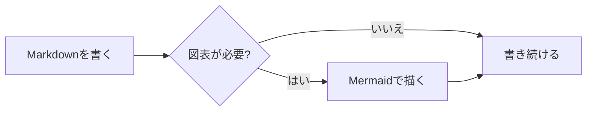
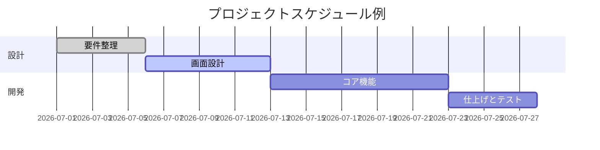
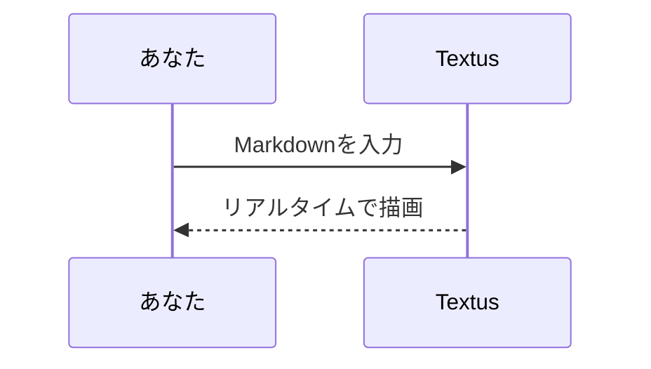

# Textus Markdown ガイド

このガイド自体が、自由に書き換えられる文書です。まずはよく使うことを 5 分で、残りはやりたいことから探してください。読み終わったら、保存せずに閉じてかまいません。

> [!TIP]
> `Cmd+/`（Windows と Linux では `Ctrl+/`）でソースに切り替えると、それぞれの例の書き方が見られます。

## 5 分で始める

Markdown はいくつかの記号で書式を表し、Textus は入力に合わせてその場で整えて表示します。行頭に次のように入力します：

- `# ` に続けて文字：見出し。`## ` ならひとつ小さい見出し。
- `- `：箇条書き。`1. `：番号付きリスト。`- [ ] `：タスク。
- `> `：引用。

語句を囲む記号：`**太字**`、`*斜体*`、`==ハイライト==`、`` `コード` ``。リンクは `[テキスト](https://example.com)` と書きます。画像は貼り付けるだけです。

記号を覚えたくなければ、文書の上の**書式バー**を使うか、選択したテキストを右クリックしてください。何かが見つからないときは、`Cmd+Shift+P` でコマンドパレットを開き、名前を数文字入力します。

## 長い文章を書く

**段落の先頭を字下げ**（設定 › 編集 › 本文）をオンにすると、各段落の 1 行目が 2 文字分下がります。リスト、引用、表はそのままです。

### 書き方とモード

WYSIWYG エディターとソースモード（`Cmd+/`）のほかに、Textus には 3 つの書き方があります（Windows と Linux では `Cmd` を `Ctrl` に読み替えてください。現在の割り当ては 設定 › ショートカット で確認できます）：

- **ソースとプレビュー**（`Cmd+Shift+E`）：左に Markdown ソース、右にレンダリング結果のプレビューを表示し、スクロールも連動します。
- **タイプライターモード**：入力中の行を常にウィンドウの中央に保ちます。エディター、ソースモード、ソースとプレビューで使えます。
- **禅モード**（`Cmd+Shift+J`）：今いる文書以外をすべて隠し、書いている段落以外を薄く表示します。右上の × か、もう一度ショートカットを押すと終了します。

どれも **表示** メニュー（最初の 2 つは **表示 › モード**）と、**設定 › 編集 › 本文** の **表示** グループにあります。それぞれ Textus 全体で 1 つの設定です。どのウィンドウで切り替えても、すべてのウィンドウのすべてのタブが一緒に切り替わり、次に開く文書もその表示で開き、次回 Textus を起動したときもその表示になります。

**表示 › モード › 閲覧モード**（タブの右クリックメニューにもあります）にすると、入力、貼り付け、ドロップ、取り消し、Textus AI、プラグインのどれによっても文書が変更されなくなります。タイトルの横に錠前のアイコンが表示され、クリックすると再び編集できるようになります。

**表示 › コマンドパレット…**（`Cmd+Shift+P`）では、名前を数文字入力するだけで、メニューにあるあらゆる操作と、プラグインが追加したすべてのコマンドを見つけられます。外観（ライト、ダーク、システムに合わせる）やエディターのテーマの切り替え、Textus AI のオン・オフもできます。**編集 › 検索と置換…**（`Cmd+F`）で文書内を検索し、**編集 › 置換…**（`Cmd+Option+F`）で置換欄を開いた状態で表示し、`Cmd+G` で次の一致に移動します。

サイドバーの**アウトライン**パネルには文書の見出しが並び、クリックするとその見出しへ移動します。アウトラインを右クリックすると**すべて展開**と**すべて折りたたむ**があり、見出しの矢印を `Option` キー（`Alt` キー）を押しながらクリックすると、すべての見出しをまとめて折りたたんだり展開したりできます。

**インターフェイスのサイズ**（設定 › 外観）で、サイドバー、タブ、メニュー、AI のタブ、設定を文字もボタンもまとめて大きくしたり小さくしたりできます。文書はそれぞれ自分のズーム（`Cmd+=`、`Cmd+-`）を保ちます。`Ctrl+Tab` と `Ctrl+Shift+Tab` で次のタブ、前のタブに移動します。

### 脚注、区切り線、目次

脚注はこのように書きます[^1]。以下は水平区切り線です：

---

[^1]: 脚注の内容は文書の末尾にまとめて表示されます。

行に `[TOC]` だけを入力して Enter を押すと目次が入ります。文書の見出しを一覧にし、書くのに合わせて更新されます。項目をクリックするとその見出しへ移動します。

## 表、コード、数式、図表

### 表

| 機能 | 記法 | 結果 |
| --- | --- | --- |
| 太字 | `**テキスト**` | **テキスト** |
| ハイライト | `==テキスト==` | ==テキスト== |
| インライン数式 | `$x^2$` | $x^2$ |

表の上にマウスを乗せると行・列の追加や削除ができます。`| 名前 | 年齢 |` と入力して Enter を押すと表になります。Enter を押すと次の行へ移り、最終行では行が追加され、空のままの新しい行でもう一度押すと表から出ます。Ctrl/⌘+Enter ならいつでも出られます。表の中では Tab と Shift+Tab で次と前のセルへ移り、Shift+Enter でセル内で改行できます。

### コードブロック

シンタックスハイライト付きのフェンスコードブロックです（ブロックの右上で言語を切り替えられます）。末尾の空行で Enter を押すとブロックから出ます。Ctrl/⌘+Enter ならいつでも出られ、引用でも同じです。言語の横にある**コピー**と**すべて選択**でブロックのコードをコピーまたは選択でき、**コードブロックに行番号を表示**（設定 › 編集 › 本文）で各行に行番号が付きます。どちらもエクスポートや印刷には含まれません。

```python
def fib(n: int) -> int:
    """お馴染みのフィボナッチ数列。"""
    a, b = 0, 1
    for _ in range(n):
        a, b = b, a + b
    return a
```

```rust
fn main() {
    let greeting = "こんにちは、Textus!";
    println!("{greeting}");
}
```

### 数式ブロック

`$$` で囲んだブロック数式は KaTeX によって描画されます：

$$
\int_{-\infty}^{\infty} e^{-x^2} \, dx = \sqrt{\pi}
$$

### 図表（Mermaid）

```` ```mermaid ```` のコードブロックは、その場で図表として描画されます。フローチャート：



ガントチャート：



シーケンス図：



**図表エンジン**（設定 › 編集 › 本文）で、これらのブロックを描くエンジンを選べます。既定の Mermaid か、より高速な Pele です。Pele は独自のレイアウトで描画し、一部の機能には対応していません。Pele で描けない図表は Mermaid が描きます。

図表の配色は外観に従います。明るい外観では落ち着いたグレーのパレット、暗い外観ではダーク用のパレットが使われ、インポートしたテーマやカスタム CSS では `--doc-mermaid-theme: forest` で別の内蔵パレットを指定できます。

## 画像と貼り付け

### 画像

クリップボードから画像を直接貼り付けると、Textus は画像を保存して参照を挿入します。保存先は **設定 › 編集 › 画像** で決めます。**このコンピューター**なら、文書のフォルダー内の**サブフォルダー**（既定は `assets/`、名前は変更できます）か、**ドキュメントと同じフォルダー**を選べます。貼り付けた画像に付くリンクは設定画面に表示されます。**画像ホストにアップロード**なら、PicGo / PicList、SM.MS、Imgur、または自分のエンドポイント（**カスタム**）へ送ります。

カスタムのエンドポイントは `multipart/form-data` の `file` フィールドで画像を受け取り、公開 URL をプレーンテキストか、設定できる JSON フィールドで返します。アップロードするファイルの名前は、自動で付け直す、元の名前のままにする、毎回アップロード前に尋ねる、から選べます。保存先を切り替えても、既存の画像参照は変更されません。

参照を手で書くこともできます：

```markdown

```

Obsidian の埋め込み（`![[image.png]]` や `![[attachments/image.png|300]]`）も画像として表示されます。Textus は文書が属する Obsidian の保管庫からファイルを探し、埋め込みは書いたとおりに保存します。

画像をよく見るには、ダブルクリックするか、右上の**画像を拡大**を押します（図表にも同じボタンがあります）。スクロールかピンチで拡大・縮小、ドラッグで移動、ダブルクリックで全体表示に戻り、`Esc` で閉じます。画像の右端のハンドルをドラッグするとサイズを変えられます。**単独行の画像**（設定 › 編集 › 画像）で、1 行に単独で置かれた画像を中央に置くか左に寄せるかを選べます。エディターでも、HTML と PDF の書き出しでも同じです。

### コピーと貼り付け

**コピー**すると、クリップボードのプレーンテキストには Markdown が、その横には書式が入ります。そのため GitHub、Obsidian、VS Code、チャットアプリには Markdown が、Word、Pages、メール、Notion には書式付きで貼り付けられます。画像を右クリックしてコピーすると画像そのものがクリップボードに入り、そのままチャットや文書に貼り付けられます。**編集 › プレーンテキストとしてペースト**（`Cmd+Shift+V`）は、クリップボードのテキストを Markdown として読まずに、そのまま貼り付けます。

## ファイルとフォルダー

### フォルダーと検索

**ファイル › フォルダーを開く…** で、フォルダー全体をサイドバーに開けます。中の文書を開いてもファイルツリーはそのフォルダーのままで、次回起動時にはセッションとともに戻ります。**ファイル › フォルダーを閉じる** を選ぶと、ツリーは再び文書に合わせて切り替わります。**検索**パネル（アクティビティバーの虫めがね、または `Cmd+Shift+O`）では、フォルダー全体からファイルを名前で、行を語句で探せます。行をクリックすると、その位置で文書が開きます。どちらもデスクトップ版だけの機能です。

ツリーは小さなファイルマネージャーにもなります。上にある親フォルダーの名前をクリックすると 1 つ上の階層に移動します。ツリーのメニューで、名前順か変更日順に並べ替えたり、**すべてのファイル**か**文書のみ**を表示したりできます。フォルダー、ファイル、または下の空白部分を右クリックすると、そこに**新規ドキュメント**や**新規フォルダ**を作れます。ファイルやフォルダーを別のフォルダーにドラッグすると移動でき、開いている文書も新しい場所に追従します。何かが置き換えられることはありません。すでに使われている名前は拒否されます。

Finder やエクスプローラーからファイルをウィンドウにドラッグすると開けます。文書はタブで開き、画像はドロップした位置で文書に入り、フォルダーはサイドバーに開きます。**ファイル › パスをコピー** で、手前の文書のフルパスをコピーします。

ターミナルからは `textus notes.md` でファイルを Textus で開けます。`textus` コマンドがまだなければ、**設定 › 一般** でインストールできます。ウィンドウを開かずにできることもあります。`textus search <語句>` でフォルダー内のファイルを検索し、`textus read` で PDF や Word のファイルを Markdown として表示します。`textus help` ではプラグインのものも含め、すべてのコマンドを確認できます。

**ファイル › 開く…** では Word 文書（`.docx`）も開けます。ウィンドウにドロップしても同じです。見出し、リスト、表、リンク、脚注、画像を保ったまま、同じ名前の、まだ保存されていない新しい Markdown 文書になります。画像は保存したときに、**設定 › 編集 › 画像** で貼り付けた画像に決めた場所へ入ります。**保存** では Word ファイルの隣の `.md` ファイルが提案されます。一部の書式は Word と異なって見える場合があります。元の Word ファイルは変更されません。デスクトップ版のみです。

### 書き出し

**ファイル › 書き出す** で文書を HTML か PDF として保存します。[Pandoc](https://pandoc.org) をインストールしていれば、Word（`.docx`）、OpenDocument、RTF、EPUB、LaTeX などにも書き出せます。Mac では、**PDF を明るい配色で書き出す**（設定 › 編集 › 書き出す）をオンにすると、ダークモードで書いていても、テーマの明るい配色で白地の PDF を出力します。

### バックグラウンドで実行し続ける

**設定 › 一般 › アプリ › バックグラウンドで実行し続ける** をオンにすると、最後のウィンドウを閉じても Textus は実行を続け、通知領域（Windows）、システムトレイ（Linux）、メニューバー（Mac）にアイコンを表示します。そのメニューの **Textus を開く** で文書に戻れます。完全に終了するのは、そこで **Textusを終了** を選んだときです。GNOME では AppIndicator 拡張機能がないとトレイアイコンは表示されません。

## ウィンドウ

### ウィンドウの中身

左から順に：

- **アクティビティバー**：アイコンが縦に並んだ列です。**ファイル**（ファイルツリー）、**アウトライン**（文書の見出し）、**検索**（フォルダー全体）、**プラグイン**、その後にプラグインが追加したパネルが続きます。**設定**（歯車）は一番下にあります。アイコンをクリックするとそのパネルがサイドバーに開き、もう一度クリックするとサイドバーが閉じます。アイコンはドラッグで並べ替えられ、右クリックで表示・非表示を切り替えられます。
- **サイドバー**：一度に 1 つのパネルを表示します。`Cmd+\` か上部のサイドバーボタンで表示・非表示を切り替え、端をドラッグすると幅を広げられます。
- **アイランド**：文書が置かれる場所です。アイランドはそれぞれ 1 列のタブとその下のページでできていて、タブはウィンドウ上部のバーに並びます。ウィンドウを分割すると、いくつものアイランドが並びます（下の **アイランドとタブ** を参照）。各文書の上にある**書式バー**には書式メニューのボタンが並んでいます。**表示 › 書式バー** で隠せます。
- **Textus AI**：上部バーの右にあるきらめきのボタン（`Cmd+Shift+L`）で、会話がタブとして、右側の専用のアイランドに開きます。詳しくはヘルプメニューの **AI 機能ガイド** を参照してください。
- **設定**（`Cmd+,` または歯車）：ページの一覧はサイドバーに、ページ本体はタブに表示されます。

Windows と Linux では、メニューは左上の ☰ ボタンの中にあります。設定 › 外観 の **メニューバーを表示** をオンにすると上部に並びます。文字数は各文書の右下に表示されます。

### アイランドとタブ

1 組のタブとその下のページを**アイランド**と呼びます。1 つのアイランドには一度に 1 つの文書が表示されます。ウィンドウを分割すると、いくつものアイランドが左右や上下に並びます。

- **タブをドラッグ**して列から離すと、狙った場所でアイランドが場所を空けます。離すとそこに開きます。アイランドの横（外側の 5 分の 1 を狙います）、上や下（上端や下端）、または別のアイランドのタブの間です。ドラッグ中に `Option`（`Alt`）を押すと、アイランド全体を動かせます。`Esc` で元に戻ります。サイドバーのファイルも同じようにドラッグできます。
- **タブをウィンドウの外へドラッグ**すると、そのタブだけのウィンドウになります。
- **表示 › 右に分割**（`Cmd+Option+S`）と **表示 › 下に分割** で今いるアイランドを分割し、**表示 › 分割を閉じる** で 1 つに戻します。
- 2 つのアイランドの間の線をドラッグすると大きさを変えられます。
- アイランドが 2 つ以上あるときに **`Cmd`**（`Ctrl`）を少し押し続けると、それぞれに番号が表示され、`Cmd+1`… `Cmd+6` でそのアイランドに移動します。
- アイランドの最後のタブを閉じると、アイランドもなくなります。レイアウト全体は Textus を開き直したときに元どおりに戻ります。

`Cmd+N`（または `Cmd+T`）で新しいタブ、`Cmd+Shift+N` で新しいウィンドウを開き、**ファイル › 閉じたタブを再度開く**（`Cmd+Shift+T`）で閉じた文書を新しいものから順に戻せます。列の末尾の **+** で、そのアイランドに新しいタブを開きます。タブは中クリックで閉じます。タブの右クリックメニューには**他のタブを閉じる**、**左側のタブを閉じる**、**右側のタブを閉じる**、**保存済みを閉じる**（未保存の変更があるタブは開いたままです）、**パスをコピー**、**ファイルツリーで表示**があります。Textus を開き直すと、それぞれのウィンドウが自分のタブとともに戻ります。

## プラグイン、テーマ、スキル

**プラグイン**パネル（アクティビティバーのパズルのアイコン）の **インストール可能** に、追加できるプラグインが並んでいます。Vim や Emacs のキー操作、PDF リーダー、グラフ、ナレッジグラフ、執筆ツールなどです。テーマは **設定 › 外観** のテーマストアに、スキルは **設定 › Textus AI › Agent 機能** にあります。それぞれボタンは 1 つだけで、**インストール**、その後は**更新**、**オフにする**、**オンにする**と変わり、横のメニューに**アンインストール**があります。プラグインのページには使い方が書かれていて、そのコマンドは**プラグイン**メニューとコマンドパレットに表示されます。

## ヘルプ

**ヘルプ › 問題を報告…**（**設定 › について** のヘルプにもあります）で短いフォームが開きます。報告の種類、Textus のどの部分に関係するか、バグなら深刻さを選んでから、何が起きたかを書くと、Textus がバージョン、システム、プラグイン、個人的な情報を除いた設定、最近のエラーを添えます。送信前にすべて表示されます。**送信**を押すと、GitHub のアカウントがなくても GitHub に issue として登録され、その番号が表示されます。**GitHub で送信**は代わりに GitHub のフォームを開き、**コピー**でクリップボードに入れてチャットやメールに使えます。書いた内容は公開の issue になります。追加で質問してもよい場合に残すメールアドレスや WeChat は、チームにだけ届きます。

**設定 › について › ヘルプ** では、ようこそツアーをもう一度見たり、ガイドを開いたりできます。**Textusについて** ではバージョンを確認して **アップデートを確認** できます（Mac では **Textus › アップデートを確認…** も使えます）。**ヘルプ › コミュニティに参加** でコミュニティのページが開きます。

## リファレンス：書けるものすべて

Textus が理解する Markdown をすべて紹介します。ソース（`Cmd+/`）と見比べてみてください。

### 見出しと引用

行頭に `#` とスペースを入力するとレベル 1、`##` とスペースならレベル 2 の見出しになります。上の見出しが実際の表示例です。`Ctrl+1`〜`Ctrl+6`（Mac では `Cmd+1`〜`Cmd+6`）で、今の行をそのレベルの見出しにできます。

引用ブロック：

> 引用文の中には **太字** や `コード` など他の記法もネストできます。

GitHub 形式のアラート：

> [!NOTE]
> これは補足説明に適したノートです。

> [!WARNING]
> これは注意すべき点を伝える警告です。

### インラインスタイル

**太字**（`**テキスト**`）、*斜体*（`*テキスト*`）、***太字斜体***、~~取り消し線~~（`~~テキスト~~`）、==ハイライト==（`==テキスト==`）、そして `インラインコード`。``Ctrl+` ``（Mac でも Control）で選択範囲をインラインコードに、``Ctrl+Shift+` `` で取り消し線に、`Cmd+K` でリンクにして、カーソルはアドレスを入れる位置に置かれます。

GitHub と同じ絵文字ショートコードは絵文字で表示されます：:tada:（`:tada:`）、:rocket:（`:rocket:`）。ファイルにはショートコードのまま保存され、カーソルを置くと編集できます。

下付き・上付き文字は Typora や Pandoc と同じ書き方です：H~2~O（`H~2~O`）、x^2^（`x^2^`）。中に空白は入れられません。

`(`、`[`、`{`、引用符や、日本語・中国語の入力システムで入れた `（`、`【`、`「` などの括弧を入力すると、カーソルの後ろに閉じ側が自動で入ります。閉じ側を入力するとそれを飛び越え、開き側の直後で Backspace を押すと両方が消え、テキストを選択して入力するとその前後を囲みます。**設定 › 編集 › 本文** の **()、[]、「」を補完** でオフにできます。

リンクの書き方：[Textus リポジトリ](https://github.com/CatVinci-Studio/Textus)。Ctrl/⌘ を押しながらクリックするとリンク先へ移動します。Web のリンクはブラウザで、別の Markdown ファイルへのリンクはタブで開き、`#見出し` へのリンクはその見出しまでスクロールします。普通にクリックするとカーソルがリンクに入り、Markdown の `[テキスト](URL)` が表示されてその場で編集できます。カーソルが離れるとリンクに戻ります。インライン HTML も描画されます。例えばキーボードキー <kbd>Cmd</kbd> + <kbd>S</kbd>。`<details>` の折りたたみ、HTML の表、一部のインラインスタイル（色、背景色、サイズ、太さ、配置、下線、取り消し線）、インラインの `<svg>`（画像として表示）も描画されます。スクリプトなどそれ以外の HTML はソースのまま表示されます。別のファイルの見出しへのリンク（例：`[参照](notes.md#見出し)`）は、そのファイルをその見出しの位置で開きます。Obsidian のウィキリンク `[[ノート]]`、`[[ノート|表示テキスト]]`、`[[ノート#見出し]]` も同じように開けます。ノートは文書と同じフォルダーにあっても、保管庫内のどこにあってもかまいません。ウィキリンクと行頭の `#タグ` は、書いたとおりに保存されます。

**カラーコードの前の色見本**（設定 › 編集 › 本文）で、カラーコードの前にその色の小さな四角を表示できます。**コード内のみ**では、色を表すインラインコード（`#0af` や `rgb(0 128 255)` など）とコードブロック内の色の値の前に表示し、**すべて**では、本文に書いた 6 桁か 8 桁のカラーコード（#ff8800 など）やカラー関数（hsl(210 100% 50%) など）の前にも表示します。本文の短い形、#cafe のようなタグ、#234 のような番号、リンクはそのままです。

インライン数式：質量とエネルギーの関係式 $E = mc^2$、オイラーの等式 $e^{i\pi} + 1 = 0$。

### リスト

- 箇条書きリスト
- ネストに対応
  - 2 階層目の項目
  - もう 1 つの項目

1. 番号付きリスト
2. 2 番目の項目

タスクリスト（チェックボックスをクリックすると切り替わります）：

- [x] 完了した項目
- [ ] 未完了の項目

執筆を楽しんで！
