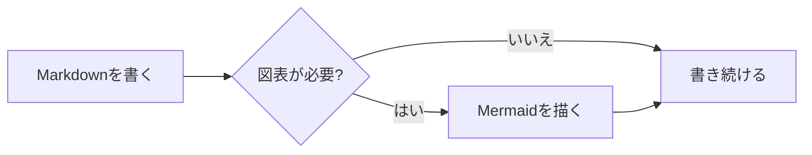
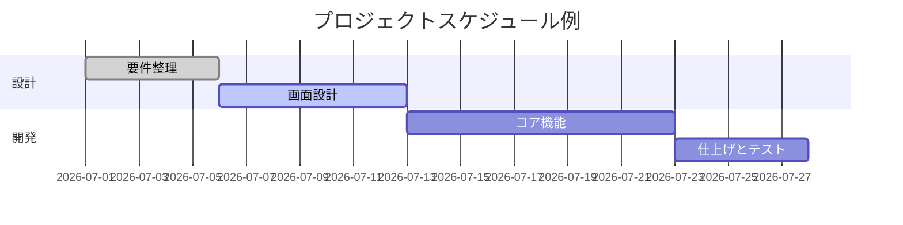
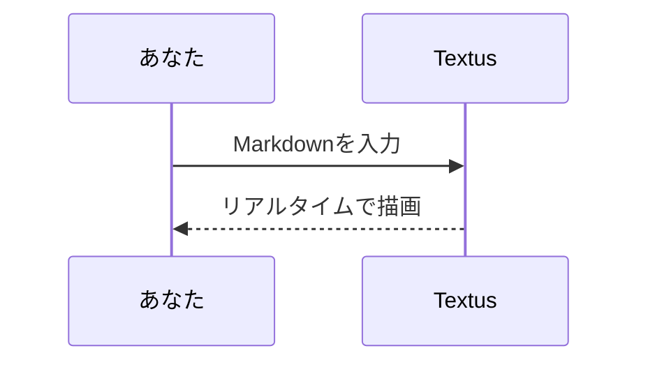

# Textus Markdown ガイド

ようこそ！これはTextusが対応するMarkdownレンダリング機能を紹介する、内蔵のデモ文書です。これは保存されていない草稿なので、自由に編集して試してかまいません —— 閉じるときに保存しなければそれで大丈夫です。

> [!TIP]
> `Cmd+/` でWYSIWYGとソースコードモードを切り替えられます。どの例も元の書き方を見比べてみてください。

## 見出しと引用

行頭に `#` とスペースを入力するとレベル1、`##` とスペースならレベル2の見出しになります。上の見出しが実際の表示例です。`Ctrl+1`〜`Ctrl+6`（Mac では `Cmd+1`〜`Cmd+6`）で、今の行をそのレベルの見出しにできます。

引用ブロック：

> 引用文の中には **太字** や `コード` など他の記法もネストできます。

GitHub形式のアラートブロック:

> [!NOTE]
> これは補足説明に適したノートです。

> [!WARNING]
> これは注意すべき点を伝える警告です。

## インラインスタイル

**太字**、*斜体*、***太字斜体***、~~取り消し線~~、==ハイライト==、そして `インラインコード`。

下付き・上付き文字は Typora や Pandoc と同じ書き方です：H~2~O（`H~2~O`）、x^2^（`x^2^`）。中に空白は入れられません。

`(`、`[`、`{`、引用符や、日本語・中国語の入力システムで入れた `（`、`【`、`「` などの括弧を入力すると、カーソルの後ろに閉じ側が自動で入ります。閉じ側を入力するとそれを飛び越え、開き側の直後で Backspace を押すと両方が消え、テキストを選択して入力するとその前後を囲みます。**設定 → 編集と外観 → ()、[]、「」を補完**でオフにできます。

リンクの書き方：[Textus リポジトリ](https://github.com/CatVinci-Studio/Textus)。Ctrl/⌘ を押しながらクリックするとリンク先へ移動します。Web のリンクはブラウザで、別の Markdown ファイルへのリンクはタブで開き、`#見出し` へのリンクはその見出しまでスクロールします。普通にクリックするとカーソルがリンクに入り、Markdown の `[テキスト](URL)` が表示されてその場で編集できます。カーソルが離れるとリンクに戻ります。インラインHTMLも描画されます。例えばキーボードキー <kbd>Cmd</kbd> + <kbd>S</kbd>。`<details>` の折りたたみ、HTML の表、一部のインラインスタイル（色、背景色、サイズ、太さ、配置、下線、取り消し線）、インラインの `<svg>`（画像として表示）も描画されます。スクリプトなどそれ以外の HTML はソースのまま表示されます。別のファイルの見出しへのリンク（例：`[参照](notes.md#見出し)`）は、そのファイルをその見出しの位置で開きます。Obsidian のウィキリンク `[[ノート]]`、`[[ノート|表示テキスト]]`、`[[ノート#見出し]]` も同じように開けます。ノートは文書と同じフォルダーにあっても、保管庫内のどこにあってもかまいません。ウィキリンクと行頭の `#タグ` は、書いたとおりに保存されます。

**設定 → 編集と外観 → カラーコードの前の色見本**で、カラーコードの前にその色の小さな四角を表示できます。**コード内のみ**では、色を表すインラインコード（`#0af` や `rgb(0 128 255)` など）とコードブロック内の色の値の前に表示し、**すべて**では、本文に書いた 6 桁か 8 桁のカラーコード（#ff8800 など）やカラー関数（hsl(210 100% 50%) など）の前にも表示します。本文の短い形、#cafe のようなタグ、#234 のような番号、リンクはそのままです。

インライン数式：質量とエネルギーの関係式 $E = mc^2$、オイラーの等式 $e^{i\pi} + 1 = 0$。

## リスト

- 箇条書きリスト
- ネストに対応
  - 2階層目の項目
  - もう1つの2階層目の項目

1. 番号付きリスト
2. 2番目の項目

タスクリスト(チェックボックスをクリックするだけで切り替え可能):

- [x] 完了した項目
- [ ] 未完了の項目

## 表

| 機能 | 記法 | 結果 |
| --- | --- | --- |
| 太字 | `**テキスト**` | **テキスト** |
| ハイライト | `==テキスト==` | ==テキスト== |
| インライン数式 | `$x^2$` | $x^2$ |

表の上にマウスを乗せると行・列の追加や削除ができます。`| 名前 | 年齢 |` と入力して Enter を押すと表になります。表の中で Enter を押すと次の行へ移り、最終行では行が追加され、空のままの新しい行でもう一度 Enter を押すと表から出ます。Ctrl/⌘+Enter ならいつでも出られます。表の中では Tab と Shift+Tab で次と前のセルへ移り、Shift+Enter でセル内で改行できます。

## コードブロック

シンタックスハイライト付きのフェンスコードブロック(右上で言語を切り替え可能)。末尾の空行で Enter を押すとブロックから出ます。Ctrl/⌘+Enter ならいつでも出られ、引用でも同じです。言語の横にある**コピー**と**すべて選択**でブロックのコードをコピーまたは選択でき、**設定 → 編集と外観 → コードブロックに行番号を表示**で各行に行番号が付きます。どちらもエクスポートや印刷には含まれません。

```python
def fib(n: int) -> int:
    """お馴染みのフィボナッチ数列。"""
    a, b = 0, 1
    for _ in range(n):
        a, b = b, a + b
    return a
```

```rust
fn main() {
    let greeting = "こんにちは、Textus!";
    println!("{greeting}");
}
```

## 数式ブロック

`$$` で囲んだブロック数式はKaTeXによって描画されます:

$$
\int_{-\infty}^{\infty} e^{-x^2} \, dx = \sqrt{\pi}
$$

## 図表(Mermaid)

`mermaid` コードブロックはリアルタイムで図表に描画されます。フローチャート:



ガントチャート:



シーケンス図:



**設定 → 編集と外観 → 図表エンジン**で、これらのブロックを描くエンジンを選べます。既定の Mermaid か、より高速な Pele です。Pele は独自のレイアウトで描画し、一部の機能には対応していません。Pele で描けない図表は Mermaid が描きます。

## 画像

クリップボードから画像を直接貼り付けると、Textusは画像を保存して参照を挿入します。保存先は**設定 → 編集と外観 → 画像**で決めます。**このコンピューター**なら、ドキュメントのフォルダー内の**サブフォルダー**（既定は `assets/`、名前は変更できます）か、**ドキュメントと同じフォルダー**を選べます。貼り付けた画像に付くリンクは設定画面に表示されます。**画像ホストにアップロード**なら、PicGo / PicList、SM.MS、Imgur、または自分のエンドポイント(**カスタム**)へ送ります。

カスタムのエンドポイントは `multipart/form-data` の `file` フィールドで画像を受信し、公開 URL をプレーンテキストまたは設定可能な JSON フィールドで返します。ファイル名は自動変更、元の名前の保持、アップロード前の毎回確認から選べます。保存先を切り替えても既存の画像参照は変更されません。

参照を手書きすることもできます:

```markdown

```

Obsidian の埋め込み（`![[image.png]]` や `![[attachments/image.png|300]]`）も画像として表示されます。Textus は文書が属する Obsidian の保管庫からファイルを探し、埋め込みは書いたとおりに保存します。

画像をよく見るには、ダブルクリックするか、右上の**画像を拡大**を押します（図表にも同じボタンがあります）。スクロールかピンチで拡大・縮小、ドラッグで移動、ダブルクリックで全体表示に戻り、`Esc` で閉じます。画像の右端のハンドルをドラッグするとサイズを変えられます。**設定 → 編集と外観 → 単独行の画像**で、1 行に単独で置かれた画像を中央に置くか左に寄せるかを選べます。エディターでも、HTML と PDF の書き出しでも同じです。

## コピーと貼り付け

**コピー**すると、クリップボードのプレーンテキストには Markdown が、その横には書式が入ります。そのため GitHub、Obsidian、VS Code、チャットアプリには Markdown が、Word、Pages、メール、Notion には書式付きで貼り付けられます。画像を右クリックしてコピーすると画像そのものがクリップボードに入り、そのままチャットや文書に貼り付けられます。**編集 → プレーンテキストとしてペースト**（`Cmd+Shift+V`）は、クリップボードのテキストを Markdown として読まずに、そのまま貼り付けます。

## 表示とモード

WYSIWYGエディタとソースコードモード(`Cmd+/`)のほかに、Textusには3つの書き方があります(WindowsとLinuxでは `Cmd` を `Ctrl` に読み替えてください。ショートカットを変更した場合は 設定 → ショートカット の設定が優先されます):

- **ソースとプレビュー**(`Cmd+Shift+E`):左にMarkdownソース、右にレンダリング結果のプレビューを表示し、スクロールも連動します。
- **タイプライターモード**:入力中の行を常にウィンドウ中央に保ちます。エディター、ソースモード、ソースとプレビューで有効です。
- **禅モード**(`Cmd+Shift+J`):本文以外をすべて隠し、書いている段落以外を薄く表示します。`Esc` で終了します。

どれも **表示** メニューと **設定 → 編集と外観 → 表示** にあります。それぞれ Textus 全体で1つの設定です。どのウィンドウで切り替えても、すべてのウィンドウのすべてのタブが一緒に切り替わり、次に開く文書もその表示で開き、次回 Textus を起動したときもその表示になります。

**表示 → 読み取り専用**（タブの右クリックメニューにもあります）にすると、入力、貼り付け、ドロップ、取り消し、Textus AI、プラグインのどれによっても文書が変更されなくなります。タイトルの横に錠前のアイコンが表示され、クリックすると再び編集できるようになります。

**表示 → コマンドパレット…**（`Cmd+Shift+P`）では、名前を数文字入力するだけで、メニューにあるあらゆる操作と、プラグインが追加したすべてのコマンドを見つけられます。外観（ライト、ダーク、システムに合わせる）やエディターのテーマの切り替え、Textus AI のオン・オフもできます。

サイドバーの**アウトライン**タブには文書の見出しが並び、クリックするとその見出しへ移動します。アウトラインを右クリックすると**すべて展開**と**すべて折りたたむ**があり、見出しの矢印を `Option` キーを押しながら（`Alt` キーを押しながら）クリックすると、すべての見出しをまとめて折りたたんだり展開したりできます。

**設定 → 編集と外観 → インターフェイスの文字サイズ**で、サイドバー、タブ、メニュー、AI パネル、設定の文字を大きくしたり小さくしたりできます。文書自体のズームはそのままです。`Ctrl+Tab` と `Ctrl+Shift+Tab` で次のタブ、前のタブに移動します。

## 複数の文書を同時に

**表示 → 右に分割**（`Cmd+Option+S`）で手前の文書を別の文書と左右に並べ、**表示 → 下に分割**で上下に並べます。ペインごとにタブがあり、開いた文書は今いるペインに入ります。右に分割や下に分割を選ぶとそのペインがさらに分かれ、何度でも分割できます。

- タブ、またはサイドバーのファイルをペインの端までドラッグすると、その側の新しいペインで開きます。エディターの外側の端までドラッグすると、すべてのペインの横に開きます。上下に並んだ 2 つのペインの右端なら、右側を上から下まで占めます。別のペインのタブの上にドロップすると、そのペインへ移動します。
- 2 つのペインの間の線をドラッグすると大きさを変えられ、ダブルクリックすると同じ大きさになります。右クリックすると、左右の並びを上下に変えたり、入れ替えたり、分割を閉じたりできます。
- タブの右クリックメニューの**横に開く**で、そのタブを手前の文書の横に表示します。
- ペインの最後のタブを閉じると、ペインもなくなります。レイアウト全体は Textus を開き直したときに元どおりに戻ります。

## タブとウインドウ

`Cmd+T` で新しいタブ、`Cmd+N` で新しいウインドウを開き、**ファイル → 閉じたタブを再度開く**（`Cmd+Shift+T`）で閉じた文書を新しいものから順に戻せます。タブは中クリックで閉じます。タブの右クリックメニューには**他のタブを閉じる**、**左側のタブを閉じる**、**右側のタブを閉じる**（未保存の変更があるタブは開いたままです）、**パスをコピー**、**新しいウインドウに移動**があります。タブをウインドウの外へドラッグして、そのタブだけのウインドウにすることもできます。Textus を開き直すと、それぞれのウインドウが自分のタブとともに戻ります。

## フォルダーとファイル検索

**ファイル → フォルダーを開く…**で、フォルダー全体をサイドバーに開けます。中の文書を開いてもファイルツリーはそのフォルダーのままで、次回起動時にはセッションとともに戻ります。**ファイル → フォルダーを閉じる**を選ぶと、ツリーは再び文書に合わせて切り替わります。サイドバーの**ファイル**タブ上部の検索欄では、フォルダー全体からファイル名を検索できます。`Cmd+Shift+O` で検索欄に移動し、入力で絞り込み、`↑`/`↓` で移動、`Enter` で開き、`Esc` でクリアします。どちらもデスクトップ版だけの機能です。

ツリーは小さなファイルマネージャーにもなります。上にある親フォルダの名前をクリックすると 1 つ上の階層に移動します。**並べ替え**で名前順か変更日順にでき、検索ボックスの横のフィルタ（**すべてのファイル**または**文書のみ**）は検索だけでなくツリーにも適用されます。フォルダ、ファイル、または下の空白部分を右クリックすると、そこに**新規ドキュメント**や**新規フォルダ**を作れます。ファイルやフォルダを別のフォルダにドラッグすると移動でき、開いているドキュメントも新しい場所に追従します。何かが置き換えられることはありません。使われている名前は拒否されます。

Finder やエクスプローラーからファイルをウインドウにドラッグすると開けます。文書はタブで開き、画像はドロップした位置で文書に入り、フォルダーはサイドバーに開きます。**ファイル → パスをコピー**で、手前の文書のフルパスをコピーします。

ターミナルからは `textus notes.md` でファイルを Textus で開けます。`textus` コマンドがまだなければ、**設定 → 一般**でインストールできます。

**ファイル → 開く…**では Word 文書（`.docx`）も開けます。ウィンドウにドロップしても同じです。見出し、リスト、表、リンク、脚注、画像を保ったまま、同じ名前の、まだ保存されていない新しい Markdown 文書になります。画像は保存したときに、**設定 → 編集と外観 → 画像**で貼り付けた画像に決めた場所へ入ります。**保存**では Word ファイルの隣の `.md` ファイルが提案されます。一部の書式は Word と異なって見える場合があります。元の Word ファイルは変更されません。デスクトップ版のみです。

## バックグラウンドで実行し続ける

**設定 → 一般 → アプリ → バックグラウンドで実行し続ける**をオンにすると、最後のウインドウを閉じても Textus は実行を続け、通知領域（Windows）、システムトレイ（Linux）、メニューバー（Mac）にアイコンを表示します。そのメニューの**Textus を開く**で書類に戻れます。完全に終了するのはそこで**Textusを終了**を選んだときです。GNOME では AppIndicator 拡張機能がないとトレイアイコンは表示されません。

## 書き出し

**ファイル → 書き出す**で文書を HTML か PDF として保存します。[Pandoc](https://pandoc.org) をインストールしていれば、Word（`.docx`）、OpenDocument、RTF、EPUB、LaTeX などにも書き出せます。Mac では、**設定 → 編集と外観 → PDF を明るい配色で書き出す**をオンにすると、ダークモードで書いていても、テーマの明るい配色で白地の PDF を出力します。

## プラグイン、テーマ、スキル

**設定 → 拡張機能 → さらに入手**に、追加できるプラグイン、テーマ、スキルが並んでいます。Vim や Emacs のキー操作、PDF リーダー、グラフ、ナレッジグラフ、執筆ツールなどです。それぞれボタンは 1 つだけで、**インストール**、その後は**更新**、**オフにする**、**オンにする**と変わり、横のメニューに**アンインストール**があります。プラグインのページには使い方が書かれていて、そのコマンドは**プラグイン**メニューとコマンドパレットに表示されます。

## ヘルプ

**ヘルプ → 問題を報告…**（**設定 → 一般**のヘルプにもあります）で短いフォームが開きます。報告の種類、Textus のどの部分に関係するか、バグなら深刻さを選んでから、何が起きたかを書くと、Textus がバージョン、システム、プラグイン、個人的な情報を除いた設定、最近のエラーを添えます。送信前にすべて表示されます。**送信**を押すと、GitHub のアカウントがなくても GitHub に issue として登録され、その番号が表示されます。**GitHub で送信**は代わりに GitHub のフォームを開き、**コピー**でクリップボードに入れてチャットやメールに使えます。書いた内容は公開の issue になります。追加で質問してもよい場合に残すメールアドレスや WeChat は、チームにだけ届きます。

**設定 → 一般 → ヘルプ**では、ようこそ・チュートリアルをもう一度見たり、使い方ガイドを開いたり、**Textus について**でバージョンを確認して**アップデートを確認**したりできます（Mac では **Textus → アップデートを確認…** も使えます）。**ヘルプ → コミュニティに参加**でコミュニティのページが開きます。

## 脚注と区切り線

脚注はこのように書きます[^1]。以下は水平区切り線です:

---

[^1]: 脚注の内容は文書の末尾にまとめて表示されます。

執筆を楽しんで！
