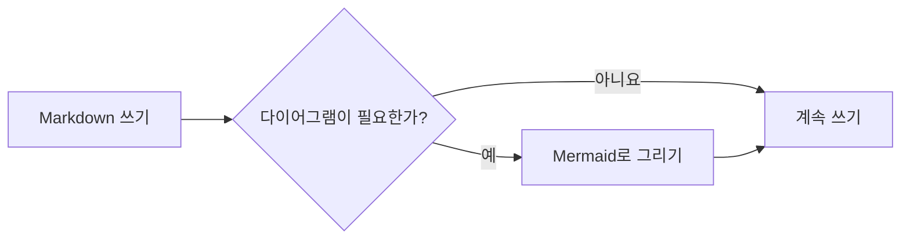
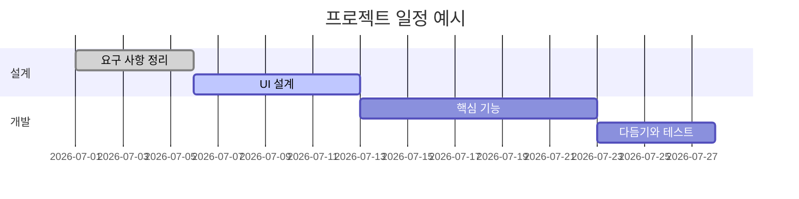
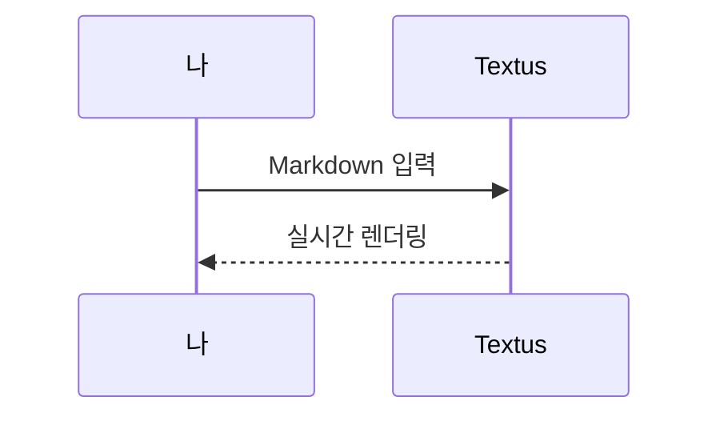

# Textus Markdown 가이드

환영합니다. 이 문서는 Textus가 지원하는 Markdown 렌더링을 보여 주는 내장 문서입니다. 저장되지 않은 초안일 뿐이니 마음껏 고치고 실험해 본 다음 저장하지 않고 닫으면 됩니다.

> [!TIP]
> `Cmd+/` 키를 누르면 WYSIWYG 모드와 소스 모드를 오가며 여기 있는 예시의 원래 문법을 볼 수 있습니다.

## 제목과 인용

줄 맨 앞에 `#` 기호와 공백을 넣으면 1단계 제목, `##` 기호와 공백을 넣으면 2단계 제목이 됩니다. 위의 제목들이 렌더링된 결과입니다. `Ctrl+1`부터 `Ctrl+6`까지(Mac에서는 `Cmd+1`부터 `Cmd+6`까지) 누르면 현재 줄이 해당 단계의 제목이 됩니다.

인용문:

> 인용문 안에도 **굵게**나 `코드` 같은 다른 서식을 넣을 수 있습니다.

GitHub 스타일 알림:

> [!NOTE]
> 참고 알림으로, 덧붙일 정보를 전할 때 씁니다.

> [!WARNING]
> 경고 알림으로, 주의할 점을 알릴 때 씁니다.

## 인라인 스타일

**굵게**(`**텍스트**`), *기울임꼴*(`*텍스트*`), ***굵은 기울임꼴***, ~~취소선~~(`~~텍스트~~`), ==강조 표시==(`==텍스트==`), 그리고 `인라인 코드`.

`(`, `[`, `{`, 따옴표나 중국어·일본어 입력기로 입력한 `（`, `【`, `「` 같은 괄호를 입력하면 커서 뒤에 닫는 짝이 자동으로 들어갑니다. 닫는 기호를 입력하면 그 위를 지나가고, 여는 기호 바로 뒤에서 Backspace 키를 누르면 둘 다 지워지며, 텍스트를 선택한 채 입력하면 그 텍스트를 감쌉니다. **설정 → 편집기 및 모양 → (), [], “” 짝 맞추기**에서 끌 수 있습니다.

링크는 이렇게 씁니다: [Textus 저장소](https://github.com/CatVinci-Studio/Textus). Ctrl/⌘를 누른 채 클릭하면 링크를 따라갑니다. 웹 링크는 브라우저에서, 다른 Markdown 파일 링크는 탭에서 열리고, `#제목` 링크는 그 제목으로 스크롤합니다. 그냥 클릭하면 커서가 링크 안에 놓이고 Markdown `[텍스트](URL)`이 보여 그 자리에서 고칠 수 있습니다. 커서가 벗어나면 다시 링크가 됩니다. 인라인 HTML도 렌더링됩니다(예: 키보드 키 <kbd>Cmd</kbd> + <kbd>S</kbd>). `<details>` 접기, HTML 표, 일부 인라인 스타일(색, 배경색, 크기, 굵기, 정렬, 밑줄과 취소선), 인라인 `<svg>`(그림으로 표시)도 렌더링됩니다. 스크립트 등 그 밖의 HTML은 소스 그대로 보입니다. 다른 파일의 제목으로 가는 링크(예: `[참고](notes.md#제목)`)는 그 파일을 열고 해당 제목으로 이동합니다. Obsidian 위키링크 `[[노트]]`, `[[노트|표시할 텍스트]]`, `[[노트#제목]]`도 같은 방식으로 열리며, 노트가 문서와 같은 폴더에 있든 보관소 안 어디에 있든 찾아 줍니다. 위키링크와 줄 맨 앞의 `#태그`는 쓴 그대로 저장됩니다.

**설정 → 편집기 및 모양 → 색상 코드 앞 색상 견본**은 색상 코드 앞에 그 색의 작은 사각형을 표시합니다. **코드에서만**을 고르면 색을 나타내는 인라인 코드(`#0af`, `rgb(0 128 255)` 등)와 코드 블록 안의 색상 값 앞에, **모든 곳**을 고르면 본문에 쓴 6자리나 8자리 색상 코드(#ff8800 등)와 색상 함수(hsl(210 100% 50%) 등) 앞에도 표시됩니다. 본문의 짧은 형태, #cafe 같은 태그, #234 같은 번호와 링크는 그대로입니다.

인라인 수식: 질량-에너지 등가 원리 $E = mc^2$, 오일러 등식 $e^{i\pi} + 1 = 0$.

## 목록

- 순서 없는 목록
- 중첩 가능
  - 2단계 항목
  - 또 다른 항목

1. 순서 있는 목록
2. 두 번째 항목

할 일 목록(체크박스를 클릭하면 바뀝니다):

- [x] 끝낸 일
- [ ] 할 일

## 표

| 기능 | 문법 | 결과 |
| --- | --- | --- |
| 굵게 | `**텍스트**` | **텍스트** |
| 강조 표시 | `==텍스트==` | ==텍스트== |
| 인라인 수식 | `$x^2$` | $x^2$ |

표 위에 포인터를 올리면 행과 열을 추가하거나 삭제할 수 있습니다. `| 이름 | 나이 |`처럼 입력하고 Enter 키를 누르면 표가 만들어집니다. 표 안에서 Enter 키를 누르면 아래 행으로 이동하고, 마지막 행에서는 행이 추가되며, 비워 둔 새 행에서 누르면 표에서 나갑니다. Ctrl/⌘+Enter 키를 누르면 언제든지 나갈 수 있습니다. 표 안에서 Tab 키와 Shift+Tab 키는 다음 칸과 이전 칸으로 이동하고, Shift+Enter 키는 칸 안에서 줄을 바꿉니다.

## 코드 블록

구문 강조가 적용되는 펜스 코드 블록입니다(블록 오른쪽 위에서 언어를 바꿀 수 있습니다). 비어 있는 마지막 줄에서 Enter 키를 누르면 블록에서 나가고, Ctrl/⌘+Enter 키를 누르면 언제든지 나갈 수 있습니다. 인용에서도 마찬가지입니다. 언어 옆의 **복사**와 **모두 선택**은 블록의 코드를 복사하거나 선택하고, **설정 → 편집기 및 모양 → 코드 블록에 줄 번호 표시**를 켜면 줄마다 번호가 붙습니다. 둘 다 내보내기와 인쇄에는 나타나지 않습니다.

```python
def fib(n: int) -> int:
    """고전적인 피보나치 수열."""
    a, b = 0, 1
    for _ in range(n):
        a, b = b, a + b
    return a
```

```rust
fn main() {
    let greeting = "안녕하세요, Textus!";
    println!("{greeting}");
}
```

## 수식 블록

`$$`로 감싼 블록 수식은 KaTeX로 렌더링됩니다:

$$
\int_{-\infty}^{\infty} e^{-x^2} \, dx = \sqrt{\pi}
$$

## 다이어그램(Mermaid)

코드 블록을 ```` ```mermaid ````로 시작하면 실시간 다이어그램으로 렌더링됩니다. 순서도:



간트 차트:



시퀀스 다이어그램:



**설정 → 편집기 및 모양 → 다이어그램 엔진**에서 이 블록을 그릴 엔진을 고릅니다. 기본값인 Mermaid, 또는 더 빠른 Pele입니다. Pele는 다이어그램을 자기 방식으로 배치하고 몇 가지 기능을 지원하지 않으며, Pele가 그리지 못하는 다이어그램은 Mermaid가 그립니다.

## 이미지

클립보드에서 이미지를 바로 붙여넣으면 Textus가 저장하고 참조를 삽입합니다. 저장 위치는 **설정 → 편집기 및 모양 → 이미지**에서 정합니다. **이 컴퓨터에 저장**을 고르면 문서 폴더 안의 **하위 폴더**(기본값 `assets/`, 이름은 바꿀 수 있음)나 **문서와 같은 폴더**를 고를 수 있으며, 붙여넣은 이미지에 들어갈 링크가 설정에 표시됩니다. **이미지 호스팅에 업로드**를 고르면 PicGo / PicList, SM.MS, Imgur 또는 직접 운영하는 엔드포인트(**사용자 지정**)로 보냅니다.

사용자 지정 엔드포인트는 `file` 필드가 있는 `multipart/form-data`를 받고, 공개 URL을 일반 텍스트로 반환하거나 지정한 JSON 필드에 담아 반환하면 됩니다. 업로드하는 파일은 자동으로 이름을 바꾸거나, 원래 이름을 유지하거나, 업로드할 때마다 이름을 묻게 할 수 있습니다. 저장 방식을 바꿔도 기존 이미지 참조는 바뀌지 않습니다.

참조를 직접 쓸 수도 있습니다:

```markdown

```

`![[image.png]]`나 `![[attachments/image.png|300]]` 같은 Obsidian 임베드도 그림으로 보입니다. Textus는 문서가 속한 Obsidian 보관함에서 파일을 찾고, 임베드는 쓴 그대로 저장합니다.

그림을 자세히 보려면 두 번 클릭하거나 오른쪽 위의 **이미지 확대**를 누르세요(다이어그램에도 같은 버튼이 있습니다). 스크롤하거나 두 손가락을 오므리고 벌려 확대/축소하고, 끌어서 옮기고, 두 번 클릭하면 다시 화면에 맞추며, `Esc` 키로 닫습니다. 그림 오른쪽 가장자리의 핸들을 끌면 크기가 바뀝니다. **설정 → 편집기 및 모양 → 한 줄을 차지하는 이미지**에서 한 줄에 홀로 놓인 그림을 가운데에 둘지 왼쪽에 둘지 고를 수 있으며, 편집기와 HTML·PDF 내보내기에 모두 적용됩니다.

## 복사와 붙여넣기

**복사**하면 클립보드의 일반 텍스트에는 Markdown이, 그 옆에는 서식이 담깁니다. 그래서 GitHub, Obsidian, VS Code, 채팅 앱에는 Markdown이 들어가고, Word, Pages, 메일, Notion에는 서식이 적용된 채로 붙여 넣어집니다. 그림을 오른쪽 클릭해 복사하면 그림 자체가 클립보드에 들어가, 채팅이나 문서에 바로 붙여 넣을 수 있습니다. **편집 → 일반 텍스트로 붙여넣기**(`Cmd+Shift+V`)는 클립보드의 텍스트를 Markdown으로 읽지 않고 그대로 붙여 넣습니다.

## 보기와 모드

WYSIWYG 편집기와 소스 모드(`Cmd+/`) 외에도 Textus에는 세 가지 쓰기 방식이 있습니다(Windows와 Linux에서는 `Cmd` 대신 `Ctrl`을 쓰세요. 지금 지정된 단축키는 설정 → 단축키에서 볼 수 있습니다):

- **소스와 미리보기**(`Cmd+Shift+E`): 왼쪽에 Markdown 소스, 오른쪽에 렌더링된 미리 보기가 표시되고 함께 스크롤됩니다.
- **타자기 모드**: 입력 중인 줄이 창 가운데에 머무릅니다. 편집기, 소스 모드, 소스와 미리보기 모두에서 작동합니다.
- **젠 모드**(`Cmd+Shift+J`): 본문 외의 모든 것을 숨기고, 지금 쓰고 있는 문단을 뺀 나머지 문단을 흐리게 표시합니다. `Esc` 키를 누르면 빠져나옵니다.

모두 **보기** 메뉴와 **설정 → 편집기 및 모양 → 보기**에 있습니다. 각각 Textus 전체에 하나뿐인 설정이라, 어느 창에서 바꾸든 모든 창의 모든 탭이 함께 바뀌고, 다음에 여는 문서도 그 보기로 열리며, 다음에 Textus를 열 때도 그대로입니다.

**보기 → 읽기 전용**(탭의 오른쪽 클릭 메뉴에도 있습니다)을 켜면 입력, 붙여넣기, 끌어다 놓기, 실행 취소, Textus AI, 플러그인 중 어느 것으로도 문서가 바뀌지 않습니다. 제목 옆에 자물쇠가 표시되며, 클릭하면 다시 편집할 수 있습니다.

**보기 → 명령 팔레트…**(`Cmd+Shift+P`)에서는 이름을 몇 글자만 입력해 메뉴에 있는 모든 기능과 플러그인이 추가한 모든 명령을 찾을 수 있습니다. 모양(밝게, 어둡게 또는 시스템 설정)과 편집기 테마를 바꾸고, Textus AI를 켜거나 끌 수도 있습니다.

사이드바의 **개요** 탭에는 문서의 제목이 나열되며, 클릭하면 그 제목으로 이동합니다. 개요를 오른쪽 클릭하면 **모두 펼치기**와 **모두 접기**가 있고, 제목의 화살표를 `Option`-클릭(`Alt`-클릭)하면 모든 제목을 한꺼번에 접거나 펼칩니다.

**설정 → 편집기 및 모양 → 인터페이스 글자 크기**로 사이드바, 탭, 메뉴, AI 패널, 설정의 글자를 키우거나 줄일 수 있으며, 문서는 자체 확대/축소 배율을 그대로 유지합니다. `Ctrl+Tab`과 `Ctrl+Shift+Tab`으로 다음 탭과 이전 탭으로 이동합니다.

## 여러 문서를 한 번에

**보기 → 오른쪽으로 분할**(`Cmd+Option+S`)은 앞에 있는 문서를 다른 문서와 나란히 보여 주고, **보기 → 아래로 분할**은 위아래로 놓습니다. 분할 영역마다 탭이 따로 있습니다. 문서를 열면 지금 있는 영역에 들어가고, 오른쪽으로 분할이나 아래로 분할을 고르면 그 영역이 다시 나뉩니다. 몇 번이든 나눌 수 있습니다.

- 탭이나 사이드바의 파일을 분할 영역의 가장자리로 끌면 그쪽에 생기는 새 영역에서 열립니다. 편집기의 바깥 가장자리로 끌면 모든 영역 옆에 열립니다. 위아래로 놓인 두 영역의 오른쪽 가장자리라면 오른쪽을 위에서 아래까지 채웁니다. 다른 영역의 탭 위에 놓으면 그 영역으로 옮겨집니다.
- 두 영역 사이의 선을 끌면 크기가 바뀌고, 두 번 클릭하면 크기가 같아집니다. 선을 오른쪽 클릭하면 나란히 놓인 영역을 위아래로 바꾸거나, 서로 맞바꾸거나, 분할을 닫을 수 있습니다.
- 탭의 오른쪽 클릭 메뉴에서 **옆에 열기**를 고르면 그 탭을 앞에 있는 문서 옆에 보여 줍니다.
- 영역의 마지막 탭을 닫으면 그 영역도 사라집니다. 전체 배치는 Textus를 다시 열면 그대로 돌아옵니다.

## 탭과 창

`Cmd+T`는 새 탭을, `Cmd+N`은 새 창을 열고, **파일 → 닫은 탭 다시 열기**(`Cmd+Shift+T`)는 닫은 문서를 가장 최근 것부터 다시 엽니다. 탭은 가운데 버튼 클릭으로 닫힙니다. 탭의 오른쪽 클릭 메뉴에는 **다른 탭 닫기**, **왼쪽 탭 닫기**, **오른쪽 탭 닫기**(저장하지 않은 변경이 있는 탭은 열린 채로 남습니다), **경로 복사**, **새 창으로 이동**이 있습니다. 탭을 창 밖으로 끌어 내 그 탭만의 창을 만들 수도 있습니다. Textus를 다시 열면 창마다 자기 탭과 함께 돌아옵니다.

## 폴더와 파일 검색

**파일 → 폴더 열기…**로 폴더 전체를 사이드바에 엽니다. 그 안의 문서를 열어도 파일 트리는 그 폴더에 머물고, 다음 실행 때 세션과 함께 복원됩니다. **파일 → 폴더 닫기**를 고르면 트리가 다시 현재 문서를 따라갑니다. 사이드바 **파일** 탭 맨 위의 검색 상자에서 폴더 전체의 파일 이름을 검색할 수 있고, `Cmd+Shift+O`를 누르면 바로 그곳으로 이동합니다. 입력해서 걸러 내고, `↑`/`↓`로 이동하고, `Enter`로 열고, `Esc`로 지웁니다. 두 기능 모두 데스크톱에서만 쓸 수 있습니다.

트리는 작은 파일 관리자이기도 합니다. 위쪽의 상위 폴더 이름을 클릭하면 한 단계 위로 올라갑니다. **정렬**로 이름순이나 수정한 날짜순으로 정렬할 수 있고, 검색창 옆의 필터(**모든 파일** 또는 **문서만**)는 검색과 트리 모두에 적용됩니다. 폴더, 파일 또는 아래의 빈 공간을 오른쪽 클릭하면 그곳에 **새 문서**나 **새 폴더**를 만들 수 있고, 파일이나 폴더를 다른 폴더 위로 끌어다 놓으면 그 안으로 옮겨집니다. 열려 있는 문서도 새 위치를 따라갑니다. 아무것도 덮어쓰지 않습니다. 이미 있는 이름은 거부됩니다.

Finder나 파일 탐색기에서 파일을 창으로 끌어다 놓으면 열립니다. 문서는 탭으로 열리고, 그림은 놓은 자리의 문서에 들어가며, 폴더는 사이드바에 열립니다. **파일 → 경로 복사**는 앞에 있는 문서의 전체 경로를 복사합니다.

터미널에서 `textus notes.md`를 입력하면 Textus에서 파일이 열립니다. `textus` 명령어가 아직 없으면 **설정 → 일반**에서 설치하세요.

**파일 → 열기…**로 Word 문서(`.docx`)도 열 수 있고, 창에 끌어다 놓아도 같습니다. 제목, 목록, 표, 링크, 각주, 이미지를 그대로 담은 같은 이름의, 아직 저장되지 않은 새 Markdown 문서가 됩니다. 이미지는 저장할 때 **설정 → 편집기 및 모양 → 이미지**에서 붙여넣은 이미지에 정한 위치로 들어가고, **저장**은 Word 파일 옆의 `.md` 파일을 제안합니다. 일부 서식은 Word와 다르게 보일 수 있으며, 원본 Word 파일은 바뀌지 않습니다. 데스크톱에서만 됩니다.

## 백그라운드에서 계속 실행

**설정 → 일반 → 앱 → 백그라운드에서 계속 실행**을 켜면 마지막 창을 닫아도 Textus가 계속 실행되고, 알림 영역(Windows), 시스템 트레이(Linux), 메뉴 막대(Mac)에 아이콘이 표시됩니다. 아이콘 메뉴의 **Textus 열기**로 문서로 돌아가고, **Textus 종료**를 골라야 완전히 종료됩니다. GNOME에서는 AppIndicator 확장이 있어야 트레이 아이콘이 보입니다.

## 내보내기

**파일 → 내보내기**로 문서를 HTML이나 PDF로 저장합니다. [Pandoc](https://pandoc.org)을 설치했다면 Word(`.docx`), OpenDocument, RTF, EPUB, LaTeX 등으로도 저장할 수 있습니다. Mac에서는 **설정 → 편집기 및 모양 → PDF를 밝은 색으로 내보내기**를 켜면 다크 모드로 쓰는 중에도 테마의 밝은 색으로 흰 바탕의 PDF를 만듭니다.

## 플러그인, 테마, 스킬

**설정 → 확장 → 더 받기**에 추가할 수 있는 플러그인, 테마, 스킬이 나와 있습니다. Vim·Emacs 키, PDF 리더, 차트, 지식 그래프, 글쓰기 도구 등이 있습니다. 항목마다 버튼이 하나 있어 **설치**, 그다음에는 **업데이트**, **끄기**, **켜기**로 바뀌고, 옆의 메뉴에 **제거**가 있습니다. 플러그인 페이지에는 사용법이 나와 있으며, 플러그인의 명령은 **플러그인** 메뉴와 명령 팔레트에 나타납니다.

## 도움 받기

**도움말 → 문제 신고…**(**설정 → 일반**의 도움말 아래에도 있습니다)를 누르면 짧은 양식이 열립니다. 신고 유형, Textus의 어느 부분과 관련되는지, 버그라면 심각도를 고른 뒤 무엇이 잘못됐는지 적으면 Textus가 버전, 시스템, 플러그인, 개인 정보를 뺀 설정, 최근 오류를 덧붙이며, 보내기 전에 모두 보여 줍니다. **보내기**는 GitHub 계정 없이도 GitHub에 이슈로 올려 주고 그 번호를 알려 줍니다. **GitHub에 제출**은 대신 GitHub 양식을 열고, **복사**는 채팅이나 이메일에 쓸 수 있게 클립보드에 넣습니다. 적은 내용은 공개 이슈가 되며, 추가로 물어봐도 될 때 남기는 이메일이나 WeChat은 팀에만 전달됩니다.

**설정 → 일반 → 도움말**에서는 시작하기 및 튜토리얼을 다시 보고, 사용 안내를 열고, **Textus 정보**에서 버전을 보고 **업데이트 확인**을 할 수도 있습니다(Mac에서는 **Textus → 업데이트 확인…**도 있습니다). **도움말 → 커뮤니티 참여**는 커뮤니티 페이지를 엽니다.

## 각주와 구분선

각주는 이렇게 씁니다[^1]. 아래는 가로 구분선입니다:

---

[^1]: 각주 내용은 문서 끝에 모아서 표시됩니다.

한 줄에 `[TOC]`만 입력하고 Enter를 누르면 목차가 들어갑니다. 문서의 제목을 나열하고 글을 쓰는 대로 갱신되며, 항목을 클릭하면 해당 제목으로 이동합니다.

즐겁게 써 보세요.
