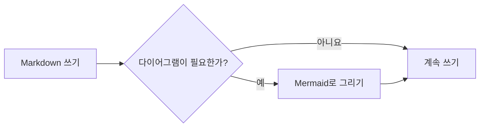
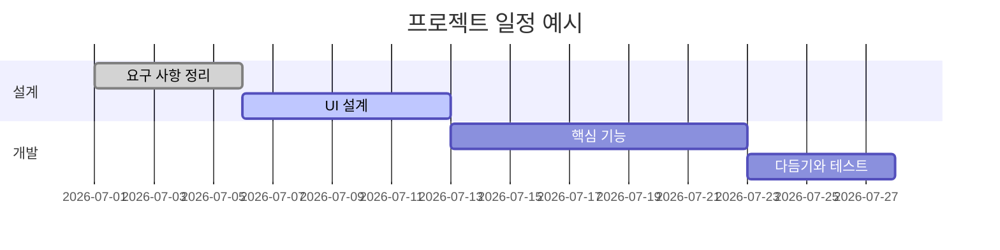
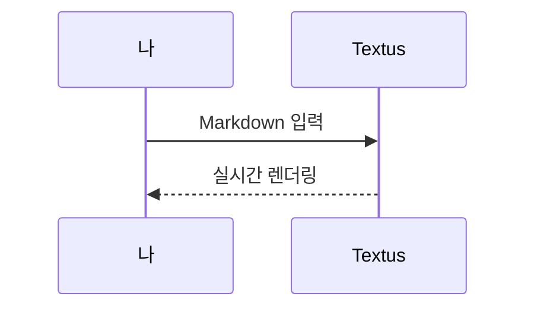

# Textus Markdown 가이드

환영합니다. 이 문서는 Textus가 지원하는 Markdown 렌더링을 보여 주는 내장 문서입니다. 저장되지 않은 초안일 뿐이니 마음껏 고치고 실험해 본 다음 저장하지 않고 닫으면 됩니다.

> [!TIP]
> `Cmd+/` 키를 누르면 WYSIWYG 모드와 소스 모드를 오가며 여기 있는 예시의 원래 문법을 볼 수 있습니다.

## 제목과 인용

줄 맨 앞에 `#` 기호와 공백을 넣으면 1단계 제목, `##` 기호와 공백을 넣으면 2단계 제목이 됩니다. 위의 제목들이 렌더링된 결과입니다. `Ctrl+1`부터 `Ctrl+6`까지(Mac에서는 `Cmd+1`부터 `Cmd+6`까지) 누르면 현재 줄이 해당 단계의 제목이 됩니다.

인용문:

> 인용문 안에도 **굵게**나 `코드` 같은 다른 서식을 넣을 수 있습니다.

GitHub 스타일 알림:

> [!NOTE]
> 참고 알림으로, 덧붙일 정보를 전할 때 씁니다.

> [!WARNING]
> 경고 알림으로, 주의할 점을 알릴 때 씁니다.

## 인라인 스타일

**굵게**(`**텍스트**`), *기울임꼴*(`*텍스트*`), ***굵은 기울임꼴***, ~~취소선~~(`~~텍스트~~`), ==강조 표시==(`==텍스트==`), 그리고 `인라인 코드`.

`(`, `[`, `{`, 따옴표나 중국어·일본어 입력기로 입력한 `（`, `【`, `「` 같은 괄호를 입력하면 커서 뒤에 닫는 짝이 자동으로 들어갑니다. 닫는 기호를 입력하면 그 위를 지나가고, 여는 기호 바로 뒤에서 Backspace 키를 누르면 둘 다 지워지며, 텍스트를 선택한 채 입력하면 그 텍스트를 감쌉니다. **설정 → 편집기 및 모양 → 괄호와 따옴표 자동으로 닫기**에서 끌 수 있습니다.

링크는 이렇게 씁니다: [Textus 저장소](https://github.com/CatVinci-Studio/Textus). Ctrl/⌘를 누른 채 클릭하면 링크를 따라갑니다. 웹 링크는 브라우저에서, 다른 Markdown 파일 링크는 탭에서 열리고, `#제목` 링크는 그 제목으로 스크롤합니다. 그냥 클릭하면 커서가 링크 안에 놓이고 Markdown `[텍스트](URL)`이 보여 그 자리에서 고칠 수 있습니다. 커서가 벗어나면 다시 링크가 됩니다. 인라인 HTML도 렌더링됩니다(예: 키보드 키 <kbd>Cmd</kbd> + <kbd>S</kbd>). `<details>` 접기, HTML 표, 일부 인라인 스타일(색, 배경색, 크기, 굵기, 정렬, 밑줄과 취소선), 인라인 `<svg>`(그림으로 표시)도 렌더링됩니다. 스크립트 등 그 밖의 HTML은 소스 그대로 보입니다. 다른 파일의 제목으로 가는 링크(예: `[참고](notes.md#제목)`)는 그 파일을 열고 해당 제목으로 이동합니다. Obsidian 위키링크 `[[노트]]`, `[[노트|표시할 텍스트]]`, `[[노트#제목]]`도 같은 방식으로 열리며, 노트가 문서와 같은 폴더에 있든 보관소 안 어디에 있든 찾아 줍니다. 위키링크와 줄 맨 앞의 `#태그`는 쓴 그대로 저장됩니다.

**설정 → 편집기 및 모양 → 색상 코드 앞 색상 견본**은 색상 코드 앞에 그 색의 작은 사각형을 표시합니다. **코드에서만**을 고르면 색을 나타내는 인라인 코드(`#0af`, `rgb(0 128 255)` 등)와 코드 블록 안의 색상 값 앞에, **모든 곳**을 고르면 본문에 쓴 6자리나 8자리 색상 코드(#ff8800 등)와 색상 함수(hsl(210 100% 50%) 등) 앞에도 표시됩니다. 본문의 짧은 형태, #cafe 같은 태그, #234 같은 번호와 링크는 그대로입니다.

인라인 수식: 질량-에너지 등가 원리 $E = mc^2$, 오일러 등식 $e^{i\pi} + 1 = 0$.

## 목록

- 순서 없는 목록
- 중첩 가능
  - 2단계 항목
  - 또 다른 항목

1. 순서 있는 목록
2. 두 번째 항목

할 일 목록(체크박스를 클릭하면 바뀝니다):

- [x] 끝낸 일
- [ ] 할 일

## 표

| 기능 | 문법 | 결과 |
| --- | --- | --- |
| 굵게 | `**텍스트**` | **텍스트** |
| 강조 표시 | `==텍스트==` | ==텍스트== |
| 인라인 수식 | `$x^2$` | $x^2$ |

표 위에 포인터를 올리면 행과 열을 추가하거나 삭제할 수 있습니다. `| 이름 | 나이 |`처럼 입력하고 Enter 키를 누르면 표가 만들어집니다. 표 안에서 Enter 키를 누르면 아래 행으로 이동하고, 마지막 행에서는 행이 추가되며, 비워 둔 새 행에서 누르면 표에서 나갑니다. Ctrl/⌘+Enter 키를 누르면 언제든지 나갈 수 있습니다. 표 안에서 Tab 키와 Shift+Tab 키는 다음 칸과 이전 칸으로 이동하고, Shift+Enter 키는 칸 안에서 줄을 바꿉니다.

## 코드 블록

구문 강조가 적용되는 펜스 코드 블록입니다(블록 오른쪽 위에서 언어를 바꿀 수 있습니다). 비어 있는 마지막 줄에서 Enter 키를 누르면 블록에서 나가고, Ctrl/⌘+Enter 키를 누르면 언제든지 나갈 수 있습니다. 인용에서도 마찬가지입니다. 언어 옆의 **복사** 버튼은 블록의 코드를 복사하고, **설정 → 편집기 및 모양 → 코드 블록에 줄 번호 표시**를 켜면 줄마다 번호가 붙습니다. 둘 다 내보내기와 인쇄에는 나타나지 않습니다.

```python
def fib(n: int) -> int:
    """고전적인 피보나치 수열."""
    a, b = 0, 1
    for _ in range(n):
        a, b = b, a + b
    return a
```

```rust
fn main() {
    let greeting = "안녕하세요, Textus!";
    println!("{greeting}");
}
```

## 수식 블록

`$$`로 감싼 블록 수식은 KaTeX로 렌더링됩니다:

$$
\int_{-\infty}^{\infty} e^{-x^2} \, dx = \sqrt{\pi}
$$

## 다이어그램(Mermaid)

코드 블록을 ```` ```mermaid ````로 시작하면 실시간 다이어그램으로 렌더링됩니다. 순서도:



간트 차트:



시퀀스 다이어그램:



**설정 → 편집기 및 모양 → 다이어그램 엔진**에서 이 블록을 그릴 엔진을 고릅니다. 기본값인 Mermaid, 또는 더 빠른 Pele입니다. Pele는 다이어그램을 자기 방식으로 배치하고 몇 가지 기능을 지원하지 않으며, Pele가 그리지 못하는 다이어그램은 Mermaid가 그립니다.

## 이미지

클립보드에서 이미지를 바로 붙여넣으면 Textus가 저장하고 참조를 삽입합니다. 저장 위치는 **설정 → 편집기 및 모양 → 이미지**에서 정합니다. **이 컴퓨터에 저장**을 고르면 문서 폴더 안의 **하위 폴더**(기본값 `assets/`, 이름은 바꿀 수 있음)나 **문서와 같은 폴더**를 고를 수 있으며, 붙여넣은 이미지에 들어갈 링크가 설정에 표시됩니다. **이미지 호스팅에 업로드**를 고르면 PicGo / PicList, SM.MS, Imgur 또는 직접 운영하는 엔드포인트(**사용자 지정**)로 보냅니다.

사용자 지정 엔드포인트는 `file` 필드가 있는 `multipart/form-data`를 받고, 공개 URL을 일반 텍스트로 반환하거나 지정한 JSON 필드에 담아 반환하면 됩니다. 업로드하는 파일은 자동으로 이름을 바꾸거나, 원래 이름을 유지하거나, 업로드할 때마다 이름을 묻게 할 수 있습니다. 저장 방식을 바꿔도 기존 이미지 참조는 바뀌지 않습니다.

참조를 직접 쓸 수도 있습니다:

```markdown

```

`![[image.png]]`나 `![[attachments/image.png|300]]` 같은 Obsidian 임베드도 그림으로 보입니다. Textus는 문서가 속한 Obsidian 보관함에서 파일을 찾고, 임베드는 쓴 그대로 저장합니다.

## 보기와 모드

WYSIWYG 편집기와 소스 모드(`Cmd+/`) 외에도 Textus에는 세 가지 쓰기 방식이 있습니다(Windows와 Linux에서는 `Cmd` 대신 `Ctrl`을 쓰세요. 지금 지정된 단축키는 설정 → 단축키에서 볼 수 있습니다):

- **분할 보기**(`Cmd+Shift+E`): 왼쪽에 Markdown 소스, 오른쪽에 렌더링된 미리 보기가 표시되고 함께 스크롤됩니다.
- **타자기 모드**(설정 → 편집기 및 모양 → 보기): 입력 중인 줄이 창 가운데에 머무릅니다. 편집기, 소스 모드, 분할 보기 모두에서 작동합니다.
- **젠 모드**(`Cmd+Shift+J`): 본문 외의 모든 것을 숨기고 전체 화면으로 바꾸며, 지금 쓰고 있는 문단을 뺀 나머지 문단을 흐리게 표시합니다. `Esc` 키를 누르면 빠져나옵니다.

세 가지 모두 **보기** 메뉴에도 있습니다.

**설정 → 편집기 및 모양 → 인터페이스 글자 크기**로 사이드바, 탭, 메뉴, AI 패널, 설정의 글자를 키우거나 줄일 수 있으며, 문서는 자체 확대/축소 배율을 그대로 유지합니다. `Ctrl+Tab`과 `Ctrl+Shift+Tab`으로 다음 탭과 이전 탭으로 이동합니다.

## 폴더와 파일 검색

**파일 → 폴더 열기…**로 폴더 전체를 사이드바에 엽니다. 그 안의 문서를 열어도 파일 트리는 그 폴더에 머물고, 다음 실행 때 세션과 함께 복원됩니다. **파일 → 폴더 닫기**를 고르면 트리가 다시 현재 문서를 따라갑니다. 사이드바 **파일** 탭 맨 위의 검색 상자에서 폴더 전체의 파일 이름을 검색할 수 있고, `Cmd+Shift+O`를 누르면 바로 그곳으로 이동합니다. 입력해서 걸러 내고, `↑`/`↓`로 이동하고, `Enter`로 열고, `Esc`로 지웁니다. 두 기능 모두 데스크톱에서만 쓸 수 있습니다.

트리는 작은 파일 관리자이기도 합니다. 위쪽의 상위 폴더 이름을 클릭하면 한 단계 위로 올라갑니다. **정렬**로 이름순이나 수정한 날짜순으로 정렬할 수 있고, 검색창 옆의 필터(**모든 파일** 또는 **문서만**)는 검색과 트리 모두에 적용됩니다. 폴더, 파일 또는 아래의 빈 공간을 오른쪽 클릭하면 그곳에 **새 문서**나 **새 폴더**를 만들 수 있고, 파일이나 폴더를 다른 폴더 위로 끌어다 놓으면 그 안으로 옮겨집니다. 열려 있는 문서도 새 위치를 따라갑니다. 아무것도 덮어쓰지 않습니다. 이미 있는 이름은 거부됩니다.

**파일 → 열기…**로 Word 문서(`.docx`)도 열 수 있고, 창에 끌어다 놓아도 같습니다. 제목, 목록, 표, 링크, 각주, 이미지를 그대로 담은 같은 이름의, 아직 저장되지 않은 새 Markdown 문서가 됩니다. 이미지는 저장할 때 **설정 → 편집기 및 모양 → 이미지**에서 붙여넣은 이미지에 정한 위치로 들어가고, **저장**은 Word 파일 옆의 `.md` 파일을 제안합니다. 일부 서식은 Word와 다르게 보일 수 있으며, 원본 Word 파일은 바뀌지 않습니다. 데스크톱에서만 됩니다.

## 백그라운드에서 계속 실행

**설정 → 일반 → 앱 → 백그라운드에서 계속 실행**을 켜면 마지막 창을 닫아도 Textus가 계속 실행되고, 알림 영역(Windows), 시스템 트레이(Linux), 메뉴 막대(Mac)에 아이콘이 표시됩니다. 아이콘 메뉴의 **Textus 열기**로 문서로 돌아가고, **Textus 종료**를 골라야 완전히 종료됩니다. GNOME에서는 AppIndicator 확장이 있어야 트레이 아이콘이 보입니다.

## 각주와 구분선

각주는 이렇게 씁니다[^1]. 아래는 가로 구분선입니다:

---

[^1]: 각주 내용은 문서 끝에 모아서 표시됩니다.

즐겁게 써 보세요.
