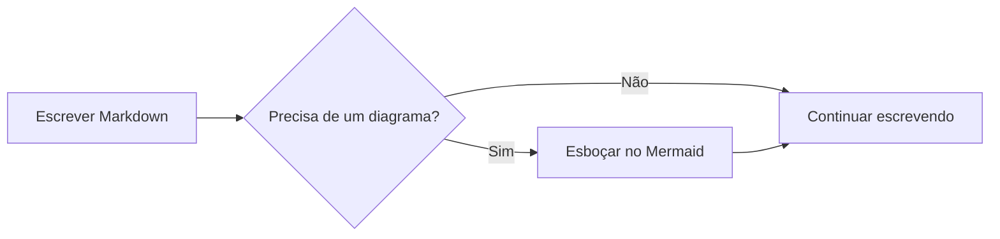
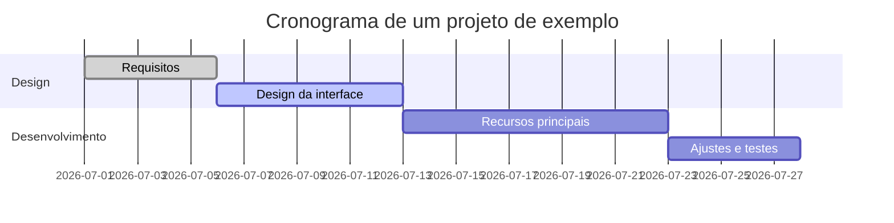
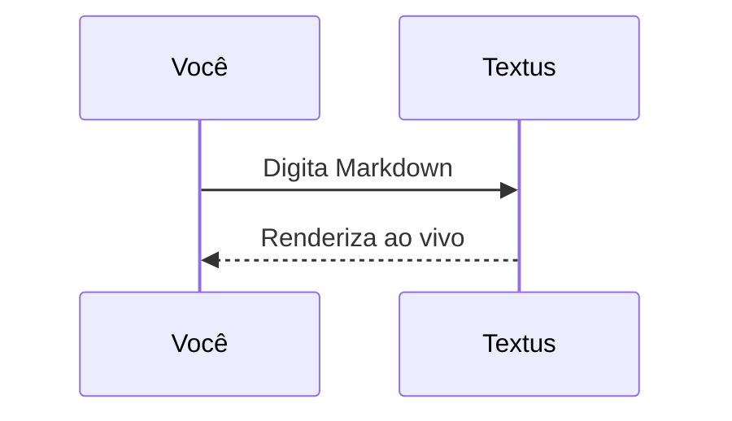

# Guia de Markdown do Textus

Este documento integrado mostra a renderização de Markdown que o Textus oferece. É só um rascunho não salvo: edite e experimente à vontade e depois feche sem salvar.

> [!TIP]
> Pressione `Cmd+/` para alternar entre o modo WYSIWYG e o modo código-fonte e ver a sintaxe por trás de qualquer exemplo deste guia.

## Títulos e citações

Digite `#` e um espaço no início de uma linha para criar um título de nível 1, ou `##` e um espaço para o nível 2. Os títulos acima mostram o resultado renderizado.

Uma citação:

> O texto citado pode conter outras marcações, como **negrito** e `código`.

Alertas no estilo do GitHub:

> [!NOTE]
> Uma nota, para dar mais contexto.

> [!WARNING]
> Um aviso, para pontos que pedem atenção.

## Estilos de texto

**Negrito** (`**texto**`), *itálico* (`*texto*`), ***negrito e itálico***, ~~tachado~~ (`~~texto~~`), ==destaque== (`==texto==`) e `código no texto`.

Links ficam assim: [o repositório do Textus](https://github.com/CatVinci-Studio/Textus). Ctrl/⌘+clique segue um link: um link da web abre no navegador, um link para outro arquivo Markdown o abre em uma aba e um link para `#um-titulo` rola até ele. HTML no meio do texto também é renderizado, por exemplo as teclas <kbd>Cmd</kbd> + <kbd>S</kbd>. Também funcionam blocos recolhíveis `<details>`, tabelas HTML, alguns estilos inline (cor, fundo, tamanho, peso, alinhamento, sublinhado e tachado) e `<svg>` no meio do texto, que aparece como imagem. Scripts e o resto do HTML ficam como código-fonte. Um link para um título em outro arquivo, como `[veja](notas.md#um-titulo)`, abre esse arquivo nesse título. Os wikilinks do Obsidian (`[[Nota]]`, `[[Nota|texto]]` e `[[Nota#Título]]`) abrem do mesmo jeito, a partir da pasta do documento ou de qualquer lugar do cofre; eles e as `#tags` no início de uma linha são salvos exatamente como foram escritos.

**Ajustes → Editor e aparência → Amostras antes dos códigos de cor** põe um quadradinho da cor antes de um código de cor. **Só no código** mostra-o no código em linha que é uma cor, como `#0af` ou `rgb(0 128 255)`, e antes dos valores de cor dos blocos de código; **Em todo o texto**, também antes dos escritos no texto com seis ou oito dígitos, como #ff8800, ou como função de cor, como hsl(210 100% 50%). Códigos curtos no texto, etiquetas como #cafe, números como #234 e links ficam como estão.

Fórmulas no texto: a equivalência massa-energia $E = mc^2$ e a identidade de Euler $e^{i\pi} + 1 = 0$.

## Listas

- Lista não ordenada
- Com aninhamento
  - Um item de segundo nível
  - Mais um

1. Lista ordenada
2. Segundo item

Lista de tarefas (clique em uma caixa de seleção para marcá-la ou desmarcá-la):

- [x] Algo já feito
- [ ] Algo a fazer

## Tabelas

| Recurso | Sintaxe | Resultado |
| --- | --- | --- |
| Negrito | `**texto**` | **texto** |
| Destaque | `==texto==` | ==texto== |
| Fórmula no texto | `$x^2$` | $x^2$ |

Passe o ponteiro sobre uma tabela para adicionar ou remover linhas e colunas. Digite `| Nome | Idade |` e pressione Enter para criar uma tabela. Enter desce uma linha, cria uma nova quando você está na última e, em uma linha nova deixada vazia, sai da tabela; Ctrl/⌘+Enter sai a qualquer momento.

## Blocos de código

Blocos de código delimitados, com realce de sintaxe (troque a linguagem no canto superior direito do bloco). Enter na última linha, quando ela está vazia, sai do bloco, assim como Ctrl/⌘+Enter a qualquer momento; o mesmo vale para as citações. O botão **Copiar**, ao lado da linguagem, copia o código do bloco, e **Ajustes → Editor e aparência → Números de linha nos blocos de código** numera as linhas; nenhum dos dois aparece nas exportações nem na impressão.

```python
def fib(n: int) -> int:
    """A clássica sequência de Fibonacci."""
    a, b = 0, 1
    for _ in range(n):
        a, b = b, a + b
    return a
```

```rust
fn main() {
    let greeting = "Olá, Textus!";
    println!("{greeting}");
}
```

## Blocos de fórmulas

Fórmulas em bloco, entre `$$`, são renderizadas pelo KaTeX:

$$
\int_{-\infty}^{\infty} e^{-x^2} \, dx = \sqrt{\pi}
$$

## Diagramas (Mermaid)

Um bloco de código ```` ```mermaid ```` vira um diagrama ao vivo. Um fluxograma:



Um gráfico de Gantt:



Um diagrama de sequência:



**Ajustes → Editor e aparência → Motor de diagramas** escolhe quem desenha esses blocos: o Mermaid, padrão, ou o Pele, mais rápido, mas que organiza os diagramas do seu próprio jeito e deixa de fora alguns recursos; um diagrama que o Pele não consegue desenhar é desenhado pelo Mermaid.

## Imagens

Cole uma imagem direto da área de transferência: o Textus a salva e insere a referência. O destino se escolhe em **Ajustes → Editor e aparência → Imagens**. **Neste computador**, é uma **Subpasta** da pasta do documento, `assets/` por padrão, cujo nome você pode mudar, ou **A mesma pasta do documento**; os ajustes mostram o link que a imagem colada recebe. Com **Enviar para uma hospedagem de imagens**, ela vai para PicGo / PicList, SM.MS, Imgur ou um endpoint seu (**Personalizado**).

Um endpoint personalizado recebe `multipart/form-data` com um campo `file` e pode devolver a URL pública como texto simples ou em um campo JSON configurável. Os arquivos enviados podem ser renomeados automaticamente, manter o nome original ou pedir um nome antes de cada envio. As referências a imagens que já existem nunca mudam quando você troca o modo de armazenamento.

Ou escreva a referência à mão:

```markdown

```

Incorporações do Obsidian, como `![[image.png]]` ou `![[attachments/image.png|300]]`, também mostram a imagem: o Textus procura o arquivo no cofre do Obsidian ao qual o documento pertence e salva a incorporação exatamente como foi escrita.

## Visualizações e modos

Além do editor WYSIWYG e do modo código-fonte (`Cmd+/`), o Textus tem três maneiras de escrever (no Windows e no Linux, use `Ctrl` no lugar de `Cmd`; Ajustes → Atalhos mostra as combinações atuais):

- **Visualização dividida** (`Cmd+Shift+E`): o código-fonte Markdown à esquerda e a prévia renderizada à direita, rolando juntos.
- **Modo máquina de escrever** (Ajustes → Editor e aparência → Visualização): a linha que você está digitando fica no meio da janela, no editor, no modo código-fonte e na visualização dividida.
- **Modo zen** (`Cmd+Shift+J`): esconde tudo menos o texto, entra em tela cheia e esmaece todos os parágrafos, menos o que você está escrevendo. Pressione `Esc` para sair.

Os três também estão no menu **Visualizar**.

**Ajustes → Editor e aparência → Tamanho do texto da interface** aumenta ou diminui o texto da barra lateral, das abas, dos menus, do painel de IA e dos Ajustes; o documento mantém o próprio zoom. `Ctrl+Tab` e `Ctrl+Shift+Tab` vão para a próxima aba e para a anterior.

## Pastas e busca de arquivos

**Arquivo → Abrir Pasta…** abre uma pasta inteira na barra lateral: a árvore de arquivos fica nela enquanto você abre documentos lá dentro, a pasta volta com a sua sessão e **Arquivo → Fechar Pasta** faz a árvore voltar a acompanhar o documento. A caixa no topo da aba **Arquivos** da barra lateral busca nomes de arquivo na pasta inteira; `Cmd+Shift+O` leva direto a ela. Digite para filtrar, use `↑`/`↓` para se mover, `Enter` para abrir e `Esc` para limpar. Os dois recursos são só do desktop.

**Arquivo → Abrir…** também abre um documento do Word (`.docx`), assim como soltá-lo na janela: ele vira um novo documento Markdown com o mesmo nome, ainda não salvo, com seus títulos, listas, tabelas, links, notas de rodapé e imagens. As imagens vão, ao salvar, para onde **Ajustes → Editor e aparência → Imagens** coloca as coladas, e **Salvar** sugere um arquivo `.md` ao lado do arquivo do Word. Parte da formatação pode ficar diferente; o arquivo do Word nunca é alterado. Só no computador.

## Continuar em segundo plano

Ative **Ajustes → Geral → Aplicativo → Continuar em segundo plano** e, ao fechar a última janela, o Textus continua aberto, com o ícone na área de notificação (Windows), na bandeja do sistema (Linux) ou na barra de menus (Mac). **Abrir o Textus** no menu do ícone traz seus documentos de volta; **Encerrar Textus** ali encerra o Textus de vez. O GNOME só mostra o ícone de bandeja com a extensão AppIndicator.

## Notas de rodapé e linhas horizontais

Notas de rodapé ficam assim[^1], e logo abaixo há uma linha horizontal:

---

[^1]: O conteúdo das notas de rodapé fica reunido no fim do documento.

Boa escrita!
