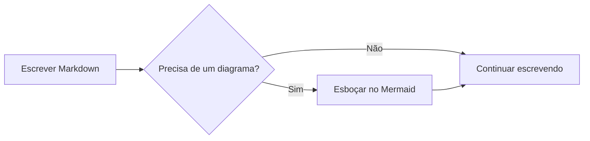
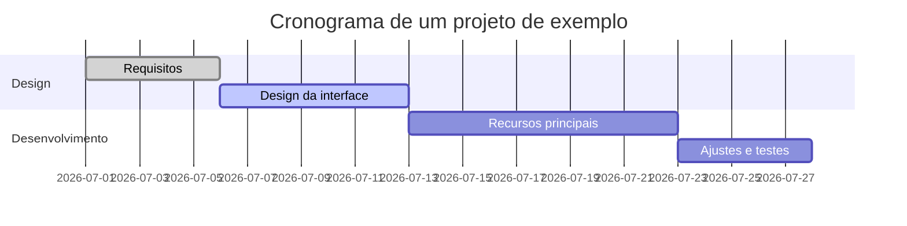
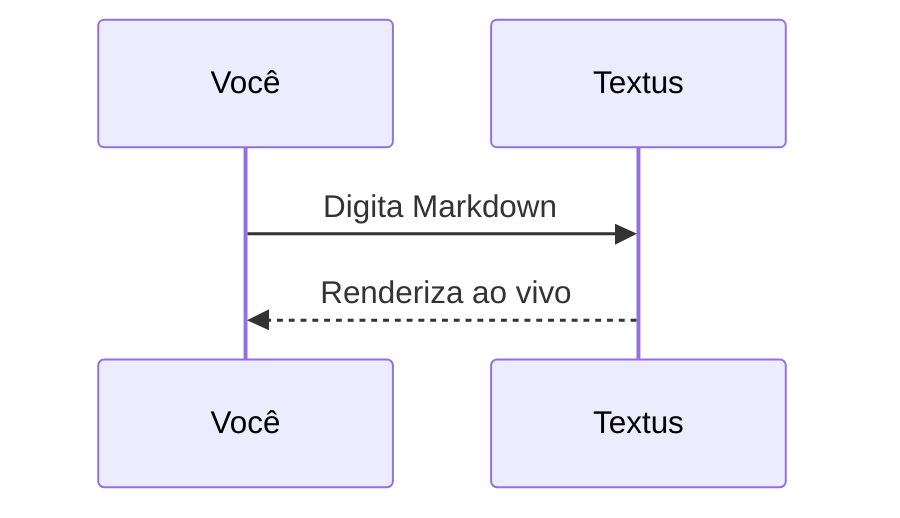

# Guia de Markdown do Textus

Este documento integrado mostra a renderização de Markdown que o Textus oferece. É só um rascunho não salvo: edite e experimente à vontade e depois feche sem salvar.

> [!TIP]
> Pressione `Cmd+/` para alternar entre o modo WYSIWYG e o modo código-fonte e ver a sintaxe por trás de qualquer exemplo deste guia.

## Títulos e citações

Digite `#` e um espaço no início de uma linha para criar um título de nível 1, ou `##` e um espaço para o nível 2. Os títulos acima mostram o resultado renderizado. `Ctrl+1` a `Ctrl+6` (`Cmd+1` a `Cmd+6` no Mac) transformam a linha atual em um título desse nível.

Uma citação:

> O texto citado pode conter outras marcações, como **negrito** e `código`.

Alertas no estilo do GitHub:

> [!NOTE]
> Uma nota, para dar mais contexto.

> [!WARNING]
> Um aviso, para pontos que pedem atenção.

## Estilos de texto

**Negrito** (`**texto**`), *itálico* (`*texto*`), ***negrito e itálico***, ~~tachado~~ (`~~texto~~`), ==destaque== (`==texto==`) e `código no texto`.

Ao digitar `(`, `[`, `{`, aspas ou um parêntese de um método de entrada chinês ou japonês, como `（`, `【` ou `「`, o par de fechamento entra depois do cursor: digitar o fechamento passa por cima dele, Backspace logo depois da abertura apaga os dois e, com texto selecionado, o par o envolve. **Ajustes → Editor e aparência → Fechar (), [] e “”** desativa isso.

Links ficam assim: [o repositório do Textus](https://github.com/CatVinci-Studio/Textus). Ctrl/⌘+clique segue um link: um link da web abre no navegador, um link para outro arquivo Markdown o abre em uma aba e um link para `#um-titulo` rola até ele. Um clique simples põe o cursor no link e mostra seu Markdown, `[texto](url)`, para editar ali mesmo; quando o cursor sai, ele volta a ser um link. HTML no meio do texto também é renderizado, por exemplo as teclas <kbd>Cmd</kbd> + <kbd>S</kbd>. Também funcionam blocos recolhíveis `<details>`, tabelas HTML, alguns estilos inline (cor, fundo, tamanho, peso, alinhamento, sublinhado e tachado) e `<svg>` no meio do texto, que aparece como imagem. Scripts e o resto do HTML ficam como código-fonte. Um link para um título em outro arquivo, como `[veja](notas.md#um-titulo)`, abre esse arquivo nesse título. Os wikilinks do Obsidian (`[[Nota]]`, `[[Nota|texto]]` e `[[Nota#Título]]`) abrem do mesmo jeito, a partir da pasta do documento ou de qualquer lugar do cofre; eles e as `#tags` no início de uma linha são salvos exatamente como foram escritos.

**Ajustes → Editor e aparência → Amostras antes dos códigos de cor** põe um quadradinho da cor antes de um código de cor. **Só no código** mostra-o no código em linha que é uma cor, como `#0af` ou `rgb(0 128 255)`, e antes dos valores de cor dos blocos de código; **Em todo o texto**, também antes dos escritos no texto com seis ou oito dígitos, como #ff8800, ou como função de cor, como hsl(210 100% 50%). Códigos curtos no texto, etiquetas como #cafe, números como #234 e links ficam como estão.

Fórmulas no texto: a equivalência massa-energia $E = mc^2$ e a identidade de Euler $e^{i\pi} + 1 = 0$.

## Listas

- Lista não ordenada
- Com aninhamento
  - Um item de segundo nível
  - Mais um

1. Lista ordenada
2. Segundo item

Lista de tarefas (clique em uma caixa de seleção para marcá-la ou desmarcá-la):

- [x] Algo já feito
- [ ] Algo a fazer

## Tabelas

| Recurso | Sintaxe | Resultado |
| --- | --- | --- |
| Negrito | `**texto**` | **texto** |
| Destaque | `==texto==` | ==texto== |
| Fórmula no texto | `$x^2$` | $x^2$ |

Passe o ponteiro sobre uma tabela para adicionar ou remover linhas e colunas. Digite `| Nome | Idade |` e pressione Enter para criar uma tabela. Enter desce uma linha, cria uma nova quando você está na última e, em uma linha nova deixada vazia, sai da tabela; Ctrl/⌘+Enter sai a qualquer momento. Em uma tabela, Tab e Shift+Tab vão para a célula seguinte e a anterior, e Shift+Enter começa uma nova linha dentro da célula.

## Blocos de código

Blocos de código delimitados, com realce de sintaxe (troque a linguagem no canto superior direito do bloco). Enter na última linha, quando ela está vazia, sai do bloco, assim como Ctrl/⌘+Enter a qualquer momento; o mesmo vale para as citações. **Copiar** e **Selecionar Tudo**, ao lado da linguagem, copiam ou selecionam o código do bloco, e **Ajustes → Editor e aparência → Números de linha nos blocos de código** numera as linhas; nenhum dos dois aparece nas exportações nem na impressão.

```python
def fib(n: int) -> int:
    """A clássica sequência de Fibonacci."""
    a, b = 0, 1
    for _ in range(n):
        a, b = b, a + b
    return a
```

```rust
fn main() {
    let greeting = "Olá, Textus!";
    println!("{greeting}");
}
```

## Blocos de fórmulas

Fórmulas em bloco, entre `$$`, são renderizadas pelo KaTeX:

$$
\int_{-\infty}^{\infty} e^{-x^2} \, dx = \sqrt{\pi}
$$

## Diagramas (Mermaid)

Um bloco de código ```` ```mermaid ```` vira um diagrama ao vivo. Um fluxograma:



Um gráfico de Gantt:



Um diagrama de sequência:



**Ajustes → Editor e aparência → Motor de diagramas** escolhe quem desenha esses blocos: o Mermaid, padrão, ou o Pele, mais rápido, mas que organiza os diagramas do seu próprio jeito e deixa de fora alguns recursos; um diagrama que o Pele não consegue desenhar é desenhado pelo Mermaid.

## Imagens

Cole uma imagem direto da área de transferência: o Textus a salva e insere a referência. O destino se escolhe em **Ajustes → Editor e aparência → Imagens**. **Neste computador**, é uma **Subpasta** da pasta do documento, `assets/` por padrão, cujo nome você pode mudar, ou **A mesma pasta do documento**; os ajustes mostram o link que a imagem colada recebe. Com **Enviar para uma hospedagem de imagens**, ela vai para PicGo / PicList, SM.MS, Imgur ou um endpoint seu (**Personalizado**).

Um endpoint personalizado recebe `multipart/form-data` com um campo `file` e pode devolver a URL pública como texto simples ou em um campo JSON configurável. Os arquivos enviados podem ser renomeados automaticamente, manter o nome original ou pedir um nome antes de cada envio. As referências a imagens que já existem nunca mudam quando você troca o modo de armazenamento.

Ou escreva a referência à mão:

```markdown

```

Incorporações do Obsidian, como `![[image.png]]` ou `![[attachments/image.png|300]]`, também mostram a imagem: o Textus procura o arquivo no cofre do Obsidian ao qual o documento pertence e salva a incorporação exatamente como foi escrita.

Para ver uma imagem de perto, clique duas vezes nela ou clique em **Ampliar imagem** no canto superior direito (os diagramas têm o mesmo botão): role ou faça o gesto de pinça para dar zoom, arraste para mover, clique duas vezes para ajustá-la de novo e pressione `Esc` para fechar. Arraste a alça na borda direita de uma imagem para redimensioná-la. **Ajustes → Editor e aparência → Imagens em linha própria** coloca as imagens que ficam sozinhas numa linha no centro ou à esquerda, no editor e nas exportações em HTML e PDF.

## Copiar e colar

**Copiar** põe o Markdown no texto simples da área de transferência e a formatação ao lado, de modo que GitHub, Obsidian, VS Code e apps de chat recebem Markdown, enquanto Word, Pages, e-mail e Notion colam o texto formatado. Uma imagem que você copia com o botão direito vai para a área de transferência como a própria imagem, pronta para colar num chat ou num documento. **Editar → Colar como texto simples** (`Cmd+Shift+V`) cola o texto da área de transferência exatamente como está, sem interpretar o Markdown que houver nele.

## Visualizações e modos

Além do editor WYSIWYG e do modo código-fonte (`Cmd+/`), o Textus tem três maneiras de escrever (no Windows e no Linux, use `Ctrl` no lugar de `Cmd`; Ajustes → Atalhos mostra as combinações atuais):

- **Código e pré-visualização** (`Cmd+Shift+E`): o código-fonte Markdown à esquerda e a prévia renderizada à direita, rolando juntos.
- **Modo máquina de escrever**: a linha que você está digitando fica no meio da janela, no editor, no modo código-fonte e em Código e pré-visualização.
- **Modo zen** (`Cmd+Shift+J`): esconde tudo menos o texto e esmaece todos os parágrafos, menos o que você está escrevendo. Pressione `Esc` para sair.

Todos estão no menu **Visualizar** e em **Ajustes → Editor e aparência → Visualização**. Cada um é um único ajuste para todo o Textus: mude em qualquer janela e todas as abas de todas as janelas mudam junto, os documentos que você abrir em seguida aparecem nele, e o Textus volta a abrir nele da próxima vez.

**Visualizar → Só leitura** (também no menu de contexto de uma aba) impede que um documento seja alterado, seja digitando, colando, soltando, desfazendo, pela Textus AI ou por plugins. Um cadeado ao lado do título indica isso; clique nele para tornar o documento editável de novo.

**Visualizar → Paleta de comandos…** (`Cmd+Shift+P`) encontra tudo o que os menus fazem, e cada comando que um plugin adiciona, digitando algumas letras do nome. Ela também muda a aparência (clara, escura ou a do sistema) e o tema do editor, e liga ou desliga a Textus AI.

A aba **Estrutura** da barra lateral lista os títulos do documento; clique em um para ir até ele. Clique com o botão direito na estrutura para **Expandir tudo** e **Recolher tudo**, ou clique com `Option` (`Alt`) na seta de um título para recolher ou expandir todos de uma vez.

**Ajustes → Editor e aparência → Tamanho do texto da interface** aumenta ou diminui o texto da barra lateral, das abas, dos menus, do painel de IA e dos Ajustes; o documento mantém o próprio zoom. `Ctrl+Tab` e `Ctrl+Shift+Tab` vão para a próxima aba e para a anterior.

## Vários documentos ao mesmo tempo

**Visualizar → Dividir à direita** (`Cmd+Option+S`) mostra o documento em primeiro plano ao lado de outro, e **Visualizar → Dividir para baixo** coloca um acima do outro. Cada painel tem as próprias abas: um documento que você abre vai para o painel em que você está, e Dividir à direita ou Dividir para baixo dividem esse painel de novo, quantas vezes você quiser.

- Arraste uma aba (ou um arquivo da barra lateral) até a borda de um painel, e ela abre em um novo painel desse lado. Arraste até a borda externa do editor e ela abre ao lado de todos os painéis: na borda direita de dois painéis um acima do outro, ela ocupa o lado direito de cima a baixo. Solte-a sobre as abas de outro painel para movê-la para lá.
- Arraste a linha entre dois painéis para redimensioná-los; clique duas vezes nela para deixá-los iguais. Clique com o botão direito nela para passá-los de lado a lado para um acima do outro, trocá-los de lugar ou fechar a divisão.
- **Abrir ao lado**, no menu de contexto de uma aba, mostra-a ao lado da que está em primeiro plano.
- Feche a última aba de um painel e o painel some. O layout inteiro volta quando você reabre o Textus.

## Abas e janelas

`Cmd+T` abre uma nova aba, `Cmd+N` uma nova janela, e **Arquivo → Reabrir Aba Fechada** (`Cmd+Shift+T`) traz de volta os documentos que você fechou, do mais recente para o mais antigo. Um clique com o botão do meio fecha uma aba; o menu de contexto de uma aba tem **Fechar as outras**, **Fechar abas à esquerda** e **Fechar abas à direita** (abas com alterações não salvas continuam abertas), **Copiar caminho** e **Mover para nova janela**. Você também pode arrastar uma aba para fora da janela para dar a ela uma janela própria. Quando o Textus reabre, cada janela volta com as suas próprias abas.

## Pastas e busca de arquivos

**Arquivo → Abrir Pasta…** abre uma pasta inteira na barra lateral: a árvore de arquivos fica nela enquanto você abre documentos lá dentro, a pasta volta com a sua sessão e **Arquivo → Fechar Pasta** faz a árvore voltar a acompanhar o documento. A caixa no topo da aba **Arquivos** da barra lateral busca nomes de arquivo na pasta inteira; `Cmd+Shift+O` leva direto a ela. Digite para filtrar, use `↑`/`↓` para se mover, `Enter` para abrir e `Esc` para limpar. Os dois recursos são só do desktop.

A árvore também é um pequeno gerenciador de arquivos. O nome da pasta superior, acima dela, leva você um nível acima. **Ordenar** a organiza por nome ou por data de modificação, e o filtro ao lado da caixa de busca, **Todos os arquivos** ou **Só documentos**, vale para a árvore e para a busca. Clique com o botão direito em uma pasta, um arquivo ou no espaço vazio abaixo para criar ali um **Novo documento** ou uma **Nova pasta**, e arraste um arquivo ou uma pasta sobre outra pasta para movê-lo; um documento aberto vai junto para o novo lugar. Nada é substituído: um nome já usado é recusado.

Arraste arquivos do Finder ou do Explorador de Arquivos para a janela para abri-los: documentos abrem em abas, imagens entram no documento onde você as solta e uma pasta abre na barra lateral. **Arquivo → Copiar caminho** copia o caminho completo do documento em primeiro plano.

Num terminal, `textus notas.md` abre um arquivo no Textus; **Ajustes → Geral** instala o comando `textus` se ele ainda não estiver lá.

**Arquivo → Abrir…** também abre um documento do Word (`.docx`), assim como soltá-lo na janela: ele vira um novo documento Markdown com o mesmo nome, ainda não salvo, com seus títulos, listas, tabelas, links, notas de rodapé e imagens. As imagens vão, ao salvar, para onde **Ajustes → Editor e aparência → Imagens** coloca as coladas, e **Salvar** sugere um arquivo `.md` ao lado do arquivo do Word. Parte da formatação pode ficar diferente; o arquivo do Word nunca é alterado. Só no computador.

## Continuar em segundo plano

Ative **Ajustes → Geral → Aplicativo → Continuar em segundo plano** e, ao fechar a última janela, o Textus continua aberto, com o ícone na área de notificação (Windows), na bandeja do sistema (Linux) ou na barra de menus (Mac). **Abrir o Textus** no menu do ícone traz seus documentos de volta; **Encerrar Textus** ali encerra o Textus de vez. O GNOME só mostra o ícone de bandeja com a extensão AppIndicator.

## Exportar

**Arquivo → Exportar** salva o documento como HTML ou PDF; com o [Pandoc](https://pandoc.org) instalado, também como Word (`.docx`), OpenDocument, RTF, EPUB, LaTeX e outros. No Mac, **Ajustes → Editor e aparência → Exportar PDFs em cores claras** gera um PDF em fundo branco com as cores claras do seu tema, mesmo enquanto você escreve no modo escuro.

## Plugins, temas e habilidades

**Ajustes → Extensões → Obter mais** lista plugins, temas e habilidades para adicionar: teclas do Vim e do Emacs, um leitor de PDF, gráficos, um grafo de conhecimento, ferramentas de escrita e mais. Cada um tem um só botão (**Instalar**, depois **Atualizar**, **Desativar** ou **Ativar**) e **Desinstalar** no menu ao lado. A página de um plugin mostra como usá-lo, e os comandos dele aparecem no menu **Plugins** e na paleta de comandos.

## Obter ajuda

**Ajuda → Relatar um problema…** (também em **Ajustes → Geral**, em Ajuda) abre um formulário curto. Diga que tipo de relato é, de que parte do Textus se trata e, para um bug, qual a gravidade, e depois o que deu errado; o Textus acrescenta a versão dele, o seu sistema, os seus plugins, os seus ajustes sem nada privado e os erros recentes, tudo mostrado antes de qualquer envio. **Enviar** registra o relato como issue no GitHub para você, sem precisar de conta no GitHub, e informa o número; **Enviar no GitHub** abre o formulário do GitHub em vez disso; **Copiar** coloca tudo na área de transferência para um chat ou um e-mail. O que você escreve vira uma issue pública; um e-mail ou WeChat que você deixar, caso possamos perguntar mais, vai só para a equipe.

**Ajustes → Geral → Ajuda** também reabre o tutorial de boas-vindas, abre os guias e leva a **Sobre o Textus**, com a versão e **Verificar Atualizações** (no Mac, também **Textus → Verificar Atualizações…**). **Ajuda → Participe da comunidade** abre a página da comunidade.

## Notas de rodapé e linhas horizontais

Notas de rodapé ficam assim[^1], e logo abaixo há uma linha horizontal:

---

[^1]: O conteúdo das notas de rodapé fica reunido no fim do documento.

Boa escrita!
