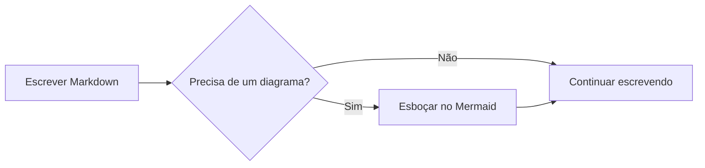
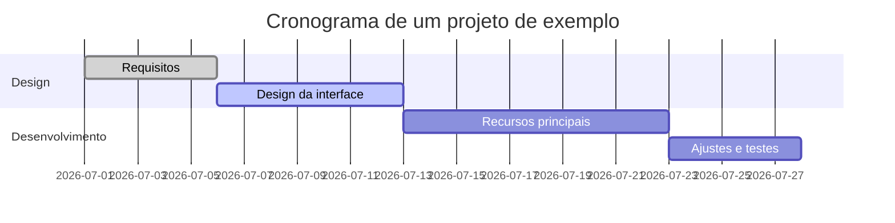
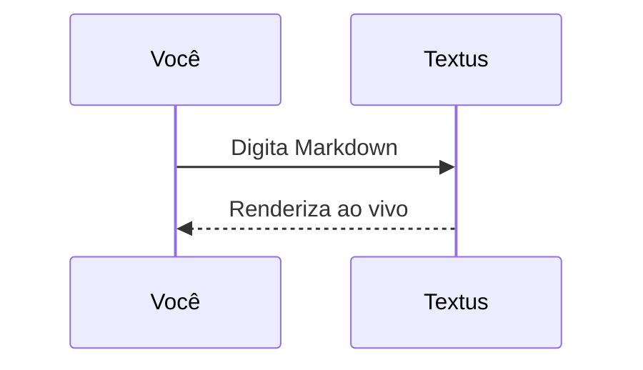

# Guia de Markdown do Textus

Este documento integrado mostra a renderização de Markdown que o Textus oferece. É só um rascunho não salvo: edite e experimente à vontade e depois feche sem salvar.

> [!TIP]
> Pressione `Cmd+/` para alternar entre o modo WYSIWYG e o modo código-fonte e ver a sintaxe por trás de qualquer exemplo deste guia.

## Títulos e citações

Digite `#` e um espaço no início de uma linha para criar um título de nível 1, ou `##` e um espaço para o nível 2. Os títulos acima mostram o resultado renderizado.

Uma citação:

> O texto citado pode conter outras marcações, como **negrito** e `código`.

Alertas no estilo do GitHub:

> [!NOTE]
> Uma nota, para dar mais contexto.

> [!WARNING]
> Um aviso, para pontos que pedem atenção.

## Estilos de texto

**Negrito** (`**texto**`), *itálico* (`*texto*`), ***negrito e itálico***, ~~tachado~~ (`~~texto~~`), ==destaque== (`==texto==`) e `código no texto`.

Links ficam assim: [o repositório do Textus](https://github.com/CatVinci-Studio/Textus). Ctrl/⌘+clique segue um link: um link da web abre no navegador, um link para outro arquivo Markdown o abre em uma aba e um link para `#um-titulo` rola até ele. HTML no meio do texto também é renderizado, por exemplo as teclas <kbd>Cmd</kbd> + <kbd>S</kbd>. Também funcionam blocos recolhíveis `<details>`, tabelas HTML, alguns estilos inline (cor, fundo, tamanho, peso, alinhamento, sublinhado e tachado) e `<svg>` no meio do texto, que aparece como imagem. Scripts e o resto do HTML ficam como código-fonte.

Fórmulas no texto: a equivalência massa-energia $E = mc^2$ e a identidade de Euler $e^{i\pi} + 1 = 0$.

## Listas

- Lista não ordenada
- Com aninhamento
  - Um item de segundo nível
  - Mais um

1. Lista ordenada
2. Segundo item

Lista de tarefas (clique em uma caixa de seleção para marcá-la ou desmarcá-la):

- [x] Algo já feito
- [ ] Algo a fazer

## Tabelas

| Recurso | Sintaxe | Resultado |
| --- | --- | --- |
| Negrito | `**texto**` | **texto** |
| Destaque | `==texto==` | ==texto== |
| Fórmula no texto | `$x^2$` | $x^2$ |

Passe o ponteiro sobre uma tabela para adicionar ou remover linhas e colunas. Digite `| Nome | Idade |` e pressione Enter para criar uma tabela. Enter desce uma linha, cria uma nova quando você está na última e, em uma linha nova deixada vazia, sai da tabela; Ctrl/⌘+Enter sai a qualquer momento.

## Blocos de código

Blocos de código delimitados, com realce de sintaxe (troque a linguagem no canto superior direito do bloco). Enter na última linha, quando ela está vazia, sai do bloco, assim como Ctrl/⌘+Enter a qualquer momento; o mesmo vale para as citações.

```python
def fib(n: int) -> int:
    """A clássica sequência de Fibonacci."""
    a, b = 0, 1
    for _ in range(n):
        a, b = b, a + b
    return a
```

```rust
fn main() {
    let greeting = "Olá, Textus!";
    println!("{greeting}");
}
```

## Blocos de fórmulas

Fórmulas em bloco, entre `$$`, são renderizadas pelo KaTeX:

$$
\int_{-\infty}^{\infty} e^{-x^2} \, dx = \sqrt{\pi}
$$

## Diagramas (Mermaid)

Um bloco de código ```` ```mermaid ```` vira um diagrama ao vivo. Um fluxograma:



Um gráfico de Gantt:



Um diagrama de sequência:



## Imagens

Cole uma imagem direto da área de transferência: o Textus a salva e insere a referência. O destino se escolhe em **Ajustes → Editor e aparência → Imagens**. **Neste computador**, é uma **Subpasta** da pasta do documento, `assets/` por padrão, cujo nome você pode mudar, ou **A mesma pasta do documento**; os ajustes mostram o link que a imagem colada recebe. Com **Enviar para uma hospedagem de imagens**, ela vai para PicGo / PicList, SM.MS, Imgur ou um endpoint seu (**Personalizado**).

Um endpoint personalizado recebe `multipart/form-data` com um campo `file` e pode devolver a URL pública como texto simples ou em um campo JSON configurável. Os arquivos enviados podem ser renomeados automaticamente, manter o nome original ou pedir um nome antes de cada envio. As referências a imagens que já existem nunca mudam quando você troca o modo de armazenamento.

Ou escreva a referência à mão:

```markdown

```

Incorporações do Obsidian, como `![[image.png]]` ou `![[attachments/image.png|300]]`, também mostram a imagem: o Textus procura o arquivo no cofre do Obsidian ao qual o documento pertence e salva a incorporação exatamente como foi escrita.

## Visualizações e modos

Além do editor WYSIWYG e do modo código-fonte (`Cmd+/`), o Textus tem três maneiras de escrever (no Windows e no Linux, use `Ctrl` no lugar de `Cmd`; Ajustes → Atalhos mostra as combinações atuais):

- **Visualização dividida** (`Cmd+Shift+E`): o código-fonte Markdown à esquerda e a prévia renderizada à direita, rolando juntos.
- **Modo máquina de escrever** (Ajustes → Editor e aparência → Visualização): a linha que você está digitando fica no meio da janela, no editor, no modo código-fonte e na visualização dividida.
- **Modo zen** (`Cmd+Shift+J`): esconde tudo menos o texto, entra em tela cheia e esmaece todos os parágrafos, menos o que você está escrevendo. Pressione `Esc` para sair.

Os três também estão no menu **Visualizar**.

## Notas rápidas

**Arquivo → Nova nota rápida** abre uma janela pequena para anotar algo na hora. Pressione `Esc` (ou `Cmd+Enter`, `Cmd+S`, `Cmd+W`) e a nota é salva e a janela fecha; uma nota vazia simplesmente fecha. **Abrir no Textus** salva a nota e a abre numa aba.

As notas vão para `Textus/Notas rápidas` na sua pasta Documentos, um arquivo por nota, com o nome da primeira linha. Em **Ajustes → Geral → Notas rápidas** você pode escolher outra pasta, usar **um arquivo por dia** e ativar um **atalho global** que abre uma nota rápida em qualquer app: `Control+Option+N` no Mac, `Ctrl+Alt+N` no Linux, `Win+Alt+N` no Windows. Abrir outra poucos minutos depois continua a última nota. No Wayland, associe o comando `textus --quick-note` mostrado ali a uma tecla nas configurações do seu desktop.

Para ter o Textus à mão mesmo sem janelas abertas, ative **Ajustes → Geral → Segundo plano → Continuar em segundo plano**: ao fechar a última janela, o Textus continua aberto, com um ícone na área de notificação (Windows), na bandeja do sistema (Linux) ou na barra de menus (Mac). O menu do ícone abre uma nova nota rápida, seus documentos, a pasta de notas rápidas e os ajustes; **Encerrar Textus** ali encerra o Textus de vez. **Abrir ao iniciar sessão** o inicia assim ao iniciar sessão. O GNOME só mostra o ícone de bandeja com a extensão AppIndicator.

## Notas de rodapé e linhas horizontais

Notas de rodapé ficam assim[^1], e logo abaixo há uma linha horizontal:

---

[^1]: O conteúdo das notas de rodapé fica reunido no fim do documento.

Boa escrita!
