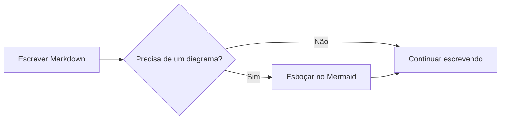
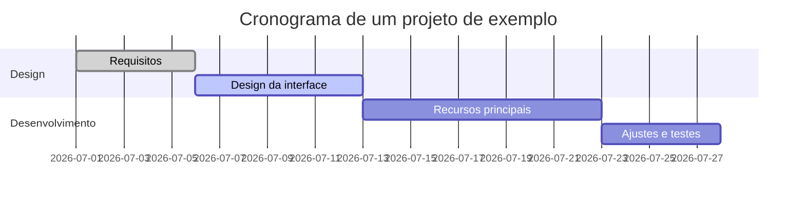
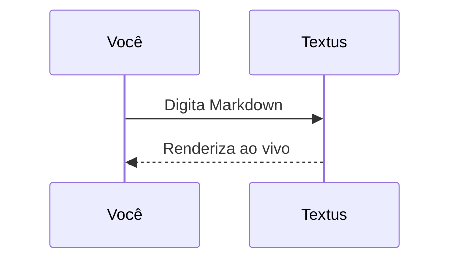

# Guia de Markdown do Textus

Este guia também é um documento que você pode alterar: cinco minutos para o que você mais vai usar e, depois, o resto conforme o que você quiser fazer. Quando terminar, feche sem salvar.

> [!TIP]
> Pressione `Cmd+/` (`Ctrl+/` no Windows e no Linux) para passar ao código-fonte e ver como cada exemplo foi escrito.

## Cinco minutos para começar

O Markdown marca a formatação com alguns poucos símbolos, e o Textus dá forma a eles enquanto você digita. No início de uma linha, digite:

- `# ` e algumas palavras: um título; `## `: um menor.
- `- `: uma lista; `1. `: uma lista numerada; `- [ ] `: uma tarefa.
- `> `: uma citação.

Em volta das palavras: `**negrito**`, `*itálico*`, `==destaque==`, `` `código` ``. Um link é `[palavras](https://example.com)`; para uma imagem, basta colá-la.

Prefere não decorar os símbolos? Use a **barra de formatação** acima do documento, ou clique com o botão direito no texto selecionado. Não encontra alguma coisa? Pressione `Cmd+Shift+P` para abrir a paleta de comandos e digite algumas letras.

## Escrever textos longos

**Recuo da primeira linha** (Ajustes › Edição › Texto) recua em dois caracteres a primeira linha de cada parágrafo; listas, citações e tabelas ficam como estão.

### Maneiras de escrever e modos

Além do editor WYSIWYG e do modo código-fonte (`Cmd+/`), o Textus tem três maneiras de escrever (no Windows e no Linux, use `Ctrl` no lugar de `Cmd`; Ajustes › Atalhos mostra as combinações atuais):

- **Código e pré-visualização** (`Cmd+Shift+E`): o código-fonte Markdown à esquerda e a prévia renderizada à direita, rolando juntos.
- **Modo Máquina de Escrever**: a linha que você está digitando fica no meio da janela, no editor, no modo código-fonte e em Código e pré-visualização.
- **Modo Zen** (`Cmd+Shift+J`): esconde tudo menos o documento em que você está e esmaece todos os parágrafos, menos o que você está escrevendo. O × no canto superior direito, ou o mesmo atalho, sai dele.

Todos estão no menu **Visualizar** (**Visualizar › Modo** para os dois primeiros) e no grupo **Visualização** de **Ajustes › Edição › Texto**. Cada um é um único ajuste para todo o Textus: mude em qualquer janela e todas as abas de todas as janelas mudam junto, os documentos que você abrir em seguida aparecem nele, e o Textus volta a abrir nele da próxima vez.

**Visualizar › Modo › Modo leitura** (também no menu de contexto de uma aba) impede que um documento seja alterado, seja digitando, colando, soltando, desfazendo, pela Textus AI ou por plugins. Um cadeado ao lado do título indica isso; clique nele para permitir alterações de novo.

**Visualizar › Paleta de comandos…** (`Cmd+Shift+P`) encontra tudo o que os menus fazem, e cada comando que um plugin adiciona, digitando algumas letras do nome. Ela também muda a aparência (clara, escura ou a do sistema) e o tema do editor, e liga ou desliga a Textus AI. **Editar › Buscar e Substituir…** (`Cmd+F`) procura no documento, **Editar › Substituir…** (`Cmd+Option+F`) abre a barra com a linha de substituição e `Cmd+G` vai para a próxima ocorrência.

O painel **Estrutura** da barra lateral lista os títulos do documento; clique em um para ir até ele. Clique com o botão direito na estrutura para **Expandir tudo** e **Recolher tudo**, ou clique com `Option` (`Alt`) na seta de um título para recolher ou expandir todos de uma vez.

**Tamanho do texto da interface** (Ajustes › Aparência) aumenta ou diminui o texto da barra lateral, das abas, dos menus, das abas de IA e dos Ajustes; cada documento mantém o próprio zoom (`Cmd+=`, `Cmd+-`). `Ctrl+Tab` e `Ctrl+Shift+Tab` vão para a próxima aba e para a anterior.

### Notas de rodapé, linhas e sumário

Notas de rodapé ficam assim[^1], e logo abaixo há uma linha horizontal:

---

[^1]: O conteúdo das notas de rodapé fica reunido no fim do documento.

Digite `[TOC]` sozinho numa linha e pressione Enter para inserir um sumário: ele lista os títulos do documento e acompanha o que você escreve; clique num item para ir até ele.

## Tabelas, código, fórmulas e diagramas

### Tabelas

| Recurso | Sintaxe | Resultado |
| --- | --- | --- |
| Negrito | `**texto**` | **texto** |
| Destaque | `==texto==` | ==texto== |
| Fórmula no texto | `$x^2$` | $x^2$ |

Passe o ponteiro sobre uma tabela para adicionar ou remover linhas e colunas. Digite `| Nome | Idade |` e pressione Enter para criar uma tabela. Enter desce uma linha, cria uma nova quando você está na última e, em uma linha nova deixada vazia, sai da tabela; Ctrl/⌘+Enter sai a qualquer momento. Em uma tabela, Tab e Shift+Tab vão para a célula seguinte e a anterior, e Shift+Enter começa uma nova linha dentro da célula.

### Blocos de código

Blocos de código delimitados, com realce de sintaxe (troque a linguagem no canto superior direito do bloco). Enter na última linha, quando ela está vazia, sai do bloco, assim como Ctrl/⌘+Enter a qualquer momento; o mesmo vale para as citações. **Copiar** e **Selecionar Tudo**, ao lado da linguagem, copiam ou selecionam o código do bloco, e **Números de linha nos blocos de código** (Ajustes › Edição › Texto) numera as linhas; nenhum dos dois aparece nas exportações nem na impressão.

```python
def fib(n: int) -> int:
    """A clássica sequência de Fibonacci."""
    a, b = 0, 1
    for _ in range(n):
        a, b = b, a + b
    return a
```

```rust
fn main() {
    let greeting = "Olá, Textus!";
    println!("{greeting}");
}
```

### Blocos de fórmulas

Fórmulas em bloco, entre `$$`, são renderizadas pelo KaTeX:

$$
\int_{-\infty}^{\infty} e^{-x^2} \, dx = \sqrt{\pi}
$$

### Diagramas (Mermaid)

Um bloco de código ```` ```mermaid ```` vira um diagrama ao vivo. Um fluxograma:



Um gráfico de Gantt:



Um diagrama de sequência:



**Motor de diagramas** (Ajustes › Edição › Texto) escolhe quem desenha esses blocos: o Mermaid, padrão, ou o Pele, mais rápido, mas que organiza os diagramas do seu próprio jeito e deixa de fora alguns recursos; um diagrama que o Pele não consegue desenhar é desenhado pelo Mermaid.

As cores seguem a aparência — uma paleta cinza e sóbria no claro e a escura no escuro — e um tema importado ou o CSS personalizado pode escolher outra paleta interna com `--doc-mermaid-theme: forest`.

## Imagens e colar

### Imagens

Cole uma imagem direto da área de transferência: o Textus a salva e insere a referência. O destino se escolhe em **Ajustes › Edição › Imagens**. **Neste computador**, é uma **Subpasta** da pasta do documento, `assets/` por padrão, cujo nome você pode mudar; a outra opção é **A mesma pasta do documento**. Os Ajustes mostram o link que a imagem colada recebe. Com **Enviar para uma hospedagem de imagens**, ela vai para PicGo / PicList, SM.MS, Imgur ou um endpoint seu (**Personalizado**).

Um endpoint personalizado recebe `multipart/form-data` com um campo `file` e pode devolver a URL pública como texto simples ou em um campo JSON configurável. Os arquivos enviados podem ser renomeados automaticamente, manter o nome original ou pedir um nome antes de cada envio. As referências a imagens que já existem nunca mudam quando você troca o modo de armazenamento.

Ou escreva a referência à mão:

```markdown

```

Incorporações do Obsidian, como `![[image.png]]` ou `![[attachments/image.png|300]]`, também mostram a imagem: o Textus procura o arquivo no cofre do Obsidian ao qual o documento pertence e salva a incorporação exatamente como foi escrita.

Para ver uma imagem de perto, clique duas vezes nela ou clique em **Ampliar imagem** no canto superior direito (os diagramas têm o mesmo botão): role ou faça o gesto de pinça para dar zoom, arraste para mover, clique duas vezes para ajustá-la de novo e pressione `Esc` para fechar. Arraste a alça na borda direita de uma imagem para redimensioná-la. **Imagens em linha própria** (Ajustes › Edição › Imagens) coloca as imagens que ficam sozinhas numa linha no centro ou à esquerda, no editor e nas exportações em HTML e PDF.

### Copiar e colar

**Copiar** põe o Markdown no texto simples da área de transferência e a formatação ao lado, de modo que GitHub, Obsidian, VS Code e apps de chat recebem Markdown, enquanto Word, Pages, e-mail e Notion colam o texto formatado. Uma imagem que você copia com o botão direito vai para a área de transferência como a própria imagem, pronta para colar num chat ou num documento. **Editar › Colar como texto simples** (`Cmd+Shift+V`) cola o texto da área de transferência exatamente como está, sem interpretar o Markdown que houver nele.

## Arquivos e pastas

### Pastas e busca

**Arquivo › Abrir Pasta…** abre uma pasta inteira na barra lateral: a árvore de arquivos fica nela enquanto você abre documentos lá dentro, a pasta volta com a sua sessão e **Arquivo › Fechar Pasta** faz a árvore voltar a acompanhar o documento. O painel **Pesquisar** (a lupa na barra de atividades, ou `Cmd+Shift+O`) encontra arquivos pelo nome e linhas pelas palavras em toda a pasta; clique numa linha para abrir o documento ali. Os dois recursos são só do desktop.

A árvore também é um pequeno gerenciador de arquivos. O nome da pasta superior, acima dela, leva você um nível acima. O menu dela a organiza por nome ou por data de modificação e mostra **Todos os arquivos** ou **Só documentos**. Clique com o botão direito em uma pasta, um arquivo ou no espaço vazio abaixo para criar ali um **Novo documento** ou uma **Nova pasta**, e arraste um arquivo ou uma pasta sobre outra pasta para movê-lo; um documento aberto vai junto para o novo lugar. Nada é substituído: um nome já usado é recusado.

Arraste arquivos do Finder ou do Explorador de Arquivos para a janela para abri-los: documentos abrem em abas, imagens entram no documento onde você as solta e uma pasta abre na barra lateral. **Arquivo › Copiar caminho** copia o caminho completo do documento em primeiro plano.

Num terminal, `textus notas.md` abre um arquivo no Textus; **Ajustes › Geral** instala o comando `textus` se ele ainda não estiver lá. Ele faz mais sem abrir janela: `textus search <palavras>` as encontra nos arquivos de uma pasta, `textus read` mostra um PDF ou arquivo do Word como Markdown e `textus help` lista todos os comandos, inclusive os dos plugins.

**Arquivo › Abrir…** também abre um documento do Word (`.docx`), assim como soltá-lo na janela: ele vira um novo documento Markdown com o mesmo nome, ainda não salvo, com seus títulos, listas, tabelas, links, notas de rodapé e imagens. As imagens vão, ao salvar, para onde **Ajustes › Edição › Imagens** coloca as coladas, e **Salvar** sugere um arquivo `.md` ao lado do arquivo do Word. Parte da formatação pode ficar diferente; o arquivo do Word nunca é alterado. Só no desktop.

### Exportar

**Arquivo › Exportar** salva o documento como HTML ou PDF; com o [Pandoc](https://pandoc.org) instalado, também como Word (`.docx`), OpenDocument, RTF, EPUB, LaTeX e outros. No Mac, **Exportar PDFs em cores claras** (Ajustes › Edição › Exportar) gera um PDF em fundo branco com as cores claras do seu tema, mesmo enquanto você escreve no modo escuro.

### Continuar em segundo plano

Ative **Ajustes › Geral › Aplicativo › Continuar em segundo plano** e, ao fechar a última janela, o Textus continua aberto, com o ícone na área de notificação (Windows), na bandeja do sistema (Linux) ou na barra de menus (Mac). **Abrir Textus** no menu do ícone traz seus documentos de volta; **Encerrar Textus** ali encerra o Textus de vez. O GNOME só mostra o ícone de bandeja com a extensão AppIndicator.

## A janela

### O que há na janela

Da esquerda para a direita:

- **A barra de atividades**: a coluna de ícones. **Arquivos** (a árvore de arquivos), **Estrutura** (os títulos do documento), **Pesquisar** (em toda a pasta), **Plugins** e depois os painéis que os plugins adicionam. **Ajustes** (a engrenagem) fica no pé. Clique em um ícone para abrir o painel dele na barra lateral; clique de novo para fechar a barra lateral. Arraste os ícones para reordená-los; clique com o botão direito para mostrá-los ou ocultá-los.
- **A barra lateral**: um painel por vez. `Cmd+\` ou o botão da barra lateral no topo mostra e oculta a barra; arraste a borda dela para alargá-la.
- **Ilhas**: os documentos. Cada ilha é uma fileira de abas com a página embaixo; as abas ficam na barra no topo da janela. Divida a janela e várias ilhas ficam lado a lado (veja **Ilhas e abas** abaixo). A **barra de formatação** no topo de cada documento tem os botões do menu Formatar; **Visualizar › Barra de formatação** a oculta.
- **Textus AI**: as faíscas à direita da barra superior (`Cmd+Shift+L`) abrem as conversas como abas, numa ilha própria à direita. O **Guia dos Recursos de IA**, no menu Ajuda, explica tudo.
- **Ajustes** (`Cmd+,` ou a engrenagem): a lista de páginas na barra lateral e a página em uma aba.

No Windows e no Linux, o menu fica atrás do botão ☰ no canto superior esquerdo, ou ao longo do topo com **Mostrar a barra de menus** em Ajustes › Aparência. A contagem de palavras fica no canto inferior direito de cada documento.

### Ilhas e abas

Cada grupo de abas com a página embaixo é uma **ilha**. Uma ilha mostra um documento por vez; divida a janela e várias ficam lado a lado ou uma acima da outra.

- **Arraste uma aba** para fora da fileira e as ilhas abrem espaço onde você mira; solte e ela abre ali: ao lado de uma ilha (mire no quinto externo dela), acima ou abaixo dela (a borda de cima ou de baixo), ou entre as abas de outra ilha. Segure `Option` (`Alt`) enquanto arrasta para mover a ilha inteira. `Esc` a devolve ao lugar. Arraste um arquivo da barra lateral do mesmo jeito.
- **Arraste uma aba para fora da janela** para dar a ela uma janela própria.
- **Visualizar › Dividir à direita** (`Cmd+Option+S`) e **Visualizar › Dividir para baixo** dividem a ilha em que você está; **Visualizar › Fechar a divisão** volta a uma só.
- Arraste a linha entre duas ilhas para redimensioná-las.
- **Segure `Cmd`** (`Ctrl`) por um instante com duas ou mais ilhas abertas: cada uma mostra um número, e `Cmd+1`… `Cmd+6` vai para aquela ilha.
- Feche a última aba de uma ilha e a ilha some. O layout inteiro volta quando você reabre o Textus.

`Cmd+N` (ou `Cmd+T`) abre uma nova aba, `Cmd+Shift+N` uma nova janela, e **Arquivo › Reabrir Aba Fechada** (`Cmd+Shift+T`) traz de volta os documentos que você fechou, do mais recente para o mais antigo. O **+** no fim de uma fileira abre uma nova aba naquela ilha. Um clique com o botão do meio fecha uma aba; o menu de contexto de uma aba tem **Fechar as outras**, **Fechar abas à esquerda**, **Fechar abas à direita** e **Fechar as salvas** (abas com alterações não salvas continuam abertas), **Copiar caminho** e **Mostrar na árvore de arquivos**. Quando o Textus reabre, cada janela volta com as suas próprias abas.

## Plugins, temas e habilidades

O painel **Plugins** (a peça de quebra-cabeça na barra de atividades) lista em **Disponíveis** os plugins para adicionar: teclas do Vim e do Emacs, um leitor de PDF, gráficos, um grafo de conhecimento, ferramentas de escrita e mais. Os temas ficam na loja de temas em **Ajustes › Aparência**, e as habilidades em **Ajustes › Textus AI › Agente**. Cada um tem um só botão (**Instalar**, depois **Atualizar**, **Desativar** ou **Ativar**) e **Desinstalar** no menu ao lado. A página de um plugin mostra como usá-lo, e os comandos dele aparecem no menu **Plugins** e na paleta de comandos.

## Obter ajuda

**Ajuda › Relatar um problema…** (também em **Ajustes › Sobre**, em Ajuda) abre um formulário curto. Diga que tipo de relato é, de que parte do Textus se trata e, para um bug, qual a gravidade, e depois o que deu errado; o Textus acrescenta a versão dele, o seu sistema, os seus plugins, os seus ajustes sem nada privado e os erros recentes, tudo mostrado antes de qualquer envio. **Enviar** registra o relato como issue no GitHub para você, sem precisar de conta no GitHub, e informa o número; **Enviar no GitHub** abre o formulário do GitHub em vez disso; **Copiar** coloca tudo na área de transferência para um chat ou um e-mail. O que você escreve vira uma issue pública; um e-mail ou WeChat que você deixar, caso possamos perguntar mais, vai só para a equipe.

**Ajustes › Sobre › Ajuda** também reabre o tutorial de boas-vindas, abre os guias e leva a **Sobre o Textus**, com a versão e **Verificar Atualizações** (no Mac, também **Textus › Verificar Atualizações…**). **Ajuda › Participe da comunidade** abre a página da comunidade.

## Referência: tudo o que você pode escrever

Aqui está todo o Markdown que o Textus entende; compare com o código-fonte (`Cmd+/`).

### Títulos e citações

Digite `#` e um espaço no início de uma linha para criar um título de nível 1, ou `##` e um espaço para o nível 2. Os títulos acima mostram o resultado renderizado. `Ctrl+1` a `Ctrl+6` (`Cmd+1` a `Cmd+6` no Mac) transformam a linha atual em um título desse nível.

Uma citação:

> O texto citado pode conter outras marcações, como **negrito** e `código`.

Alertas no estilo do GitHub:

> [!NOTE]
> Uma nota, para dar mais contexto.

> [!WARNING]
> Um aviso, para pontos que pedem atenção.

### Estilos de texto

**Negrito** (`**texto**`), *itálico* (`*texto*`), ***negrito e itálico***, ~~tachado~~ (`~~texto~~`), ==destaque== (`==texto==`) e `código no texto`. ``Ctrl+` `` (Control também no Mac) transforma a seleção em código no texto, ``Ctrl+Shift+` `` a risca e `Cmd+K` a coloca num link, com o cursor onde vai o endereço.

Códigos curtos de emoji como no GitHub aparecem como o emoji: :tada: (`:tada:`), :rocket: (`:rocket:`). O arquivo mantém o código; coloque o cursor sobre ele para editá-lo.

Subscrito e sobrescrito como no Typora e no Pandoc: H~2~O (`H~2~O`), x^2^ (`x^2^`); sem espaços dentro.

Ao digitar `(`, `[`, `{`, aspas ou um parêntese de um método de entrada chinês ou japonês, como `（`, `【` ou `「`, o par de fechamento entra depois do cursor: digitar o fechamento passa por cima dele, Backspace logo depois da abertura apaga os dois e, com texto selecionado, o par o envolve. **Fechar (), [] e “”**, em **Ajustes › Edição › Texto**, desativa isso.

Links ficam assim: [o repositório do Textus](https://github.com/CatVinci-Studio/Textus). Ctrl/⌘+clique segue um link: um link da web abre no navegador, um link para outro arquivo Markdown o abre em uma aba e um link para `#um-titulo` rola até ele. Um clique simples põe o cursor no link e mostra seu Markdown, `[texto](url)`, para editar ali mesmo; quando o cursor sai, ele volta a ser um link. HTML no meio do texto também é renderizado, por exemplo as teclas <kbd>Cmd</kbd> + <kbd>S</kbd>, assim como blocos recolhíveis `<details>`, tabelas HTML, alguns estilos inline (cor, fundo, tamanho, peso, alinhamento, sublinhado e tachado) e `<svg>` no meio do texto, que aparece como imagem. Scripts e o resto do HTML ficam como código-fonte. Um link para um título em outro arquivo, como `[veja](notas.md#um-titulo)`, abre esse arquivo nesse título. Os wikilinks do Obsidian (`[[Nota]]`, `[[Nota|texto]]` e `[[Nota#Título]]`) abrem do mesmo jeito, a partir da pasta do documento ou de qualquer lugar do cofre; eles e as `#tags` no início de uma linha são salvos exatamente como foram escritos.

**Amostras antes dos códigos de cor** (Ajustes › Edição › Texto) põe um quadradinho da cor antes de um código de cor. **Só no código** mostra-o no código em linha que é uma cor, como `#0af` ou `rgb(0 128 255)`, e antes dos valores de cor dos blocos de código; **Em todo o texto**, também antes dos escritos no texto com seis ou oito dígitos, como #ff8800, ou como função de cor, como hsl(210 100% 50%). Códigos curtos no texto, etiquetas como #cafe, números como #234 e links ficam como estão.

Fórmulas no texto: a equivalência massa-energia $E = mc^2$ e a identidade de Euler $e^{i\pi} + 1 = 0$.

### Listas

- Lista não ordenada
- Com aninhamento
  - Um item de segundo nível
  - Mais um

1. Lista ordenada
2. Segundo item

Lista de tarefas (clique em uma caixa de seleção para marcá-la ou desmarcá-la):

- [x] Algo já feito
- [ ] Algo a fazer

Boa escrita!
