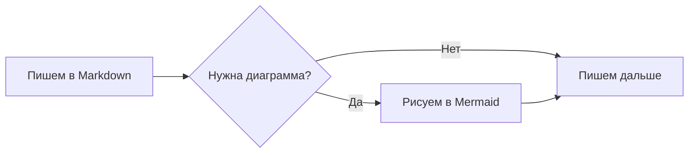
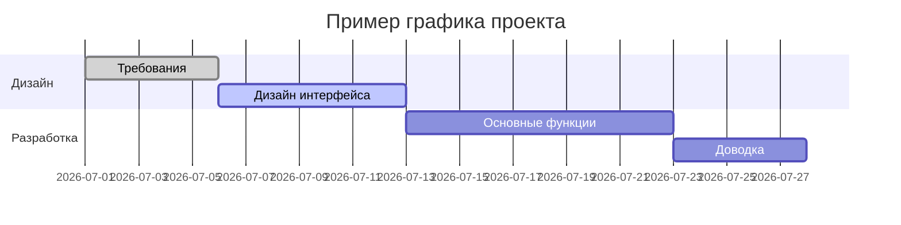
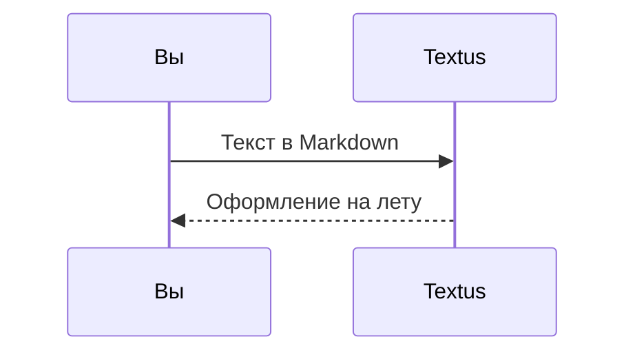

# Руководство по Markdown в Textus

Этот встроенный документ показывает, какое оформление Markdown поддерживает Textus. Это просто несохранённый черновик — смело редактируйте его и экспериментируйте, а потом закройте без сохранения.

> [!TIP]
> Нажмите `Cmd+/`, чтобы переключиться между визуальным режимом и режимом исходного кода и увидеть разметку любого примера на этой странице.

## Заголовки и цитаты

Наберите в начале строки `#` и пробел, чтобы получить заголовок первого уровня, или `##` и пробел — для второго уровня. Заголовки выше показывают результат.

Цитата:

> В цитату можно вкладывать другую разметку, например **жирный** и `код`.

Выноски в стиле GitHub:

> [!NOTE]
> Заметка — для дополнительного контекста.

> [!WARNING]
> Предупреждение — о том, на что стоит обратить внимание.

## Стили текста

**Жирный** (`**текст**`), *курсив* (`*текст*`), ***жирный курсив***, ~~зачёркнутый~~ (`~~текст~~`), ==выделение цветом== (`==текст==`) и `код в строке`.

Ссылки выглядят так: [репозиторий Textus](https://github.com/CatVinci-Studio/Textus). Ctrl/⌘+щелчок открывает ссылку: веб-ссылка открывается в браузере, ссылка на другой файл Markdown — во вкладке, а ссылка на `#заголовок` прокручивает к нему. Встроенный HTML тоже отображается, например клавиши <kbd>Cmd</kbd> + <kbd>S</kbd>. Также отображаются сворачиваемые блоки `<details>`, HTML-таблицы, некоторые встроенные стили (цвет, фон, размер, насыщенность, выравнивание, подчёркивание и зачёркивание) и встроенный `<svg>`, который показывается как картинка. Скрипты и прочий HTML остаются исходным кодом. Ссылка на заголовок в другом файле, например `[см.](notes.md#заголовок)`, открывает этот файл на этом заголовке. Вики-ссылки Obsidian (`[[Заметка]]`, `[[Заметка|текст]]` и `[[Заметка#Заголовок]]`) открываются так же — из папки документа или из любого места его хранилища; они и `#теги` в начале строки сохраняются ровно так, как написаны.

**Настройки → Редактор и оформление → Образцы перед кодами цвета** ставит маленький квадрат цвета перед кодом цвета. **Только в коде** показывает его во встроенном коде, который обозначает цвет, например `#0af` или `rgb(0 128 255)`, и перед значениями цвета в блоках кода; **Везде** — ещё и перед написанными в тексте кодами из шести или восьми цифр, например #ff8800, и функциями цвета, например hsl(210 100% 50%). Короткие коды в тексте, теги вроде #cafe, номера вроде #234 и ссылки остаются как есть.

Формулы в строке: эквивалентность массы и энергии $E = mc^2$, тождество Эйлера $e^{i\pi} + 1 = 0$.

## Списки

- Маркированный список
- С вложенностью
  - Пункт второго уровня
  - Ещё один

1. Нумерованный список
2. Второй пункт

Список задач (нажмите на флажок, чтобы отметить его или снять отметку):

- [x] Уже сделано
- [ ] Ещё предстоит сделать

## Таблицы

| Оформление | Синтаксис | Результат |
| --- | --- | --- |
| Жирный | `**текст**` | **текст** |
| Выделение цветом | `==текст==` | ==текст== |
| Формула в строке | `$x^2$` | $x^2$ |

Наведите указатель на таблицу, чтобы добавить или удалить строки и столбцы. Наберите `| Имя | Возраст |` и нажмите Enter, чтобы создать таблицу. Enter переходит на строку ниже, в последней строке добавляет новую, а в новой пустой строке выводит из таблицы; Ctrl/⌘+Enter выходит из неё в любой момент.

## Блоки кода

В блоках кода работает подсветка синтаксиса (язык переключается в правом верхнем углу блока). Enter на пустой последней строке выводит из блока, как и Ctrl/⌘+Enter в любой момент; в цитатах это работает так же. Кнопка **Копировать** рядом с языком копирует код блока, а **Настройки → Редактор и оформление → Номера строк в блоках кода** нумерует его строки; ни то ни другое не попадает в экспорт и на печать.

```python
def fib(n: int) -> int:
    """Классическая последовательность Фибоначчи."""
    a, b = 0, 1
    for _ in range(n):
        a, b = b, a + b
    return a
```

```rust
fn main() {
    let greeting = "Привет, Textus!";
    println!("{greeting}");
}
```

## Блоки формул

Блочные формулы в обрамлении `$$` отображаются с помощью KaTeX:

$$
\int_{-\infty}^{\infty} e^{-x^2} \, dx = \sqrt{\pi}
$$

## Диаграммы (Mermaid)

Блок кода ```` ```mermaid ```` превращается в живую диаграмму. Блок-схема:



Диаграмма Ганта:



Диаграмма последовательности:



**Настройки → Редактор и оформление → Движок диаграмм** определяет, чем рисуются эти блоки: Mermaid (по умолчанию) или Pele — он быстрее, но располагает диаграммы по-своему и не поддерживает некоторые возможности; диаграмму, которую Pele нарисовать не может, рисует Mermaid.

## Изображения

Вставьте изображение прямо из буфера обмена — Textus сохранит его и вставит ссылку на него. Куда именно, задаётся в разделе **Настройки → Редактор и оформление → Изображения**. **На этом компьютере** это **Вложенная папка** в папке документа, по умолчанию `assets/`, её имя можно изменить, или **Та же папка, что и документ**; в настройках видно, какую ссылку получит вставленное изображение. С вариантом **Загружать на хостинг изображений** изображение уходит в PicGo / PicList, SM.MS, Imgur или на собственный адрес загрузки (**Свой сервер**).

Собственный адрес загрузки получает `multipart/form-data` с полем `file` и может вернуть публичный URL обычным текстом или в настраиваемом поле JSON. Загружаемые файлы можно переименовывать автоматически, оставлять с исходным именем или каждый раз спрашивать имя перед загрузкой. При смене способа хранения уже вставленные ссылки на изображения не меняются.

Или напишите ссылку вручную:

```markdown

```

Встраивания Obsidian вроде `![[image.png]]` или `![[attachments/image.png|300]]` тоже показываются как картинки: Textus ищет файл в хранилище Obsidian, к которому относится документ, и сохраняет встраивание ровно так, как оно написано.

## Виды и режимы

Кроме визуального редактора и режима исходного кода (`Cmd+/`), в Textus есть ещё три способа писать (в Windows и Linux вместо `Cmd` нажимайте `Ctrl`; текущие сочетания клавиш — в разделе «Настройки → Сочетания клавиш»):

- **Разделённый вид** (`Cmd+Shift+E`): слева исходный код Markdown, справа — просмотр результата; обе части прокручиваются вместе.
- **Режим пишущей машинки** (Настройки → Редактор и оформление → Вид): строка, которую вы набираете, остаётся посередине окна — в редакторе, в режиме исходного кода и в разделённом виде.
- **Режим дзен** (`Cmd+Shift+J`): скрывает всё, кроме текста, разворачивает окно на весь экран и приглушает все абзацы, кроме того, над которым вы работаете. Чтобы выйти, нажмите `Esc`.

Все три есть и в меню **Вид**.

**Настройки → Редактор и оформление → Размер текста интерфейса** увеличивает или уменьшает текст боковой панели, вкладок, меню, панели ИИ и настроек; у документа остаётся свой масштаб. `Ctrl+Tab` и `Ctrl+Shift+Tab` переключают на следующую и предыдущую вкладку.

## Папки и поиск файлов

**Файл → Открыть папку…** открывает целую папку в боковой панели: дерево файлов остаётся в ней, пока вы открываете документы внутри, папка возвращается вместе с сеансом, а **Файл → Закрыть папку** снова позволяет дереву следовать за документом. Поле вверху вкладки **Файлы** боковой панели ищет имена файлов по всей папке; `Cmd+Shift+O` переводит в него. Вводите текст, чтобы отфильтровать, `↑`/`↓` — перемещение, `Enter` — открыть, `Esc` — очистить. Обе функции есть только в настольной версии.

**Файл → Открыть…** открывает и документ Word (`.docx`), как и перетаскивание его в окно: он становится новым, ещё не сохранённым документом Markdown с тем же именем с заголовками, списками, таблицами, ссылками, сносками и изображениями. Изображения при сохранении попадают туда, куда **Настройки → Редактор и оформление → Изображения** кладёт вставленные, а **Сохранить** предлагает файл `.md` рядом с файлом Word. Часть оформления может выглядеть иначе; сам файл Word никогда не меняется. Только на компьютере.

## Работа в фоне

Включите **Настройки → Основные → Приложение → Продолжать работать в фоне**, и после закрытия последнего окна Textus продолжит работать, а его значок останется в области уведомлений (Windows), системном лотке (Linux) или строке меню (Mac). **Открыть Textus** в меню значка возвращает к документам; **Завершить Textus** там завершает программу полностью. GNOME показывает значок только с расширением AppIndicator.

## Сноски и разделители

Сноска выглядит так[^1], а ниже — горизонтальная линия:

---

[^1]: Текст сносок собирается в конце документа.

Пишите с удовольствием.
