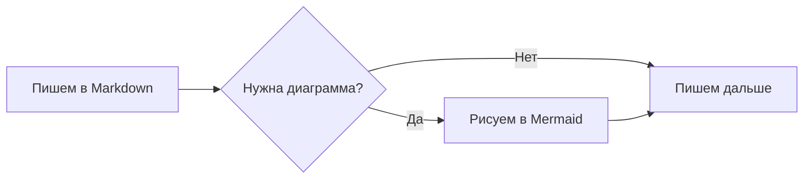
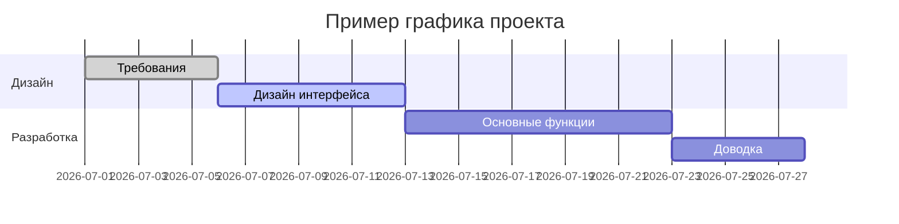
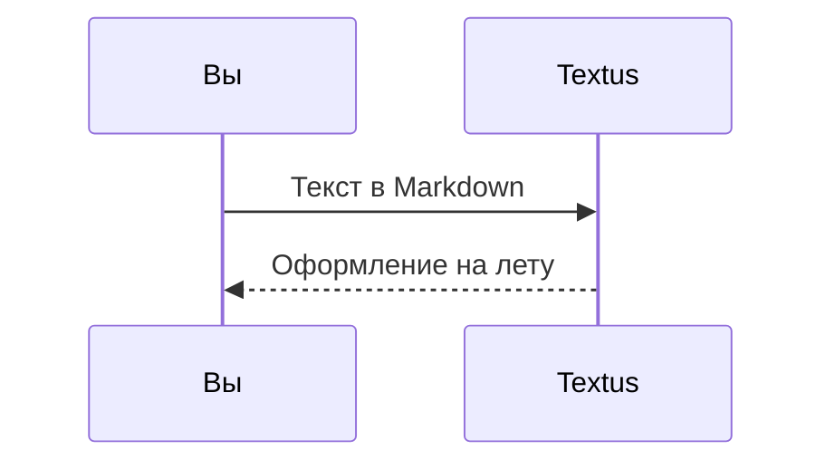

# Руководство по Markdown в Textus

Этот встроенный документ показывает, какое оформление Markdown поддерживает Textus. Это просто несохранённый черновик — смело редактируйте его и экспериментируйте, а потом закройте без сохранения.

> [!TIP]
> Нажмите `Cmd+/`, чтобы переключиться между визуальным режимом и режимом исходного кода и увидеть разметку любого примера на этой странице.

## Заголовки и цитаты

Наберите в начале строки `#` и пробел, чтобы получить заголовок первого уровня, или `##` и пробел — для второго уровня. Заголовки выше показывают результат. `Ctrl+1`–`Ctrl+6` (`Cmd+1`–`Cmd+6` на Mac) делают текущую строку заголовком этого уровня.

Цитата:

> В цитату можно вкладывать другую разметку, например **жирный** и `код`.

Выноски в стиле GitHub:

> [!NOTE]
> Заметка — для дополнительного контекста.

> [!WARNING]
> Предупреждение — о том, на что стоит обратить внимание.

## Стили текста

**Жирный** (`**текст**`), *курсив* (`*текст*`), ***жирный курсив***, ~~зачёркнутый~~ (`~~текст~~`), ==выделение цветом== (`==текст==`) и `код в строке`.

Короткие коды эмодзи, как на GitHub, показываются как эмодзи: :tada: (`:tada:`), :rocket: (`:rocket:`). В файле остаётся код; поставьте на него курсор, чтобы изменить.

Если набрать `(`, `[`, `{`, кавычку или скобку из китайского или японского способа ввода, например `（`, `【` или `「`, после курсора сразу появится закрывающая пара: набранная закрывающая скобка перешагивает через неё, Backspace сразу после открывающей удаляет обе, а выделенный текст оказывается внутри пары. **Настройки → Редактор и оформление → Закрывать (), [] и «»** отключает это.

Ссылки выглядят так: [репозиторий Textus](https://github.com/CatVinci-Studio/Textus). Ctrl/⌘+щелчок открывает ссылку: веб-ссылка открывается в браузере, ссылка на другой файл Markdown — во вкладке, а ссылка на `#заголовок` прокручивает к нему. Обычный щелчок ставит курсор в ссылку и показывает её Markdown, `[текст](адрес)`, чтобы править прямо на месте; когда курсор уходит, это снова ссылка. Встроенный HTML тоже отображается, например клавиши <kbd>Cmd</kbd> + <kbd>S</kbd>. Также отображаются сворачиваемые блоки `<details>`, HTML-таблицы, некоторые встроенные стили (цвет, фон, размер, насыщенность, выравнивание, подчёркивание и зачёркивание) и встроенный `<svg>`, который показывается как картинка. Скрипты и прочий HTML остаются исходным кодом. Ссылка на заголовок в другом файле, например `[см.](notes.md#заголовок)`, открывает этот файл на этом заголовке. Вики-ссылки Obsidian (`[[Заметка]]`, `[[Заметка|текст]]` и `[[Заметка#Заголовок]]`) открываются так же — из папки документа или из любого места его хранилища; они и `#теги` в начале строки сохраняются ровно так, как написаны.

**Настройки → Редактор и оформление → Образцы перед кодами цвета** ставит маленький квадрат цвета перед кодом цвета. **Только в коде** показывает его во встроенном коде, который обозначает цвет, например `#0af` или `rgb(0 128 255)`, и перед значениями цвета в блоках кода; **Везде** — ещё и перед написанными в тексте кодами из шести или восьми цифр, например #ff8800, и функциями цвета, например hsl(210 100% 50%). Короткие коды в тексте, теги вроде #cafe, номера вроде #234 и ссылки остаются как есть.

Формулы в строке: эквивалентность массы и энергии $E = mc^2$, тождество Эйлера $e^{i\pi} + 1 = 0$.

## Списки

- Маркированный список
- С вложенностью
  - Пункт второго уровня
  - Ещё один

1. Нумерованный список
2. Второй пункт

Список задач (нажмите на флажок, чтобы отметить его или снять отметку):

- [x] Уже сделано
- [ ] Ещё предстоит сделать

## Таблицы

| Оформление | Синтаксис | Результат |
| --- | --- | --- |
| Жирный | `**текст**` | **текст** |
| Выделение цветом | `==текст==` | ==текст== |
| Формула в строке | `$x^2$` | $x^2$ |

Наведите указатель на таблицу, чтобы добавить или удалить строки и столбцы. Наберите `| Имя | Возраст |` и нажмите Enter, чтобы создать таблицу. Enter переходит на строку ниже, в последней строке добавляет новую, а в новой пустой строке выводит из таблицы; Ctrl/⌘+Enter выходит из неё в любой момент. В таблице Tab и Shift+Tab переходят к следующей и предыдущей ячейке, а Shift+Enter начинает новую строку внутри ячейки.

## Блоки кода

В блоках кода работает подсветка синтаксиса (язык переключается в правом верхнем углу блока). Enter на пустой последней строке выводит из блока, как и Ctrl/⌘+Enter в любой момент; в цитатах это работает так же. Кнопки **Копировать** и **Выбрать все** рядом с языком копируют или выделяют код блока, а **Настройки → Редактор и оформление → Номера строк в блоках кода** нумерует его строки; ни то ни другое не попадает в экспорт и на печать.

```python
def fib(n: int) -> int:
    """Классическая последовательность Фибоначчи."""
    a, b = 0, 1
    for _ in range(n):
        a, b = b, a + b
    return a
```

```rust
fn main() {
    let greeting = "Привет, Textus!";
    println!("{greeting}");
}
```

## Блоки формул

Блочные формулы в обрамлении `$$` отображаются с помощью KaTeX:

$$
\int_{-\infty}^{\infty} e^{-x^2} \, dx = \sqrt{\pi}
$$

## Диаграммы (Mermaid)

Блок кода ```` ```mermaid ```` превращается в живую диаграмму. Блок-схема:



Диаграмма Ганта:



Диаграмма последовательности:



**Настройки → Редактор и оформление → Движок диаграмм** определяет, чем рисуются эти блоки: Mermaid (по умолчанию) или Pele — он быстрее, но располагает диаграммы по-своему и не поддерживает некоторые возможности; диаграмму, которую Pele нарисовать не может, рисует Mermaid.

## Изображения

Вставьте изображение прямо из буфера обмена — Textus сохранит его и вставит ссылку на него. Куда именно, задаётся в разделе **Настройки → Редактор и оформление → Изображения**. **На этом компьютере** это **Вложенная папка** в папке документа, по умолчанию `assets/`, её имя можно изменить, или **Та же папка, что и документ**; в настройках видно, какую ссылку получит вставленное изображение. С вариантом **Загружать на хостинг изображений** изображение уходит в PicGo / PicList, SM.MS, Imgur или на собственный адрес загрузки (**Свой сервер**).

Собственный адрес загрузки получает `multipart/form-data` с полем `file` и может вернуть публичный URL обычным текстом или в настраиваемом поле JSON. Загружаемые файлы можно переименовывать автоматически, оставлять с исходным именем или каждый раз спрашивать имя перед загрузкой. При смене способа хранения уже вставленные ссылки на изображения не меняются.

Или напишите ссылку вручную:

```markdown

```

Встраивания Obsidian вроде `![[image.png]]` или `![[attachments/image.png|300]]` тоже показываются как картинки: Textus ищет файл в хранилище Obsidian, к которому относится документ, и сохраняет встраивание ровно так, как оно написано.

Чтобы рассмотреть картинку поближе, дважды щёлкните её или нажмите **Увеличить изображение** в её правом верхнем углу (у диаграмм такая же кнопка): прокрутка или щипок масштабирует, перетаскивание сдвигает, двойной щелчок снова вписывает картинку в окно, а `Esc` закрывает просмотр. Чтобы изменить размер картинки, перетащите маркер на её правом краю. **Настройки → Редактор и оформление → Изображения на отдельной строке** ставит картинки, которые стоят на строке одни, по центру или слева — в редакторе и при экспорте в HTML и PDF.

## Копирование и вставка

**Копировать** кладёт в буфер обмена Markdown как обычный текст, а рядом — форматирование, поэтому GitHub, Obsidian, VS Code и мессенджеры получают Markdown, а Word, Pages, почта и Notion вставляют текст с форматированием. Картинка, скопированная через меню правой кнопки, попадает в буфер обмена как само изображение — его можно сразу вставить в чат или документ. **Правка → Вставить как обычный текст** (`Cmd+Shift+V`) вставляет текст из буфера обмена в точности как есть, не разбирая в нём Markdown.

## Виды и режимы

Кроме визуального редактора и режима исходного кода (`Cmd+/`), в Textus есть ещё три способа писать (в Windows и Linux вместо `Cmd` нажимайте `Ctrl`; текущие сочетания клавиш — в разделе «Настройки → Сочетания клавиш»):

- **Исходник и просмотр** (`Cmd+Shift+E`): слева исходный код Markdown, справа — просмотр результата; обе части прокручиваются вместе.
- **Режим пишущей машинки**: строка, которую вы набираете, остаётся посередине окна — в редакторе, в режиме исходного кода и в режиме «Исходник и просмотр».
- **Режим дзен** (`Cmd+Shift+J`): скрывает всё, кроме текста, и приглушает все абзацы, кроме того, над которым вы работаете. Чтобы выйти, нажмите `Esc`.

Все они есть в меню **Вид** и в **Настройки → Редактор и оформление → Вид**. Каждый из них — одна настройка для всего Textus: переключите его в любом окне, и вместе с ним переключатся все вкладки всех окон, в нём откроются следующие документы, и в следующий раз Textus тоже откроется в нём.

**Вид → Только чтение** (есть и в контекстном меню вкладки) защищает документ от изменений — набором, вставкой, перетаскиванием, отменой, Textus AI или плагинами. Об этом говорит замок рядом с заголовком; щёлкните его, чтобы документ снова можно было править.

**Вид → Палитра команд…** (`Cmd+Shift+P`) находит всё, что умеют меню, и каждую команду, добавленную плагином, по нескольким буквам её названия. Ещё она меняет оформление (светлое, тёмное или как в системе) и тему редактора, а также включает и выключает Textus AI.

Вкладка **Оглавление** на боковой панели показывает заголовки документа; щёлкните заголовок, чтобы перейти к нему. В контекстном меню оглавления есть **Развернуть все** и **Свернуть все**, а щелчок с `Option` (`Alt`) по стрелке заголовка сворачивает или разворачивает их все сразу.

**Настройки → Редактор и оформление → Размер текста интерфейса** увеличивает или уменьшает текст боковой панели, вкладок, меню, панели ИИ и настроек; у документа остаётся свой масштаб. `Ctrl+Tab` и `Ctrl+Shift+Tab` переключают на следующую и предыдущую вкладку.

## Несколько документов сразу

**Вид → Разделить вправо** (`Cmd+Option+S`) показывает текущий документ рядом с другим, а **Вид → Разделить вниз** ставит их один над другим. У каждой панели свои вкладки: открытый документ попадает в ту панель, где вы находитесь, а «Разделить вправо» или «Разделить вниз» снова делит эту панель — сколько угодно раз.

- Перетащите вкладку (или файл из боковой панели) к краю панели — она откроется в новой панели с этой стороны. Перетащите её к внешнему краю редактора — она откроется рядом со всеми панелями: у правого края двух панелей, стоящих одна над другой, она займёт правую сторону сверху донизу. Бросьте её на вкладки другой панели, чтобы перенести туда.
- Перетащите линию между двумя панелями, чтобы изменить их размер; двойной щелчок по ней делает их одинаковыми. В её контекстном меню можно поставить панели одну над другой вместо бок о бок, поменять их местами или убрать разделение.
- **Открыть рядом** в контекстном меню вкладки показывает её рядом с текущей.
- Закройте последнюю вкладку панели — и панель исчезнет. Вся раскладка возвращается при следующем запуске Textus.

## Вкладки и окна

`Cmd+T` открывает новую вкладку, `Cmd+N` — новое окно, а **Файл → Открыть закрытую вкладку** (`Cmd+Shift+T`) возвращает закрытые документы, начиная с последнего. Щелчок средней кнопкой закрывает вкладку; в контекстном меню вкладки есть **Закрыть другие**, **Закрыть вкладки слева** и **Закрыть вкладки справа** (вкладки с несохранёнными изменениями остаются открытыми), **Копировать путь** и **Переместить в новое окно**. Вкладку можно и вытащить за пределы окна, чтобы она открылась в собственном окне. При следующем запуске Textus каждое окно возвращается со своими вкладками.

## Папки и поиск файлов

**Файл → Открыть папку…** открывает целую папку в боковой панели: дерево файлов остаётся в ней, пока вы открываете документы внутри, папка возвращается вместе с сеансом, а **Файл → Закрыть папку** снова позволяет дереву следовать за документом. Поле вверху вкладки **Файлы** боковой панели ищет имена файлов по всей папке; `Cmd+Shift+O` переводит в него. Вводите текст, чтобы отфильтровать, `↑`/`↓` — перемещение, `Enter` — открыть, `Esc` — очистить. Обе функции есть только в настольной версии.

Дерево — это ещё и небольшой файловый менеджер. Имя родительской папки над ним переносит на уровень выше. **Сортировка** упорядочивает его по имени или по дате изменения, а фильтр рядом с полем поиска, **Все файлы** или **Только документы**, действует и на дерево, и на поиск. Щёлкните правой кнопкой по папке, файлу или пустому месту ниже, чтобы создать там **Новый документ** или **Новую папку**, а файл или папку, перетащенные на другую папку, можно переместить в неё; открытый документ последует за ним на новое место. Ничего не заменяется: занятое имя отклоняется.

Перетащите файлы из Finder или Проводника в окно, чтобы открыть их: документы открываются во вкладках, картинки попадают в документ туда, где вы их отпустили, а папка открывается в боковой панели. **Файл → Копировать путь** копирует полный путь текущего документа.

Из терминала `textus notes.md` открывает файл в Textus; **Настройки → Основные** устанавливают команду `textus`, если её ещё нет.

**Файл → Открыть…** открывает и документ Word (`.docx`), как и перетаскивание его в окно: он становится новым, ещё не сохранённым документом Markdown с тем же именем с заголовками, списками, таблицами, ссылками, сносками и изображениями. Изображения при сохранении попадают туда, куда **Настройки → Редактор и оформление → Изображения** кладёт вставленные, а **Сохранить** предлагает файл `.md` рядом с файлом Word. Часть оформления может выглядеть иначе; сам файл Word никогда не меняется. Только на компьютере.

## Работа в фоне

Включите **Настройки → Основные → Приложение → Продолжать работать в фоне**, и после закрытия последнего окна Textus продолжит работать, а его значок останется в области уведомлений (Windows), системном лотке (Linux) или строке меню (Mac). **Открыть Textus** в меню значка возвращает к документам; **Завершить Textus** там завершает программу полностью. GNOME показывает значок только с расширением AppIndicator.

## Экспорт

**Файл → Экспорт** сохраняет документ в HTML или PDF, а если установлен [Pandoc](https://pandoc.org), то и в Word (`.docx`), OpenDocument, RTF, EPUB, LaTeX и другие форматы. На Mac **Настройки → Редактор и оформление → Экспортировать PDF в светлых цветах** печатает PDF на белом фоне в светлых цветах вашей темы, даже если вы пишете в тёмном режиме.

## Плагины, темы и навыки

**Настройки → Расширения → Получить ещё** показывает плагины, темы и навыки, которые можно добавить: клавиши Vim и Emacs, просмотр PDF, диаграммы, граф знаний, инструменты для письма и многое другое. У каждого одна кнопка — **Установить**, затем **Обновить**, **Выключить** или **Включить**, — а **Удалить** находится в меню рядом. На странице плагина рассказано, как им пользоваться, а его команды появляются в меню **Плагины** и в палитре команд.

## Помощь

**Справка → Сообщить о проблеме…** (есть и в **Настройки → Основные**, в разделе «Справка») открывает короткую форму. Укажите тип сообщения, какой части Textus оно касается и, если это ошибка, насколько она серьёзна, а затем опишите, что пошло не так; Textus добавит свою версию, вашу систему, ваши плагины, ваши настройки без личных данных и недавние ошибки — всё это видно до отправки. **Отправить** создаёт за вас issue на GitHub, без учётной записи GitHub, и сообщает его номер; **Отправить на GitHub** вместо этого открывает форму GitHub; **Копировать** кладёт всё в буфер обмена для чата или письма. Написанное вами станет публичным issue; адрес почты или WeChat, который вы оставите, если нам можно задать вам вопросы, увидит только команда.

В **Настройки → Основные → Справка** можно также снова пройти знакомство, открыть руководства и перейти в **О Textus**, где видна версия и есть **Проверить обновления** (на Mac также **Textus → Проверить обновления…**). **Справка → Сообщество** открывает страницу сообщества.

## Сноски и разделители

Сноска выглядит так[^1], а ниже — горизонтальная линия:

---

[^1]: Текст сносок собирается в конце документа.

Пишите с удовольствием.
