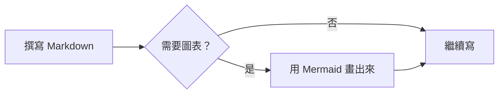
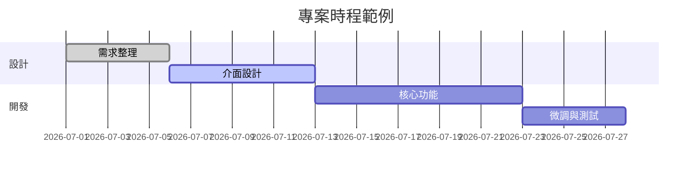
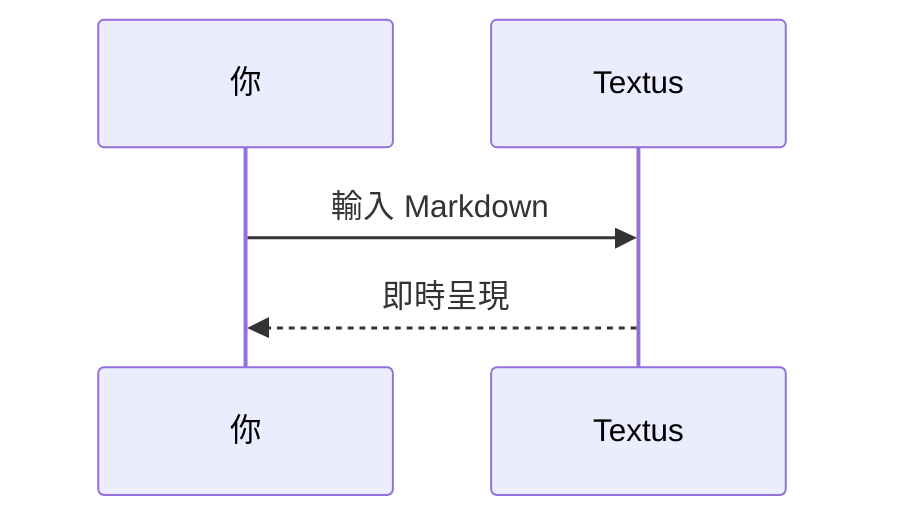

# Textus Markdown 指南

這份指南本身就是一份可以修改的文件：先花五分鐘看看最常用的功能，其餘的再依你想做的事查閱。看完後關閉時選擇不儲存即可。

> [!TIP]
> 按 `Cmd+/`（Windows 和 Linux 上是 `Ctrl+/`）切換到原始碼，看看每個範例是怎麼寫的。

## 五分鐘上手

Markdown 用幾個符號標示格式，Textus 會在你輸入時直接排好版面。在行首輸入：

- `# ` 再接幾個字：標題；`## `：小一級的標題。
- `- `：項目清單；`1. `：編號清單；`- [ ] `：待辦事項。
- `> `：引用。

包在文字兩側：`**粗體**`、`*斜體*`、`==醒目提示==`、`` `程式碼` ``。連結寫成 `[文字](https://example.com)`；圖片直接貼上就好。

不想記符號？用文件上方的**格式列**，或在選取的文字上按右鍵。找不到某個功能？按 `Cmd+Shift+P` 開啟命令面板，輸入幾個字就行。

## 寫長篇文章

**首行縮排**（設定 › 編輯 › 內文）會讓每個段落的第一行縮排兩個字元；清單、引用和表格不受影響。

### 寫作方式與模式

除了所見即所得編輯器和原始碼模式（`Cmd+/`），Textus 還有三種寫作方式（在 Windows 和 Linux 上以 `Ctrl` 取代 `Cmd`；目前的按鍵設定可在「設定 › 快速鍵」中查看）：

- **原始碼與預覽**（`Cmd+Shift+E`）：左邊是 Markdown 原始碼，右邊是呈現後的預覽，兩邊同步捲動。
- **打字機模式**：正在輸入的那一行始終保持在視窗中央——在編輯器、原始碼模式和原始碼與預覽中都適用。
- **禪模式**（`Cmd+Shift+J`）：隱藏目前文件以外的一切，並淡化正在撰寫的段落以外的所有段落。按右上角的 ×，或再按一次快速鍵即可離開。

它們都在**檢視**選單裡（前兩項在**檢視 › 模式**中），也在**設定 › 編輯 › 內文**的**檢視**群組中。每一項都是整個 Textus 共用的一個設定：在任何視窗切換，所有視窗的所有分頁都會跟著切換，之後開啟的文件也會直接使用它，下次開啟 Textus 時依然如此。

**檢視 › 模式 › 閱讀模式**（分頁的右鍵選單裡也有）讓文件不會被改動：打字、貼上、拖入、復原、Textus AI 和外掛程式都改不了它。標題旁會顯示一把小鎖，點一下就恢復可編輯。

**檢視 › 命令面板…**（`Cmd+Shift+P`）：輸入名稱中的幾個字，就能找到選單裡的任何操作，以及外掛程式新增的每一個命令。它也能切換外觀（淺色、深色或跟隨系統）和編輯器主題，以及開啟或關閉 Textus AI。**編輯 › 尋找與取代…**（`Cmd+F`）在文件裡尋找，**編輯 › 取代…**（`Cmd+Option+F`）直接打開取代列，`Cmd+G` 跳到下一個相符項目。

側邊欄的**大綱**面板列出文件的標題，點一下就跳過去。在大綱上按右鍵可以**全部展開**或**全部摺疊**；按住 `Option`（`Alt`）點標題前的箭頭，也能一次展開或摺疊全部標題。

**介面文字大小**（設定 › 外觀）可以放大或縮小側邊欄、分頁、選單、AI 分頁和設定中的文字；每份文件保有自己的縮放比例（`Cmd+=`、`Cmd+-`）。按 `Ctrl+Tab` 和 `Ctrl+Shift+Tab` 可切換到下一個、上一個分頁。

### 註腳、分隔線與目錄

註腳的寫法像這樣[^1]，下面是一條水平分隔線：

---

[^1]: 註腳內容會集中顯示在文件末尾。

在單獨一行輸入 `[TOC]` 並按 Enter，即可插入目錄：它列出文件中的所有標題，並隨寫作自動更新；點一下其中一項即可跳過去。

## 表格、程式碼、數學公式與圖表

### 表格

| 功能 | 語法 | 效果 |
| --- | --- | --- |
| 粗體 | `**文字**` | **文字** |
| 醒目提示 | `==文字==` | ==文字== |
| 行內公式 | `$x^2$` | $x^2$ |

將指標移到表格上，即可新增或刪除列與欄。輸入 `| 姓名 | 年齡 |` 後按 Enter 就會建立表格。按 Enter 會移到下一列，在最後一列按則會新增一列；在留空的新列上再按一次 Enter，就會離開表格。Ctrl/⌘+Enter 隨時都能離開。在表格裡按 Tab 和 Shift+Tab 會移到下一格和上一格，按 Shift+Enter 則在儲存格內換行。

### 程式碼區塊

具備語法突顯的圍欄式程式碼區塊（可從區塊右上角切換語言）。在最後一個空行按 Enter 會離開區塊，也可以隨時按 Ctrl/⌘+Enter 離開；引用區塊也一樣。語言旁邊的**複製**和**全選**可以複製或選取整個程式碼區塊；**程式碼區塊顯示行號**（設定 › 編輯 › 內文）會為每一行加上行號。按鈕和行號都不會出現在匯出檔案和列印稿中。

```python
def fib(n: int) -> int:
    """經典的費氏數列。"""
    a, b = 0, 1
    for _ in range(n):
        a, b = b, a + b
    return a
```

```rust
fn main() {
    let greeting = "你好，Textus";
    println!("{greeting}");
}
```

### 數學公式區塊

以 `$$` 包住的區塊公式由 KaTeX 呈現：

$$
\int_{-\infty}^{\infty} e^{-x^2} \, dx = \sqrt{\pi}
$$

### 圖表（Mermaid）

以 ```` ```mermaid ```` 開頭的程式碼區塊會即時呈現為圖表。流程圖：



甘特圖：



循序圖：



**圖表引擎**（設定 › 編輯 › 內文）決定由誰繪製這些圖表：預設的 Mermaid，或速度更快的 Pele。Pele 有自己的版面配置方式，也少了幾項功能；它畫不出的圖表會交給 Mermaid。

圖表配色跟隨外觀：淺色外觀用素雅的灰色配色，深色外觀用其深色配色；匯入的主題或自訂 CSS 也可以透過 `--doc-mermaid-theme: forest` 指定其他內建配色。

## 圖片與貼上

### 圖片

直接從剪貼簿貼上圖片，Textus 會把它存起來並插入參照。存到哪裡由**設定 › 編輯 › 圖片**決定。選**存到這台電腦**時，會存到文件所在資料夾的**子資料夾**（預設是 `assets/`，名稱可以修改）；另一個選項是**與文件相同的資料夾**。設定中會顯示貼上的圖片得到的連結。選**上傳到圖片託管服務**時，圖片則會上傳到 PicGo / PicList、SM.MS、Imgur 或你自己的上傳端點（**自訂**）。

自訂的上傳端點會以 `multipart/form-data` 的 `file` 欄位接收圖片，並以純文字回傳公開 URL，或將 URL 放在可自訂的 JSON 欄位中。上傳的檔案可以自動重新命名、保留原始檔名，或在每次上傳前詢問你。切換儲存方式時，既有的圖片參照都不會改變。

也可以手動撰寫參照：

```markdown

```

Obsidian 的嵌入寫法，例如 `![[image.png]]` 或 `![[attachments/image.png|300]]`，也會顯示成圖片：Textus 會在文件所屬的 Obsidian 保存庫裡尋找檔案，儲存時原樣寫回。

想仔細看一張圖片，按兩下它，或點圖片右上角的**放大圖片**（圖表也有同樣的按鈕）：用滾輪或雙指縮放，拖曳移動，按兩下恢復原樣，按 `Esc` 關閉。拖曳圖片右邊緣的控點可以調整大小。**獨佔一行的圖片**（設定 › 編輯 › 圖片）決定單獨佔一行的圖片置中還是靠左，編輯器裡和匯出的 HTML、PDF 都適用。

### 複製與貼上

**複製**時，剪貼簿的純文字裡是 Markdown，旁邊另附帶格式的內容：貼到 GitHub、Obsidian、VS Code 或聊天軟體會得到 Markdown，貼到 Word、Pages、郵件和 Notion 則保留格式。在圖片上按右鍵選擇複製，剪貼簿裡就是圖片本身，可以直接貼到聊天或文件裡。**編輯 › 貼上為純文字**（`Cmd+Shift+V`）會依剪貼簿裡的文字原樣貼上，不把其中的 Markdown 當作格式。

## 檔案與資料夾

### 資料夾與搜尋

**檔案 › 開啟資料夾…**會把整個資料夾放進側邊欄：在其中開啟文件時，檔案樹會一直停在這個資料夾，下次啟動時也會隨工作階段還原；**檔案 › 關閉資料夾**則讓檔案樹重新跟隨目前的文件。**搜尋**面板（活動列上的放大鏡，或按 `Cmd+Shift+O`）可以在整個資料夾中依檔名找檔案、依字詞找內文；點一下某一行，就會開啟文件並跳到那裡。這兩項功能只在桌面版提供。

檔案樹也是一個簡單的檔案管理器。樹上方的上一層資料夾名稱，點一下就回到上一層。它的選單可以依名稱或修改時間排列，並切換顯示**所有檔案**或**僅文件**。在資料夾、檔案或下方空白處按右鍵，可以在那裡**新增文件**或**新增檔案夾**；把檔案或資料夾拖到另一個資料夾上就能移進去，已開啟的文件會跟著移到新位置。不會覆蓋任何東西：名稱重複時會拒絕。

從 Finder 或檔案總管把檔案拖進視窗就能開啟：文件在分頁中開啟，圖片插入到放開的位置，資料夾在側邊欄開啟。**檔案 › 複製路徑**會複製目前文件的完整路徑。

在終端機輸入 `textus notes.md` 就能用 Textus 開啟檔案；如果還沒有 `textus` 指令，可以在**設定 › 一般**裡安裝。不開啟視窗也能做更多事：`textus search <詞語>` 在資料夾的檔案裡搜尋，`textus read` 把 PDF 或 Word 檔案以 Markdown 輸出，`textus help` 列出全部指令，包括外掛程式新增的指令。

**檔案 › 開啟…**也能開啟 Word 文件（`.docx`），把它拖進視窗也一樣：它會變成一篇同名、尚未儲存的新 Markdown 文件，標題、清單、表格、連結、註腳和圖片都會保留。儲存後，圖片會放到**設定 › 編輯 › 圖片**為貼上的圖片設定的位置；**儲存**時會建議存成 Word 檔案旁邊的 `.md` 檔案。部分格式可能與 Word 中不同，原 Word 檔案不會被更動。僅限桌面版。

### 匯出

**檔案 › 匯出**可以把文件存成 HTML 或 PDF；安裝 [Pandoc](https://pandoc.org) 之後，還能匯出 Word（`.docx`）、OpenDocument、RTF、EPUB、LaTeX 等格式。在 Mac 上，開啟**匯出 PDF 時使用淺色**（設定 › 編輯 › 匯出），即使你用深色模式寫作，匯出的 PDF 也會是白底、採用主題的淺色配色。

### 在背景持續執行

打開**設定 › 一般 › 應用程式 › 在背景持續執行**後，關閉最後一個視窗 Textus 也會繼續執行，並在通知區域（Windows）、系統匣（Linux）或選單列（Mac）顯示圖示。在圖示選單裡選**打開 Textus** 就能回到文件；選**結束 Textus** 才會真正結束。GNOME 需要安裝 AppIndicator 擴充功能才會顯示系統匣圖示。

## 視窗

### 視窗裡有什麼

從左到右：

- **活動列**：一排直列的圖示。**檔案**（檔案樹）、**大綱**（文件的標題）、**搜尋**（在整個資料夾中）、**外掛程式**，接著是外掛程式新增的面板。**設定**（齒輪）在最下方。點一下圖示，會在側邊欄開啟它的面板；再點一次就收起側邊欄。拖曳圖示可以調整順序；按右鍵可以顯示或隱藏圖示。
- **側邊欄**：一次顯示一個面板。按 `Cmd+\` 或頂端的側邊欄按鈕可以顯示或隱藏它；拖曳它的邊緣可以加寬。
- **島**：也就是文件。每個島是一排分頁，下面是頁面；分頁位在視窗頂端那一列。分割視窗後，好幾個島會並排在一起（見下方的**島與分頁**）。每份文件頂端的**格式列**放著「格式」選單裡的按鈕；**檢視 › 格式列**可以隱藏它。
- **Textus AI**：頂端列右側的星光圖示（`Cmd+Shift+L`）會把它的對話開成分頁，放在右側自己的島裡。說明選單裡的 **AI 功能指南**有詳細介紹。
- **設定**（`Cmd+,` 或齒輪）：頁面清單在側邊欄，頁面本身在分頁裡。

在 Windows 和 Linux 上，選單藏在左上角的 ☰ 按鈕後面；在設定 › 外觀中開啟**顯示選單列**，選單就會橫在視窗頂端。字數顯示在每份文件的右下角。

### 島與分頁

每一組分頁連同下面的頁面，就是一個**島**。一個島一次顯示一份文件；分割視窗後，好幾個島可以左右並排或上下排列。

- **拖曳分頁**離開它所在的那一排，你瞄準的地方會讓出空間；放開後就在那裡開啟：在某個島的旁邊（瞄準它外側五分之一的範圍）、上方或下方（它的上緣或下緣），或是另一個島的分頁之間。拖曳時按住 `Option`（`Alt`）可以移動整個島。按 `Esc` 就放回原處。側邊欄裡的檔案也能用同樣的方式拖曳。
- **把分頁拖出視窗**，它就會自成一個視窗。
- **檢視 › 向右分割**（`Cmd+Option+S`）和**檢視 › 向下分割**會分割你所在的島；**檢視 › 關閉分割**則回到只有一個。
- 拖曳兩個島之間的分隔線可以調整大小。
- 開著兩個以上的島時，**按住 `Cmd`**（`Ctrl`）片刻：每個島會顯示一個編號，按 `Cmd+1`… `Cmd+6` 就會跳到那個島。
- 關閉一個島的最後一個分頁，這個島就會消失。重新開啟 Textus 時，整個版面配置都會恢復。

`Cmd+N`（或 `Cmd+T`）新增分頁，`Cmd+Shift+N` 新增視窗；**檔案 › 重新開啟已關閉的分頁**（`Cmd+Shift+T`）會從新到舊找回關掉的文件。一排分頁末端的 **+** 會在那個島裡新增分頁。用滑鼠中鍵點分頁可以關閉它；分頁的右鍵選單裡有**關閉其他分頁**、**關閉左側分頁**、**關閉右側分頁**和**關閉已儲存的**（有未儲存修改的分頁會保留）、**複製路徑**和**在檔案樹中顯示**。重新開啟 Textus 時，每個視窗都會帶著自己的分頁恢復。

## 外掛程式、主題與技能

**外掛程式**面板（活動列上的拼圖）在**可安裝**下列出可以新增的外掛程式：Vim 和 Emacs 鍵位、PDF 閱讀器、各種圖表、關係圖譜、寫作工具等等。主題在**設定 › 外觀**的主題商店裡，技能在**設定 › Textus AI › Agent 功能**裡。每一項都有一個按鈕（**安裝**，之後是**更新**、**停用**或**啟用**），旁邊的選單裡可以**解除安裝**。外掛程式的頁面會說明怎麼使用，它的命令會出現在**外掛程式**選單和命令面板裡。

## 取得協助

**說明 › 回報問題…**（**設定 › 關於**的「說明」裡也有）會開啟一個簡短的表單。先選好回報的類型、涉及 Textus 的哪個部分，若是錯誤再選嚴重程度，然後寫下出了什麼問題；Textus 會附上版本、系統、已安裝的外掛程式、去除隱私資訊的設定和最近的錯誤，傳送前都會完整顯示給你看。**傳送**會替你在 GitHub 上建立一個 issue，不需要 GitHub 帳號，並告訴你它的編號；**在 GitHub 提交**則改為開啟 GitHub 的表單；**複製**則把內容複製下來，方便傳到群組或郵件裡。你寫的內容會成為公開的 issue；你留下的電子郵件或微信（方便我們進一步詢問）只有團隊看得到。

**設定 › 關於 › 說明**也能重新開啟歡迎導覽、開啟使用指南，並前往**關於 Textus**，查看版本並**檢查更新**（在 Mac 上也可用 **Textus › 檢查更新…**）。**說明 › 加入社群**會開啟社群頁面。

## 參考：所有可用的寫法

以下是 Textus 看得懂的所有 Markdown 寫法；可以對照原始碼（`Cmd+/`）來看。

### 標題與引用

在行首輸入 `#` 和空格就是第一級標題，輸入 `##` 和空格則是第二級標題。上方的標題就是實際的呈現效果。按 `Ctrl+1` 到 `Ctrl+6`（Mac 上是 `Cmd+1` 到 `Cmd+6`）可將目前這一行設為對應層級的標題。

引用區塊：

> 引用的文字裡也能使用其他標記，例如**粗體**和 `程式碼`。

GitHub 風格的提示區塊：

> [!NOTE]
> 這是一則附註，用來補充說明。

> [!WARNING]
> 這是一則警告，提醒需要留意的地方。

### 行內樣式

**粗體**（`**文字**`）、*斜體*（`*文字*`）、***粗斜體***、~~刪除線~~（`~~文字~~`）、==醒目提示==（`==文字==`），以及 `行內程式碼`。``Ctrl+` ``（Mac 上也是 Control）把選取的文字變成行內程式碼，``Ctrl+Shift+` `` 加上刪除線，`Cmd+K` 把它放進連結，游標停在填網址的地方。

GitHub 風格的表情短代碼會顯示為表情：:tada:（`:tada:`）、:rocket:（`:rocket:`）。檔案裡保留短代碼原文，把游標放上去即可編輯。

下標和上標的寫法與 Typora、Pandoc 相同：H~2~O（`H~2~O`）、x^2^（`x^2^`），中間不能有空格。

輸入 `(`、`[`、`{`、引號，或用中文、日文輸入法打出的 `（`、`【`、`「` 等括號時，游標後會自動補上另一半：再輸入右半邊會直接越過它，緊接著按退格鍵會把一對一起刪除，選取文字時輸入左半邊會把文字括起來。不需要時可在**設定 › 編輯 › 內文**中關閉**補全 ()、[] 和 「」**。

連結的寫法：[Textus 的原始碼存放庫](https://github.com/CatVinci-Studio/Textus)。按住 Ctrl/⌘ 點選連結即可跳轉：網頁連結在瀏覽器中開啟，指向另一個 Markdown 檔案的連結在分頁中開啟，`#某個標題` 這樣的連結會捲動到該標題。直接點選連結會把游標放進去，並顯示它的 Markdown 原始碼 `[文字](網址)`，可以就地修改；游標離開後它又變回連結。行內 HTML 也會呈現，例如鍵盤按鍵 <kbd>Cmd</kbd> + <kbd>S</kbd>。`<details>` 摺疊區塊、HTML 表格、少量行內樣式（顏色、背景色、字級、粗細、對齊、底線和刪除線）和行內 `<svg>`（顯示為圖片）也會呈現；指令碼等其他 HTML 保持原始碼顯示。指向另一個檔案中某個標題的連結，例如 `[參見](notes.md#某個標題)`，會開啟該檔案並跳到那個標題。Obsidian 的維基連結 `[[筆記]]`、`[[筆記|顯示文字]]` 和 `[[筆記#標題]]` 也能這樣點開，筆記可以在文件所在的資料夾，也可以在整個保存庫的任何位置；維基連結和行首的 `#標籤` 儲存時都會原樣保留。

**顏色代碼前的色塊**（設定 › 編輯 › 內文）會在顏色代碼前面顯示一個該顏色的小方塊。選**僅在程式碼中**時，代表顏色的行內程式碼（例如 `#0af`、`rgb(0 128 255)`）和程式碼區塊裡的顏色值前面會顯示；選**全文**時，內文裡六位或八位的顏色代碼（例如 #ff8800）和顏色函式（例如 hsl(210 100% 50%)）前面也會顯示。內文裡的短寫法、#cafe 這樣的標籤、#234 這樣的編號和連結保持原樣。

行內數學公式：質能等價 $E = mc^2$，歐拉恆等式 $e^{i\pi} + 1 = 0$。

### 清單

- 項目符號清單
- 可以巢狀排列
  - 第二層項目
  - 另一個第二層項目

1. 編號清單
2. 第二項

待辦清單（按一下核取方塊即可切換）：

- [x] 已完成的事項
- [ ] 待辦的事項

祝寫作愉快！
