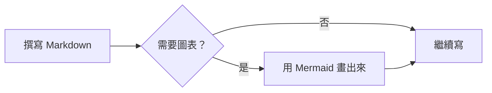
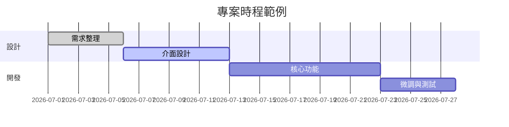
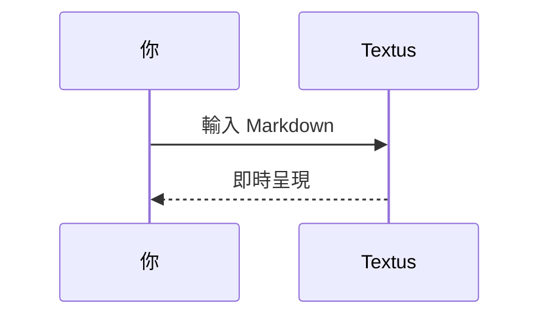

# Textus Markdown 指南

這份內建文件示範 Textus 支援的 Markdown 呈現效果。它只是一份未儲存的草稿，可以隨意編輯、試驗，關閉時選擇不儲存即可。

> [!TIP]
> 按 `Cmd+/` 可在所見即所得與原始碼模式之間切換，看看每個範例背後的原始語法。

## 標題與引用

在行首輸入 `#` 和空格就是第一級標題，輸入 `##` 和空格則是第二級標題。上方的標題就是實際的呈現效果。按 `Ctrl+1` 到 `Ctrl+6`（Mac 上是 `Cmd+1` 到 `Cmd+6`）可將目前這一行設為對應層級的標題。

引用區塊：

> 引用的文字裡也能使用其他標記，例如**粗體**和 `程式碼`。

GitHub 風格的提示區塊：

> [!NOTE]
> 這是一則附註，用來補充說明。

> [!WARNING]
> 這是一則警告，提醒需要留意的地方。

## 行內樣式

**粗體**（`**文字**`）、*斜體*（`*文字*`）、***粗斜體***、~~刪除線~~（`~~文字~~`）、==醒目提示==（`==文字==`），以及 `行內程式碼`。

輸入 `(`、`[`、`{`、引號，或用中文、日文輸入法打出的 `（`、`【`、`「` 等括號時，游標後會自動補上另一半：再輸入右半邊會直接越過它，緊接著按退格鍵會把一對一起刪除，選取文字時輸入左半邊會把文字括起來。不需要時可在**設定 → 編輯器與外觀 → 自動補上括號和引號**中關閉。

連結的寫法：[Textus 的原始碼存放庫](https://github.com/CatVinci-Studio/Textus)。按住 Ctrl/⌘ 點選連結即可跳轉：網頁連結在瀏覽器中開啟，指向另一個 Markdown 檔案的連結在新分頁中開啟，`#某個標題` 這樣的連結會捲動到該標題。直接點選連結會把游標放進去，並顯示它的 Markdown 原始碼 `[文字](網址)`，可以就地修改文字和網址；游標離開後它又變回連結。行內 HTML 也會呈現，例如鍵盤按鍵 <kbd>Cmd</kbd> + <kbd>S</kbd>。`<details>` 摺疊區塊、HTML 表格、少量行內樣式（顏色、背景色、字級、粗細、對齊、底線和刪除線）和行內 `<svg>`（顯示為圖片）也會呈現；指令碼等其他 HTML 保持原始碼顯示。指向另一個檔案中某個標題的連結，例如 `[參見](notes.md#某個標題)`，會開啟該檔案並跳到那個標題。Obsidian 的維基連結 `[[筆記]]`、`[[筆記|顯示文字]]` 和 `[[筆記#標題]]` 也能這樣點開，筆記可以在文件所在的資料夾，也可以在整個保存庫的任何位置；維基連結和行首的 `#標籤` 儲存時都會原樣保留。

**設定 → 編輯器與外觀 → 顏色代碼前的色塊**會在顏色代碼前面顯示一個該顏色的小方塊。選**僅在程式碼中**時，代表顏色的行內程式碼（例如 `#0af`、`rgb(0 128 255)`）和程式碼區塊裡的顏色值前面會顯示；選**全文**時，內文裡六位或八位的顏色代碼（例如 #ff8800）和顏色函式（例如 hsl(210 100% 50%)）前面也會顯示。內文裡的短寫法、#cafe 這樣的標籤、#234 這樣的編號和連結保持原樣。

行內數學公式：質能等價 $E = mc^2$，歐拉恆等式 $e^{i\pi} + 1 = 0$。

## 清單

- 項目符號清單
- 可以巢狀排列
  - 第二層項目
  - 另一個第二層項目

1. 編號清單
2. 第二項

待辦清單（按一下核取方塊即可切換）：

- [x] 已完成的事項
- [ ] 待辦的事項

## 表格

| 功能 | 語法 | 效果 |
| --- | --- | --- |
| 粗體 | `**文字**` | **文字** |
| 醒目提示 | `==文字==` | ==文字== |
| 行內公式 | `$x^2$` | $x^2$ |

將指標移到表格上，即可新增或刪除列與欄。輸入 `| 姓名 | 年齡 |` 後按 Enter 就會建立表格。按 Enter 會移到下一列，在最後一列按則會新增一列；在留空的新列上再按一次 Enter，就會離開表格。Ctrl/⌘+Enter 隨時都能離開。在表格裡按 Tab 和 Shift+Tab 會移到下一格和上一格，按 Shift+Enter 則在儲存格內換行。

## 程式碼區塊

具備語法突顯的圍欄式程式碼區塊（可從區塊右上角切換語言）。在最後一個空行按 Enter 會離開區塊，也可以隨時按 Ctrl/⌘+Enter 離開；引用區塊也一樣。語言旁邊的**複製**按鈕可以複製整個程式碼區塊；開啟**設定 → 編輯器與外觀 → 程式碼區塊顯示行號**會為每一行加上行號。按鈕和行號都不會出現在匯出檔案和列印稿中。

```python
def fib(n: int) -> int:
    """經典的費氏數列。"""
    a, b = 0, 1
    for _ in range(n):
        a, b = b, a + b
    return a
```

```rust
fn main() {
    let greeting = "你好，Textus";
    println!("{greeting}");
}
```

## 數學公式區塊

以 `$$` 包住的區塊公式由 KaTeX 呈現：

$$
\int_{-\infty}^{\infty} e^{-x^2} \, dx = \sqrt{\pi}
$$

## 圖表（Mermaid）

以 ```` ```mermaid ```` 開頭的程式碼區塊會即時呈現為圖表。流程圖：



甘特圖：



循序圖：



**設定 → 編輯器與外觀 → 圖表引擎**決定由誰繪製這些圖表：預設的 Mermaid，或速度更快的 Pele。Pele 有自己的版面配置方式，也少了幾項功能；它畫不出的圖表會交給 Mermaid。

## 圖片

直接從剪貼簿貼上圖片，Textus 會把它存起來並插入參照。存到哪裡由**設定 → 編輯器與外觀 → 圖片**決定：選**存到這台電腦**時，可以存到文件所在資料夾的**子資料夾**（預設是 `assets/`，名稱可以修改），或選**與文件相同的資料夾**，設定中會顯示貼上的圖片得到的連結；選**上傳到圖片託管服務**時，圖片會上傳到 PicGo / PicList、SM.MS、Imgur 或你自己的上傳端點（**自訂**）。

自訂的上傳端點會以 `multipart/form-data` 的 `file` 欄位接收圖片，並以純文字回傳公開 URL，或將 URL 放在可自訂的 JSON 欄位中。上傳的檔案可以自動重新命名、保留原始檔名，或在每次上傳前詢問你。切換儲存方式時，既有的圖片參照都不會改變。

也可以手動撰寫參照：

```markdown

```

Obsidian 的嵌入寫法，例如 `![[image.png]]` 或 `![[attachments/image.png|300]]`，也會顯示成圖片：Textus 會在文件所屬的 Obsidian 保存庫裡尋找檔案，儲存時原樣寫回。

## 檢視與模式

除了所見即所得編輯器和原始碼模式（`Cmd+/`），Textus 還有三種寫作方式（在 Windows 和 Linux 上以 `Ctrl` 取代 `Cmd`；目前的按鍵設定可在「設定 → 快速鍵」中查看）：

- **分割檢視**（`Cmd+Shift+E`）：左邊是 Markdown 原始碼，右邊是呈現後的預覽，兩邊同步捲動。
- **打字機模式**（設定 → 編輯器與外觀 → 檢視）：正在輸入的那一行始終保持在視窗中央——在編輯器、原始碼模式和分割檢視中都適用。
- **禪模式**（`Cmd+Shift+J`）：隱藏文字以外的一切，進入全螢幕，並淡化正在撰寫的段落以外的所有段落。按 `Esc` 離開。

這三種模式也都在**檢視**選單中。

**設定 → 編輯器與外觀 → 介面文字大小**可以放大或縮小側邊欄、分頁、選單、AI 面板和設定中的文字，文件本身的縮放不受影響。按 `Ctrl+Tab` 和 `Ctrl+Shift+Tab` 可切換到下一個、上一個分頁。

## 資料夾與檔案搜尋

**檔案 → 開啟資料夾…**會把整個資料夾放進側邊欄：在其中開啟文件時，檔案樹會一直停在這個資料夾，下次啟動時也會隨工作階段還原；**檔案 → 關閉資料夾**則讓檔案樹重新跟隨目前的文件。側邊欄**檔案**分頁頂端的搜尋框可以在整個資料夾中依檔名搜尋，按 `Cmd+Shift+O` 可直接跳到搜尋框：輸入即可篩選，`↑`/`↓` 移動，`Enter` 開啟，`Esc` 清除。這兩項功能只在桌面版提供。

檔案樹也是一個簡單的檔案管理器。樹上方的上一層檔案夾名稱，點一下就回到上一層。**排序**可以依名稱或依修改時間排列；搜尋框旁邊的篩選（**所有檔案**或**僅文件**）同時作用於檔案樹和搜尋結果。在檔案夾、檔案或下方空白處按右鍵，可以在那裡**新增文件**或**新增檔案夾**；把檔案或檔案夾拖到另一個檔案夾上就能移進去，已開啟的文件會跟著移到新位置。不會覆蓋任何東西：名稱重複時會提示並拒絕。

**檔案 → 開啟…**也能開啟 Word 文件（`.docx`），把它拖進視窗也一樣：它會變成一篇同名、尚未儲存的新 Markdown 文件，標題、清單、表格、連結、註腳和圖片都會保留。儲存後，圖片會放到**設定 → 編輯器與外觀 → 圖片**為貼上的圖片設定的位置；**儲存**時預設建議存成 Word 檔案旁邊的 `.md` 檔案。部分格式可能與 Word 中不同，原 Word 檔案不會被更動。僅限桌面版。

## 在背景持續執行

打開**設定 → 一般 → 應用程式 → 在背景持續執行**後，關閉最後一個視窗 Textus 也會繼續執行，並在通知區域（Windows）、系統匣（Linux）或選單列（Mac）顯示圖示。在圖示選單裡選**打開 Textus** 就能回到文件；選**結束 Textus** 才會真正結束。GNOME 需要安裝 AppIndicator 擴充功能才會顯示系統匣圖示。

## 註腳與分隔線

註腳的寫法像這樣[^1]，下面是一條水平分隔線：

---

[^1]: 註腳內容會集中顯示在文件末尾。

祝寫作愉快。
