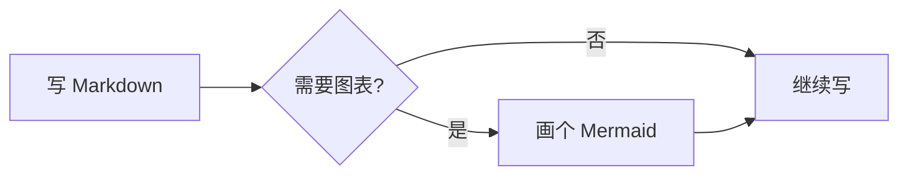
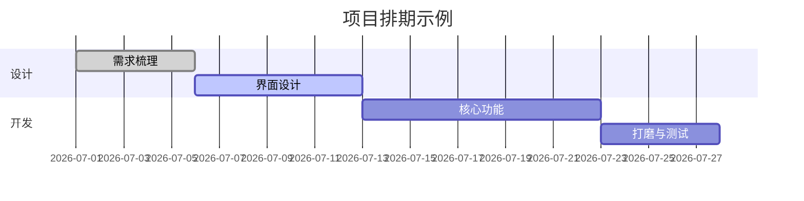
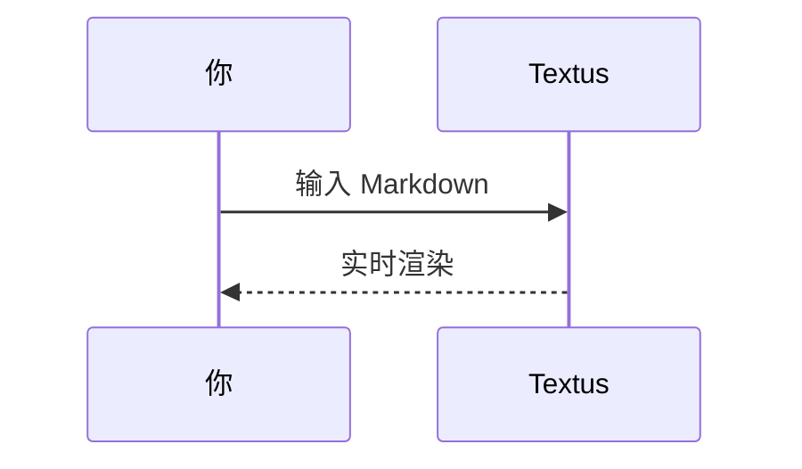

# Textus Markdown 指南

这份文档展示 Textus 支持的 Markdown 格式。可以直接编辑示例；关闭时选择不保存即可。

> [!TIP]
> 按 `Cmd+/` 切换编辑视图与源码视图，查看示例的写法。Windows 和 Linux 使用 `Ctrl+/`；修改过快捷键时，以设置中的配置为准。

## 标题与引用

行首输入 `#` 加空格创建一级标题，输入 `##` 加空格创建二级标题。本文上方的标题就是实际效果。按 `Ctrl+1` 到 `Ctrl+6`（Mac 上是 `Cmd+1` 到 `Cmd+6`）可以把当前行设为对应级别的标题。

引用块：

> 引用的文字可以嵌套其他标记，比如 **粗体** 和 `代码`。

GitHub 风格的提示块：

> [!NOTE]
> 这是一条备注，适合补充说明。

> [!WARNING]
> 这是一条警告，提醒需要留意的地方。

## 行内样式

**粗体**、*斜体*、***粗斜体***、~~删除线~~、==高亮==，以及 `行内代码`。

输入 `(`、`[`、`{`、引号，或用中文、日文输入法打出的 `（`、`【`、`「` 等括号时，光标后会自动补上另一半：再输入右半边会直接越过它，紧接着按退格会把一对一起删掉，选中文字时输入左半边会把文字括起来。不需要时可在**设置 → 编辑与外观 → 补全 ()、[] 和 “”**里关掉。

链接写法：[Textus 仓库](https://github.com/CatVinci-Studio/Textus)。按住 Ctrl/⌘ 点击链接即可跳转：网页链接在浏览器中打开，指向另一个 Markdown 文件的链接在新标签页中打开，`#某个标题` 这样的链接会滚动到该标题。直接点击链接会把光标放进去，并显示它的 Markdown 源码 `[文字](网址)`，可以就地修改文字和网址；光标离开后它又变回链接。行内 HTML 也会渲染，比如键盘按键 <kbd>Cmd</kbd> + <kbd>S</kbd>。`<details>` 折叠块、HTML 表格、少量行内样式（颜色、背景色、字号、粗细、对齐、下划线和删除线）和行内 `<svg>`（显示为图片）也能渲染；脚本等其他 HTML 保持源码显示。指向另一个文件中某个标题的链接，比如 `[参见](notes.md#某个标题)`，会打开那个文件并跳到该标题。Obsidian 的双链 `[[笔记]]`、`[[笔记|显示文字]]` 和 `[[笔记#标题]]` 也能这样点开，笔记可以在文档所在的文件夹里，也可以在整个库的任意位置；双链和行首的 `#标签` 保存时都会原样保留。

**设置 → 编辑与外观 → 颜色代码前的色块**会在颜色代码前面显示一个该颜色的小方块。选**仅在代码中**时，表示颜色的行内代码（如 `#0af`、`rgb(0 128 255)`）和代码块里的颜色值前面会显示；选**全文**时，正文里六位或八位的颜色代码（如 #ff8800）和颜色函数（如 hsl(210 100% 50%)）前面也会显示。正文里的短写法、#cafe 这样的标签、#234 这样的编号和链接保持原样。

行内数学公式：质能方程 $E = mc^2$，欧拉恒等式 $e^{i\pi} + 1 = 0$。

## 列表

- 无序列表
- 支持嵌套
  - 二级条目
  - 另一个二级条目

1. 有序列表
2. 第二项

任务清单（直接点击勾选框即可切换）：

- [x] 已完成的事项
- [ ] 待办事项

## 表格

| 功能 | 语法 | 效果 |
| --- | --- | --- |
| 粗体 | `**文字**` | **文字** |
| 高亮 | `==文字==` | ==文字== |
| 行内公式 | `$x^2$` | $x^2$ |

把鼠标悬停在表格上可以增删行列。输入 `| 姓名 | 年龄 |` 后按回车即可生成表格。在表格里按回车移到下一行，在最后一行按回车新增一行，新行留空时再按一次回车离开表格；Ctrl/⌘+回车随时离开。表格里按 Tab 和 Shift+Tab 移到下一格和上一格，按 Shift+回车在单元格内换行。

## 代码块

带语法高亮的围栏代码块（在代码块右上角可切换语言）。在末尾的空行上按回车离开代码块，也可以随时按 Ctrl/⌘+回车；引用块同样适用。语言旁边的**复制**和**全选**按钮可以复制或选中整个代码块；打开**设置 → 编辑与外观 → 代码块显示行号**会给每一行标上行号。按钮和行号都不会出现在导出文件和打印稿里。

```python
def fib(n: int) -> int:
    """经典的斐波那契数列。"""
    a, b = 0, 1
    for _ in range(n):
        a, b = b, a + b
    return a
```

```rust
fn main() {
    let greeting = "你好,Textus!";
    println!("{greeting}");
}
```

## 数学公式块

用 `$$` 包裹的块级公式由 KaTeX 渲染：

$$
\int_{-\infty}^{\infty} e^{-x^2} \, dx = \sqrt{\pi}
$$

## 图表(Mermaid)

`mermaid` 代码块会实时渲染成图表。流程图：



甘特图：



时序图：



**设置 → 编辑与外观 → 图表引擎**决定由谁来画这些图表：默认的 Mermaid，或者更快的 Pele。Pele 有自己的排版方式，也少几项功能；它画不了的图表会交给 Mermaid。

## 图片

从剪贴板直接粘贴图片，Textus 会保存它并插入引用。存到哪里由**设置 → 编辑与外观 → 图片**决定：选**存到本机**时，可以存到文档所在文件夹的**子文件夹**（默认 `assets/`，名称可以改），或选**与文档同一文件夹**，设置里会显示粘贴的图片得到的链接；选**上传到图床**时，图片会上传到 PicGo / PicList、SM.MS、Imgur 或你自己的上传接口（**自定义**）。

自定义上传接口通过 `multipart/form-data` 的 `file` 字段接收图片，可以直接返回公开 URL，也可以把 URL 放在可配置的 JSON 字段中。上传文件可以自动重命名、保留原名，或在每次上传前弹窗询问。切换存储方式不会修改已有的图片引用。

也可以手写引用：

```markdown

```

Obsidian 的嵌入写法，如 `![[image.png]]` 或 `![[attachments/image.png|300]]`，也会显示为图片：Textus 在文档所在的 Obsidian 库里查找文件，保存时原样写回。

想仔细看一张图片，双击它，或点图片右上角的**放大图片**（图表也有同样的按钮）：滚轮或双指缩放，拖动移动，双击恢复原样，按 `Esc` 关闭。拖动图片右边缘的手柄可以调整大小。**设置 → 编辑与外观 → 独占一行的图片**决定单独占一行的图片居中还是靠左，编辑器里和导出的 HTML、PDF 都适用。

## 复制与粘贴

**复制**时，剪贴板的纯文本里是 Markdown，旁边另附带格式的内容：粘贴到 GitHub、Obsidian、VS Code 或聊天软件得到 Markdown，粘贴到 Word、Pages、邮件和 Notion 则保留格式。右键图片选择复制，剪贴板里就是图片本身，可以直接粘贴到聊天或文档里。**编辑 → 粘贴为纯文本**（`Cmd+Shift+V`）按剪贴板里的文字原样粘贴，不把其中的 Markdown 当作格式。

## 视图与模式

除了所见即所得编辑和源码视图（`Cmd+/`），Textus 还有三种写作方式（Windows 和 Linux 将 `Cmd` 换成 `Ctrl`；修改过快捷键时，以设置 → 快捷键中的配置为准）：

- **源码与预览**（`Cmd+Shift+E`）：左边是 Markdown 源码，右边是渲染后的预览，两边同步滚动。
- **打字机模式**：正在输入的那一行始终保持在窗口中间，编辑器、源码模式和源码与预览都适用。
- **禅模式**（`Cmd+Shift+J`）：只留下正文，并淡化正在写的段落以外的所有内容。按 `Esc` 退出。

它们都在**视图**菜单和**设置 → 编辑与外观 → 视图**里。每一项都是整个 Textus 共用的一个设置：在任意窗口里切换，所有窗口的所有标签页都会跟着切换，之后打开的文档也会直接用它，下次打开 Textus 时依然如此。

**视图 → 只读**（标签页的右键菜单里也有）让文档不会被改动：打字、粘贴、拖入、撤销、Textus AI 和插件都改不了它。标题旁会显示一把小锁，点一下就恢复可编辑。

**视图 → 命令面板…**（`Cmd+Shift+P`）：输入几个字，就能找到菜单里的任何操作，以及插件添加的命令。它还能切换外观（浅色、深色或跟随系统）和编辑器主题，以及开启或关闭 Textus AI。

侧边栏的**大纲**标签列出文档的标题，点一下就跳过去。在大纲上点右键可以**全部展开**或**全部折叠**；按住 `Option`（`Alt`）点标题前的箭头，也能一次展开或折叠全部标题。

**设置 → 编辑与外观 → 界面文字大小**可以放大或缩小侧边栏、标签页、菜单、AI 面板和设置里的文字，文档本身的缩放不受影响。按 `Ctrl+Tab` 和 `Ctrl+Shift+Tab` 可以切换到下一个、上一个标签页。

## 同时看多篇文档

**视图 → 向右分屏**（`Cmd+Option+S`）把当前文档和另一篇并排显示，**视图 → 向下分屏**则上下排列。每一栏都有自己的标签页：新打开的文档会进入你正在用的那一栏；在某一栏里再选向右分屏或向下分屏，会把这一栏再分一次，分多少次都可以。

- 把标签页（或侧边栏里的文件）拖到某一栏的边缘松手，会在那一边新开一栏；拖到整个编辑区的最外侧边缘，会在所有栏的旁边新开一栏：比如上下两栏时拖到最右边，新的一栏会从上到下占满右侧。拖到另一栏的标签栏上，就移到那一栏。
- 拖动两栏之间的分隔线调整大小，双击分隔线让两边一样大。在分隔线上点右键，可以在左右与上下之间切换、交换两边，或关闭分屏。
- 标签页右键菜单里的**在旁边打开**会把它显示在当前文档旁边。
- 关闭一栏里的最后一个标签页，这一栏就会消失。重新打开 Textus 时，整个分栏布局都会恢复。

## 标签页与窗口

`Cmd+T` 新建标签页，`Cmd+N` 新建窗口；**文件 → 重新打开关闭的标签页**（`Cmd+Shift+T`）按从新到旧找回关掉的文档。用鼠标中键点标签页可以关闭它；标签页的右键菜单里有**关闭其他标签页**、**关闭左侧标签页**、**关闭右侧标签页**（有未保存修改的标签页会保留）、**复制路径**和**移到新窗口**。也可以把标签页拖出窗口，让它单独成为一个窗口。重新打开 Textus 时，每个窗口都会带着自己的标签页恢复。

## 文件夹与文件搜索

**文件 → 打开文件夹…**会把整个文件夹放进侧边栏：在里面打开文档时，文件树一直停在这个文件夹，下次启动时会随会话一起恢复；**文件 → 关闭文件夹**则让文件树重新跟随当前文档。侧边栏**文件树**标签顶部的搜索框可以在整个文件夹里按文件名查找，按 `Cmd+Shift+O` 直接跳到搜索框：输入即可筛选，`↑`/`↓` 上下移动，`Enter` 打开，`Esc` 清空。这两项功能只在桌面版提供。

文件树也是一个简单的文件管理器。树上方的上一级文件夹名称，点一下就回到上一级。**排序**可以按名称或按修改时间排列；搜索框旁边的筛选（**所有文件**或**仅文档**）同时作用于文件树和搜索结果。在文件夹、文件或下方空白处点右键，可以在那里**新建文档**或**新建文件夹**；把文件或文件夹拖到另一个文件夹上就能移进去，已打开的文档会跟着移到新位置。不会覆盖任何东西：重名时会提示并拒绝。

从访达或资源管理器把文件拖进窗口就能打开：文档在标签页中打开，图片插入到松手的位置，文件夹在侧边栏打开。**文件 → 复制路径**复制当前文档的完整路径。

在终端里输入 `textus notes.md` 就能用 Textus 打开文件；如果还没有 `textus` 命令，可以在**设置 → 通用**里安装。

**文件 → 打开…**也能打开 Word 文档（`.docx`），把它拖进窗口也一样：它会变成一篇同名、尚未保存的新 Markdown 文档，标题、列表、表格、链接、脚注和图片都会保留。保存后，图片会放到**设置 → 编辑与外观 → 图片**为粘贴的图片设定的位置；**保存**时默认建议存为 Word 文件旁边的 `.md` 文件。部分格式可能与 Word 中不同，原 Word 文件不会被改动。仅限桌面版。

## 在后台保持运行

打开**设置 → 通用 → 应用 → 在后台保持运行**后，关闭最后一个窗口 Textus 也会继续运行，并在通知区域（Windows）、系统托盘（Linux）或菜单栏（Mac）显示图标。在图标菜单里选**打开 Textus** 就能回到文稿；选**退出 Textus** 才会真正退出。GNOME 需要安装 AppIndicator 扩展才会显示托盘图标。

## 导出

**文件 → 导出**可以把文档存为 HTML 或 PDF；装了 [Pandoc](https://pandoc.org) 之后，还能导出 Word（`.docx`）、OpenDocument、RTF、EPUB、LaTeX 等格式。在 Mac 上，打开**设置 → 编辑与外观 → 导出 PDF 时使用浅色**，即使你用深色模式写作，导出的 PDF 也会是白底浅色主题。

## 插件、主题与技能

**设置 → 扩展 → 获取更多**里可以添加插件、主题和技能：Vim 和 Emacs 键位、PDF 阅读器、各种图表、关系图谱、写作工具等等。每一项都有一个按钮（**安装**，之后是**更新**、**停用**或**启用**），旁边的菜单里可以**卸载**。插件的页面会说明怎么用，它的命令会出现在**插件**菜单和命令面板里。

## 获取帮助

**帮助 → 报告问题…**（**设置 → 通用**的「帮助」里也有）会打开一个简短的表单。先选好报告的类型、涉及 Textus 的哪一部分，如果是 bug 再选严重程度，然后写下出了什么问题；Textus 会附上版本、系统、已装的插件、去掉隐私信息的设置和最近的报错，发送前都会完整显示给你看。**发送**会替你在 GitHub 上提交一个 issue，不需要 GitHub 账号，并告诉你它的编号；**在 GitHub 提交**则改为打开 GitHub 的反馈页；**复制**把内容复制下来，方便发到群里或邮件里。你写的内容会成为公开的 issue；如果你留下邮箱或微信，方便我们进一步询问，这些只有团队能看到。

**设置 → 通用 → 帮助**里还可以重新打开欢迎与入门教程、打开使用指南，以及进入**关于 Textus**，查看版本并**检查更新**（在 Mac 上也可以用 **Textus → 检查更新…**）。**帮助 → 加入社区**会打开社区页面。

## 脚注与分隔线

脚注写法像这样[^1]，下面是一条水平分隔线：

---

[^1]: 脚注内容会集中显示在文档末尾。

祝写作愉快！
