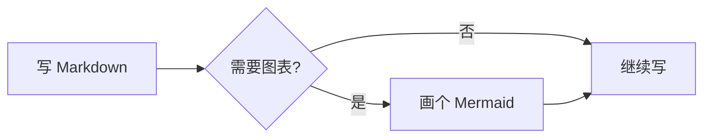
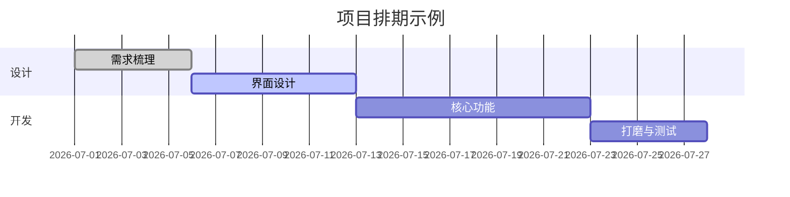
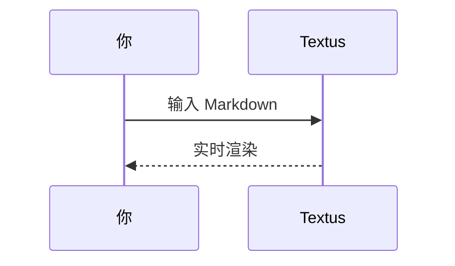

# Textus Markdown 指南

这份文档展示 Textus 支持的 Markdown 格式。可以直接编辑示例；关闭时选择不保存即可。

> [!TIP]
> 按 `Cmd+/` 切换编辑视图与源码视图，查看示例的写法。Windows 和 Linux 使用 `Ctrl+/`；修改过快捷键时，以设置中的配置为准。

## 标题与引用

行首输入 `#` 加空格创建一级标题，输入 `##` 加空格创建二级标题。本文上方的标题就是实际效果。

引用块：

> 引用的文字可以嵌套其他标记，比如 **粗体** 和 `代码`。

GitHub 风格的提示块：

> [!NOTE]
> 这是一条备注，适合补充说明。

> [!WARNING]
> 这是一条警告，提醒需要留意的地方。

## 行内样式

**粗体**、*斜体*、***粗斜体***、~~删除线~~、==高亮==，以及 `行内代码`。

链接写法：[Textus 仓库](https://github.com/CatVinci-Studio/Textus)。按住 Ctrl/⌘ 点击链接即可跳转：网页链接在浏览器中打开，指向另一个 Markdown 文件的链接在新标签页中打开，`#某个标题` 这样的链接会滚动到该标题。行内 HTML 也会渲染，比如键盘按键 <kbd>Cmd</kbd> + <kbd>S</kbd>。`<details>` 折叠块、HTML 表格、少量行内样式（颜色、背景色、字号、粗细、对齐、下划线和删除线）和行内 `<svg>`（显示为图片）也能渲染；脚本等其他 HTML 保持源码显示。指向另一个文件中某个标题的链接，比如 `[参见](notes.md#某个标题)`，会打开那个文件并跳到该标题。Obsidian 的双链 `[[笔记]]`、`[[笔记|显示文字]]` 和 `[[笔记#标题]]` 也能这样点开，笔记可以在文档所在的文件夹里，也可以在整个库的任意位置；双链和行首的 `#标签` 保存时都会原样保留。

打开**设置 → 编辑与外观 → 在颜色代码前显示色块**后，颜色代码前面会显示一个该颜色的小方块：正文里写的颜色代码（如 #ff8800、rgb(0 128 255)），以及表示颜色的行内代码（如 `#0af`）都会显示。#cafe 这样的标签、#234 这样的编号、链接和代码块保持原样。

行内数学公式：质能方程 $E = mc^2$，欧拉恒等式 $e^{i\pi} + 1 = 0$。

## 列表

- 无序列表
- 支持嵌套
  - 二级条目
  - 另一个二级条目

1. 有序列表
2. 第二项

任务清单（直接点击勾选框即可切换）：

- [x] 已完成的事项
- [ ] 待办事项

## 表格

| 功能 | 语法 | 效果 |
| --- | --- | --- |
| 粗体 | `**文字**` | **文字** |
| 高亮 | `==文字==` | ==文字== |
| 行内公式 | `$x^2$` | $x^2$ |

把鼠标悬停在表格上可以增删行列。输入 `| 姓名 | 年龄 |` 后按回车即可生成表格。在表格里按回车移到下一行，在最后一行按回车新增一行，新行留空时再按一次回车离开表格；Ctrl/⌘+回车随时离开。

## 代码块

带语法高亮的围栏代码块（在代码块右上角可切换语言）。在末尾的空行上按回车离开代码块，也可以随时按 Ctrl/⌘+回车；引用块同样适用。语言旁边的**复制**按钮可以复制整个代码块；打开**设置 → 编辑与外观 → 代码块显示行号**会给每一行标上行号。按钮和行号都不会出现在导出文件和打印稿里。

```python
def fib(n: int) -> int:
    """经典的斐波那契数列。"""
    a, b = 0, 1
    for _ in range(n):
        a, b = b, a + b
    return a
```

```rust
fn main() {
    let greeting = "你好,Textus!";
    println!("{greeting}");
}
```

## 数学公式块

用 `$$` 包裹的块级公式由 KaTeX 渲染：

$$
\int_{-\infty}^{\infty} e^{-x^2} \, dx = \sqrt{\pi}
$$

## 图表(Mermaid)

`mermaid` 代码块会实时渲染成图表。流程图：



甘特图：



时序图：



**设置 → 编辑与外观 → 图表引擎**决定由谁来画这些图表：默认的 Mermaid，或者更快的 Pele。Pele 有自己的排版方式，也少几项功能；它画不了的图表会交给 Mermaid。

## 图片

从剪贴板直接粘贴图片，Textus 会保存它并插入引用。存到哪里由**设置 → 编辑与外观 → 图片**决定：选**存到本机**时，可以存到文档所在文件夹的**子文件夹**（默认 `assets/`，名称可以改），或选**与文档同一文件夹**，设置里会显示粘贴的图片得到的链接；选**上传到图床**时，图片会上传到 PicGo / PicList、SM.MS、Imgur 或你自己的上传接口（**自定义**）。

自定义上传接口通过 `multipart/form-data` 的 `file` 字段接收图片，可以直接返回公开 URL，也可以把 URL 放在可配置的 JSON 字段中。上传文件可以自动重命名、保留原名，或在每次上传前弹窗询问。切换存储方式不会修改已有的图片引用。

也可以手写引用：

```markdown

```

Obsidian 的嵌入写法，如 `![[image.png]]` 或 `![[attachments/image.png|300]]`，也会显示为图片：Textus 在文档所在的 Obsidian 库里查找文件，保存时原样写回。

## 视图与模式

除了所见即所得编辑和源码视图（`Cmd+/`），Textus 还有三种写作方式（Windows 和 Linux 将 `Cmd` 换成 `Ctrl`；修改过快捷键时，以设置 → 快捷键中的配置为准）：

- **分屏视图**（`Cmd+Shift+E`）：左边是 Markdown 源码，右边是渲染后的预览，两边同步滚动。
- **打字机模式**（设置 → 编辑与外观 → 主题）：正在输入的那一行始终保持在窗口中间，编辑器、源码模式和分屏视图都适用。
- **禅模式**（`Cmd+Shift+J`）：只留下正文，进入全屏，并淡化正在写的段落以外的所有内容。按 `Esc` 退出。

这三项也都在**视图**（View）菜单中。

**设置 → 编辑与外观 → 界面文字大小**可以放大或缩小侧边栏、标签页、菜单、AI 面板和设置里的文字，文档本身的缩放不受影响。按 `Ctrl+Tab` 和 `Ctrl+Shift+Tab` 可以切换到下一个、上一个标签页。

## 文件夹与文件搜索

**文件 → 打开文件夹…**会把整个文件夹放进侧边栏：在里面打开文档时，文件树一直停在这个文件夹，下次启动时会随会话一起恢复；**文件 → 关闭文件夹**则让文件树重新跟随当前文档。侧边栏**文件树**标签顶部的搜索框可以在整个文件夹里按文件名查找，按 `Cmd+Shift+O` 直接跳到搜索框：输入即可筛选，`↑`/`↓` 上下移动，`Enter` 打开，`Esc` 清空。这两项功能只在桌面版提供。

## 在后台保持运行

打开**设置 → 通用 → 应用 → 在后台保持运行**后，关闭最后一个窗口 Textus 也会继续运行，并在通知区域（Windows）、系统托盘（Linux）或菜单栏（Mac）显示图标。在图标菜单里选**打开 Textus** 就能回到文稿；选**退出 Textus** 才会真正退出。GNOME 需要安装 AppIndicator 扩展才会显示托盘图标。

## 脚注与分隔线

脚注写法像这样[^1]，下面是一条水平分隔线：

---

[^1]: 脚注内容会集中显示在文档末尾。

祝写作愉快！
