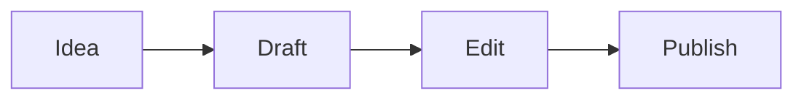

# Willkommen bei Textus

Textus ist ein Markdown-Editor, der Ihren Text so zeigt, wie er aussehen wird. Klicken Sie irgendwo hin und tippen Sie: Die Markdown-Zeichen erscheinen nur dort, wo der Cursor steht, sodass **Fett**, _Kursiv_, ==Markierung==, ~~Durchgestrichen~~ und `Inline-Code` beim Schreiben lesbar bleiben.

## Listen und Aufgaben

- [x] Den Testeditor öffnen
- [ ] Am Zeilenanfang `## ` tippen
- [ ] Strg+/ (⌘/ auf dem Mac) drücken, um den Markdown-Quelltext zu sehen

## Tabellen

| Funktion | Getippt als | Angezeigt als |
| --- | --- | --- |
| Überschrift | `# Titel` | eine Überschrift |
| Link | `[Text](URL)` | ein Link |
| Formel | `$E = mc^2$` | $E = mc^2$ |

## Mathematik

$$
\int_0^1 x^2 \, dx = \frac{1}{3}
$$

## Code

```ts
function greet(name: string): string {
  return `Hello, ${name}!`;
}
```

## Diagramme



> [!TIP]
> Importieren Sie eine `.md`-Datei mit der Schaltfläche oben oder ziehen Sie sie auf die Seite. Exportieren speichert das Dokument als Markdown.

---

Hier gibt es nur den Editor. Die Desktop-App bietet dazu Textus AI, das mit Ihnen schreibt und überarbeitet, Ordner, Themes, Bilder und den Export als PDF, Word, HTML und mehr. [Textus herunterladen](https://textus.md/de/#download), kostenlos für macOS, Windows und Linux.
