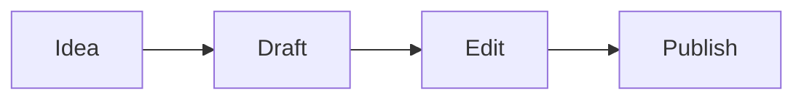

# Welcome to Textus

Textus is a Markdown editor that shows your writing as it will look. Click anywhere and type: the Markdown marks appear only where the caret is, so **bold**, _italic_, ==highlight==, ~~strikethrough~~ and `inline code` stay readable while you write.

## Lists and tasks

- [x] Open the playground
- [ ] Try typing `## ` at the start of a line
- [ ] Press Ctrl+/ (⌘/ on a Mac) to see the Markdown source

## Tables

| Feature | Typed as      | Shown as   |
| ------- | ------------- | ---------- |
| Heading | `# Title`     | a heading  |
| Link    | `[text](url)` | a link     |
| Formula | `$E = mc^2$`  | $E = mc^2$ |

## Math

$$
\int_0^1 x^2 \, dx = \frac{1}{3}
$$

## Code

```ts
function greet(name: string): string {
  return `Hello, ${name}!`;
}
```

## Diagrams



> [!TIP]
> Import a `.md` file with the button above, or drop one on the page. Export saves the document as Markdown.

---

This is the editor alone. The desktop app adds Textus AI to write and revise with you, folders, themes, images, export to PDF, Word, HTML and more. [Download Textus](https://textus.catvinci.com/#download), free for macOS, Windows and Linux.
