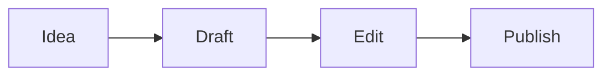

# Te damos la bienvenida a Textus

Textus es un editor de Markdown que muestra tu texto tal como quedará. Haz clic donde quieras y escribe: las marcas de Markdown solo aparecen donde está el cursor, así que la **negrita**, la _cursiva_, el ==resaltado==, el ~~tachado~~ y el `código en línea` se leen bien mientras escribes.

## Listas y tareas

- [x] Abrir el editor de prueba
- [ ] Prueba a escribir `## ` al principio de una línea
- [ ] Pulsa Ctrl+/ (⌘/ en un Mac) para ver el código Markdown

## Tablas

| Función | Se escribe     | Se ve      |
| ------- | -------------- | ---------- |
| Título  | `# Título`     | un título  |
| Enlace  | `[texto](url)` | un enlace  |
| Fórmula | `$E = mc^2$`   | $E = mc^2$ |

## Matemáticas

$$
\int_0^1 x^2 \, dx = \frac{1}{3}
$$

## Código

```ts
function greet(name: string): string {
  return `Hello, ${name}!`;
}
```

## Diagramas



> [!TIP]
> Importa un archivo `.md` con el botón de arriba o suéltalo en la página. Exportar guarda el documento como Markdown.

---

Aquí solo está el editor. La app de escritorio añade Textus AI para escribir y revisar contigo, carpetas, temas, imágenes y exportación a PDF, Word, HTML y más. [Descarga Textus](https://textus.md/es/#download), gratis para macOS, Windows y Linux.
