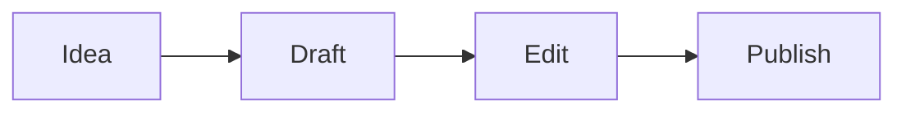

# Bienvenue dans Textus

Textus est un éditeur Markdown qui montre votre texte tel qu'il sera. Cliquez n'importe où et tapez : les marques Markdown n'apparaissent qu'à l'endroit du curseur, si bien que le **gras**, l'_italique_, le ==surlignage==, le ~~barré~~ et le `code en ligne` restent lisibles pendant que vous écrivez.

## Listes et tâches

- [x] Ouvrir le bac à sable
- [ ] Essayer de taper `## ` en début de ligne
- [ ] Appuyer sur Ctrl+/ (⌘/ sur Mac) pour voir la source Markdown

## Tableaux

| Fonction | On tape        | On voit    |
| -------- | -------------- | ---------- |
| Titre    | `# Titre`      | un titre   |
| Lien     | `[texte](url)` | un lien    |
| Formule  | `$E = mc^2$`   | $E = mc^2$ |

## Mathématiques

$$
\int_0^1 x^2 \, dx = \frac{1}{3}
$$

## Code

```ts
function greet(name: string): string {
  return `Hello, ${name}!`;
}
```

## Diagrammes



> [!TIP]
> Importez un fichier `.md` avec le bouton ci-dessus, ou déposez-le sur la page. Exporter enregistre le document en Markdown.

---

Ici, il n'y a que l'éditeur. L'application de bureau ajoute Textus AI pour écrire et réviser avec vous, les dossiers, les thèmes, les images, l'export en PDF, Word, HTML et plus encore. [Téléchargez Textus](https://textus.md/fr/#download), gratuit pour macOS, Windows et Linux.
