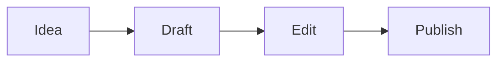

# Textus へようこそ

Textus は、仕上がりのままの見た目で書ける Markdown エディタです。どこでもクリックして入力してください。Markdown の記号はキャレットのある場所にだけ現れるので、**太字**、_斜体_、==ハイライト==、~~取り消し線~~、`インラインコード`も書きながら読みやすいままです。

## リストとタスク

- [x] プレイグラウンドを開く
- [ ] 行頭で `## ` と入力してみる
- [ ] Ctrl+/（Mac では ⌘/）で Markdown のソースを見る

## 表

| 機能 | 入力 | 表示 |
| --- | --- | --- |
| 見出し | `# タイトル` | 見出し |
| リンク | `[テキスト](URL)` | リンク |
| 数式 | `$E = mc^2$` | $E = mc^2$ |

## 数式

$$
\int_0^1 x^2 \, dx = \frac{1}{3}
$$

## コード

```ts
function greet(name: string): string {
  return `Hello, ${name}!`;
}
```

## 図



> [!TIP]
> 上のボタンで `.md` ファイルを読み込むか、ページにドロップしてください。書き出しは文書を Markdown で保存します。

---

ここにあるのはエディタだけです。デスクトップ版には、一緒に書いて推敲する Textus AI のほか、フォルダ、テーマ、画像、PDF・Word・HTML などへの書き出しがあります。[Textus をダウンロード](https://textus.md/ja/#download)。macOS、Windows、Linux で無料です。
