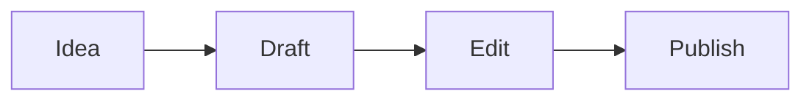

# Bem-vindo ao Textus

O Textus é um editor de Markdown que mostra o seu texto como ele vai ficar. Clique em qualquer lugar e escreva: as marcas de Markdown só aparecem onde está o cursor, por isso o **negrito**, o _itálico_, o ==realce==, o ~~riscado~~ e o `código em linha` continuam legíveis enquanto escreve.

## Listas e tarefas

- [x] Abrir o editor de teste
- [ ] Experimente escrever `## ` no início de uma linha
- [ ] Prima Ctrl+/ (⌘/ num Mac) para ver o código Markdown

## Tabelas

| Função  | Escreve-se     | Aparece como |
| ------- | -------------- | ------------ |
| Título  | `# Título`     | um título    |
| Ligação | `[texto](url)` | uma ligação  |
| Fórmula | `$E = mc^2$`   | $E = mc^2$   |

## Matemática

$$
\int_0^1 x^2 \, dx = \frac{1}{3}
$$

## Código

```ts
function greet(name: string): string {
  return `Hello, ${name}!`;
}
```

## Diagramas



> [!TIP]
> Importe um ficheiro `.md` com o botão acima, ou largue-o na página. Exportar guarda o documento em Markdown.

---

Aqui está só o editor. A app para computador acrescenta o Textus AI para escrever e rever consigo, pastas, temas, imagens e exportação para PDF, Word, HTML e mais. [Descarregue o Textus](https://textus.md/pt/#download), grátis para macOS, Windows e Linux.
