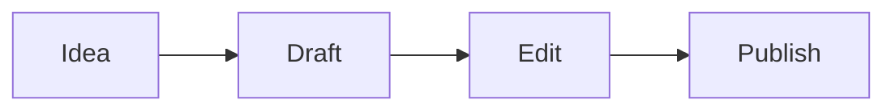

# Добро пожаловать в Textus

Textus — это редактор Markdown, который показывает текст так, как он будет выглядеть. Щёлкните в любом месте и печатайте: знаки Markdown появляются только там, где стоит курсор, поэтому **жирный**, _курсив_, ==выделение==, ~~зачёркнутый~~ и `код в строке` остаются читаемыми, пока вы пишете.

## Списки и задачи

- [x] Открыть пробный редактор
- [ ] Напечатать `## ` в начале строки
- [ ] Нажать Ctrl+/ (⌘/ на Mac), чтобы увидеть исходный Markdown

## Таблицы

| Что | Как набрать | Как выглядит |
| --- | --- | --- |
| Заголовок | `# Заголовок` | заголовок |
| Ссылка | `[текст](адрес)` | ссылка |
| Формула | `$E = mc^2$` | $E = mc^2$ |

## Формулы

$$
\int_0^1 x^2 \, dx = \frac{1}{3}
$$

## Код

```ts
function greet(name: string): string {
  return `Hello, ${name}!`;
}
```

## Диаграммы



> [!TIP]
> Импортируйте файл `.md` кнопкой выше или перетащите его на страницу. Экспорт сохраняет документ в Markdown.

---

Здесь только редактор. В приложении для компьютера есть ещё Textus AI, который пишет и правит вместе с вами, папки, темы, картинки и экспорт в PDF, Word, HTML и другие форматы. [Скачайте Textus](https://textus.md/ru/#download) — бесплатно для macOS, Windows и Linux.
