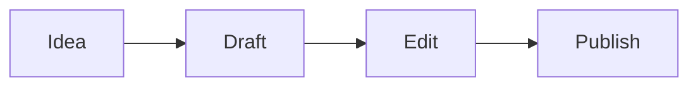

# 歡迎使用 Textus

Textus 是整合寫作環境：文件和 Textus AI 並排在一起，寫下的內容所見即所得。點任意位置開始打字：Markdown 標記只在游標所在處出現，所以**粗體**、_斜體_、==醒目提示==、~~刪除線~~和`行內程式碼`在寫作時依然好讀。

## 清單與待辦

- [x] 打開試用版
- [ ] 在一行開頭輸入 `## ` 試試
- [ ] 按 Ctrl+/（Mac 上是 ⌘/）查看 Markdown 原始碼

## 表格

| 功能 | 輸入           | 顯示為     |
| ---- | -------------- | ---------- |
| 標題 | `# 標題`       | 一個標題   |
| 連結 | `[文字](網址)` | 一個連結   |
| 公式 | `$E = mc^2$`   | $E = mc^2$ |

## 數學公式

$$
\int_0^1 x^2 \, dx = \frac{1}{3}
$$

## 程式碼

```ts
function greet(name: string): string {
  return `Hello, ${name}!`;
}
```

## 圖表



> [!TIP]
> 用上方的按鈕匯入 `.md` 檔案，或直接拖到頁面上。匯出會把文件存成 Markdown。

---

這裡只有編輯器。桌面版還有能和你一起寫作、修改的 Textus AI，以及資料夾、主題、圖片、匯出 PDF、Word、HTML 等功能。[下載 Textus](https://textus.md/zh-hant/#download)，macOS、Windows 和 Linux 都免費。
